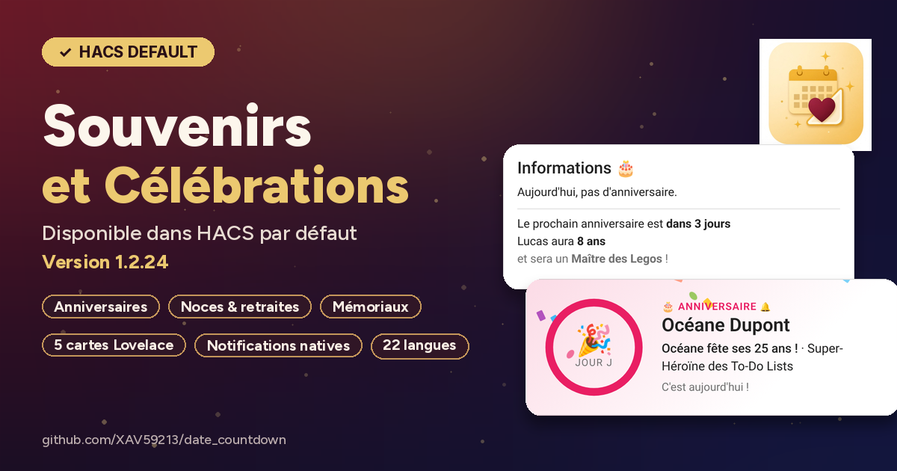
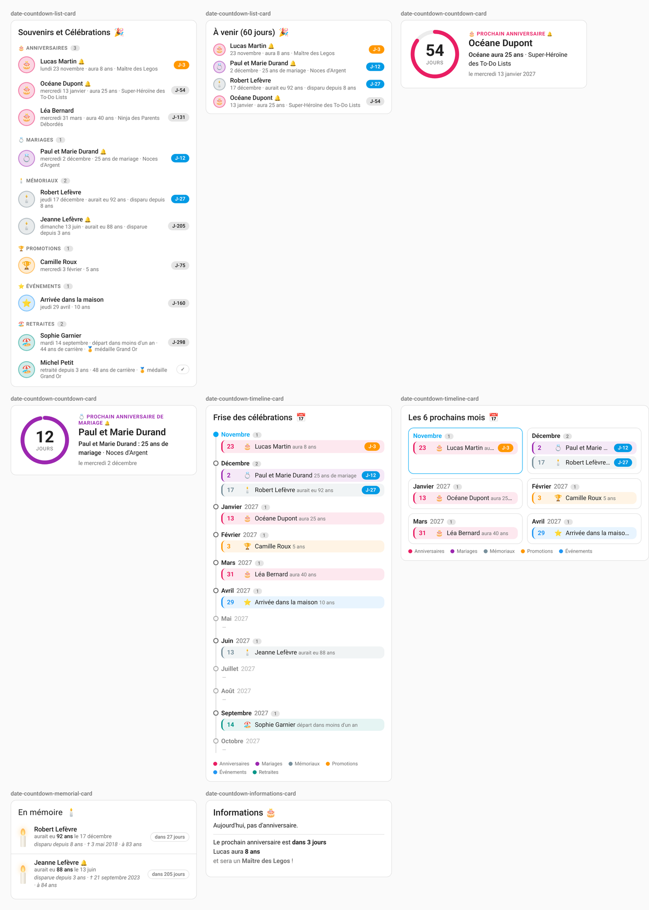
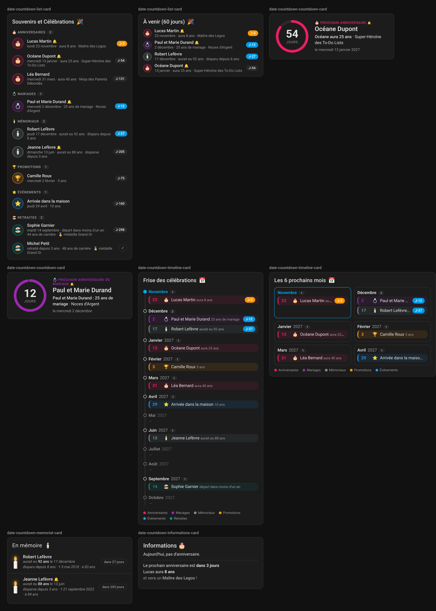
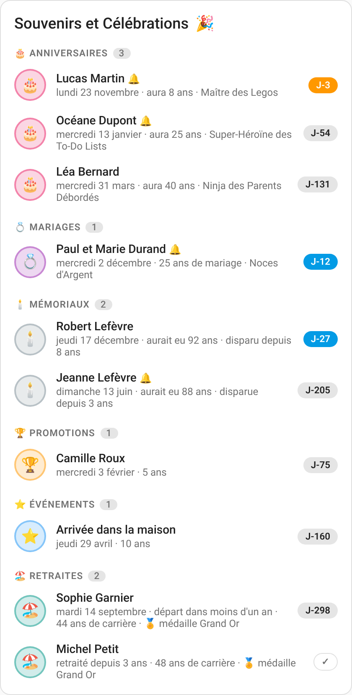

<p class="forum-cta"><a href="https://forumdomotique.com/forums/topic/4093-%F0%9F%8E%82-int%C3%A9gration-home-assistant-souvenirs-et-c%C3%A9l%C3%A9brations/">Lire et commenter sur Forum Domotique</a> · <a href="https://github.com/XAV59213/date_countdown">Dépôt HACS : Souvenirs et Célébrations</a></p>


<section class="carousel photo-carousel" data-carousel data-lightbox aria-roledescription="carrousel" aria-label="Photos de l’article (8)" tabindex="0">
<div class="carousel-track" data-track>
<figure class="photo-slide" data-slide>
  <a href="images/souvenirs-hacs-officiel-cover.png" data-full="images/souvenirs-hacs-officiel-cover.png" data-alt="Souvenirs et Célébrations est dans HACS par défaut" aria-label="Agrandir la photo 1 : Couverture HACS officiel">
    
  </a>
</figure>
<figure class="photo-slide" data-slide>
  <a href="images/apercu-global.png" data-full="images/apercu-global.png" data-alt="Aperçu des cinq cartes, thème clair" aria-label="Agrandir la photo 2 : Aperçu des cinq cartes, thème clair">
    
  </a>
</figure>
<figure class="photo-slide" data-slide>
  <a href="images/apercu-global-sombre.png" data-full="images/apercu-global-sombre.png" data-alt="Aperçu des cinq cartes, thème sombre" aria-label="Agrandir la photo 3 : Aperçu des cinq cartes, thème sombre">
    
  </a>
</figure>
<figure class="photo-slide" data-slide>
  <a href="images/informations.png" data-full="images/informations.png" data-alt="Carte Informations" aria-label="Agrandir la photo 4 : Carte Informations">
    
  </a>
</figure>
<figure class="photo-slide" data-slide>
  <a href="images/liste.png" data-full="images/liste.png" data-alt="Carte Liste / Agenda" aria-label="Agrandir la photo 5 : Carte Liste / Agenda">
    
  </a>
</figure>
<figure class="photo-slide" data-slide>
  <a href="images/compte-a-rebours-jour-j.png" data-full="images/compte-a-rebours-jour-j.png" data-alt="Carte Compte à rebours, jour J" aria-label="Agrandir la photo 6 : Carte Compte à rebours, jour J">
    
  </a>
</figure>
<figure class="photo-slide" data-slide>
  <a href="images/frise.png" data-full="images/frise.png" data-alt="Carte Frise des mois" aria-label="Agrandir la photo 7 : Carte Frise des mois">
    
  </a>
</figure>
<figure class="photo-slide" data-slide>
  <a href="images/memoriaux.png" data-full="images/memoriaux.png" data-alt="Carte Mémoriaux" aria-label="Agrandir la photo 8 : Carte Mémoriaux">
    
  </a>
</figure>
</div>
<button type="button" class="carousel-nav" data-prev aria-label="Photo précédente">‹</button>
<button type="button" class="carousel-nav" data-next aria-label="Photo suivante">›</button>
<div class="carousel-dots" data-dots></div>
<div class="carousel-live" data-live aria-live="polite"></div>
<p class="carousel-hint">Faites défiler les photos, ou ouvrez-les pour les agrandir (si JavaScript est activé).</p>
</section>

# 🎂 Intégration Home Assistant – Souvenirs et Célébrations


<!-- source : https://cdn.forumdomotique.com/monthly_2026_11/souvenirs-hacs-officiel-cover.png.6458cd8e9dd77136e8fbcfb71ff6a761.png -->

Bonjour à tous 👋

Ce matin, je vous présentais **Souvenirs et Célébrations**, en précisant qu’elle serait bientôt dans la bibliothèque officielle de HACS. La nouvelle n’a pas tardé : cet après-midi, **Franck Nijhof (frenck)** a examiné, approuvé et fusionné la demande d’ajout. L’intégration figure désormais dans le catalogue par défaut de HACS.

La pull request est la [n° 14559](https://github.com/hacs/default/pull/14559), fusionnée le **20 novembre 2026 à 15 h 02** (heure de Paris). Le robot de HACS précise qu’il peut falloir **jusqu’à 8 heures** avant que la fiche apparaisse dans la liste de chacun.

Concrètement, plus besoin d’ajouter le dépôt personnalisé : il suffit de chercher « Souvenirs et Célébrations » dans HACS, de télécharger, de redémarrer, puis d’ajouter l’intégration. Si vous l’aviez déjà installée comme dépôt personnalisé, vous n’avez rien à faire : tout continue de fonctionner, et les mises à jour se feront comme d’habitude.

La version actuelle est la [**1.2.24**](https://github.com/XAV59213/date_countdown/releases/tag/1.2.24), publiée aujourd’hui à 12 h 50 (heure de Paris). Elle n’ajoute que les badges Forum Domotique et GitHub Stars au README : les capteurs, les cartes et les notifications restent ceux de la 1.2.23 présentée ce matin.

👉 **Le plus simple :** un clic sur ce bouton ouvre directement l’intégration dans votre HACS :

[](https://my.home-assistant.io/redirect/hacs_repository/?owner=XAV59213&repository=date_countdown&category=integration)
<!-- source : https://my.home-assistant.io/badges/hacs_repository.svg -->


<!-- source : https://raw.githubusercontent.com/XAV59213/date_countdown/main/brand/logo.png -->


<!-- source : https://raw.githubusercontent.com/XAV59213/date_countdown/main/docs/cartes/apercu-global.png -->

### 🤔 Un rappel, pour ceux qui découvrent le sujet

**Souvenirs et Célébrations** (`date_countdown`) permet de suivre, au fil de l’année, les dates qui comptent vraiment : les anniversaires, les noces, les départs à la retraite, les promotions, les événements un peu à part, et aussi ces jours plus silencieux où l’on se souvient de ceux qui ne sont plus là.

Chaque événement devient un appareil dans Home Assistant, avec ses capteurs, son calendrier et, si vous le souhaitez, une notification le jour J. Cinq cartes Lovelace natives, sans aucune dépendance externe, viennent habiller le tableau de bord. Tout se configure dans l’interface graphique : pas besoin d’écrire une ligne de YAML pour ajouter un événement.

### 📌 Six types d’événements

- 🎂 **Anniversaire**
- 💍 **Anniversaire de mariage**, avec le nom des noces (Coton, Argent, Or…)
- 🕯️ **Mémorial** : l’âge qu’aurait eu la personne, les années depuis le décès, et l’anniversaire du décès dans le calendrier
- 🏖️ **Retraite**, avec estimation de la date et médaille du travail
- 🏆 **Promotion**
- 🌟 **Événement spécial**

Un genre peut être indiqué (homme, femme ou non précisé) : les textes, les notifications et les catégories d’âge s’accordent alors correctement, y compris au féminin.

Les événements datés du **29 février** sont observés le 28 février les années non bissextiles, selon l’usage courant en France. La date d’origine n’est jamais modifiée.

### 📟 Un appareil par événement

Pour chaque événement, l’intégration crée un appareil, puis les capteurs qui lui correspondent :

- le nombre de **jours restants** (c’est l’état du capteur principal)
- la **prochaine date**
- l’**âge**, l’**âge au prochain anniversaire** et une **catégorie d’âge** humoristique (accordée au genre)
- les **noces** pour un mariage, la **médaille du travail** pour une retraite
- un **binary_sensor « Aujourd’hui »**, actif le jour J
- des **capteurs de date d’origine** (naissance, mariage, promotion, événement, début de carrière ou décès, selon le type)
- une **entité calendrier**, qui inclut aussi l’anniversaire du décès pour les mémoriaux

Ces entités se prêtent aussi bien à un tableau de bord qu’à une automatisation ou à une annonce vocale.

### 🔔 Notifications natives

Chaque événement peut envoyer une notification le jour J, **sans automatisation à écrire**. Le réglage se fait dans les options de l’événement : *Paramètres → Appareils et services → Souvenirs et Célébrations → Configurer les notifications*.

- services `notify.*` classiques (application mobile, etc.) et entités de notification modernes, via `notify.send_message`
- heure d’envoi au choix (9 h par défaut)
- rappel **J-N** (par exemple une semaine avant)
- notification distincte pour l’**anniversaire du décès**, sur les mémoriaux
- notification **persistante** dans Home Assistant, si vous le souhaitez
- **anti-doublon** : rien n’est renvoyé après un redémarrage, et un rattrapage a lieu si Home Assistant démarre après l’heure prévue
- un **service de test** (`date_countdown.send_test_notification`) pour vérifier le message tout de suite

### 🎨 Cinq cartes Lovelace natives

Les cartes sont livrées avec l’intégration : rien à copier dans `www`, aucune ressource à ajouter à la main. Dans le tableau de bord, il suffit d’ajouter une carte et de chercher **« Souvenirs et Célébrations »**. Un éditeur visuel permet de régler le titre, les capteurs et les options d’affichage. Les cartes suivent le thème clair ou sombre de Home Assistant.

- **Informations** : l’anniversaire du jour, ou le prochain, avec l’âge et la catégorie d’âge


<!-- source : https://raw.githubusercontent.com/XAV59213/date_countdown/main/docs/cartes/informations.png -->

- **Liste / Agenda** : tous les événements, regroupés par type, avec un badge selon la proximité du jour J


<!-- source : https://raw.githubusercontent.com/XAV59213/date_countdown/main/docs/cartes/liste.png -->

- **Compte à rebours** : un événement en grand, avec un anneau de progression sur l’année et des confettis le jour J (ils respectent l’option « réduire les animations »)


<!-- source : https://raw.githubusercontent.com/XAV59213/date_countdown/main/docs/cartes/compte-a-rebours-jour-j.png -->

- **Frise des mois** : les mois qui viennent, en frise verticale ou en grille


<!-- source : https://raw.githubusercontent.com/XAV59213/date_countdown/main/docs/cartes/frise.png -->

- **Mémoriaux** : une carte plus recueillie, avec une bougie, l’âge qu’aurait eu la personne et les années depuis le départ


<!-- source : https://raw.githubusercontent.com/XAV59213/date_countdown/main/docs/cartes/memoriaux.png -->

Vous pouvez aussi les ajouter en YAML. Voici un exemple de carte Liste, tiré des [exemples du dépôt](https://github.com/XAV59213/date_countdown/tree/main/examples/lovelace/) :

```yaml
type: custom:date-countdown-list-card
title: Souvenirs et Célébrations
group_by_type: true
max_items: 10
horizon_days: 120
```

### 🛠️ Installation pas à pas (bibliothèque officielle HACS)

*Pour ceux qui débutent : HACS, c’est un peu le « magasin d’applications » communautaire de Home Assistant. Il permet d’installer et de mettre à jour en quelques clics des intégrations qui ne sont pas fournies d’origine. S’il n’est pas encore installé chez vous, le guide officiel est ici :* [https://hacs.xyz/docs/use/](https://hacs.xyz/docs/use/)

L’intégration fait désormais partie de la **bibliothèque HACS par défaut** : plus besoin d’ajouter un dépôt personnalisé. Il faut Home Assistant **2024.7.0** ou plus récent.

**Le plus rapide :** un clic sur ce bouton ouvre directement l’intégration dans votre HACS :

[](https://my.home-assistant.io/redirect/hacs_repository/?owner=XAV59213&repository=date_countdown&category=integration)
<!-- source : https://my.home-assistant.io/badges/hacs_repository.svg -->

**Ou à la main :**

1. Dans Home Assistant, ouvrez **HACS** dans le menu de gauche
2. Tapez **Souvenirs et Célébrations** dans la barre de recherche (vous pouvez aussi chercher **Date Countdown**)
3. Ouvrez la fiche et cliquez sur **Télécharger**
4. Redémarrez Home Assistant (**Paramètres > Système > bouton ⏻ en haut à droite > Redémarrer**)
5. Allez dans **Paramètres > Appareils et services > + Ajouter une intégration**, et cherchez **Souvenirs et Célébrations**

⚠️ HACS ne fait que **télécharger les fichiers** : ce sont le redémarrage et l’étape 5 qui créent réellement l’intégration et ses entités.

Si la fiche n’apparaît pas encore dans la recherche, patientez un peu : le robot de HACS indique un délai pouvant aller jusqu’à 8 heures après l’ajout au catalogue. Le bouton ci-dessus reste le chemin le plus direct.

Raccourci pour l’étape 5 : <https://my.home-assistant.io/redirect/config_flow_start/?domain=date_countdown>

### ⚙️ La configuration, étape par étape

L’assistant vous pose les questions dans l’ordre, sans aucun YAML. Chaque événement correspond à une entrée distincte :

1. **Type** d’événement, parmi les six proposés
2. **Nom** (obligatoire) et **prénom** (optionnel)
3. **Date** au format `JJ/MM/AAAA`
4. Pour un mémorial : date de décès, facultative
5. Pour une retraite : date de début du travail, type de carrière, option « travaux pénibles »
6. Le **genre**, si vous souhaitez que les textes s’accordent

Pour modifier un événement ou régler ses notifications : dans l’entrée de l’intégration, `⋮ > Options`. Pour le supprimer, on retire simplement l’entrée correspondante dans **Paramètres > Appareils et services**.

### 🔔 Exemple d’automatisation

Les notifications natives suffisent dans la plupart des cas. Si vous préférez écrire la vôtre — par exemple un rappel à J-7, avec l’âge qu’aurait eu la personne — voici l’exemple du dépôt :


```yaml
automation:
  - alias: "Rappel mémorial 7 jours avant"
    trigger:
      platform: numeric_state
      entity_id: sensor.memorial_jean_01011950
      value: 7
    action:
      service: notify.notify
      data:
        message: >
          
```

`📅`

` Dans 7 jours : anniversaire de {{ state_attr('sensor.memorial_jean_01011950', 'friendly_name') }}.           Âge s’il était en vie : {{ state_attr('sensor.memorial_jean_01011950', 'age_if_alive') }} ans.`


### 🌍 Langues et qualité

L’interface est traduite en **22 langues**. Les cartes Lovelace, les messages de notification et les catégories d’âge le sont en français, anglais, allemand, espagnol et italien (avec un repli en anglais pour les autres langues).

Côté technique, la 1.2.24 passe **142 tests**, avec une validation continue **HACS** et **Hassfest**.

### 🙏 Remerciements

Un grand merci à **frenck**, pour le temps qu’il consacre à relire les intégrations de la bibliothèque HACS, et pour avoir accueilli Souvenirs et Célébrations aujourd’hui. Merci aussi à tous ceux qui suivent le projet, ici ou sur GitHub : vos retours aident l’intégration à rester simple, soignée et utile au quotidien.

### 🔗 Liens

- Demande d’ajout à HACS (fusionnée) : <https://github.com/hacs/default/pull/14559>
- Dépôt GitHub : <https://github.com/XAV59213/date_countdown>
- Dernière version (1.2.24) : <https://github.com/XAV59213/date_countdown/releases/tag/1.2.24>
- Signaler un bug ou proposer une idée : <https://github.com/XAV59213/date_countdown/issues>
- Exemples de cartes Lovelace : <https://github.com/XAV59213/date_countdown/tree/main/examples/lovelace/>

Vos retours, idées et remontées de bugs sont les bienvenus, ici ou sur GitHub 😉

Merci à tous, et bonne domotique ! 🏠  
Xavier (XAV59213)
