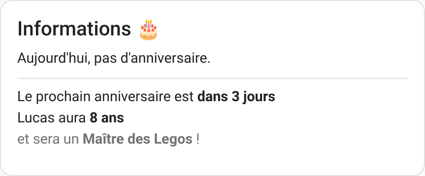
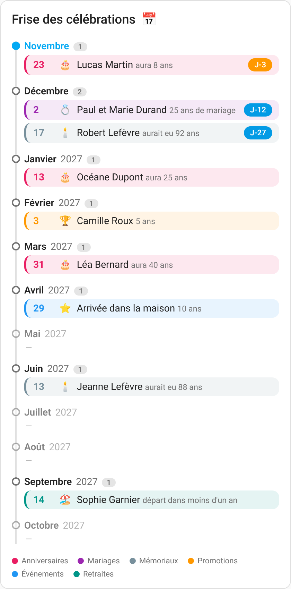
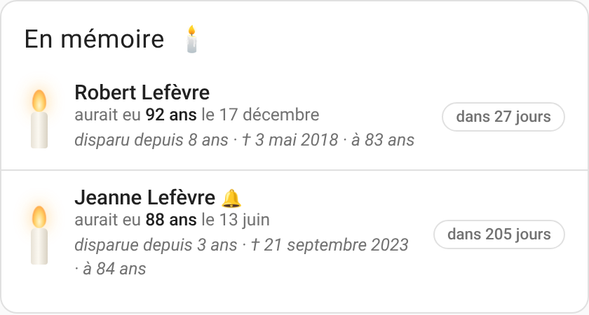

# 🎂 Intégration Home Assistant – Souvenirs et Célébrations

- **Catégorie :** [Projets et Personnalisations](https://forumdomotique.com/forums/12-projets-et-personnalisations/)
- **Sujet :** https://forumdomotique.com/forums/topic/4093-%F0%9F%8E%82-int%C3%A9gration-home-assistant-souvenirs-et-c%C3%A9l%C3%A9brations/
- **Auteur du premier message du sujet :** XAV59213
- **Messages de XAV59213 dans ce sujet :** 1
- **Premier message de XAV59213 :** 20 novembre 2026 à 09:52 (Europe/Paris)

---

## Message 1 — 20 novembre 2026 à 09:52 (Europe/Paris)

- **Identifiant :** `5576`
- **Lien :** https://forumdomotique.com/forums/topic/4093-%F0%9F%8E%82-int%C3%A9gration-home-assistant-souvenirs-et-c%C3%A9l%C3%A9brations/#findComment-5576

Bonjour à tous 👋

Je vous présente une intégration personnalisée que j’ai développée pour Home Assistant : **Souvenirs et Célébrations**. Elle permet de suivre, au fil de l’année, les dates qui comptent vraiment : les anniversaires, les noces, les départs à la retraite, les promotions, les événements un peu à part, et aussi ces jours plus silencieux où l’on se souvient de ceux qui ne sont plus là.

L’idée est simple. Chaque événement devient un appareil dans Home Assistant, avec ses capteurs, son calendrier et, si vous le souhaitez, une notification le jour J. Cinq cartes Lovelace natives, sans aucune dépendance externe, viennent ensuite habiller le tableau de bord. Tout se configure dans l’interface graphique : pas besoin d’écrire une ligne de YAML pour ajouter un événement.

La version actuelle est la [**1.2.23**](https://github.com/XAV59213/date_countdown/releases/tag/1.2.23), sortie le 20 novembre 2026. L’installation se fait pour l’instant via un **dépôt HACS personnalisé**. Bonne nouvelle : elle sera **bientôt disponible directement dans la bibliothèque officielle de HACS**, comme Saints du Jour et Freebox Homexa. Il suffira alors de la chercher dans HACS, sans ajouter de dépôt personnalisé.

👉 **Le plus simple :** cliquez sur ce bouton, il ouvre directement l’intégration dans votre HACS (le dépôt est ajouté automatiquement) :


<!-- source : https://my.home-assistant.io/badges/hacs_repository.svg -->


<!-- source : https://raw.githubusercontent.com/XAV59213/date_countdown/main/docs/cartes/apercu-global.png -->


<!-- source : https://raw.githubusercontent.com/XAV59213/date_countdown/main/docs/cartes/apercu-global-sombre.png -->

### 📌 Six types d’événements

- 🎂 **Anniversaire**
- 💍 **Anniversaire de mariage**, avec le nom des noces (Coton, Argent, Or…)
- 🕯️ **Mémorial** : l’âge qu’aurait eu la personne, les années depuis le décès, et l’anniversaire du décès dans le calendrier
- 🏖️ **Retraite**, avec estimation de la date et médaille du travail
- 🏆 **Promotion**
- 🌟 **Événement spécial**

Un genre peut être indiqué (homme, femme ou non précisé) : les textes, les notifications et les catégories d’âge s’accordent alors correctement, y compris au féminin.

Les événements datés du **29 février** sont observés le 28 février les années non bissextiles, selon l’usage courant en France. La date d’origine n’est jamais modifiée.

### 📟 Un appareil par événement

Pour chaque événement, l’intégration crée un appareil, puis les capteurs qui lui correspondent :

- le nombre de **jours restants** (c’est l’état du capteur principal)
- la **prochaine date**
- l’**âge**, l’**âge au prochain anniversaire** et une **catégorie d’âge** humoristique (121 catégories, de 0 à 120 ans, accordées au genre)
- les **noces** pour un mariage, la **médaille du travail** pour une retraite
- un **binary_sensor « Aujourd’hui »**, actif le jour J
- des **capteurs de date d’origine** : « Date de naissance » (anniversaires et mémoriaux), « Date du mariage », « Date de la promotion », « Date de l’événement » ou « Date de début de carrière » selon le type, et « Date de décès » pour les mémoriaux
- une **entité calendrier**, qui inclut aussi l’anniversaire du décès pour les mémoriaux

Les capteurs exprimés en années affichent désormais l’unité « **ans** » (traduite dans les 22 langues) plutôt que « years ».

Ces entités se prêtent aussi bien à un tableau de bord qu’à une automatisation ou à une annonce vocale.

### 🔔 Notifications natives

Chaque événement peut envoyer une notification le jour J, **sans automatisation à écrire**. Le réglage se fait dans les options de l’événement : *Paramètres → Appareils et services → Souvenirs et Célébrations → Configurer les notifications*.

- services `notify.*` classiques (application mobile, etc.) et entités de notification modernes, via `notify.send_message`
- heure d’envoi au choix (9 h par défaut)
- rappel **J-N** (par exemple une semaine avant)
- notification distincte pour l’**anniversaire du décès**, sur les mémoriaux
- notification **persistante** dans Home Assistant, si vous le souhaitez
- **anti-doublon** : rien n’est renvoyé après un redémarrage, et un rattrapage a lieu si Home Assistant démarre après l’heure prévue
- un **service de test** (`date_countdown.send_test_notification`) pour vérifier le message tout de suite

### 🎨 Cinq cartes Lovelace natives

Les cartes sont livrées avec l’intégration : rien à copier dans `www`, aucune ressource à ajouter à la main, aucun module HACS supplémentaire. Dans le tableau de bord, il suffit d’ajouter une carte et de chercher **« Souvenirs et Célébrations »**. Un éditeur visuel permet de régler le titre, les capteurs et les options d’affichage. Les cartes suivent le thème clair ou sombre de Home Assistant. Depuis la 1.2.23, elles reconnaissent aussi les nouvelles entités : si vous choisissez un capteur secondaire (âge, date, « Aujourd’hui »…), la carte affiche simplement l’événement auquel il appartient, sans doublon. Vos cartes existantes continuent de fonctionner sans rien changer.

- **Informations** : l’anniversaire du jour, ou le prochain, avec l’âge et la catégorie d’âge


<!-- source : https://raw.githubusercontent.com/XAV59213/date_countdown/main/docs/cartes/informations.png -->

- **Liste / Agenda** : tous les événements, regroupés par type, avec un badge selon la proximité du jour J


<!-- source : https://raw.githubusercontent.com/XAV59213/date_countdown/main/docs/cartes/liste.png -->

- **Compte à rebours** : un événement en grand, avec un anneau de progression sur l’année et des confettis le jour J (ils respectent l’option « réduire les animations »)


<!-- source : https://raw.githubusercontent.com/XAV59213/date_countdown/main/docs/cartes/compte-a-rebours-jour-j.png -->

- **Frise des mois** : les mois qui viennent, en frise verticale ou en grille


<!-- source : https://raw.githubusercontent.com/XAV59213/date_countdown/main/docs/cartes/frise.png -->

- **Mémoriaux** : une carte plus recueillie, avec une bougie, l’âge qu’aurait eu la personne et les années depuis le départ


<!-- source : https://raw.githubusercontent.com/XAV59213/date_countdown/main/docs/cartes/memoriaux.png -->

Vous pouvez aussi les ajouter en YAML. Voici un exemple de carte Liste, tiré des [exemples du dépôt](https://github.com/XAV59213/date_countdown/tree/main/examples/lovelace/) :

```plaintext
type: custom:date-countdown-list-card
title: Souvenirs et Célébrations
# entities:            # facultatif : vide = tous les capteurs détectés
#   - sensor.oceane_dupont_anniversaire
types: []              # vide = tous les types
group_by_type: true
max_items: 0           # 0 = illimité
horizon_days: 0        # 0 = pas de limite (ex. 60 = les 60 prochains jours)
hide_today: false
hide_past: false
compact: false
show_date: true
show_details: true
```

### 🌍 Langues et qualité

L’interface est traduite en **22 langues**. Les cartes Lovelace, les messages de notification et les catégories d’âge humoristiques le sont en français, anglais, allemand, espagnol et italien (avec un repli en anglais pour les autres langues).

En cas de souci, des **diagnostics** se téléchargent en un clic depuis l’intégration ou depuis un appareil : ils rassemblent la version, les options et l’état des notifications, avec les noms des personnes pseudonymisés. Pensez simplement à relire le fichier avant de le partager, car les dates y restent visibles.

Côté technique, la 1.2.23 passe **142 tests**, avec une validation continue **HACS** et **Hassfest**. Prérequis : Home Assistant **2024.7.0** ou plus récent, et HACS.

### 🛠️ Installation via HACS (dépôt personnalisé)

1. Ouvrez **HACS > Intégrations**
2. Cliquez sur **⋮ > Dépôt personnalisé**
3. Ajoutez ce dépôt, en tant que type **Intégration** :

<https://github.com/XAV59213/date_countdown>

4. Recherchez et installez **Souvenirs et Célébrations**
5. Redémarrez Home Assistant
6. Allez dans **Paramètres > Appareils & services > Ajouter une intégration** et cherchez **Souvenirs et Célébrations** (ou **Date Countdown**)

**Encore plus rapide :** un clic sur ce bouton ouvre directement l’intégration dans votre HACS, sans avoir à saisir l’adresse du dépôt :


<!-- source : https://my.home-assistant.io/badges/hacs_repository.svg -->

Puis ajouter l’intégration :  
<https://my.home-assistant.io/redirect/config_flow_start/?domain=date_countdown>

### 🔗 Liens

- Dépôt GitHub : <https://github.com/XAV59213/date_countdown>
- Version 1.2.23 : <https://github.com/XAV59213/date_countdown/releases/tag/1.2.23>
- Signaler un bug ou proposer une idée : <https://github.com/XAV59213/date_countdown/issues>
- Exemples de cartes Lovelace : <https://github.com/XAV59213/date_countdown/tree/main/examples/lovelace/>

Vos retours, idées et remontées de bugs sont les bienvenus, ici ou sur GitHub 😉

Merci à tous, et bonne domotique ! 🏠  
Xavier (XAV59213)

---
