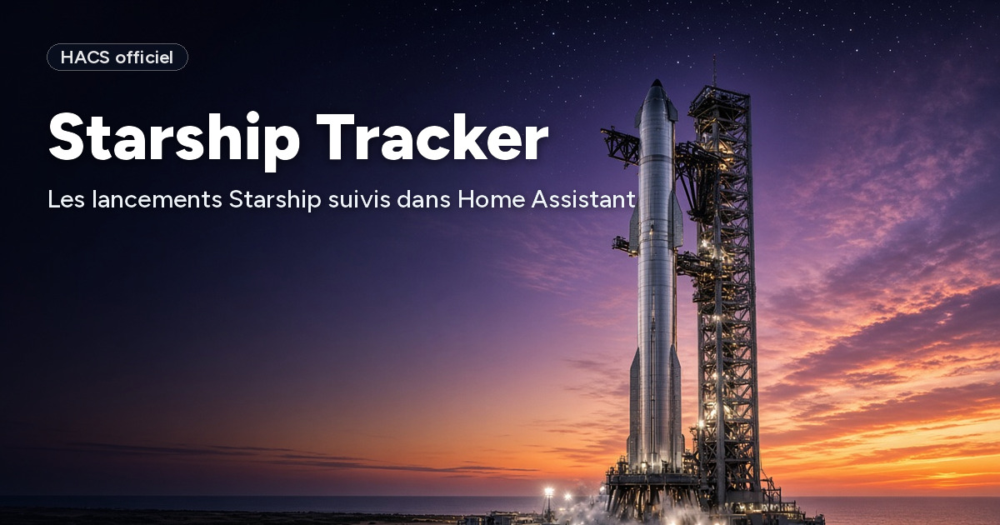
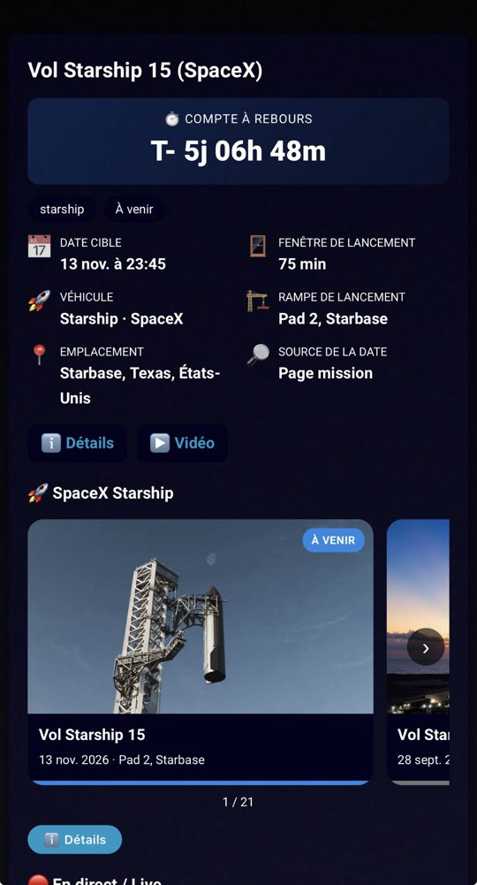
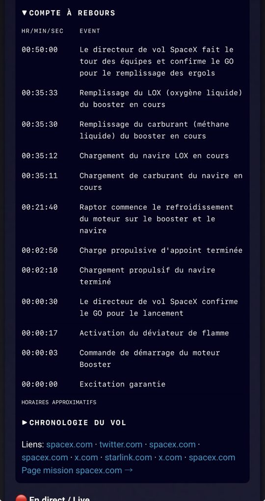
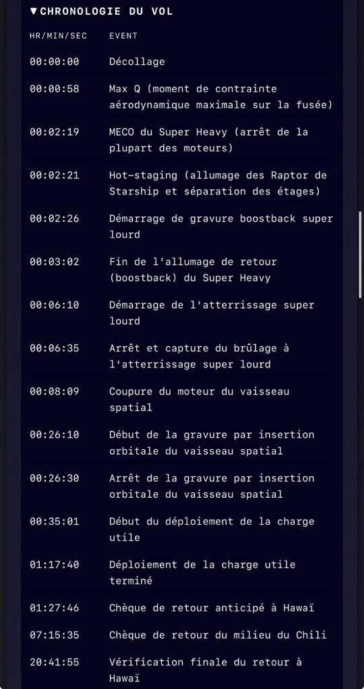
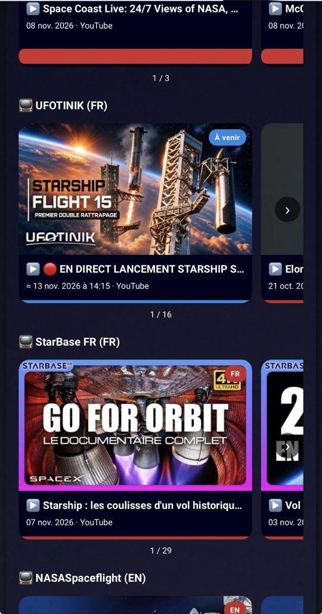


<p class="forum-cta"><a href="https://forumdomotique.com/forums/topic/4095-%F0%9F%9A%80-starship-tracker-suivez-les-lancements-starship-de-spacex-dans-home-assistant/">Lire et commenter sur Forum Domotique</a> · <a href="https://github.com/XAV59213/starship_tracker">Dépôt HACS : Starship Tracker</a></p>


<section class="carousel photo-carousel" data-carousel data-lightbox aria-roledescription="carrousel" aria-label="Photos de l’article (5)" tabindex="0">
<div class="carousel-track" data-track>
<figure class="photo-slide" data-slide>
  <a href="images/banner-starship.jpg" data-full="images/banner-starship.jpg" data-alt="Bannière de Starship Tracker, les lancements Starship dans Home Assistant" aria-label="Agrandir la photo 1 : Bannière de Starship Tracker">
    
  </a>
</figure>
<figure class="photo-slide" data-slide>
  <a href="images/card-bloc-mission.jpg" data-full="images/card-bloc-mission.jpg" data-alt="Photo 1 — 🚀 Starship Tracker – Suivez les lancements Starship de SpaceX dans Home Assistant" aria-label="Agrandir la photo 1 : Photo 1 — 🚀 Starship Tracker – Suivez les lancements Starship de SpaceX dans Home Assistant">
    
  </a>
</figure>
<figure class="photo-slide" data-slide>
  <a href="images/card-compte-a-rebours.jpg" data-full="images/card-compte-a-rebours.jpg" data-alt="Photo 2 — 🚀 Starship Tracker – Suivez les lancements Starship de SpaceX dans Home Assistant" aria-label="Agrandir la photo 2 : Photo 2 — 🚀 Starship Tracker – Suivez les lancements Starship de SpaceX dans Home Assistant">
    
  </a>
</figure>
<figure class="photo-slide" data-slide>
  <a href="images/card-vol-1.jpg" data-full="images/card-vol-1.jpg" data-alt="Photo 3 — 🚀 Starship Tracker – Suivez les lancements Starship de SpaceX dans Home Assistant" aria-label="Agrandir la photo 3 : Photo 3 — 🚀 Starship Tracker – Suivez les lancements Starship de SpaceX dans Home Assistant">
    
  </a>
</figure>
<figure class="photo-slide" data-slide>
  <a href="images/card-chaines.jpg" data-full="images/card-chaines.jpg" data-alt="Photo 4 — 🚀 Starship Tracker – Suivez les lancements Starship de SpaceX dans Home Assistant" aria-label="Agrandir la photo 4 : Photo 4 — 🚀 Starship Tracker – Suivez les lancements Starship de SpaceX dans Home Assistant">
    
  </a>
</figure>
</div>
<button type="button" class="carousel-nav" data-prev aria-label="Photo précédente">‹</button>
<button type="button" class="carousel-nav" data-next aria-label="Photo suivante">›</button>
<div class="carousel-dots" data-dots></div>
<div class="carousel-live" data-live aria-live="polite"></div>
<p class="carousel-hint">Faites défiler les photos, ou ouvrez-les pour les agrandir (si JavaScript est activé).</p>
</section>

# 🚀 Starship Tracker – Suivez les lancements Starship de SpaceX dans Home Assistant

- **Catégorie :** [Projets et Personnalisations](https://forumdomotique.com/forums/12-projets-et-personnalisations/)
- **Sujet :** https://forumdomotique.com/forums/topic/4095-%F0%9F%9A%80-starship-tracker-suivez-les-lancements-starship-de-spacex-dans-home-assistant/
- **Auteur du premier message du sujet :** XAV59213
- **Messages de XAV59213 dans ce sujet :** 1
- **Premier message de XAV59213 :** 20 novembre 2026 à 10:32 (Europe/Paris)

---

## Message 1 — 20 novembre 2026 à 10:32 (Europe/Paris)

- **Identifiant :** `5583`
- **Lien :** https://forumdomotique.com/forums/topic/4095-%F0%9F%9A%80-starship-tracker-suivez-les-lancements-starship-de-spacex-dans-home-assistant/#findComment-5583

Bonjour à tous 👋

Les fans d’espace vont aimer 🚀 Je vous présente **Starship Tracker**, une intégration Home Assistant qui suit le programme **Starship de SpaceX** : la prochaine mission, le compte à rebours, le direct quand il commence, les dernières actualités et les vidéos des chaînes YouTube spécialisées, le tout dans une carte Lovelace dédiée.

Elle fait partie de la **bibliothèque officielle de HACS**, et la version actuelle est la [**v1.29.1**](https://github.com/XAV59213/starship_tracker/releases/tag/v1.29.1).

👉 **Le plus simple :** cliquez sur ce bouton. Un clic ouvre directement l’intégration dans votre HACS, et le dépôt est ajouté automatiquement :


<!-- source : https://my.home-assistant.io/badges/hacs_repository.svg -->


<!-- source : https://raw.githubusercontent.com/XAV59213/starship_tracker/main/docs/images/card-bloc-mission.jpg -->

### 🤔 À quoi ça sert, concrètement ?

Starship, c’est la fusée géante que SpaceX teste à Starbase, au Texas. Chaque vol d’essai est un événement… mais les dates bougent sans arrêt, les lancements sont reportés à la dernière minute, et on finit souvent par apprendre qu’il a décollé une fois que c’est fini 😅

Starship Tracker surveille tout ça pour vous, à partir du site officiel de SpaceX :

- 🛰️ la **prochaine mission** : nom, date, heure, site de lancement, booster et vaisseau utilisés
- ⏱️ un **compte à rebours** jusqu’au décollage
- 🔴 un capteur **« Starship en direct »** qui s’allume dès que le live commence sur spacex.com
- 🛂 les **autorisations avant décollage** : zone d’exclusion aérienne de la FAA, avis aux navigateurs, fermeture de la route et de la plage de Starbase… résumées en Prêt, Partiel ou En attente
- 📜 le **dernier vol** et l’historique des missions Starship
- 📊 les **compteurs SpaceX** : missions terminées, atterrissages, réutilisations
- 📰 les **5 dernières actualités** Starship
- 📺 les vidéos et les directs de chaînes comme **UFOTINIK, StarBase FR et NASASpaceflight**


<!-- source : https://raw.githubusercontent.com/XAV59213/starship_tracker/main/docs/images/card-compte-a-rebours.jpg -->

### 🔔 Être prévenu quand le direct commence

C’est pour moi la fonction la plus pratique : au début du live, l’intégration déclenche un événement `starship_tracker_live_started`. On peut s’en servir pour recevoir une notification sur son téléphone avec le lien du direct :

```plaintext
automation:
  - alias: "Starship en direct"
    triggers:
      - trigger: event
        event_type: starship_tracker_live_started
    actions:
      - action: notify.mobile_app_mon_telephone
        data:
          title: "
```

🚀

Starship en direct" message: "{{ trigger.event.data.mission }} est en live sur spacex.com" data: url: "{{ trigger.event.data.url }}"

Remplacez `notify.mobile_app_mon_telephone` par le service de notification de votre téléphone.

### ✨ Les grandes étapes du projet

Le projet a beaucoup évolué en quelques semaines (plus de 40 versions) :

- 🎨 une **carte Lovelace dédiée**, chargée automatiquement : bloc mission avec grand compte à rebours, carrousels de vidéos, chronologie du vol, actualités
- 🔴 un carrousel **« En direct »** qui regroupe les lives en cours (1.25)
- 🚀 les numéros du **booster et du vaisseau** (ex. Super Heavy B22 · Ship S42) (1.28)
- 🛂 le bloc **« Autorisations avant décollage »** (1.29)
- 🔐 plus aucune clé livrée avec l’intégration : chacun utilise sa propre clé NewsAPI gratuite
- ✅ l’entrée dans la **bibliothèque HACS par défaut**


<!-- source : https://raw.githubusercontent.com/XAV59213/starship_tracker/main/docs/images/card-vol-1.jpg -->

### 🔑 Étape 0 : une clé NewsAPI gratuite

Les actualités viennent du service **NewsAPI**. Il faut donc une clé, gratuite :

1. Créez un compte sur <https://newsapi.org/register>
2. Copiez la clé affichée : l’assistant d’installation vous la demandera

### 🛠️ Installation pas à pas (bibliothèque officielle HACS)

*Pour ceux qui débutent : HACS, c’est un peu le « magasin d’applications » communautaire de Home Assistant. Il permet d’installer et de mettre à jour en quelques clics des intégrations qui ne sont pas fournies d’origine. S’il n’est pas encore installé chez vous, le guide officiel est ici :* [*https://hacs.xyz/docs/use/*](https://hacs.xyz/docs/use/)

L’intégration fait partie de la **bibliothèque HACS par défaut** : plus besoin d’ajouter un dépôt personnalisé.

**Le plus rapide :** un clic sur ce bouton ouvre directement l’intégration dans votre HACS, et le dépôt est ajouté automatiquement :


<!-- source : https://my.home-assistant.io/badges/hacs_repository.svg -->

**Ou à la main :**

1. Dans Home Assistant, ouvrez **HACS** dans le menu de gauche
2. Tapez **Starship Tracker** dans la barre de recherche
3. Ouvrez la fiche, puis cliquez sur **Télécharger**
4. Redémarrez Home Assistant (**Paramètres > Système > bouton ⏻ en haut à droite > Redémarrer**)
5. Allez dans **Paramètres > Appareils et services > + Ajouter une intégration**, et cherchez **Starship Tracker**

⚠️ Petite subtilité qui piège souvent au début : HACS ne fait que **télécharger les fichiers**. Ce sont les étapes 4 et 5 qui créent réellement l’intégration et ses entités. Si vous ne voyez qu’une entité `update.…` après l’installation, c’est normal : c’est HACS qui surveille les mises à jour, il reste juste l’étape 5.

À l’étape 5, collez votre clé NewsAPI : elle est testée avant la création de l’intégration. Vous pourrez la changer plus tard dans **Configurer**. Il faut Home Assistant **2024.11** ou plus récent.

Raccourci pour l’étape 5 : <https://my.home-assistant.io/redirect/config_flow_start/?domain=starship_tracker>

### 🎨 Ajouter la carte

La carte est livrée avec l’intégration : rien à copier, aucune ressource à ajouter. **Tableau de bord > Modifier > Ajouter une carte**, puis cherchez **Starship Tracker**. En YAML : `type: custom:starship-tracker-card`.

Après une mise à jour, si la carte ne change pas, videz le cache du navigateur ou de l’application.


<!-- source : https://raw.githubusercontent.com/XAV59213/starship_tracker/main/docs/images/card-chaines.jpg -->

### 📚 Documentation

Tout est détaillé dans le wiki : <https://github.com/XAV59213/starship_tracker/wiki>

### 🔗 Liens

- Dépôt GitHub : <https://github.com/XAV59213/starship_tracker>
- Dernière version (v1.29.1) : <https://github.com/XAV59213/starship_tracker/releases/tag/v1.29.1>
- Signaler un bug ou proposer une idée : <https://github.com/XAV59213/starship_tracker/issues>

Vos retours, idées et remontées de bugs sont les bienvenus, ici ou sur GitHub 😉

Bonne domotique ! 🏠  
Xavier (XAV59213)

Projet personnel, sans lien avec SpaceX. Les données viennent des pages publiques de spacex.com, de NewsAPI, de Launch Library 2 et de YouTube.

---

