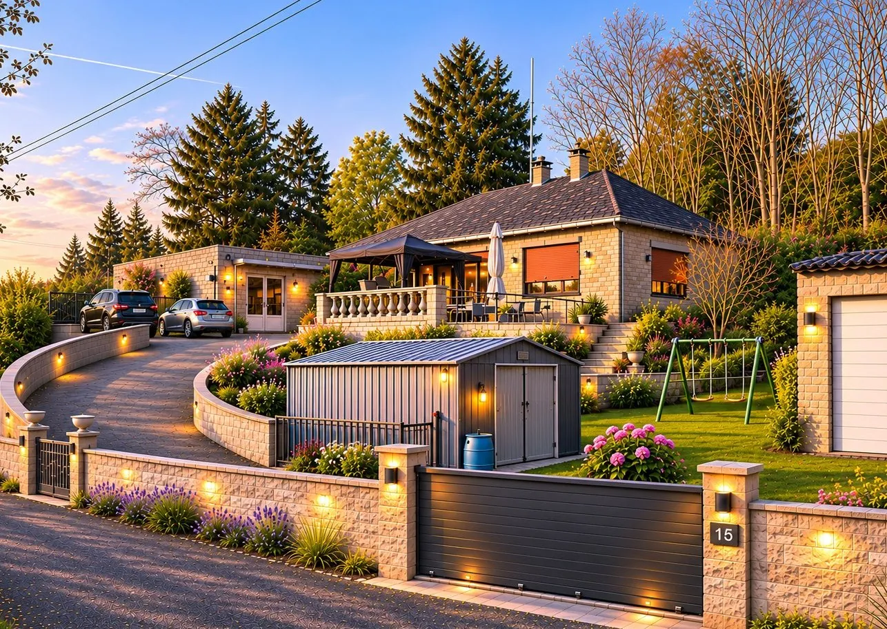
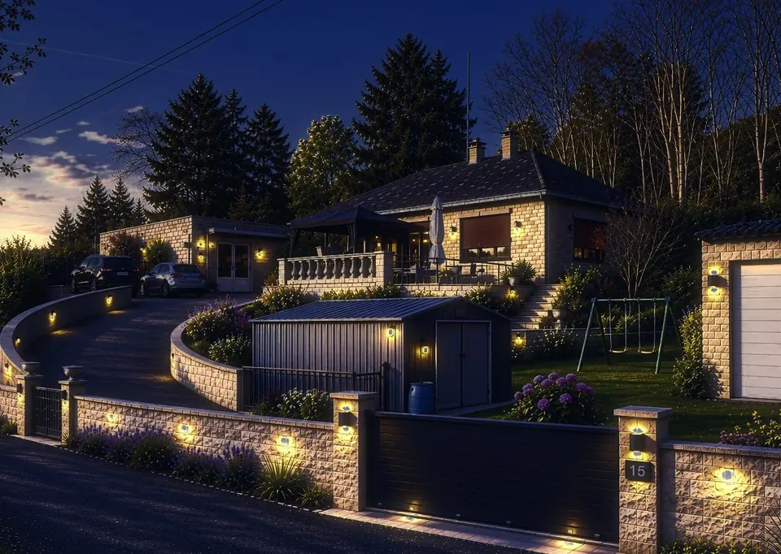
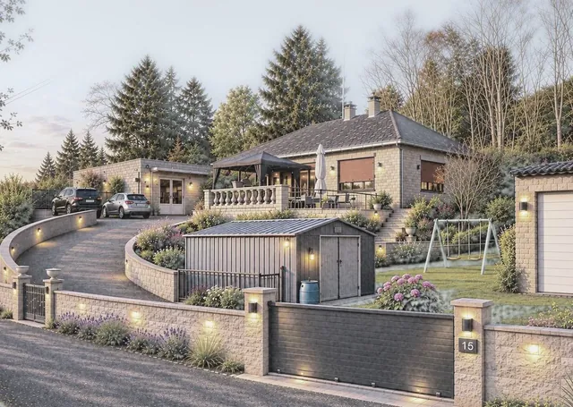

<p class="forum-cta"><a href="https://forumdomotique.com/forums/topic/4096-%F0%9F%8F%A1-projet-en-cours-maison-3d-votre-maison-qui-vit-au-rythme-de-la-m%C3%A9t%C3%A9o-dans-home-assistant/">Lire et commenter sur Forum Domotique</a> · <a href="https://github.com/XAV59213/maison3d">Dépôt HACS : Maison 3D</a></p>


<section class="carousel photo-carousel" data-carousel data-lightbox aria-roledescription="carrousel" aria-label="Photos de l’article (3)" tabindex="0">
<div class="carousel-track" data-track>
<figure class="photo-slide" data-slide>
  <a href="images/maison3d-reference.webp" data-full="images/maison3d-reference.webp" data-alt="Photo 1 — 🏡 [Projet en cours] Maison 3D – Votre maison qui vit au rythme de la météo dans Home Assistant" aria-label="Agrandir la photo 1 : Photo 1 — 🏡 [Projet en cours] Maison 3D – Votre maison qui vit au rythme de la météo dans Home Assistant">
    
  </a>
</figure>
<figure class="photo-slide" data-slide>
  <a href="images/clair-nuit-960.webp" data-full="images/clair-nuit-960.webp" data-alt="Photo 2 — 🏡 [Projet en cours] Maison 3D – Votre maison qui vit au rythme de la météo dans Home Assistant" aria-label="Agrandir la photo 2 : Photo 2 — 🏡 [Projet en cours] Maison 3D – Votre maison qui vit au rythme de la météo dans Home Assistant">
    
  </a>
</figure>
<figure class="photo-slide" data-slide>
  <a href="images/neige-jour-640.webp" data-full="images/neige-jour-640.webp" data-alt="Photo 3 — 🏡 [Projet en cours] Maison 3D – Votre maison qui vit au rythme de la météo dans Home Assistant" aria-label="Agrandir la photo 3 : Photo 3 — 🏡 [Projet en cours] Maison 3D – Votre maison qui vit au rythme de la météo dans Home Assistant">
    
  </a>
</figure>
</div>
<button type="button" class="carousel-nav" data-prev aria-label="Photo précédente">‹</button>
<button type="button" class="carousel-nav" data-next aria-label="Photo suivante">›</button>
<div class="carousel-dots" data-dots></div>
<div class="carousel-live" data-live aria-live="polite"></div>
<p class="carousel-hint">Faites défiler les photos, ou ouvrez-les pour les agrandir (si JavaScript est activé).</p>
</section>

# 🏡 [Projet en cours] Maison 3D – Votre maison qui vit au rythme de la météo dans Home Assistant

- **Catégorie :** [Projets et Personnalisations](https://forumdomotique.com/forums/12-projets-et-personnalisations/)
- **Sujet :** https://forumdomotique.com/forums/topic/4096-%F0%9F%8F%A1-projet-en-cours-maison-3d-votre-maison-qui-vit-au-rythme-de-la-m%C3%A9t%C3%A9o-dans-home-assistant/
- **Auteur du premier message du sujet :** XAV59213
- **Messages de XAV59213 dans ce sujet :** 1
- **Premier message de XAV59213 :** 20 novembre 2026 à 10:34 (Europe/Paris)

---

## Message 1 — 20 novembre 2026 à 10:34 (Europe/Paris)

- **Identifiant :** `5584`
- **Lien :** https://forumdomotique.com/forums/topic/4096-%F0%9F%8F%A1-projet-en-cours-maison-3d-votre-maison-qui-vit-au-rythme-de-la-m%C3%A9t%C3%A9o-dans-home-assistant/#findComment-5584

Bonjour à tous 👋

Aujourd’hui, je vous présente un projet un peu à part, plus visuel que les autres : **Maison 3D** 🏡. C’est une intégration Home Assistant qui affiche **une photo de votre maison qui vit au rythme de la météo** : la pluie tombe quand il pleut chez vous, la neige s’installe en hiver, la lune apparaît la nuit avec sa vraie phase, et les lumières extérieures s’allument sur la photo quand elles s’allument dans la réalité.

🚧 **Petite précision importante : Maison 3D est un projet en cours de développement.** Il évolue presque tous les jours, certaines fonctions peuvent encore changer, et quelques bugs peuvent se glisser ici ou là. Il **n’est pas encore dans la bibliothèque officielle de HACS** : pour l’instant, on l’installe comme **dépôt personnalisé**, ce qui ne prend que quelques secondes (je vous explique tout plus bas). Vos retours sont donc particulièrement précieux à ce stade !

La version actuelle est la [**v2.16.1**](https://github.com/XAV59213/maison3d/releases/tag/v2.16.1), en catégorie **Intégration**.

👉 **Le plus simple :** cliquez sur ce bouton. Même si l’intégration n’est pas encore dans la bibliothèque officielle, un clic l’ouvre directement dans votre HACS et ajoute le dépôt personnalisé automatiquement :


<!-- source : https://my.home-assistant.io/badges/hacs_repository.svg -->


<!-- source : https://raw.githubusercontent.com/XAV59213/maison3d/main/custom_components/maison3d/www/maison3d-reference.webp -->

### 🤔 À quoi ça sert, concrètement ?

C’est avant tout un plaisir pour les yeux, idéal sur une tablette murale ou un écran d’entrée. Mais c’est aussi une façon très parlante de voir la météo et l’état de la maison d’un seul coup d’œil, même pour ceux qui ne touchent jamais à Home Assistant.

L’intégration propose **deux vues** :

- 🖼️ une **photo réelle animée** : votre photo reste fixe, et les effets se dessinent par-dessus (pluie, neige, nuages, soleil, vent, orage, saisons)
- 🏡 une **maquette 3D** (Three.js), indépendante de la photo, qu’on peut faire tourner, zoomer et modifier

Petite précision pour éviter toute confusion : la photo n’est pas un modèle 3D qu’on fait tourner. C’est une image fixe enrichie d’animations, et la maquette 3D est une vue à part.

### 🌦️ Ce qui s’anime

- 🌧️ pluie et reflets, ❄️ neige et voile d’hiver, ⚡ éclairs en cas d’orage, 💨 rafales, ☁️ nuages qui passent
- 🌸 pétales au printemps, ☀️ rayons en été, 🍂 feuilles en automne
- 🌓 la **lune**, avec sa vraie phase, dessinée dans le ciel
- 🧊 du **givre** sur les bords de la photo quand il gèle, d’autant plus qu’il fait froid
- 💡 les **lumières extérieures** la nuit, avec en option un clic pour les allumer ou les éteindre
- 🎚️ l’intensité des animations réglable de 0 à 200 %, et un réglage qui respecte l’option « réduire les animations »


<!-- source : https://raw.githubusercontent.com/XAV59213/maison3d/main/custom_components/maison3d/www/images/clair-nuit-960.webp -->

### 🖼️ Avec votre propre maison

La photo de démonstration est celle de ma maison, mais vous pouvez bien sûr **mettre la vôtre** : déposez par exemple `ma-maison.jpg` dans le dossier `/config/www/maison3d/`, puis indiquez `/local/maison3d/ma-maison.jpg` dans **Paramètres > Appareils et services > Maison 3D > Configurer > Image principale**. Toutes les animations se placent au-dessus.

En option, l’intégration fournit aussi **14 photos retouchées** de la maison de démonstration (une de jour et une de nuit pour chaque météo), désactivées par défaut.


<!-- source : https://raw.githubusercontent.com/XAV59213/maison3d/main/custom_components/maison3d/www/images/neige-jour-640.webp -->

### ✨ Les nouveautés récentes

La V2 est sortie mi-novembre, et elle a déjà reçu une quinzaine de mises à jour :

- 🌍 l’interface suit la **langue de Home Assistant** (français ou anglais) (v2.16)
- 📱 un affichage pensé pour les **téléphones** (v2.15)
- 👀 des **aperçus temporaires** des saisons et des phases de lune, pour tester sans rien enregistrer, et une **saison fixe** au choix (v2.14)
- 💡 les **lumières extérieures la nuit** et des **capteurs de diagnostic** (saison, ambiance, jour / nuit) (v2.12)
- 🐛 un correctif important : l’intégration ne plante plus au démarrage de Home Assistant (v2.16.1)

### 🛠️ Installation pas à pas (dépôt personnalisé HACS)

*Pour ceux qui débutent : HACS, c’est un peu le « magasin d’applications » communautaire de Home Assistant. Il permet d’installer et de mettre à jour en quelques clics des intégrations qui ne sont pas fournies d’origine. S’il n’est pas encore installé chez vous, le guide officiel est ici :* [*https://hacs.xyz/docs/use/*](https://hacs.xyz/docs/use/)

Maison 3D étant encore en développement, elle **n’est pas encore dans la bibliothèque officielle de HACS** : on l’ajoute comme **dépôt personnalisé**, ça prend trente secondes.

**Le plus rapide :** un clic sur ce bouton ouvre directement l’intégration dans votre HACS, et le dépôt est ajouté automatiquement :


<!-- source : https://my.home-assistant.io/badges/hacs_repository.svg -->

**Ou à la main :**

1. Dans Home Assistant, ouvrez **HACS** dans le menu de gauche
2. Cliquez sur les **⋮** en haut à droite, puis sur **Dépôts personnalisés**
3. Collez l’adresse `https://github.com/XAV59213/maison3d`, choisissez le type **Intégration**, puis **Ajouter**
4. Cherchez **Maison 3D** dans HACS, ouvrez la fiche et cliquez sur **Télécharger**
5. Redémarrez Home Assistant (**Paramètres > Système > bouton ⏻ en haut à droite > Redémarrer**)
6. Allez dans **Paramètres > Appareils et services > + Ajouter une intégration**, et cherchez **Maison 3D**

⚠️ HACS ne fait que **télécharger les fichiers** : ce sont le redémarrage et l’étape 6 qui créent réellement l’intégration et ses entités.

Une fois l’intégration ajoutée, un nouveau panneau **Maison 3D** apparaît dans la **barre latérale** de Home Assistant. Il faut Home Assistant **2025.12** ou plus récent.

Raccourci pour l’étape 6 : <https://my.home-assistant.io/redirect/config_flow_start/?domain=maison3d>

### 🌡️ Brancher vos capteurs

Tout se règle dans **Paramètres > Appareils et services > Maison 3D > Configurer**. Le minimum, c’est votre entité **météo** (`weather.*`) et le **soleil** (`sun.sun`) pour le jour et la nuit. Le reste est facultatif et enrichit l’animation :

- 🌙 une **phase de lune** (l’intégration [Phase de la Lune](https://github.com/XAV59213/phase_lune) fait très bien l’affaire 😉)
- 🌡️ la **température extérieure** (pour le givre)
- 💨 le **vent**
- 🌧️ la **pluie** et ❄️ la **neige** : un capteur, un on/off, ou même une **vigilance Météo-France** (vert, jaune, orange, rouge)
- ☁️ la **couverture nuageuse**

### 🎨 La carte Lovelace

En plus du panneau, une carte permet de mettre la maison dans n’importe quel tableau de bord, avec son éditeur visuel :

```plaintext
type: custom:maison3d-card
title: Ma maison
height: 600
base_image_url: /local/maison3d/ma-maison.jpg
effects_enabled: true
frost_enabled: true
```

### 🔗 Liens

- Dépôt GitHub : <https://github.com/XAV59213/maison3d>
- Dernière version (v2.16.1) : <https://github.com/XAV59213/maison3d/releases/tag/v2.16.1>
- Signaler un bug ou proposer une idée : <https://github.com/XAV59213/maison3d/issues>

Comme c’est un projet en cours, n’hésitez surtout pas : vos retours, idées et remontées de bugs m’aident énormément à le faire avancer, ici ou sur GitHub 😉

Bonne domotique ! 🏠  
Xavier (XAV59213)

---
