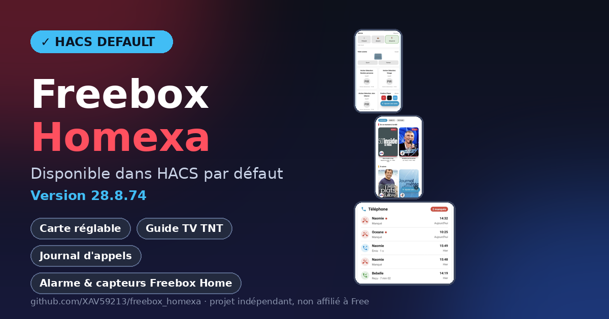
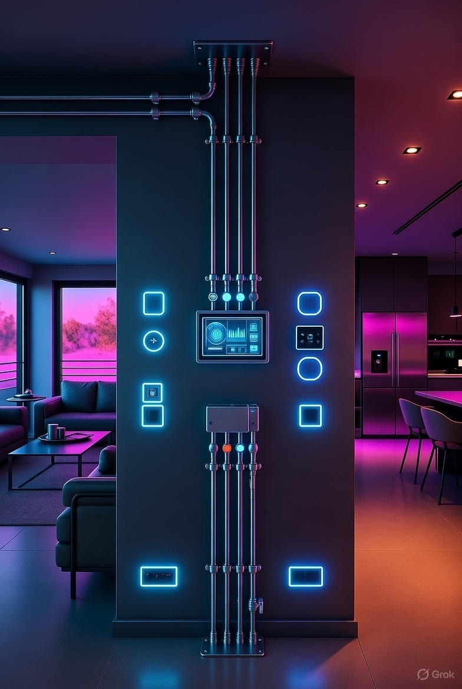
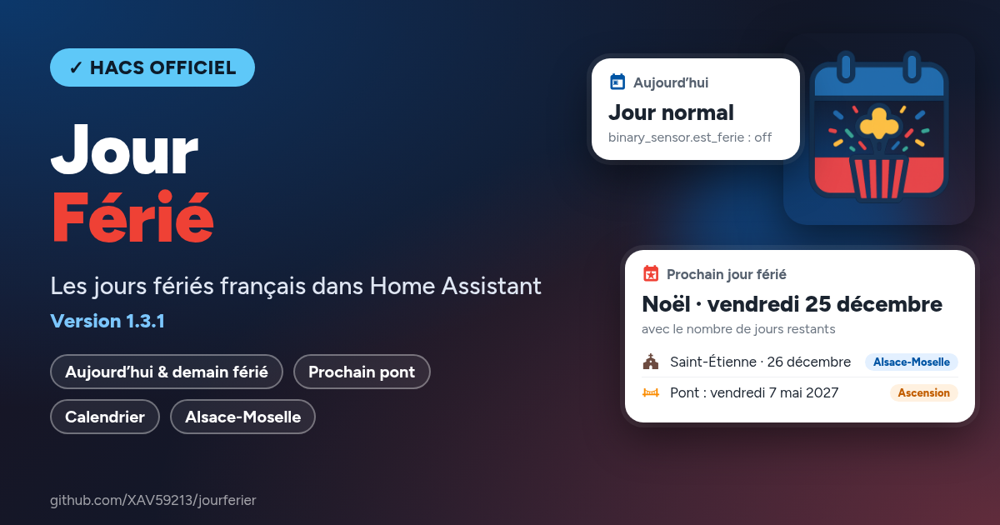
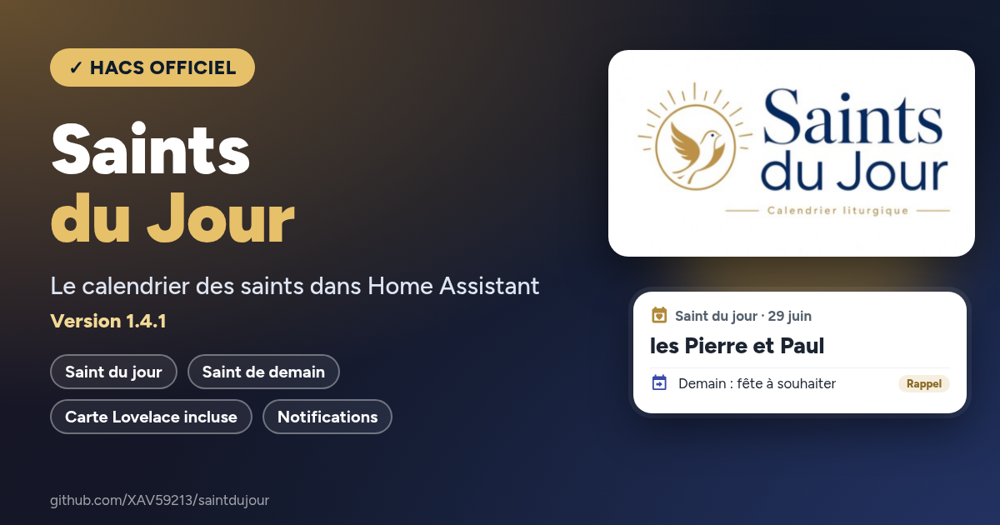
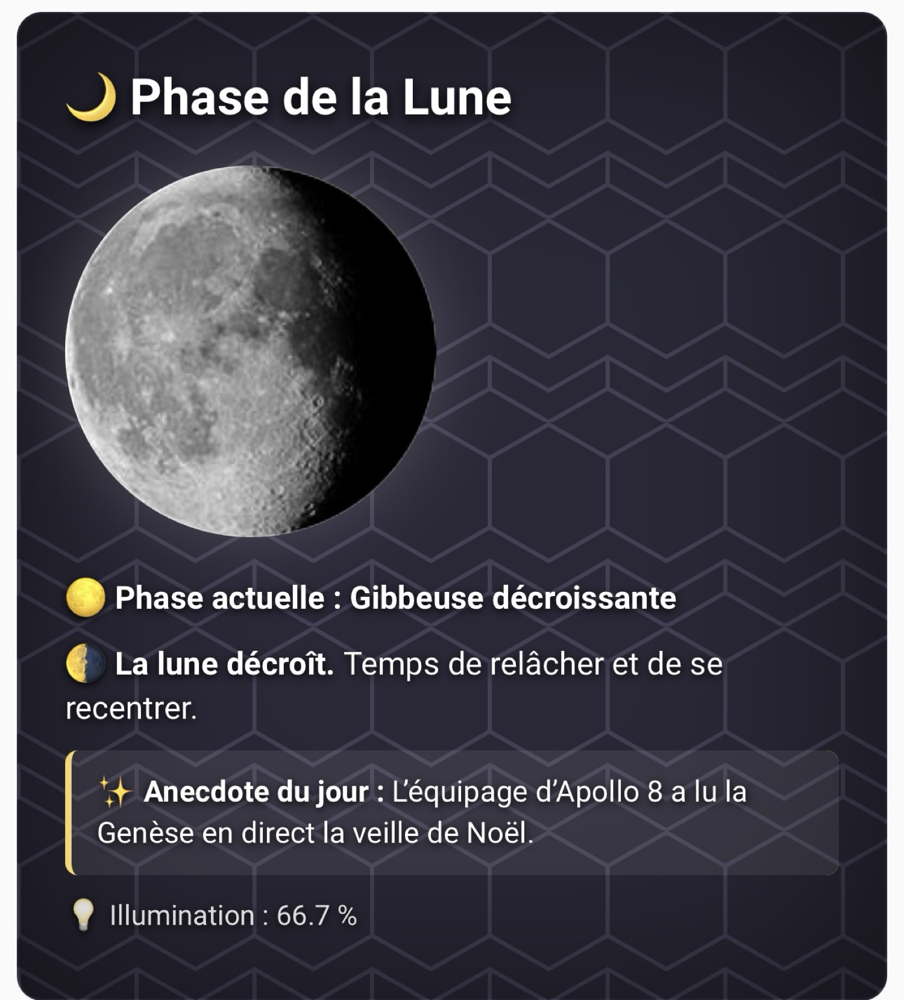
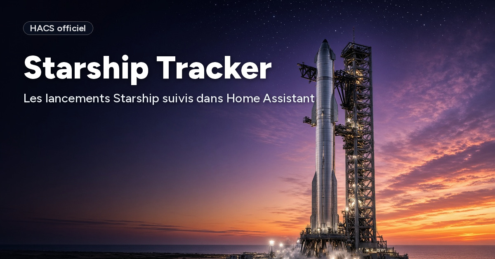
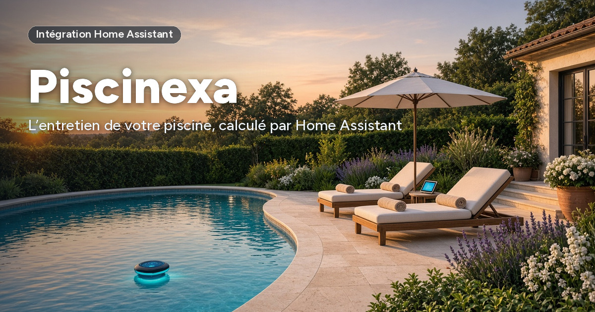

<a href="https://forumdomotique.com/forums/topic/4097-merci-%C3%A0-vous-vos-installations-le-forum-et-la-suite/">Lire et commenter sur Forum Domotique</a>

# Merci à vous : vos installations, le forum, et la suite

Bonjour à tous 👋

Aujourd’hui, j’avais simplement envie de vous dire **merci**.

Merci à celles et ceux qui ont installé l’une de mes intégrations, qui la font vivre au quotidien, qui la mettent à jour, ou qui en parlent ici. Derrière chaque téléchargement, il y a une maison, des habitudes, parfois un radiateur, une Freebox, un anniversaire ou un SMS d’alerte. Cela me touche beaucoup.

<!-- source : https://cdn.forumdomotique.com/monthly_2026_11/maison-cover.jpg.4e48a2d070fbc2c673900081bc9b5cc1.jpg -->

### 📊 Quelques chiffres, en toute transparence

Sur les pages de présentation de mes dépôts GitHub, un badge « Downloads » additionne les téléchargements de **toutes les versions** : ce compteur ne repart pas à zéro lorsque je publie une mise à jour. Consultés le 21 novembre 2026, ces badges totalisent aujourd’hui **3 766 téléchargements**.

Ce n’est pas un nombre d’utilisateurs uniques : chaque mise à jour peut compter comme un nouveau téléchargement. Voici le détail :

- **Freebox Homexa** : 1 196 téléchargements
- **Free Mobile SMS XA** : 775 téléchargements
- **Saints du Jour** : 759 téléchargements
- **Chauffage Électrique Fil Pilote FR** : 476 téléchargements
- **Jour Férié** : 244 téléchargements
- **Starship Tracker** : 111 téléchargements
- **Phase de la Lune** : 101 téléchargements
- **Souvenirs et Célébrations** : 76 téléchargements
- **Piscinexa** : 28 téléchargements

**Maison 3D**, encore proposée comme dépôt personnalisé, n’affiche pas ce badge sur son README. Elle n’apparaît pas non plus, pour le moment, dans les statistiques anonymes de [Home Assistant Analytics](https://analytics.home-assistant.io/).

### 🏠 Je suis toujours ici, sur Forum Domotique

Je n’ai pas quitté Forum Domotique. C’est ici que tout a commencé, et c’est ici que je continue d’échanger avec vous.

J’ai maintenant une [vitrine](https://xav59213.github.io/forumdomotique/), pour relire mes articles plus confortablement. **Forum Domotique reste la référence** : tous mes futurs tests, projets et guides seront systématiquement publiés d’abord ici, sur le forum. La vitrine y renvoie à chaque fois. La discussion, les questions et les retours restent chez nous.

### 🛡️ Qualité, HACS et mises à jour de Home Assistant

Huit de mes intégrations figurent désormais dans la **bibliothèque officielle de HACS**. C’est une fierté, et aussi une responsabilité. Avant chaque publication, je teste systématiquement les changements, afin de respecter le fonctionnement de HACS, qui contrôle chaque pull request.

J’ai également relevé le niveau d’exigence en m’appuyant sur l’[Integration Quality Scale](https://developers.home-assistant.io/docs/core/integration-quality-scale/) de Home Assistant, pour rester au plus près des pratiques du projet. À chaque mise à jour de Home Assistant, je vérifie que chaque intégration reste conforme, pour ne pas la casser, et je l’améliore si besoin.

### 🤝 Vos idées, vos issues, vos pull requests

N’hésitez pas à ouvrir une **issue** ou une **pull request** sur [GitHub](https://github.com/XAV59213), ou à poster ici, sur le forum. Je suis attentif aux pull requests : je les examine avec soin, et je les teste avant toute publication.

### 🔗 Mes intégrations

Toutes sont sur mon [profil GitHub](https://github.com/XAV59213). Celles qui sont dans la bibliothèque officielle de HACS s’installent en quelques clics : un appui sur le bouton « Ouvrir dans HACS » ouvre directement la fiche. Et pour en parler, le mieux, c’est encore le forum.

**Dans la bibliothèque officielle de HACS :**

[**Freebox Homexa**](https://github.com/XAV59213/freebox_homexa) — [sujet sur le forum](https://forumdomotique.com/forums/topic/4074-freebox-homexa-est-dans-hacs-par-d%C3%A9faut-%F0%9F%8E%89-et-pas-mal-de-nouveaut%C3%A9s/)

<!-- source : https://xav59213.github.io/forumdomotique/sujets/4074-freebox-homexa-est-dans-hacs-par-defaut-et-pas-mal-de-nouveautes/images/IMG_7808.png -->

Toute votre Freebox, rassemblée dans Home Assistant.

<!-- source : https://img.shields.io/github/downloads/XAV59213/freebox_homexa/total.svg?label=Downloads -->

<!-- source : https://my.home-assistant.io/badges/hacs_repository.svg -->

[**Chauffage Électrique Fil Pilote FR**](https://github.com/XAV59213/chauffage) — [sujet sur le forum](https://forumdomotique.com/forums/topic/596-chauffage-%C3%A9lectrique-fil-pilote-fr-enfin-une-int%C3%A9gration-qui-parle-fran%C3%A7ais/)

<!-- source : https://xav59213.github.io/forumdomotique/sujets/596-chauffage-electrique-fil-pilote-fr-enfin-une-integration-qui-parle-francais/images/IMG_6431.jpeg -->

Vos radiateurs à fil pilote, pilotés en local, sans cloud.

<!-- source : https://img.shields.io/github/downloads/XAV59213/chauffage/total.svg?label=Downloads -->

<!-- source : https://my.home-assistant.io/badges/hacs_repository.svg -->

[**Free Mobile SMS XA**](https://github.com/XAV59213/freesmsxa) — [sujet sur le forum](https://forumdomotique.com/forums/topic/110-%F0%9F%93%A8-free-mobile-sms-xa-int%C3%A9gration-home-assistant/)

<!-- source : https://xav59213.github.io/forumdomotique/sujets/110-free-mobile-sms-xa-integration-home-assistant/images/banner-freesmsxa.png -->

Les alertes de la maison, tout simplement par SMS.

<!-- source : https://img.shields.io/github/downloads/XAV59213/freesmsxa/total.svg?label=Downloads -->

<!-- source : https://my.home-assistant.io/badges/hacs_repository.svg -->

[**Jour Férié**](https://github.com/XAV59213/jourferier) — [sujet sur le forum](https://forumdomotique.com/forums/topic/194-%F0%9F%87%AB%F0%9F%87%B7-int%C3%A9gration-ha-jour-f%C3%A9ri%C3%A9-capteur-de-jours-f%C3%A9ri%C3%A9s/)

<!-- source : https://xav59213.github.io/forumdomotique/sujets/194-integration-ha-jour-ferie-capteur-de-jours-feries/images/banner-jourferier.png -->

Savoir si aujourd’hui est férié, et préparer le prochain pont.

<!-- source : https://img.shields.io/github/downloads/XAV59213/jourferier/total.svg?label=Downloads -->

<!-- source : https://my.home-assistant.io/badges/hacs_repository.svg -->

[**Saints du Jour**](https://github.com/XAV59213/saintdujour) — [sujet sur le forum](https://forumdomotique.com/forums/topic/193-%F0%9F%95%8A%EF%B8%8F-int%C3%A9gration-home-assistant-saints-du-jour-%F0%9F%87%AB%F0%9F%87%B7/)

<!-- source : https://xav59213.github.io/forumdomotique/sujets/193-integration-home-assistant-saints-du-jour/images/banner-saintdujour.png -->

Le saint du jour, chaque matin, selon le calendrier français.

<!-- source : https://img.shields.io/github/downloads/XAV59213/saintdujour/total.svg?label=Downloads -->

<!-- source : https://my.home-assistant.io/badges/hacs_repository.svg -->

[**Phase de la Lune**](https://github.com/XAV59213/phase_lune) — [sujet sur le forum](https://forumdomotique.com/forums/topic/4094-%F0%9F%8C%99-phase-de-la-lune-la-lune-son-illumination-et-une-anecdote-par-jour-dans-home-assistant/)

<!-- source : https://xav59213.github.io/forumdomotique/sujets/4094-phase-de-la-lune-la-lune-son-illumination-et-une-anecdote-par-jour-dans-home-ass/images/card-preview.jpg -->

La lune, son illumination, et une petite anecdote au réveil.

<!-- source : https://img.shields.io/github/downloads/XAV59213/phase_lune/total.svg?label=Downloads -->

<!-- source : https://my.home-assistant.io/badges/hacs_repository.svg -->

[**Starship Tracker**](https://github.com/XAV59213/starship_tracker) — [sujet sur le forum](https://forumdomotique.com/forums/topic/4095-%F0%9F%9A%80-starship-tracker-suivez-les-lancements-starship-de-spacex-dans-home-assistant/)

<!-- source : https://xav59213.github.io/forumdomotique/sujets/4095-starship-tracker-suivez-les-lancements-starship-de-spacex-dans-home-assistant/images/banner-starship.jpg -->

Les lancements Starship, le compte à rebours et l’actualité, dans le tableau de bord.

<!-- source : https://img.shields.io/github/downloads/XAV59213/starship_tracker/total.svg?label=Downloads -->

<!-- source : https://my.home-assistant.io/badges/hacs_repository.svg -->

[**Souvenirs et Célébrations**](https://github.com/XAV59213/date_countdown) — [sujet sur le forum](https://forumdomotique.com/forums/topic/4093-%F0%9F%8E%82-int%C3%A9gration-home-assistant-souvenirs-et-c%C3%A9l%C3%A9brations/)

<!-- source : https://xav59213.github.io/forumdomotique/sujets/4093-integration-home-assistant-souvenirs-et-celebrations/images/banner-date_countdown.png -->

Les dates qui comptent vraiment : anniversaires, noces, et souvenirs.

<!-- source : https://img.shields.io/github/downloads/XAV59213/date_countdown/total.svg?label=Downloads -->

<!-- source : https://my.home-assistant.io/badges/hacs_repository.svg -->

**Encore en dépôt personnalisé :**

[**Maison 3D**](https://github.com/XAV59213/maison3d) — [sujet sur le forum](https://forumdomotique.com/forums/topic/4096-%F0%9F%8F%A1-projet-en-cours-maison-3d-votre-maison-qui-vit-au-rythme-de-la-m%C3%A9t%C3%A9o-dans-home-assistant/)

<!-- source : https://xav59213.github.io/forumdomotique/sujets/4096-projet-en-cours-maison-3d-votre-maison-qui-vit-au-rythme-de-la-meteo-dans-home-a/images/maison3d-reference.webp -->

Une photo de votre maison qui vit au rythme de la météo — un projet encore en cours.

<!-- source : https://my.home-assistant.io/badges/hacs_repository.svg -->

[**Piscinexa**](https://github.com/XAV59213/piscinexa) — [sujet sur le forum](https://forumdomotique.com/forums/topic/133-projet-piscine-besoin-de-testeur/)

<!-- source : https://xav59213.github.io/forumdomotique/sujets/133-projet-piscine-besoin-de-testeur/images/banner-piscinexa.jpg -->

Le pH, le chlore et le temps de filtration, pour une piscine plus sereine.

<!-- source : https://img.shields.io/github/downloads/XAV59213/piscinexa/total.svg?label=Downloads -->

<!-- source : https://my.home-assistant.io/badges/hacs_repository.svg -->

Vous retrouverez aussi ces présentations sur la [vitrine](https://xav59213.github.io/forumdomotique/), qui renvoie à chaque fois vers le forum.

Merci encore pour votre confiance. Tant que ces intégrations vous sont utiles, je continuerai à les faire vivre, ici, parmi vous.

À bientôt sur le forum, et bonne domotique ! 🏠

— XAV5921
