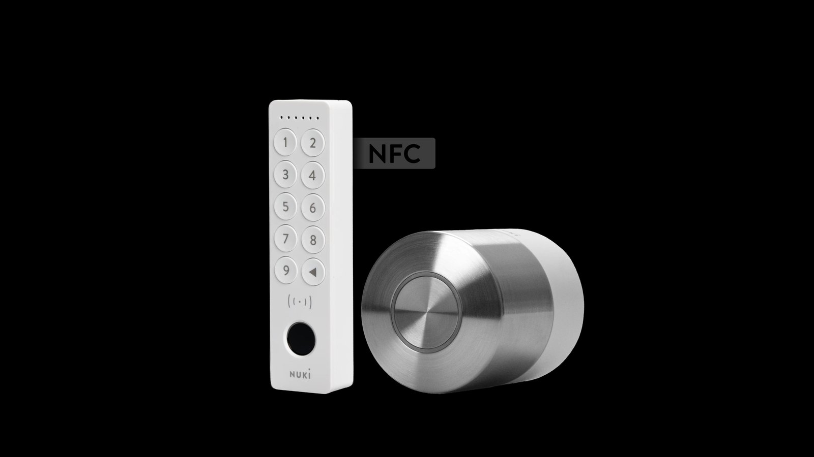
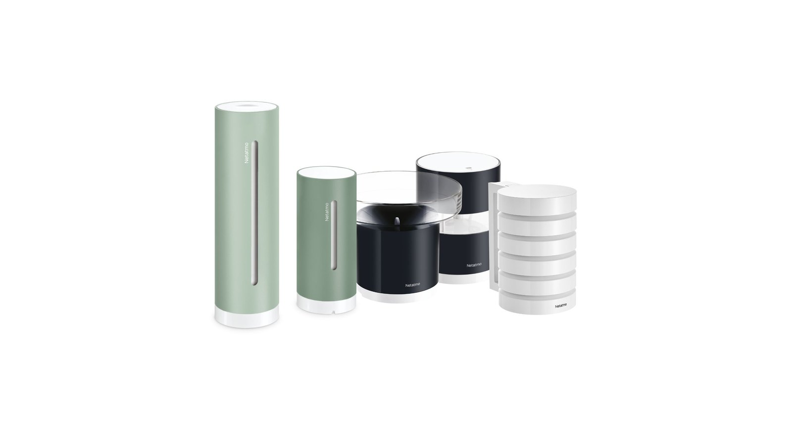

<a href="https://forumdomotique.com/forums/topic/4098-%F0%9F%94%90%F0%9F%8C%A6%EF%B8%8F-deux-tests-%C3%A0-venir-nuki-smart-lock-pro-et-station-m%C3%A9t%C3%A9o-netatmo/">Lire et commenter sur Forum Domotique</a>

# 🔐🌦️ Deux tests à venir : Nuki Smart Lock Pro et Station Météo Netatmo

Bonjour à tous 👋

Deux nouveaux tests se préparent, et j'avais envie de vous les annoncer avant de les commencer : l'un pour la porte d'entrée, l'autre pour le jardin et la météo. Comme toujours, ils seront publiés **ici, sur Forum Domotique**, en premier.

## 🔐 Nuki Smart Lock Pro, 5e génération

<!-- source : https://xav59213.github.io/forumdomotique/assets/images/prochains-tests/nuki-smart-lock-pro-keypad-2-nfc-blanc.jpg -->

*Visuel officiel © Nuki*

Je m'apprête à tester la serrure connectée **Nuki Smart Lock Pro de 5e génération**, accompagnée du **Keypad 2 NFC blanc** et de sa détection de vol, du **Door Sensor** et du **Fob**.

Le test se fera en deux volets :

- **L'installation et les usages au quotidien** : la pose, l'application, le clavier, le badge, et ce que la serrure change vraiment à la maison ;
- **L'intégration dans Home Assistant**, via Matter et Thread, avec des automatisations concrètes.

📅 Publication visée **début décembre**.

## 🌦️ Station Météo Original de Netatmo

<!-- source : https://xav59213.github.io/forumdomotique/assets/images/prochains-tests/netatmo-station-meteo-original-anemometre-pluviometre.jpg -->

*Visuel officiel © Netatmo*

Je m'apprête aussi à tester la **Station Météo Original de Netatmo** : le module intérieur et le module extérieur, complétés par l'**anémomètre** et le **pluviomètre**. Je regarderai d'abord les mesures au quotidien, puis l'intégration officielle dans Home Assistant.

📅 **Bientôt**.

## 💬 À vous la parole

Vous avez l'un de ces produits, ou une question précise que vous aimeriez voir traitée dans les tests ? Dites-le-moi en réponse à ce sujet : je tâcherai d'y répondre dans les articles.

Vous retrouverez aussi ces deux tests annoncés sur ma [vitrine, page Tests produits](https://xav59213.github.io/forumdomotique/tests-produits/), qui renvoie toujours vers le forum.

À très vite pour la suite, et bonne domotique ! 🏠

— XAV59213
