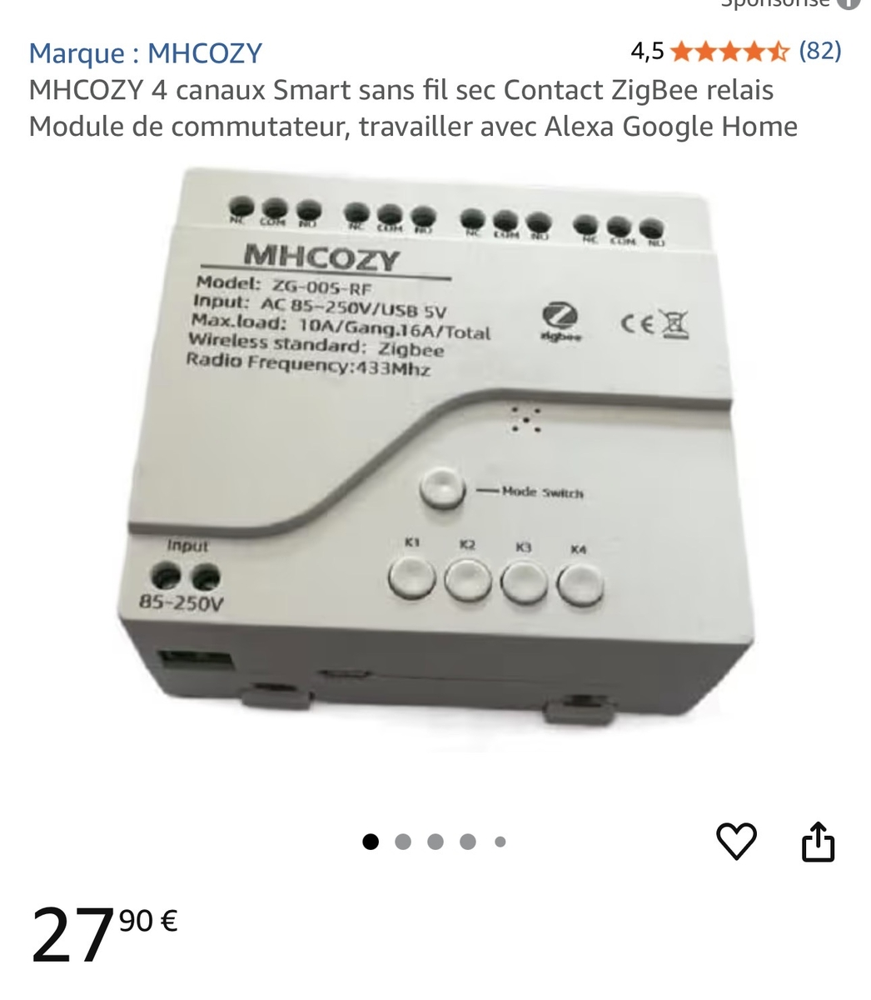
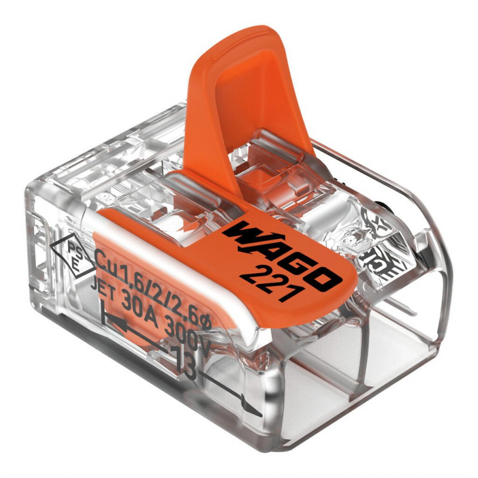
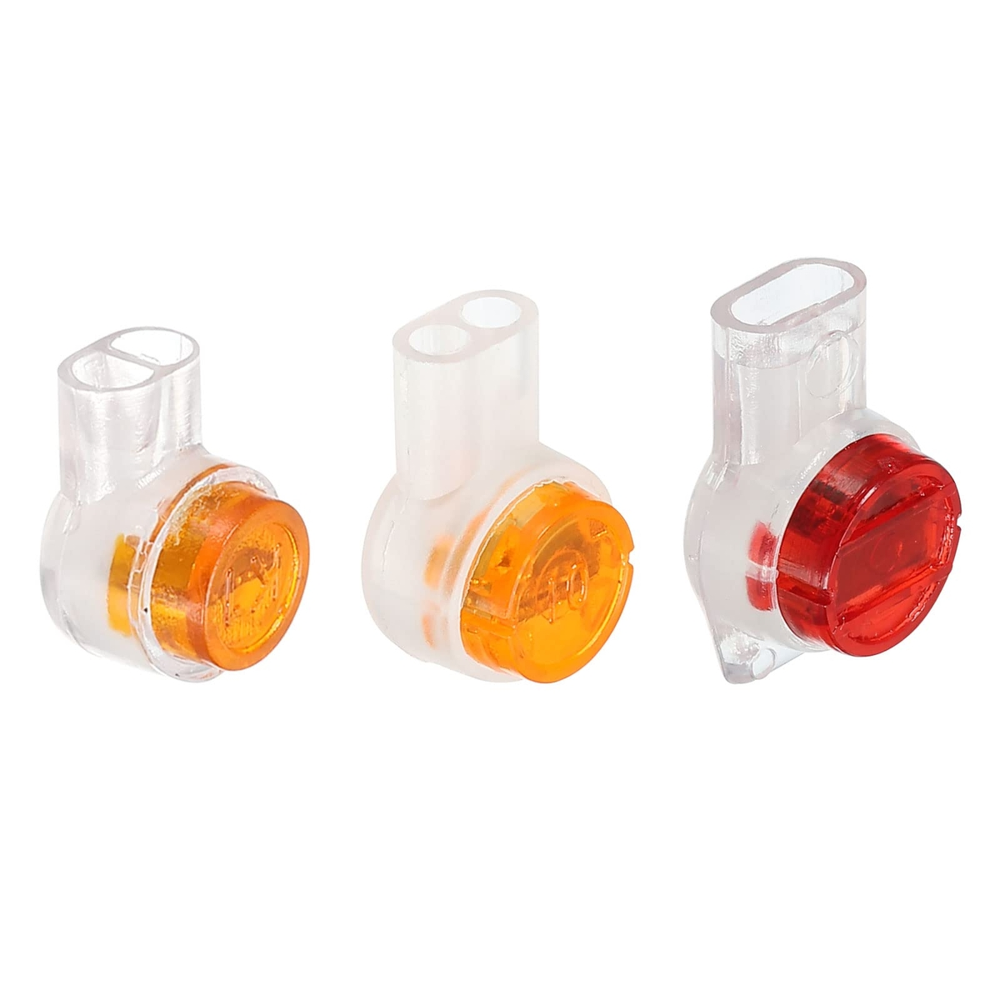

<a href="https://forumdomotique.com/forums/topic/454-quel-module-zigbee-%C3%A0-contact-sec-pour-piloter-une-chaudi%C3%A8re-avec-home-assistant-via-zigbee2mqtt/">Lire et commenter sur Forum Domotique</a>

# Quel module Zigbee à contact sec pour piloter une chaudière avec Home Assistant via Zigbee2MQTT ?

- **Catégorie :** [Autres marques de matériel domotique](https://forumdomotique.com/forums/59-autres-marques-de-mat%C3%A9riel-domotique/)
- **Sujet :** https://forumdomotique.com/forums/topic/454-quel-module-zigbee-%C3%A0-contact-sec-pour-piloter-une-chaudi%C3%A8re-avec-home-assistant-via-zigbee2mqtt/
- **Auteur du premier message du sujet :** un autre membre (XAV59213 a répondu dans ce sujet)
- **Messages de XAV59213 dans ce sujet :** 4
- **Premier message de XAV59213 :** 21 octobre 2025 à 12:24 (Europe/Paris)
- **Dernier message de XAV59213 :** 5 novembre 2025 à 10:38 (Europe/Paris)

---

## Message 1 — 21 octobre 2025 à 12:24 (Europe/Paris)

- **Identifiant :** `1076`
- **Lien :** https://forumdomotique.com/forums/topic/454-quel-module-zigbee-%C3%A0-contact-sec-pour-piloter-une-chaudi%C3%A8re-avec-home-assistant-via-zigbee2mqtt/#findComment-1076

Salut [@Neustrie](https://forumdomotique.com/profile/481-neustrie/) ,

Moi j’utilise celui là :

**NodOn SIN-4-1-21** : Un module multifonction 16A à contact sec avec mesure de consommation.

Le Module Multifonction SIN-4-1-21 avec mesure de consommation Zigbee permet de piloter une porte de garage, un portail, un radiateur, une prise, une chaudière…

- Alimentation : 230V AC ~ 50Hz
- Capacités de commutation : 230V AC – 14A
- Consommation : < 1W
- Puissance Max. : 3000W
- radio : Zigbee 3.0

---

## Message 2 — 22 octobre 2025 à 09:41 (Europe/Paris)

- **Identifiant :** `1087`
- **Lien :** https://forumdomotique.com/forums/topic/454-quel-module-zigbee-%C3%A0-contact-sec-pour-piloter-une-chaudi%C3%A8re-avec-home-assistant-via-zigbee2mqtt/#findComment-1087

Salut [@Neustrie](https://forumdomotique.com/profile/481-neustrie/) ,

J’ai trouvé le module MHCOZY 4-Channel Zigbee Dry Contact Relay qui devrait parfaitement convenir pour contrôler tes 3 interrupteurs (eau chaude, chauffage, général) sur ta chaudière, avec un canal en plus si besoin.

<!-- source : https://cdn.forumdomotique.com/monthly_2025_10/IMG_6108.jpeg.1ee3d23bf9799383054a637514867e29.jpeg -->

C’est un relais sec Zigbee abordable (25-30€), compatible Home Assistant via ZHA ou Zigbee2MQTT, avec modes self-locking pour maintien ON/OFF.

**Récap court :**

•  4 relais indépendants (dry contact, 10A max par canal).

•  Alimentation : AC 85-220V, DC 5-32V ou USB.

•  Intégration : Zigbee 3.0 (besoin d’un hub), app Smart Life pour config.

•  Avantages : Compact, fiable, bon marché pour automations comme chaudières.

•  Inconvénients : Qualité basique, modes changés via bouton physique.

Pour des plans de branchement précis (ex. connexion aux bornes COM/NO), il me faut le modèle exact de ta chaudière pour adapter aux spécificités.

Dis-moi ça et je te détaille le schéma 😊

Je pense le tester pour ma porte de mon garage portail et portillon garage!

<https://amzn.eu/d/210D91O>

---

## Message 3 — 24 octobre 2025 à 08:59 (Europe/Paris)

- **Identifiant :** `1092`
- **Lien :** https://forumdomotique.com/forums/topic/454-quel-module-zigbee-%C3%A0-contact-sec-pour-piloter-une-chaudi%C3%A8re-avec-home-assistant-via-zigbee2mqtt/#findComment-1092

Salut [@Neustrie](https://forumdomotique.com/profile/481-neustrie/)

Perso, j’utilise les WAGO pour du courant fort (prises, éclairage) jusqu’à 2.5 mm au dessus comme pour la prise four il faut passer par des dominos adapter au 6 mm et les connecteurs portail/ethernet/PTT/Scotchlok pour du faible (téléphone, réseau).

Les WAGO sont super pratiques avec leurs leviers, pas besoin d’outil, et ils sont réutilisables.

Et c’est au normes dtu

Et pour répondre à ta question !

« Petite question, qui n’a rien à voir avec la domotique mais plutôt la connectique »

Ça fait partie intégrante de la domotique, comme pour avoir un bon réseau.

Si tu es en catégorie 4, ça va pas le faire.

L’idéal, c’est du catégorie 6 en câble réseau ✌️

---

## Message 4 — 5 novembre 2025 à 10:38 (Europe/Paris)

- **Identifiant :** `1176`
- **Lien :** https://forumdomotique.com/forums/topic/454-quel-module-zigbee-%C3%A0-contact-sec-pour-piloter-une-chaudi%C3%A8re-avec-home-assistant-via-zigbee2mqtt/#findComment-1176

Mdr 😂,

Ça va tellement vite depuis 2014 🤣

---
