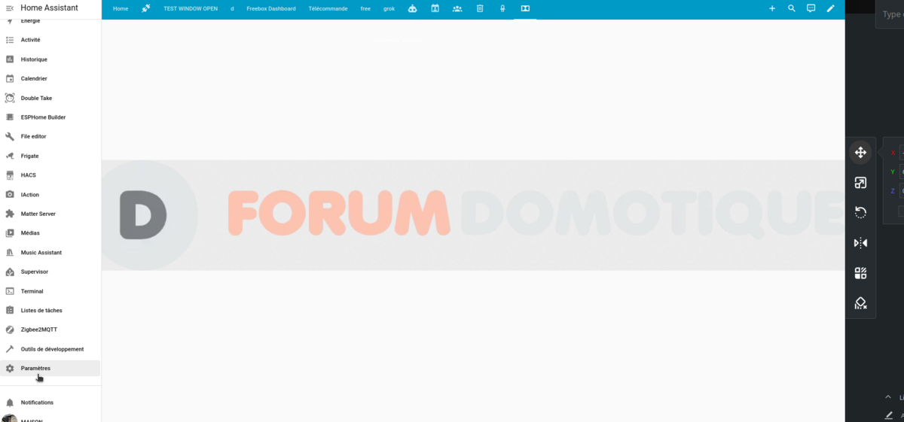
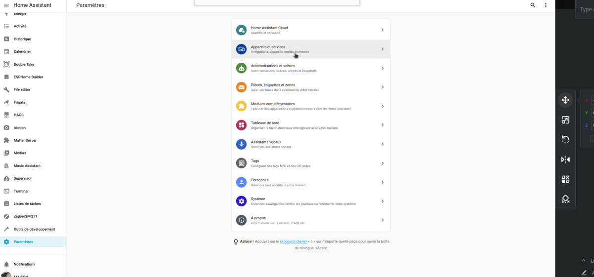
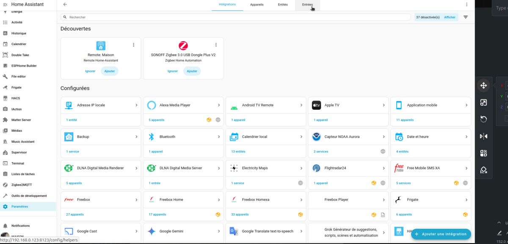
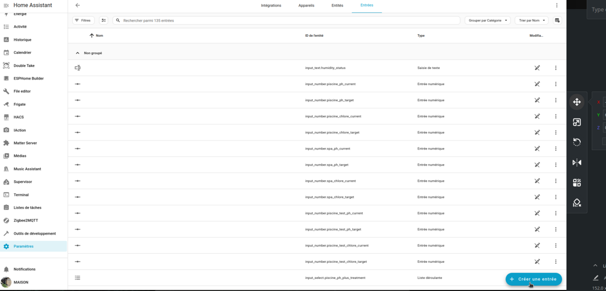
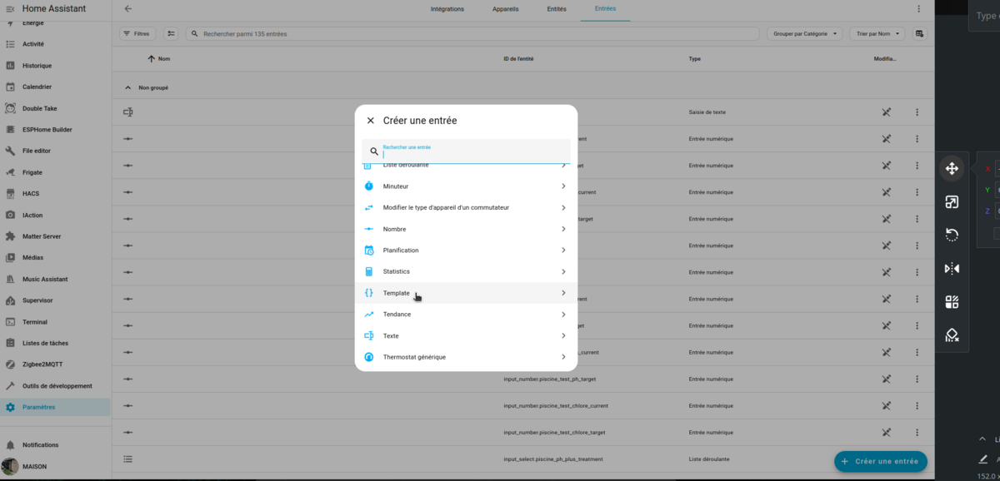
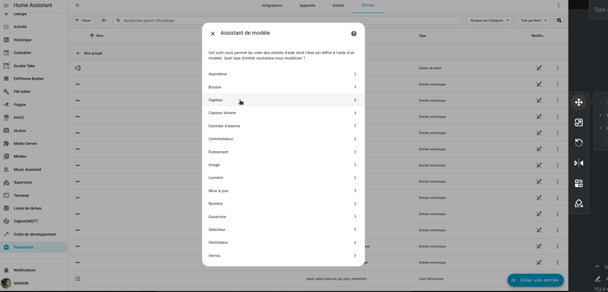
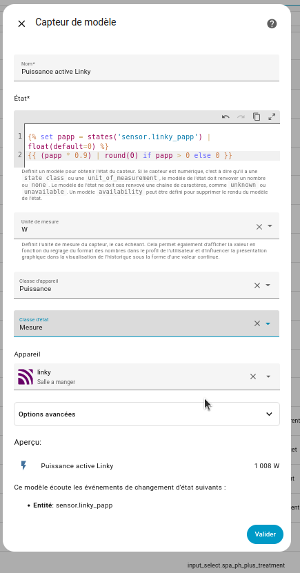
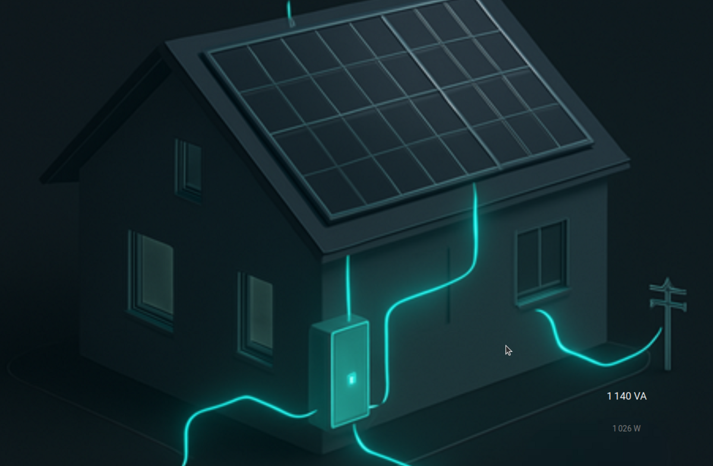


# Convertir les VA (Puissance apparente) en Watts (Puissance active) avec le Lixee sur Home Assistant

- **Catégorie :** [Projets et Personnalisations](https://forumdomotique.com/forums/12-projets-et-personnalisations/)
- **Sujet :** https://forumdomotique.com/forums/topic/456-convertir-les-va-puissance-apparente-en-watts-puissance-active-avec-le-lixee-sur-home-assistant/
- **Auteur du premier message du sujet :** XAV59213
- **Messages de XAV59213 dans ce sujet :** 1
- **Premier message de XAV59213 :** 21 octobre 2025 à 15:45 (Europe/Paris)

---

## Message 1 — 21 octobre 2025 à 15:45 (Europe/Paris)

- **Identifiant :** `1077`
- **Lien :** https://forumdomotique.com/forums/topic/456-convertir-les-va-puissance-apparente-en-watts-puissance-active-avec-le-lixee-sur-home-assistant/#findComment-1077

Le module **Lixee** (via le capteur sensor.linky_papp) te donne la **puissance apparente en VA**.

Mais dans les dashboards Énergie, on veut des **Watts (puissance active)**.

Voici comment créer un **capteur template** qui estime les Watts à partir des VA, **directement dans l’interface (UI)**.

> **Note** : On applique un facteur de **0.9** (cos φ ≈ 0.9), typique pour un logement résidentiel. Tu peux ajuster selon ton installation.

---

## 📌 **Étape 1 : Accéder aux Aides (Helpers)**

1. Va dans **Paramètres** → **Appareils et services**



2. Clique sur l’onglet **Entrée** (en haut à droite)



3. Clique sur **+ Créer une Entrée**



---

## 📌 **Étape 2 : Choisir le type de capteur**

1. Sélectionne **Modèle (Template)**



1. Puis **Capteur (Sensor)**



---

## 📌 **Étape 3 : Configurer le capteur**

Remplis les champs comme suit :

> | Champ | Valeur |
> | --- | --- |
> | **Nom** | `Puissance active Linky` |
> | **Icône** | `mdi:lightning-bolt` *(optionnel)* |
> | **Classe d’appareil** | `Puissance` (Power) |
> | **Classe d’état** | `Mesure` (Measurement) |
> | **Unité de mesure** | `W` |
> | **Modèle de valeur d’état** | ```yaml  {{ (papp * 0.9) | round(0) if papp > 0 else 0 }} ``` |

Et ajoute le code dans état:

```yaml

{{ (papp * 0.9) | round(0) if papp > 0 else 0 }}
```



## 🎉 **Et voilà !**

Tu as maintenant un capteur **prêt pour le dashboard Énergie** de Home Assistant. N’oublie pas de l’ajouter dans ta vue Énergie pour suivre ta conso en Watts !



Tu veux la version YAML ? Ajoute ça dans configuration.yaml ou via Fichier de configuration :

```yaml
template:
  - sensor:
      - name: "Puissance active Linky approx"
        unit_of_measurement: "W"
        device_class: power
        state_class: measurement
        icon: mdi:lightning-bolt
        state: >
          {{ (states('sensor.linky_papp') | float(0) * 0.9) | round(0) }}
```

Besoin d’aide ? Pose ta question dans les commentaires !

---

