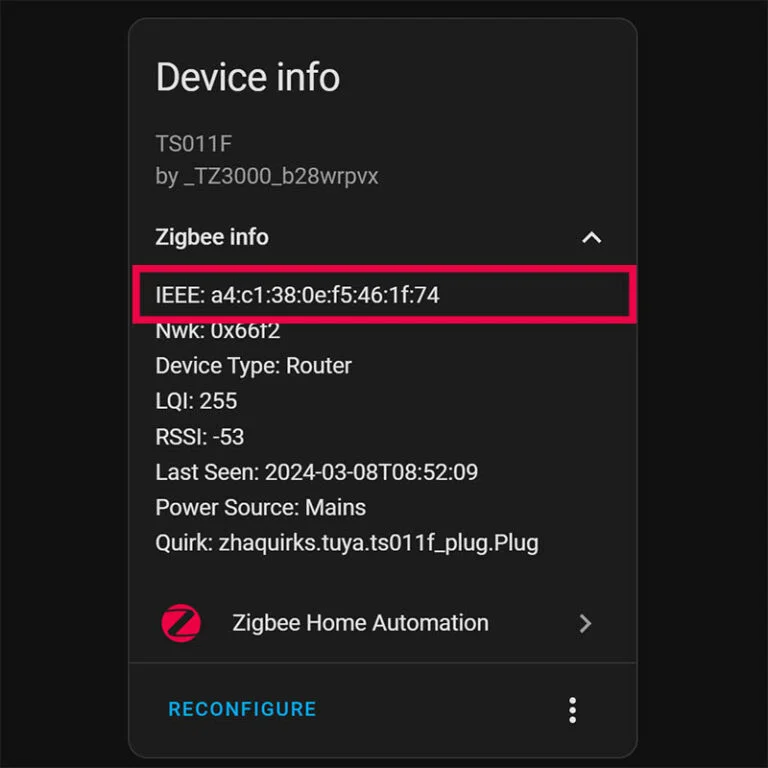

<p class="forum-cta"><a href="https://forumdomotique.com/forums/topic/457-pr%C3%A9sentation-nouveau-membre/">Lire et commenter sur Forum Domotique</a></p>

# Présentation nouveau membre

- **Catégorie :** [Présentez-vous](https://forumdomotique.com/forums/5-pr%C3%A9sentez-vous/)
- **Sujet :** https://forumdomotique.com/forums/topic/457-pr%C3%A9sentation-nouveau-membre/
- **Auteur du premier message du sujet :** un autre membre (XAV59213 a répondu dans ce sujet)
- **Messages de XAV59213 dans ce sujet :** 3
- **Premier message de XAV59213 :** 21 octobre 2025 à 18:51 (Europe/Paris)
- **Dernier message de XAV59213 :** 1 novembre 2025 à 19:31 (Europe/Paris)

---

## Message 1 — 21 octobre 2025 à 18:51 (Europe/Paris)

- **Identifiant :** `1085`
- **Lien :** https://forumdomotique.com/forums/topic/457-pr%C3%A9sentation-nouveau-membre/#findComment-1085

Bienvenue [@BatschRoland](https://forumdomotique.com/profile/563-batschroland/) !

---

## Message 2 — 1 novembre 2025 à 18:13 (Europe/Paris)

- **Identifiant :** `1132`
- **Lien :** https://forumdomotique.com/forums/topic/457-pr%C3%A9sentation-nouveau-membre/#findComment-1132

Salut [@BatschRoland](https://forumdomotique.com/profile/563-batschroland/) ,

Pour répondre a ta question.

Voici la procédure pour Réinitialiser l'énergie d'un module ZHA:

Tu dois obtenir l'appareil IEEE au lieu de son nom et l'utiliser pour exécuter un appel de service, réinitialiser le compteur.

1. Accédez aux **paramètres > Appareils et services > Zigbee Home Automation**
2. Cliquez **sur ton Appareil**
3. Cliquez sur le **nom de l'appareil**
4. Développez le menu déroulant **des infos Zigbee**
5. Copiez **l'adresse IEEE** et sauvegardez-la
6. Une image pour illustration:


<!-- source : https://cdn.forumdomotique.com/monthly_2025_11/reset-device-energy-meter-zha-getting-IEEE-address-768x768.jpg.11113becee15243c4a374a45f2a7097a.jpg -->

Maintenant, pour réinitialiser le compteur d'énergie, ou **Summation Delivered** comme son nommé dans ZHA faire ce qui suit:

7. Accédez à **Outils de développement > Services**
8. Exécutez **l'appel** de **service** suivant, en modifiant **l'adresse** IEEE:

```yaml
service: zha.issue_zigbee_cluster_command
data:
  ieee: l6:c1:38:0e:m2:46:1f:64 # adresse IEEE:
  endpoint_id: 1
  cluster_id: 0
  command: 0
  command_type: server
  args: []
```

Voilà !

Tu dois pouvoir réinitialiser la somme totale d’énergie d’une prise intelligente Zigbee, d’une prise intelligente ou d’un compteur à pince.

Cette opération est compatible avec tous les appareils dotés d’un compteur d’énergie.

---

## Message 3 — 1 novembre 2025 à 19:31 (Europe/Paris)

- **Identifiant :** `1135`
- **Lien :** https://forumdomotique.com/forums/topic/457-pr%C3%A9sentation-nouveau-membre/#findComment-1135

Salut [@BatschRoland](https://forumdomotique.com/profile/563-batschroland/) ,

L’erreur a eu lieu sur mon code ?

---
