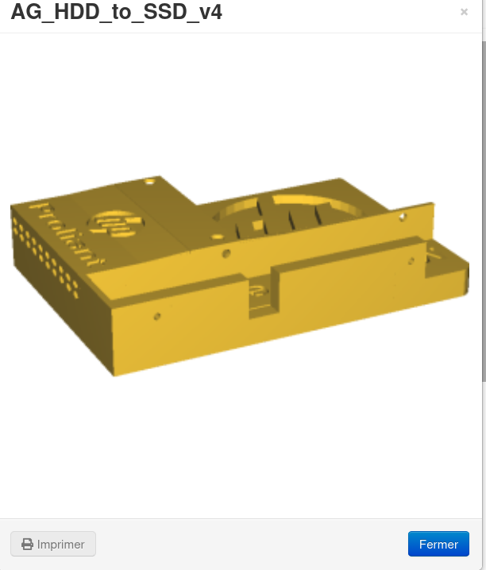
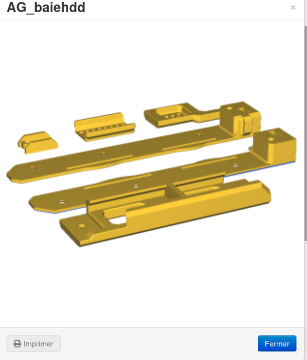
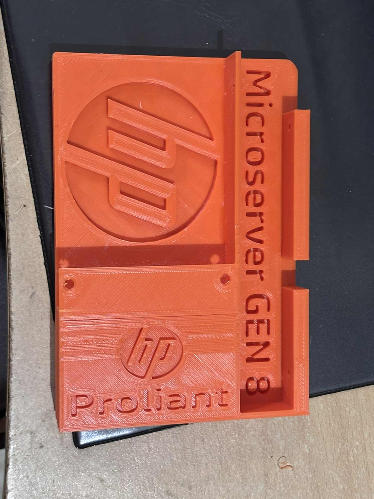
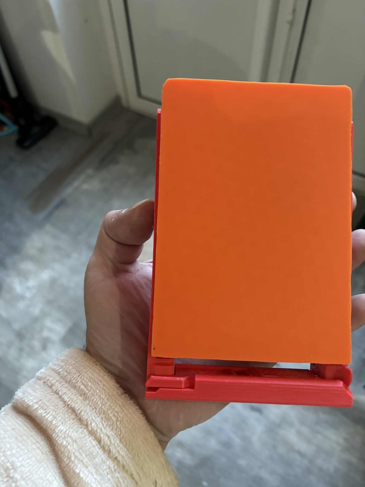
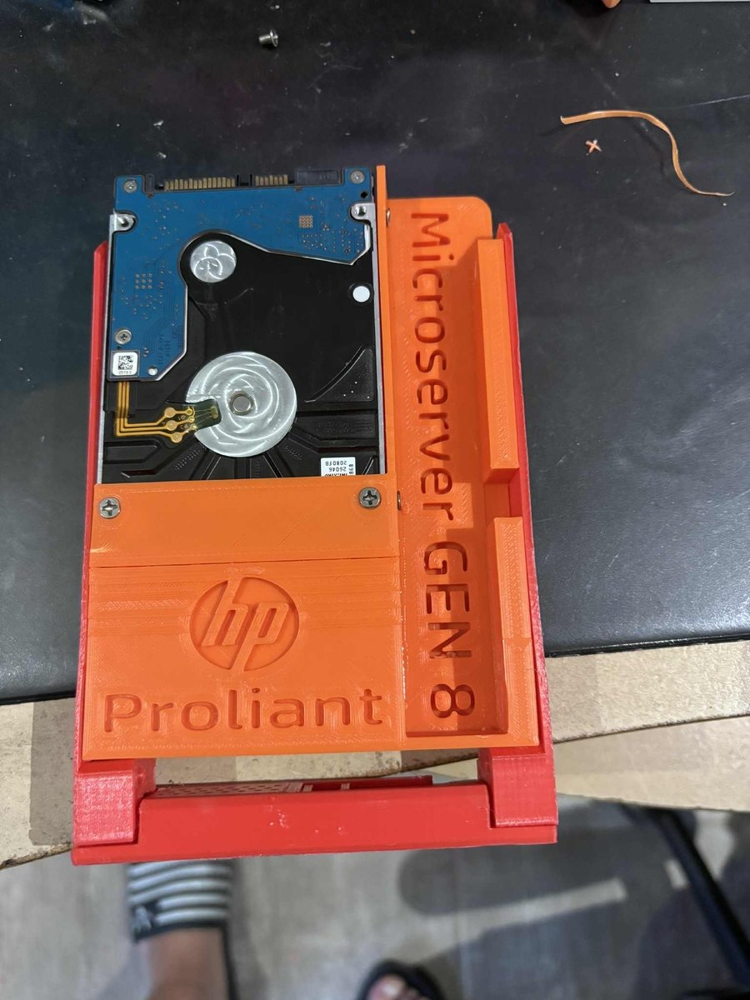
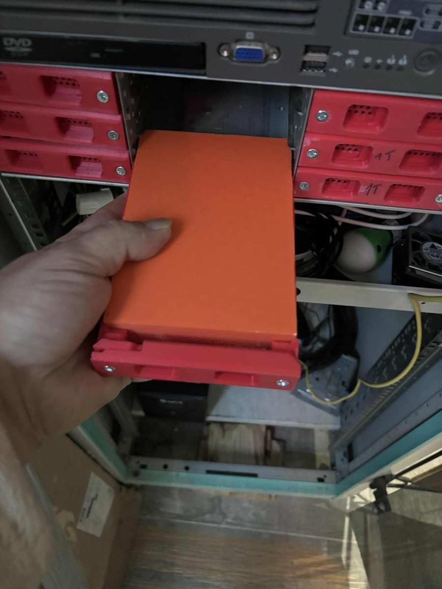
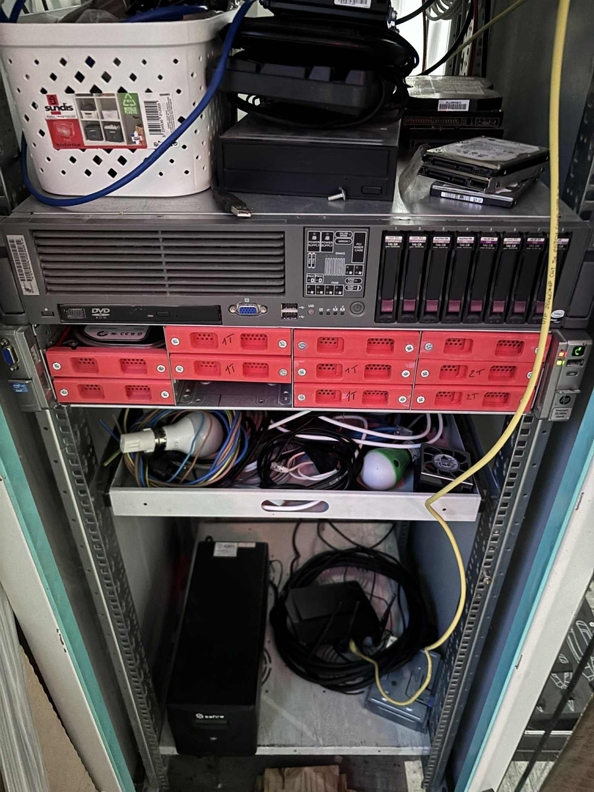

<a href="https://forumdomotique.com/forums/topic/460-mon-projet-domotique-caddies-3d-pour-s%C3%A9curiser-les-disques-de-mon-hp-gen8/">Lire et commenter sur Forum Domotique</a>

# Mon projet domotique : caddies 3D pour sécuriser les disques de mon HP  Gen8

- **Catégorie :** [Café Domotique](https://forumdomotique.com/forums/85-caf%C3%A9-domotique/)
- **Sujet :** https://forumdomotique.com/forums/topic/460-mon-projet-domotique-caddies-3d-pour-s%C3%A9curiser-les-disques-de-mon-hp-gen8/
- **Auteur du premier message du sujet :** XAV59213
- **Messages de XAV59213 dans ce sujet :** 1
- **Premier message de XAV59213 :** 25 octobre 2025 à 14:31 (Europe/Paris)

---

## Message 1 — 25 octobre 2025 à 14:31 (Europe/Paris)

- **Identifiant :** `1098`
- **Lien :** https://forumdomotique.com/forums/topic/460-mon-projet-domotique-caddies-3d-pour-s%C3%A9curiser-les-disques-de-mon-hp-gen8/#findComment-1098

Depuis **3 jours**, j’ai subi des **coupures Internet à répétition** à cause d’un **vrai déluge** dans ma région.

Internet est revenu **ce matin seulement** 😅

**Mais plutôt que de râler !!!**

j’ai **transformé cette contrainte en opportunité** : ➡️ J’ai **finalisé les caddies 3D** pour mon **serveur domotique** : un **HP Server Gen8** !

## Sécuriser les disques du Gen8 (HDD + SSD)

Mon **HP Gen8** tourne sous **Proxmox + Home Assistant (en VM)** avec un **dongle Zigbee** pour mais test:

Problème : Les disques étaient **posés à nu** dans les baies → vibrations, chaleur, risque de chute.

**Solution** : des **caddies sur mesure**, imprimés en **PLA** :

---

## Mon arme secrète : l’Artillery Genius d’occasion

---

J’ai acheté d’occasion une Artillery Genius il y a 3 mois.

***Meilleur investissement pour un bricoleur domotique !***

## Résultat : un Gen8 propre, silencieux et sécurisé

| Avant | Après |
| --- | --- |
| Disques posés sur du carton | Caddies fixés par vis M3 (compatibles baies HP) |
| Bruit de vibration HDD | Silencieux grâce |
| Température HDD → 48 °C | Température HDD → **38 °C** (meilleure aération) |

## 

> Le ventilateur frontal du Gen8 souffle maintenant directement dans les grilles des caddies → refroidissement optimal !

## Les fichiers STL OU G.CODE ARTILERY GENUIS

> **G.CODE** ARTILERY GENUIS:
>
> - [AG_Spring.gcode](https://forumdomotique.com/applications/core/interface/file/attachment.php?id=651&key=deb9f54493667afbef0743a815f7a818)
> - [AG_HDD_to_SSD_v4.gcode](https://forumdomotique.com/applications/core/interface/file/attachment.php?id=644&key=cd7c0692e62166524bedd526e0d0a88a)
>
> STL:
>
> - [Spring.stl](https://forumdomotique.com/applications/core/interface/file/attachment.php?id=650&key=d19fa7633223446560987eb2bfd8eea0)
> - [Right_Slide.stl](https://forumdomotique.com/applications/core/interface/file/attachment.php?id=649&key=1b2093e7ffb8945f69cfd8e59f5a87ad)
> - [Right_Fill_Mesh.stl](https://forumdomotique.com/applications/core/interface/file/attachment.php?id=648&key=dc9ec5ac118d78cccb7c0f56ba1ab257)
> - [Left_Slide.stl](https://forumdomotique.com/applications/core/interface/file/attachment.php?id=647&key=10e802f159edabccd900a76cf125d4b3)
> - [Left_Lock_Mesh.stl](https://forumdomotique.com/applications/core/interface/file/attachment.php?id=646&key=1af31fa0734f91ff97dd09a05b42e59d)
> - [Front.stl](https://forumdomotique.com/applications/core/interface/file/attachment.php?id=645&key=d90f2189f8522a5160c6316a705f6113)
> - [HDD_to_SSD_v4.stl](https://forumdomotique.com/applications/core/interface/file/attachment.php?id=652&key=21ad26e73d1c42e5adaa8859bde03833)

## Conclusion

> **Une coupure Internet ?**➡️ **L’excuse parfaite pour chouchouter son HP Gen8 !**

Et toi, tu as un **Gen8** en domotique ? Tu imprimes en 3D pour ton serveur ? **Dis-moi en commentaire ce que tu fabriques !**

---
