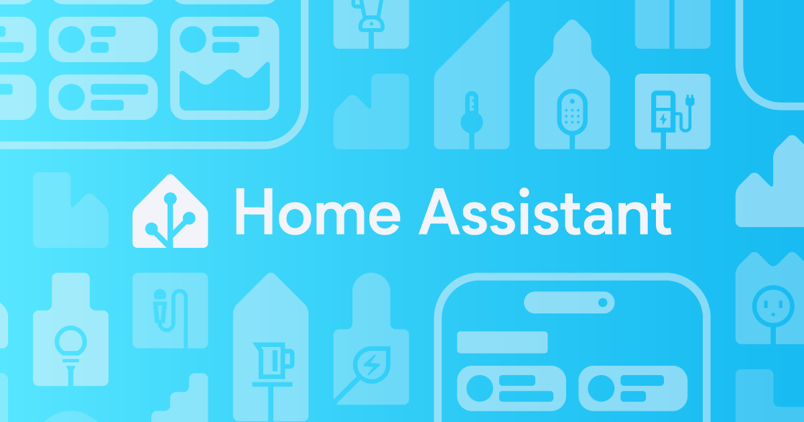

# Choisir une box domotique locale pour débutant, compatible avec mes prises Z-Wave : Home Assistant ou Eedomus/Fibaro ?

- **Catégorie :** [Choisir sa box domotique](https://forumdomotique.com/forums/100-choisir-sa-box-domotique/)
- **Sujet :** https://forumdomotique.com/forums/topic/463-choisir-une-box-domotique-locale-pour-d%C3%A9butant-compatible-avec-mes-prises-z-wave-home-assistant-ou-eedomusfibaro/
- **Auteur du premier message du sujet :** un autre membre (XAV59213 a répondu dans ce sujet)
- **Messages de XAV59213 dans ce sujet :** 2
- **Premier message de XAV59213 :** 27 octobre 2025 à 09:15 (Europe/Paris)
- **Dernier message de XAV59213 :** 25 novembre 2025 à 18:11 (Europe/Paris)

---

## Message 1 — 27 octobre 2025 à 09:15 (Europe/Paris)

- **Identifiant :** `1102`
- **Lien :** https://forumdomotique.com/forums/topic/463-choisir-une-box-domotique-locale-pour-d%C3%A9butant-compatible-avec-mes-prises-z-wave-home-assistant-ou-eedomusfibaro/#findComment-1102

Salut [@osramini](https://forumdomotique.com/profile/51-osramini/) !

Oui, Home Assistant (HA) est conçu pour être principalement local : il fonctionne sans internet pour les automatisations de base une fois configuré.

Pas de dépendance cloud forcée, contrairement à Orange.

Tu peux l’utiliser offline, mais certaines intégrations (comme des mises à jour ou API externes) nécessitent une connexion occasionnelle.

Non, Home Assistant n’est pas compliqué, surtout avec toute la communauté derrière HA. Avec un peu de volonté, en 3-4 jours tu vas plus t’arrêter, il y a tellement de possibilités avec HA ! 😊

Oui, Fibaro s’intègre à Home Assistant !

Il y a une intégration officielle pour les contrôleurs Fibaro comme le Home Center (HC2, HC3, Yubii Home), qui permet de synchroniser les devices et automatisations.

<https://www.home-assistant.io/integrations/fibaro/>

Oui, eedomus s’intègre aussi à Home Assistant, mais pas via une intégration officielle “plug-and-play”.

Tu peux utiliser l’API eedomus pour récupérer des données ou contrôler via des requêtes RESTful dans HA

Pour du simple marche/arrêt avec tes prises Z-Wave, ce n’est pas trop compliqué si tu suis les tutos.

HA a une interface intuitive via l’app mobile ou web, mais il y a une courbe d’apprentissage pour la config initiale .

Avec ton routeur Cudy P5 en 5G, ça devrait rouler comme pour tes caméras, tant que le réseau local est stable.

La plupart des accessoires Z-Wave fonctionnent avec HA via un dongle Z-Wave (comme Aeotec ou Zooz ect.. ) et l’add-on Z-Wave JS. Les anciens protocoles (Z-Wave Classic) sont supportés, mais vérifie la compatibilité sur le site HA ou la liste des devices supportés – tes prises datées devraient passer si elles sont Z-Wave standard.

Voici la liste:

<https://devices.zwave-js.io>

Setup basique : Achète une box HA (comme chez Domadoo),installe le, branche un stick Z-Wave USB, ajoute tes devices via l’interface, installe l’app Companion sur ton tel (iOS/Android), et ça tourne localement. Pas de réenregistrement à chaque panne.

Attention il te faux un dongle Z-Wave si la box n’en a pas intégré, des backups réguliers, et intégrer ton alarme Vesta plus tard via une intégration HA (existe pour certains modèles). Commence petit pour tester !

Les modèles d’alarmes Vesta (par Climax) compatibles avec Home Assistant sont ceux supportant le protocole SIA pour l’intégration (via l’add-on SIA dans HA, ou mieux Node-RED pour éviter les bugs de parsing).

##### Home Assistant

<!-- source : https://www.home-assistant.io/images/default-social.png -->

### SIA Alarm Systems

Instructions on how to integrate SIA Based Alarm systems.

---

## Message 2 — 25 novembre 2025 à 18:11 (Europe/Paris)

- **Identifiant :** `1314`
- **Lien :** https://forumdomotique.com/forums/topic/463-choisir-une-box-domotique-locale-pour-d%C3%A9butant-compatible-avec-mes-prises-z-wave-home-assistant-ou-eedomusfibaro/#findComment-1314

Salut osramini,

As-tu une TAHOMA ou un RFXCOM pour ta prise Somfy ? Quel est le modèle de ta prise ? As-tu installé <https://www.home-assistant.io/integrations/somfy/#configuration> ?

---
