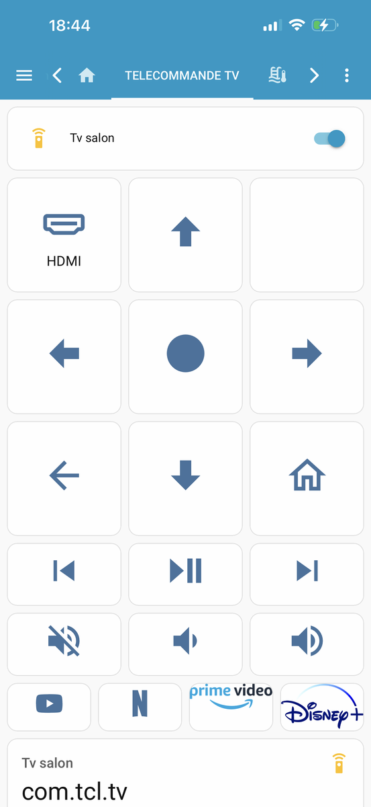
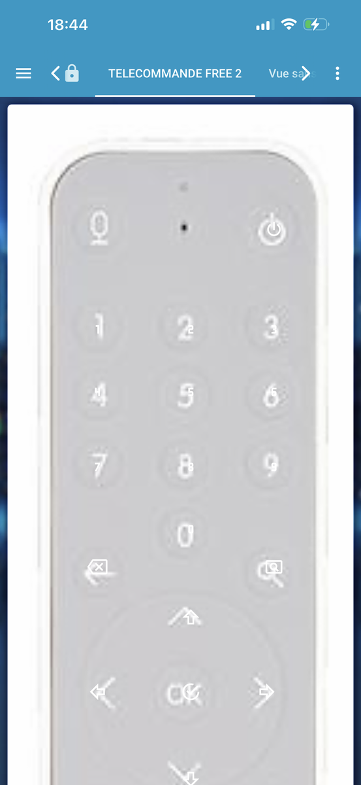
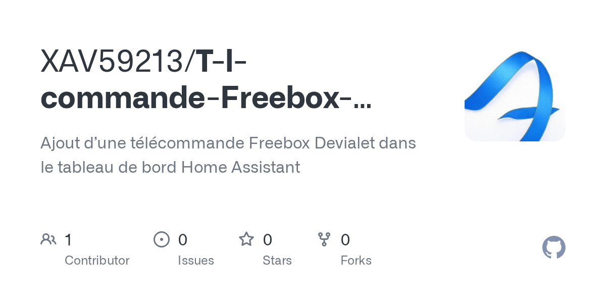

<a href="https://forumdomotique.com/forums/topic/464-administration-freebox-%C3%A0-distance/">Lire et commenter sur Forum Domotique</a>

# Administration Freebox à distance

- **Catégorie :** [Vos Tests & Retours d’expérience](https://forumdomotique.com/forums/110-vos-tests-retours-dexp%C3%A9rience/)
- **Sujet :** https://forumdomotique.com/forums/topic/464-administration-freebox-%C3%A0-distance/
- **Auteur du premier message du sujet :** un autre membre (XAV59213 a répondu dans ce sujet)
- **Messages de XAV59213 dans ce sujet :** 1
- **Premier message de XAV59213 :** 28 octobre 2025 à 18:35 (Europe/Paris)

---

## Message 1 — 28 octobre 2025 à 18:35 (Europe/Paris)

- **Identifiant :** `1107`
- **Lien :** https://forumdomotique.com/forums/topic/464-administration-freebox-%C3%A0-distance/#findComment-1107

Bienvenue paullecoder!

Oui depuis home assistant tu peux faire cela.

<!-- source : https://cdn.forumdomotique.com/monthly_2025_10/IMG_6149.png.06a26cce9562b9c4936f142e555f0255.png -->

<!-- source : https://cdn.forumdomotique.com/monthly_2025_10/IMG_6148.png.1a4257c672fcccdea433a61e1b466938.png -->

Voici le git à installé pour activer la fonction player de la freebox dans home assistant et aussi le template de la télécommande :

<!-- source : https://github.githubassets.com/favicons/favicon.svg -->

##### GitHub

<!-- source : https://opengraph.githubassets.com/706915029a5a8e57fe10e4bde69e91a4a50effc7c373e413c7390df0b0b2b8ed/XAV59213/T-l-commande-Freebox-Devialet -->

### GitHub - XAV59213/T-l-commande-Freebox-Devialet: Ajout d’...

Ajout d’une télécommande Freebox Devialet dans le tableau de bord Home Assistant - XAV59213/T-l-commande-Freebox-Devialet

<https://github.com/Pouzor/freebox_player.git>

---
