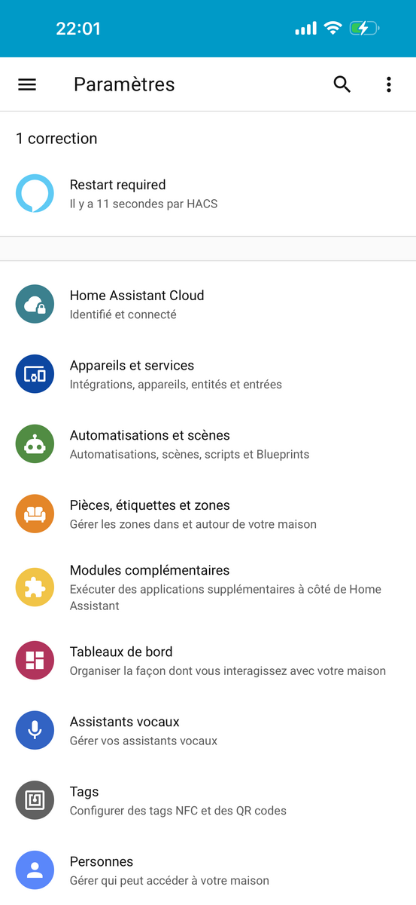
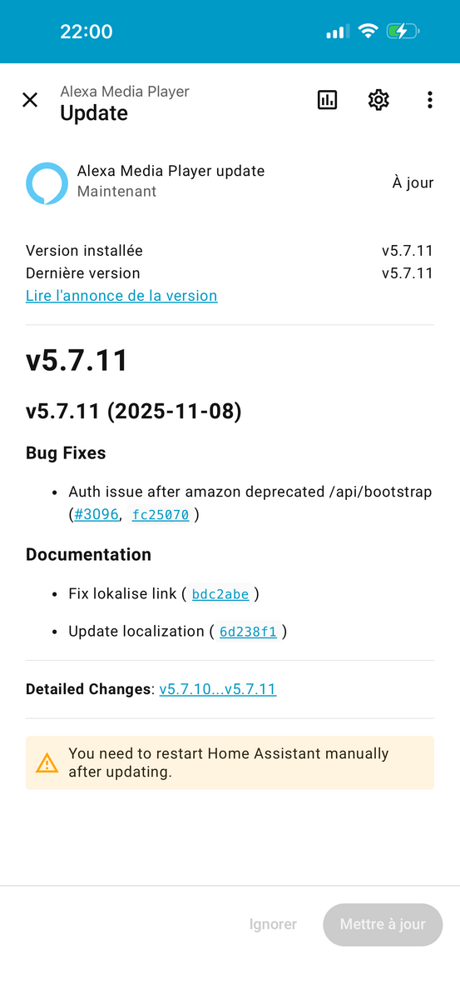

# Bug Alexa Media Player : Solution temporaire en attendant la mise à jour officielle

- **Catégorie :** [Dépannage et Support Technique](https://forumdomotique.com/forums/19-d%C3%A9pannage-et-support-technique/)
- **Sujet :** https://forumdomotique.com/forums/topic/488-bug-alexa-media-player-solution-temporaire-en-attendant-la-mise-%C3%A0-jour-officielle/
- **Auteur du premier message du sujet :** XAV59213
- **Messages de XAV59213 dans ce sujet :** 2
- **Premier message de XAV59213 :** 8 novembre 2025 à 13:58 (Europe/Paris)
- **Dernier message de XAV59213 :** 8 novembre 2025 à 22:06 (Europe/Paris)

---

## Message 1 — 8 novembre 2025 à 13:58 (Europe/Paris)

- **Identifiant :** `1182`
- **Lien :** https://forumdomotique.com/forums/topic/488-bug-alexa-media-player-solution-temporaire-en-attendant-la-mise-%C3%A0-jour-officielle/#findComment-1182

Un bug récent affecté le **custom component Alexa Media Player** dans Home Assistant, empêchant une authentification correcte avec les services Amazon Alexa. Ce problème est lié à une modification côté Amazon dans le processus d’authentification.

Heureusement, une **version corrigée temporaire** du paquet alexapy est disponible via une branche GitLab. Voici comment **résoudre le problème temporairement** en modifiant le fichier du custom component.

---

### Étapes de résolution

#### 1. **Localiser le fichier du custom component**

Le fichier à modifier se trouve dans votre dossier custom_components/alexa_media/ :

> /config/custom_components/alexa_media/manifest.json

#### 2. **Éditer le fichier manifest.json**

Ouvrez le fichier manifest.json avec un éditeur de texte (ex: VS Code, Notepad++, ou via File Editor dans HA).

**Remplacez tout le contenu** par le code suivant :

```yaml
{
  "domain": "alexa_media",
  "name": "Alexa Media Player",
  "codeowners": ["@alandtse", "@keatontaylor"],
  "config_flow": true,
  "dependencies": ["persistent_notification", "http"],
  "documentation": "https://github.com/alandtse/alexa_media_player/wiki",
  "iot_class": "cloud_polling",
  "issue_tracker": "https://github.com/alandtse/alexa_media_player/issues",
  "loggers": ["alexapy", "authcaptureproxy"],
  "requirements": [
    "git+https://gitlab.com/JtMotoX/alexapy.git@fix-auth",
    "packaging>=20.3",
    "wrapt>=1.14.0"
  ],
  "version": "5.7.11-beta1"
}
```

> **Point clé** :<https://gitlab.com/keatontaylor/alexapy/-/merge_requests/418/diffs#06aeb78c92d693f1c2f584d9146788efbe5423cf>pointe vers une **version corrigée** du module alexapy qui contourne le bug d’authentification.

---

#### 3. **Redémarrer Home Assistant**

Après avoir sauvegardé le fichier :

- Allez dans **Paramètres → Système → Redémarrer**

#### 4. **Vérifier le bon fonctionnement**

1. Allez dans **Paramètres → Appareils & Services**
2. Cherchez **Alexa Media Player**
3. Si l’intégration est toujours configurée, elle devrait se reconnecter automatiquement
4. Sinon, supprimez et **reconfigurez l’intégration** (vous devrez refaire l’authentification Amazon)

---

### Notes importantes

- Cette solution est **temporaire**. Suivez le dépôt officiel pour la mise à jour stable : <https://github.com/alandtse/alexa_media_player>
- La branche @fix-auth est maintenue par la communauté et peut évoluer.
- Si vous utilisez **HACS**, cette correction peut être intégrée automatiquement dans une future version.

---

### Sources

- Issue officielle : [GitHub - alexa_media_player issues](https://github.com/alandtse/alexa_media_player/issues)
- Correctif temporaire : [gitlab.com/JtMotoX/alexapy.git@fix-auth](https://gitlab.com/JtMotoX/alexapy.git@fix-auth)

---

**Problème résolu temporairement !** N’oubliez pas de revenir à la version officielle dès qu’une mise à jour stable est publiée.

*Mis à jour le 08/11/2025*

---

## Message 2 — 8 novembre 2025 à 22:06 (Europe/Paris)

- **Identifiant :** `1184`
- **Lien :** https://forumdomotique.com/forums/topic/488-bug-alexa-media-player-solution-temporaire-en-attendant-la-mise-%C3%A0-jour-officielle/#findComment-1184

Bug fixer !😇





---
