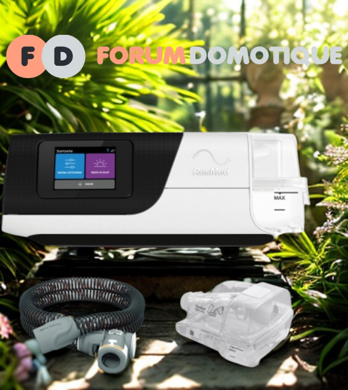
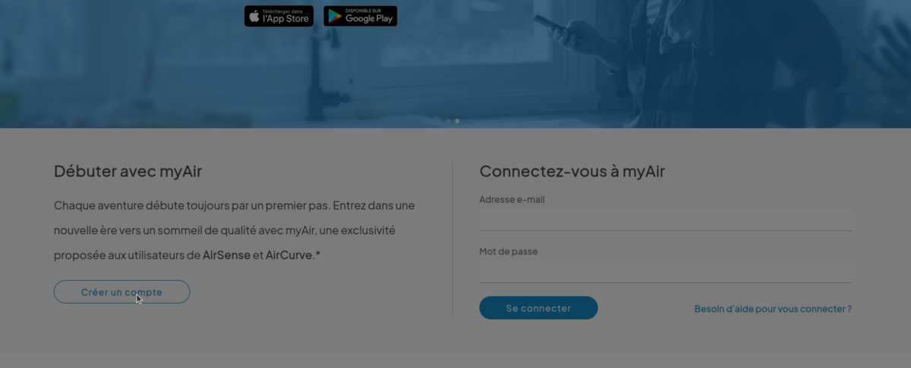
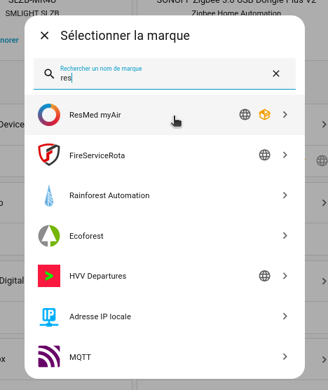
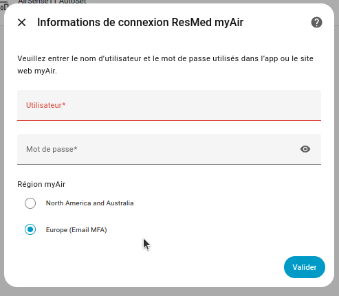
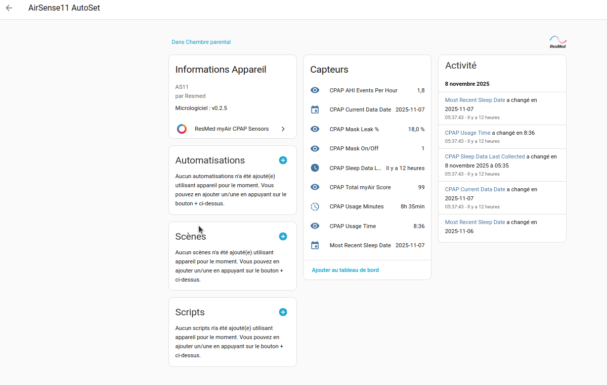
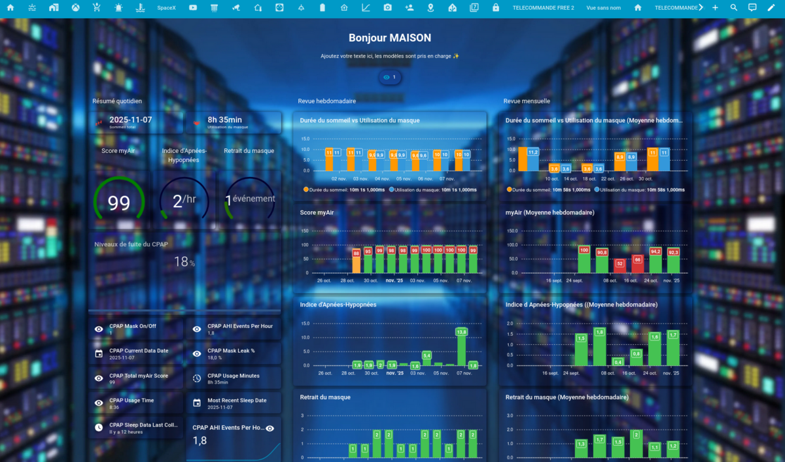


<p class="forum-cta"><a href="https://forumdomotique.com/forums/topic/489-int%C3%A9grer-resmed-myair-cpap-dans-home-assistant/">Lire et commenter sur Forum Domotique</a></p>

# Intégrer ResMed myAir CPAP dans Home Assistant

- **Catégorie :** [Intégrations et Add-ons](https://forumdomotique.com/forums/11-int%C3%A9grations-et-add-ons/)
- **Sujet :** https://forumdomotique.com/forums/topic/489-int%C3%A9grer-resmed-myair-cpap-dans-home-assistant/
- **Auteur du premier message du sujet :** XAV59213
- **Messages de XAV59213 dans ce sujet :** 1
- **Premier message de XAV59213 :** 8 novembre 2025 à 17:33 (Europe/Paris)

---

## Message 1 — 8 novembre 2025 à 17:33 (Europe/Paris)

- **Identifiant :** `1183`
- **Lien :** https://forumdomotique.com/forums/topic/489-int%C3%A9grer-resmed-myair-cpap-dans-home-assistant/#findComment-1183

## Chapitre 1 : Pourquoi intégrer son CPAP à Home Assistant ?


<!-- source : https://cdn.forumdomotique.com/monthly_2025_11/MatterServer(8).png.1081d496bc9a0c32cb89b4f4cd737d01.png -->

L’**apnée du sommeil** touche **1 personne sur 5 après 50 ans**. Ton appareil **ResMed CPAP** (AirSense 10, 11, AirCurve…) envoie déjà ses données à **myAir**, l’application officielle. Mais **Home Assistant** va plus loin :

| Avantages | Exemples concrets |
| --- | --- |
| **Dashboard santé centralisé** | Score, AHI, fuites, usage en un coup d’œil |
| **Alertes intelligentes** | Notification si AHI > 5 ou usage < 4h |
| **Historiques longs** | Graphiques sur 1 mois, 3 mois, 1 an |
| **Intégration domotique** | Allume une lampe rouge si fuites élevées |
| **Motivation quotidienne** | Badges de streak, gamification |

## Chapitre 2 : Créer ton compte myAir (EU)

> **Lien direct** : <https://myair.resmed.eu/>

### Étapes pas à pas

1. **Accède au site** → Clique sur **"S’inscrire"**
2. **Remplis le formulaire** :

   - **Email** → sera ton **identifiant Home Assistant**
   - **Mot de passe** : 8+ caractères, 1 majuscule, 1 chiffre
   - **Pays** : France


<!-- source : https://cdn.forumdomotique.com/monthly_2025_11/Capturedcrandu2025-11-0817-46-12.png.ef371e1e77b9e2582cb157d8590b700c.png -->

1. **Valide ton email** (lien reçu en 2 min)
2. **Ajoute ton CPAP** :

   - **Numéro de série** (au dos de la machine)
   - **Modèle** (ex: AirSense 11 AutoSet)
   - Active **Wi-Fi** ou **modem cellulaire**

> **Astuce** : Télécharge l’**app mobile myAir** pour forcer la première synchro : [iOS](https://apps.apple.com/app/myair-by-resmed/id1061494144) | [Android](https://play.google.com/store/apps/details?id=com.resmed.myair)

### Vérification

Après une nuit de sommeil :

- Score myAir visible
- AHI affiché
- Temps d’utilisation > 0

---

## Chapitre 3 : Installer l’intégration via HACS

> **Repo officiel** : [github.com/prestomation/resmed_myair_sensors](https://github.com/prestomation/resmed_myair_sensors) **Version actuelle** : v0.1.18 (05/11/2025)

### Prérequis

- Home Assistant **2025.10+**
- [HACS](https://hacs.xyz/) installé
- Compte myAir actif

### Installation

1. **HACS** → **Integrations** → **Explore & Download Repositories**
2. Recherche : ResMed myAir


<!-- source : https://cdn.forumdomotique.com/monthly_2025_11/Capturedcrandu2025-11-0817-41-00.png.9fc9f9820720f153e05dc887ea7372f6.png -->

3. Clique sur **"Download"** → **Redémarre Home Assistant**
4. **Settings > Devices & Services > + Add Integration**


<!-- source : https://cdn.forumdomotique.com/monthly_2025_11/Capturedcrandu2025-11-0817-44-32.png.126b084a5b00cf4ece4ae21ecb590d62.png -->

3. Tape ResMed → sélectionne **ResMed myAir CPAP Sensors**
4. Remplis :

```plaintext
Username: [email protected]
Password: ********
Region: EU (ou Auto)
Scan interval: 30 minutes
```

Problème ?

Rafraîchis la page, redémarre HA, ou vérifie les logs (resmed_myair).

Chapitre 4 : Les capteurs disponibles (v0.1.18)

| Entité | Nom | Unité | Description |
| --- | --- | --- | --- |
| `sensor.cpap_ahi_events_per_hour` | AHI | événements/h | Apnée + hypopnée |
| `sensor.cpap_usage_minutes` | Utilisation | min | Temps masque porté |
| `sensor.cpap_mask_on_off_count` | Retrait masque | count | Nombre d’enlèvements |
| `sensor.cpap_mask_leak_percentile` | Fuites | % | Percentile 95 |
| `sensor.cpap_myair_score` | Score myAir | /100 | Score global |
| `sensor.cpap_device_model` | Modèle | texte | AirSense 11, etc. |
| `sensor.cpap_current_data_date` | Date données | date | Dernière nuit |
| `sensor.cpap_sleep_data_last_collected` | Collecte | datetime | Dernier sync |


<!-- source : https://cdn.forumdomotique.com/monthly_2025_11/Capturedcrandu2025-11-0817-54-34.png.0e5b8d95ea5c66f4babab8a80795c756.png -->

## Chapitre 5 : Dashboard Lovelace complet (Mushroom + Flex + ApexCharts)

> **Cartes requises** (via HACS) :
>
> - [Mushroom Cards](https://github.com/piitaya/lovelace-mushroom)
> - [Flex Horseshoe Card](https://github.com/thomasloven/lovelace-flex-horseshoe-card)
> - [ApexCharts Card](https://github.com/RomRider/apexcharts-card)
> - [Mini Graph Card](https://github.com/kalkih/mini-graph-card)

### Code YAML complet de ma CARTE

```yaml
type: sections
max_columns: 6
title: Santé CPAP
path: sante
icon: mdi:heart-pulse
theme: transparentblue

sections:
  # === 1. RÉSUMÉ QUOTIDIEN ===
  - type: grid
    cards:
      - type: custom:mushroom-title-card
        title: ""
        subtitle: Résumé quotidien
      - type: grid
        square: false
        columns: 2
        cards:
          - type: custom:mushroom-entity-card
            entity: sensor.cpap_current_data_date
            name: Dernière nuit
            icon: mdi:calendar
            icon_color: blue
            primary_info: state
            secondary_info: last_changed
            layout: horizontal
          - type: custom:mushroom-entity-card
            entity: sensor.cpap_usage_minutes
            name: Utilisation masque
            icon: mdi:face-mask
            icon_color: green
            primary_info: state
            secondary_info: last_changed
            layout: horizontal

      - type: grid
        square: false
        columns: 3
        cards:
          - type: custom:mushroom-title-card
            title: ""
            subtitle: Score myAir
            alignment: center
          - type: custom:mushroom-title-card
            title: ""
            subtitle: AHI
            alignment: center
          - type: custom:mushroom-title-card
            title: ""
            subtitle: Retrait masque
            alignment: center

      - type: grid
        square: false
        columns: 3
        cards:
          - type: custom:flex-horseshoe-card
            entities:
              - entity: sensor.cpap_myair_score
                decimals: 0
                unit: ""
            show: { horseshoe_style: autominmax }
            layout:
              states:
                - id: 0
                  entity_index: 0
                  xpos: 50
                  ypos: 66
                  styles: { font-size: 6.5em; }
            horseshoe_scale: { min: 0, max: 100 }
            color_stops:
              "70": red
              "85": orange
              "90": green

          - type: custom:flex-horseshoe-card
            entities:
              - entity: sensor.cpap_ahi_events_per_hour
                decimals: 1
                unit: /h
            show: { horseshoe_style: autominmax }
            layout:
              states:
                - id: 0
                  entity_index: 0
                  xpos: 50
                  ypos: 60
                  styles: { font-size: 5.5em; }
            horseshoe_scale: { min: 0, max: 30 }
            color_stops:
              "5": green
              "15": orange
              "30": red

          - type: custom:flex-horseshoe-card
            entities:
              - entity: sensor.cpap_mask_on_off_count
                decimals: 0
                unit: fois
            show: { horseshoe_style: autominmax }
            layout:
              states:
                - id: 0
                  entity_index: 0
                  xpos: 50
                  ypos: 57
                  styles: { font-size: 4.5em; }
            horseshoe_scale: { min: 0, max: 7 }
            color_stops:
              "2": green
              "4": orange
              "7": red

      - type: custom:mini-graph-card
        entities:
          - entity: sensor.cpap_mask_leak_percentile
        name: Fuites masque (95e percentile)
        show: { name: true, icon: false, fill: true }
        color_thresholds:
          - { value: 0, color: "#43A047" }
          - { value: 24, color: "#FF9800" }
          - { value: 40, color: "#E53935" }
        hours_to_show: 168

  # === 2. REVUE HEBDOMADAIRE ===
  - type: grid
    cards:
      - type: custom:mushroom-title-card
        title: ""
        subtitle: Revue hebdomadaire
      - type: custom:apexcharts-card
        graph_span: 7d
        header: { show: true, title: Utilisation CPAP }
        series:
          - entity: sensor.cpap_usage_minutes
            type: column
            name: Minutes/jour
            group_by: { func: max, duration: 1d }
            show: { as_duration: minute, datalabels: true }
      - type: custom:apexcharts-card
        graph_span: 14d
        header: { show: true, title: Score myAir }
        series:
          - entity: sensor.cpap_myair_score
            type: column
            group_by: { func: max, duration: 1d }
            color_threshold:
              - { value: 0, color: "#E53935" }
              - { value: 85, color: "#FFB300" }
              - { value: 90, color: "#43A047" }
      - type: custom:apexcharts-card
        graph_span: 14d
        header: { show: true, title: AHI }
        series:
          - entity: sensor.cpap_ahi_events_per_hour
            type: column
            group_by: { func: max, duration: 1d }
            color_threshold:
              - { value: 5, color: "#43A047" }
              - { value: 15, color: "#FFB300" }
              - { value: 30, color: "#E53935" }

  # === 3. REVUE MENSUELLE ===
  - type: grid
    cards:
      - type: custom:mushroom-title-card
        title: ""
        subtitle: Revue mensuelle (moyenne hebdo)
      - type: custom:apexcharts-card
        graph_span: 1month
        series:
          - entity: sensor.cpap_myair_score
            type: column
            name: Score moyen
            group_by: { func: avg, duration: 1week }
            color_threshold:
              - { value: 85, color: "#43A047" }
              - { value: 70, color: "#FFB300" }
              - { value: 0, color: "#E53935" }

header:
  card:
    type: markdown
    content: |
      # Santé CPAP - {{ user }}
      Dernière mise à jour : {{ states('sensor.cpap_sleep_data_last_collected') | timestamp_custom('%H:%M') }}
```



## Chapitre 6 : Automatisations utiles

### 1. Alerte AHI élevé

```yaml
- alias: "Alerte AHI > 5"
  trigger:
    - platform: numeric_state
      entity_id: sensor.cpap_ahi_events_per_hour
      above: 5
  action:
    - service: notify.mobile_app_iphone
      data:
        title: "CPAP - AHI élevé"
        message: "AHI = {{ states('sensor.cpap_ahi_events_per_hour') }} /h"
```

### 2. Rappel usage faible

```yaml
- alias: "Rappel CPAP < 4h"
  trigger:
    - platform: time
      at: "08:00:00"
  condition:
    - condition: numeric_state
      entity_id: sensor.cpap_usage_minutes
      below: 240
  action:
    - service: notify.mobile_app_iphone
      data:
        title: "CPAP oublié"
        message: "Usage hier : {{ states('sensor.cpap_usage_minutes') }} min"
```

## Chapitre 7 : Dépannage & problèmes courants

| Problème | Solution |
| --- | --- |
| `401 Unauthorized` | Vérifie mot de passe / région |
| `429 Too Many Requests` | `scan_interval: 3600` |
| Pas de données | Vérifie modem CPAP + app myAir |
| Intégration absente | Redémarre HA après HACS |
| 2FA activé | Désactive-le (non supporté) |

## Chapitre 8 : Conclusion & perspectives

Tu as maintenant un **suivi médical pro** dans Home Assistant :

- **Dashboard clair et motivant**
- **Données fiables et quotidiennes**
- **Alertes automatiques**

> **Limite** : API non officielle → risque de rupture (mais stable depuis 2021).

### À faire ensuite

- Partage ton dashboard sur le [forum HA](https://community.home-assistant.io/)
- Ajoute un capteur de **température chambre** pour corréler avec AHI
- Crée un **badge de streak** (7 nuits > 4h)

---

