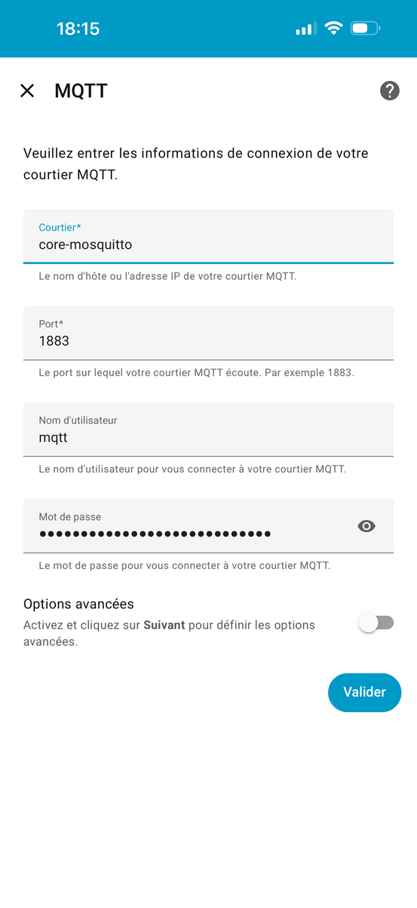

# Repartir de zéro avec Home Assistant : installation propre et séparation Zigbee2MQTT/MQTT sur Raspberry Pi pour migrer 45 appareils

- **Catégorie :** [Tutoriels, Guides & Astuces des Membres](https://forumdomotique.com/forums/87-tutoriels-guides-astuces-des-membres/)
- **Sujet :** https://forumdomotique.com/forums/topic/490-repartir-de-z%C3%A9ro-avec-home-assistant-installation-propre-et-s%C3%A9paration-zigbee2mqttmqtt-sur-raspberry-pi-pour-migrer-45-appareils/
- **Auteur du premier message du sujet :** un autre membre (XAV59213 a répondu dans ce sujet)
- **Messages de XAV59213 dans ce sujet :** 6
- **Premier message de XAV59213 :** 9 novembre 2025 à 21:26 (Europe/Paris)
- **Dernier message de XAV59213 :** 19 novembre 2025 à 17:26 (Europe/Paris)

---

## Message 1 — 9 novembre 2025 à 21:26 (Europe/Paris)

- **Identifiant :** `1188`
- **Lien :** https://forumdomotique.com/forums/topic/490-repartir-de-z%C3%A9ro-avec-home-assistant-installation-propre-et-s%C3%A9paration-zigbee2mqttmqtt-sur-raspberry-pi-pour-migrer-45-appareils/#findComment-1188

Salut [@filoo](https://forumdomotique.com/profile/232-filoo/)

Ton retour d’expérience est top, j’ai connu la même galère avec une setup HA qui grossit et devient lourd.

Ton idée de séparer Zigbee2MQTT sur un RPi dédié sous Debian Lite est maline : ça découple tout, accélère HA et simplifie les upgrades. Bonne précaution avec le clonage de la SD !

Ton idée est déjà très bonne !

Et pour l’avenir, monter HA sur un Raspberry Pi 5 serait mieux (plus puissant et stable)

---

## Message 2 — 10 novembre 2025 à 14:25 (Europe/Paris)

- **Identifiant :** `1191`
- **Lien :** https://forumdomotique.com/forums/topic/490-repartir-de-z%C3%A9ro-avec-home-assistant-installation-propre-et-s%C3%A9paration-zigbee2mqttmqtt-sur-raspberry-pi-pour-migrer-45-appareils/#findComment-1191

De rien avec plaisir ,

Oui, avec Z2M, pas de souci maintenant.

Si tu mets Home Assistant dessus, le Raspberry 3 devient limite.

Par contre, il faut laisser Z2M gérer ta clé.

Si tu as un bug, télécharge juste la config de Z2M, tu changes seulement ta clé et c’est reparti.

---

## Message 3 — 10 novembre 2025 à 18:13 (Europe/Paris)

- **Identifiant :** `1196`
- **Lien :** https://forumdomotique.com/forums/topic/490-repartir-de-z%C3%A9ro-avec-home-assistant-installation-propre-et-s%C3%A9paration-zigbee2mqttmqtt-sur-raspberry-pi-pour-migrer-45-appareils/#findComment-1196

Sur ha y a juste a mettre l intégration mqtt pour que les infos remontent

<!-- source : https://cdn.forumdomotique.com/monthly_2025_11/IMG_6232.png.c8bdf4ddd2977075554cee57cd2c8846.png -->

---

## Message 4 — 11 novembre 2025 à 21:53 (Europe/Paris)

- **Identifiant :** `1204`
- **Lien :** https://forumdomotique.com/forums/topic/490-repartir-de-z%C3%A9ro-avec-home-assistant-installation-propre-et-s%C3%A9paration-zigbee2mqttmqtt-sur-raspberry-pi-pour-migrer-45-appareils/#findComment-1204

> **il y a 9 minutes, FloDu a dit :**
> Alors vous allez peut être trouvé ça bête ... mais c'est quelle intégration mqtt qu'il faut installer pour récupérer les infos du Broker Mqtt ?
>
> Quand je cherche je ne trouve que Mosquitto et n'arrive jamais sur la page de configuraiton ci-dessus.

<https://www.home-assistant.io/integrations/mqtt>

---

## Message 5 — 19 novembre 2025 à 08:38 (Europe/Paris)

- **Identifiant :** `1261`
- **Lien :** https://forumdomotique.com/forums/topic/490-repartir-de-z%C3%A9ro-avec-home-assistant-installation-propre-et-s%C3%A9paration-zigbee2mqttmqtt-sur-raspberry-pi-pour-migrer-45-appareils/#findComment-1261

Je dois être le plus mauvais de la classe 265w 🫣

---

## Message 6 — 19 novembre 2025 à 17:26 (Europe/Paris)

- **Identifiant :** `1268`
- **Lien :** https://forumdomotique.com/forums/topic/490-repartir-de-z%C3%A9ro-avec-home-assistant-installation-propre-et-s%C3%A9paration-zigbee2mqttmqtt-sur-raspberry-pi-pour-migrer-45-appareils/#findComment-1268

> **Il y a 6 heures, filoo a dit :**
> Ah oui quand même, ça doit faire tourner un sacré matériel.
>
> ça ne semble pas beaucoup au vu du matériel, moi ça fait rikiki à côté. Par contre avec peu de matos, j'arrive à mettre un "bordel" sans nom. Tout est provisoire depuis quelques années maintenant 🙄  
> J'aurais bien fait une photo mais ce serait scandaleux, une honte...

<https://forumdomotique.com/forums/topic/100-mon-homelab-configuration-et-setup/?do=embed&comment=173&embedComment=173&embedDo=findComment#comment-173>

---
