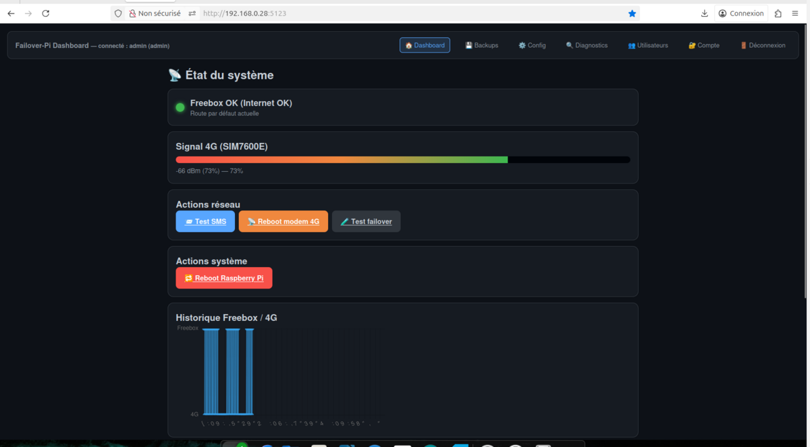
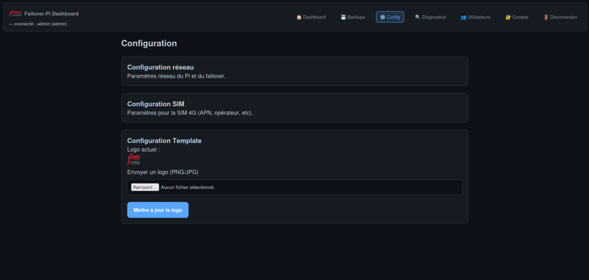
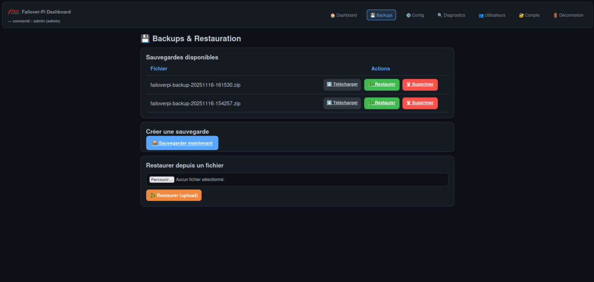
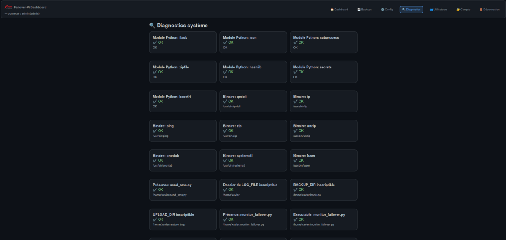
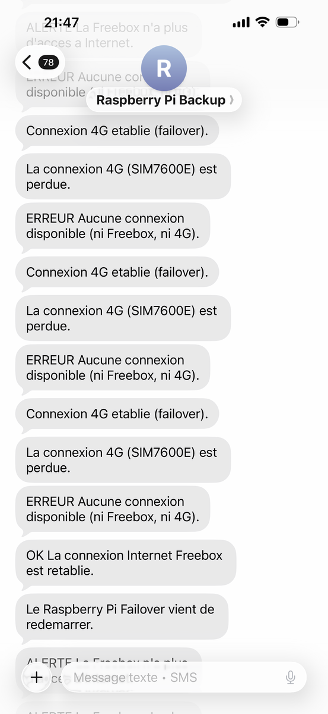
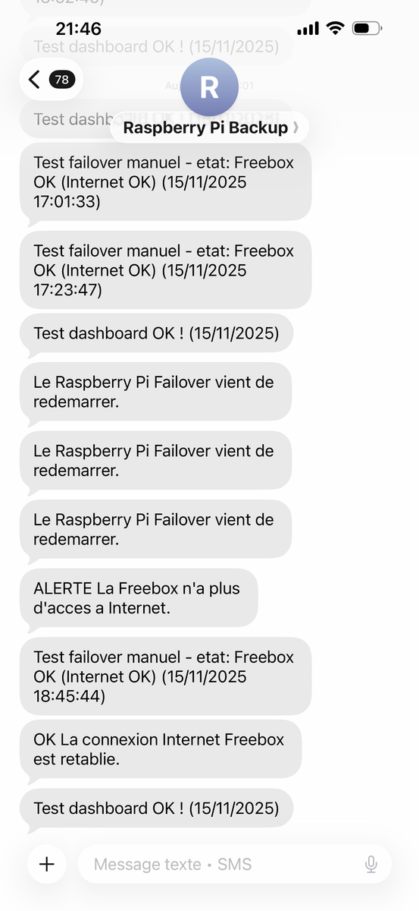

<a href="https://forumdomotique.com/forums/topic/497-failover-pi-syst%C3%A8me-de-bascule-automatique-entre-freebox-4g/">Lire et commenter sur Forum Domotique</a>

# Failover Pi — Système de bascule automatique entre Freebox & 4G

- **Catégorie :** [Projets et Personnalisations](https://forumdomotique.com/forums/12-projets-et-personnalisations/)
- **Sujet :** https://forumdomotique.com/forums/topic/497-failover-pi-syst%C3%A8me-de-bascule-automatique-entre-freebox-4g/
- **Auteur du premier message du sujet :** XAV59213
- **Messages de XAV59213 dans ce sujet :** 1
- **Premier message de XAV59213 :** 15 novembre 2025 à 21:10 (Europe/Paris)

---

## Message 1 — 15 novembre 2025 à 21:10 (Europe/Paris)

- **Identifiant :** `1219`
- **Lien :** https://forumdomotique.com/forums/topic/497-failover-pi-syst%C3%A8me-de-bascule-automatique-entre-freebox-4g/#findComment-1219

### Failover Pi est un projet que j’ai développé pour résoudre un problème réel :

#### 👉 Éviter que Home Assistant et tous mes services domotiques deviennent inaccessibles lors d’une coupure Internet.

---

##### Lorsque la Freebox tombe, la domotique tombe si les intégrations qui on besoin de cloud distant tombe aussi.

##### Pour ne plus subir ces interruptions, j’ai créé un système automatique qui :

- Surveille en temps réel la connexion Freebox
- Basculent automatiquement sur une connexion 4G (SIM7600) en cas de coupure
- M’envoie une alerte SMS pour me prévenir
- Rebasculent automatiquement sur la Freebox quand elle revient
- Propose une interface web complète pour le contrôle, les logs et les actions système
- Permet de gérer des backups, restaurations, diagnostics et utilisateurs

<!-- source : https://cdn.forumdomotique.com/monthly_2025_11/Capturedcrandu2025-11-1518-58-38.png.2b8509e4293c2de7216d9fd0dd83077b.png -->

<!-- source : https://cdn.forumdomotique.com/monthly_2025_11/Capturedcrandu2025-11-1611-43-45.png.c1b9f65a814239600aa3e70ec291dab9.png -->

<!-- source : https://cdn.forumdomotique.com/monthly_2025_11/Capturedcrandu2025-11-1616-16-24.png.b1d1e32aeeaf3d2a5984a767a801f257.png -->

<!-- source : https://cdn.forumdomotique.com/monthly_2025_11/Capturedcrandu2025-11-1616-17-49.png.50df89a0b59a78386665c7c5e0c2d702.png -->

#### Ce projet est toujours en cours de développement, avec de nouvelles fonctionnalités ajoutées régulièrement :

📡 amélioration du failover

📊 meilleur historique Freebox/4G

🔒 renforcement sécurité & multi-utilisateurs

🖥️ interface plus moderne

📦 automatisation via Systemd & scripts

…et bien plus !

<!-- source : https://github.githubassets.com/favicons/favicon.svg -->

##### GitHub

<!-- source : https://repository-images.githubusercontent.com/1095768526/4616686d-16b0-4950-9d4a-39c5617c9c24 -->

### GitHub - XAV59213/failover-pi: failover-pi freebox

failover-pi freebox. Contribute to XAV59213/failover-pi development by creating an account on GitHub.

---
