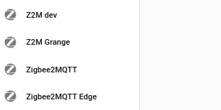
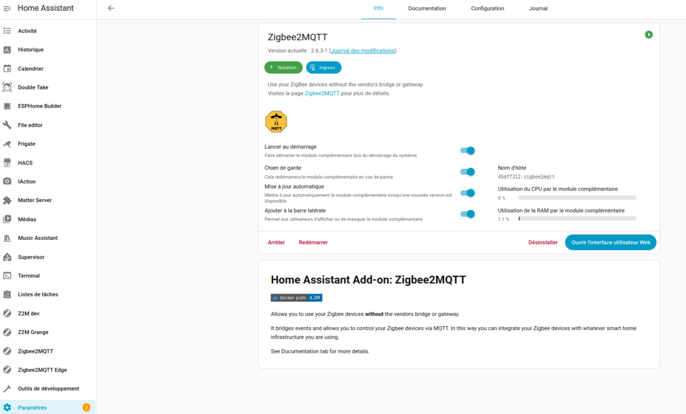

<p class="forum-cta"><a href="https://forumdomotique.com/forums/topic/509-comment-renommer-proprement-ses-instances-zigbee2mqtt-dans-le-menu-lat%C3%A9ral-de-home-assistant-et-arr%C3%AAter-davoir-dix-fois-%C2%AB-zigbee2mqtt-%C2%BB-qui-se-battent-en-duel/">Lire et commenter sur Forum Domotique</a></p>

<div class="ha-callout info" markdown="1">
**Nouvelle version.** Cette astuce est aussi publiée dans le Coin bistrot de la domotique, avec une note pour Home Assistant 2026.11 (Marketplace et applications) : [Comment renommer proprement ses instances Zigbee2MQTT dans le menu latéral]({{ '/contenus/coin-bistrot/renommer-instances-zigbee2mqtt/article.html' | relative_url }}).
</div>


# Comment renommer proprement ses instances Zigbee2MQTT dans le menu latéral de Home Assistant (et arrêter d’avoir dix fois « Zigbee2MQTT » qui se battent en duel)

- **Catégorie :** [Tutoriels, Guides & Astuces des Membres](https://forumdomotique.com/forums/87-tutoriels-guides-astuces-des-membres/)
- **Sujet :** https://forumdomotique.com/forums/topic/509-comment-renommer-proprement-ses-instances-zigbee2mqtt-dans-le-menu-lat%C3%A9ral-de-home-assistant-et-arr%C3%AAter-davoir-dix-fois-%C2%AB-zigbee2mqtt-%C2%BB-qui-se-battent-en-duel/
- **Auteur du premier message du sujet :** XAV59213
- **Messages de XAV59213 dans ce sujet :** 1
- **Premier message de XAV59213 :** 23 novembre 2025 à 11:25 (Europe/Paris)

---

## Message 1 — 23 novembre 2025 à 11:25 (Europe/Paris)

- **Identifiant :** `1279`
- **Lien :** https://forumdomotique.com/forums/topic/509-comment-renommer-proprement-ses-instances-zigbee2mqtt-dans-le-menu-lat%C3%A9ral-de-home-assistant-et-arr%C3%AAter-davoir-dix-fois-%C2%AB-zigbee2mqtt-%C2%BB-qui-se-battent-en-duel/#findComment-1279

Cela fait maintenant plusieurs années que je tourne avec plusieurs instances Zigbee2MQTT sous Home Assistant. Au début une seule suffisait largement, puis le réseau a grandi, les extensionsibees se sont multipliés, les pannes de clé USB aussi, et je me suis retrouvé avec trois, puis quatre instances différentes : une pour le salon et le rez-de-chaussée, une pour l’étage, une pour l’extérieur et la dépendance, et même une petite dernière dédiée aux appareils un peu capricieux qui préfèrent vivre leur vie à part. Tout allait bien jusqu’au jour où j’ai regardé mon menu latéral et que j’ai eu l’impression de relire dix fois la même ligne : Zigbee2MQTT, Zigbee2MQTT, Zigbee2MQTT… Impossible de savoir en un coup d’œil laquelle ouvrait quoi. Clic droit, nouvel onglet, attendre que la page charge, ah oui c’est celle de l’étage… Fastidieux.

J’ai cherché pendant des mois la solution propre, celle qui ne consiste pas à bidouiller le nom de l’add-on dans Supervisor (ça ne change rien dans le menu) ni à prier pour qu’une option magique apparaisse un jour dans les paramètres officiels. Et puis je suis tombé sur **HACS Ingress**, une petite intégration toute simple qui règle le problème en deux minutes et, surtout, de façon parfaitement propre et stable.


<!-- source : https://cdn.forumdomotique.com/monthly_2025_11/Capturedcrandu2025-11-2311-18-10.png.64eb2e204bbf536dcf10b6dc6716f53f.png -->

#### D’où vient cette intégration et pourquoi elle est parfaite pour ça

[](https://my.home-assistant.io/redirect/hacs_repository/?owner=lovelylain&repository=hass_ingress)
<!-- source : https://camo.githubusercontent.com/49f849a6409cdcad49e32d41115ab078f810d960b35466436e028d4552aadd40/68747470733a2f2f6d792e686f6d652d617373697374616e742e696f2f6261646765732f686163735f7265706f7369746f72792e737667 (original : https://my.home-assistant.io/badges/hacs_repository.svg) -->

Avant de plonger dans les étapes, deux mots sur ce qu’est Ingress. À la base, c’est le système qu’utilise Home Assistant OS pour créer les accès sécurisés aux interfaces des add-ons depuis l’interface principale (le petit iframe qui s’ouvre quand tu cliques sur « Ouvrir l’interface web » d’un add-on). Chaque add-on exposé possède un **slug** unique, un bout de code genre a1b2c3d4e5f qui permet d’y accéder via l’URL /api/hassio_ingress/a1b2c3d4e5f.

L’intégration HACS Ingress, développée par lovelylain, fait une chose toute bête mais géniale : elle te permet de créer tes propres entrées dans le menu latéral qui pointent vers ces URLs internes, avec le nom et l’icône que tu veux. Résultat : tu peux enfin appeler ton instance « Z2M Salon », « Zigbee Étage », « Réseau Extérieur » ou même « Les relous qui tombent tout le temps » si l’envie te prend. Et surtout, tu gardes exactement la même interface Zigbee2MQTT que tu avais avant, sans aucune perte de fonctionnalité.

#### Installation de HACS Ingress : vraiment pas de quoi avoir peur

Si tu as déjà HACS d’installé (et à ce stade, je pense que tout le monde l’a), l’ajout se fait en moins de cinq minutes. Tu vas dans HACS, Intégrations, tu cliques sur les trois petits points en haut à droite puis « Dépôts personnalisés ». Tu colles l’adresse <https://github.com/lovelylain/hass_ingress>, tu valides en choisissant la catégorie « Integration », et tu valides encore. Ensuite tu descends dans « Explorer et télécharger des dépôts », tu tapes « Ingress », tu télécharges, tu acceptes le redémarrage quand on te le propose, et c’est fini. Rien de plus classique, exactement comme quand tu ajoutes MQTT Explorer ou Node-RED.

Petit apart : j’ai installé ça il y a maintenant plus d’un an et je n’ai jamais eu le moindre souci de mise à jour ou de compatibilité, même en passant sur les dernières versions de Home Assistant 2025.x. C’est du solide.

#### Trouver le slug de chaque instance Zigbee2MQTT

Avant de toucher au configuration.yaml, il faut récupérer le fameux slug de chaque instance. Il y a plusieurs façons simples de le faire.

La plus rapide quand tu es sur ordinateur : tu passes la souris sur l’entrée Zigbee2MQTT dans le menu latéral, tu fais clic droit, « Inspecter » (ou Ctrl+Maj+I), et dans le code tu vois directement l’URL complète avec le slug après /api/hassio_ingress/. Ça ressemble à ça : 45df7312_zigbee2mqtt_edge

Tu notes la partie a1b2c3d4e5f6g7h8i9j0k, c’est ton slug.

Sur tablette ou téléphone c’est un peu plus chiant mais faisable : tu ouvres l’interface Zigbee2MQTT, tu partages le lien vers toi-même par mail ou Telegram, et tu récupères l’URL complète comme ça.

Dernière méthode, ultra propre : tu vas dans Paramètres > Add-ons > tu cliques sur ton instance Zigbee2MQTT > onglet « Info » tout en bas. Le slug est affiché clairement à la ligne « Ingress URL ».

#### La configuration qui change la vie en dix lignes

Une fois que tu as tous tes slugs sous la main, tu ouvres ton bon vieux configuration.yaml (moi je passe par Studio Code Server, mais File Editor ou Samba ça marche aussi) et tu ajoutes ça tout en bas :

```yaml
ingress:
  zigbee2mqtt:          # clé sans tiret
    work_mode: hassio
    title: Z2M Grange
    icon: mdi:zigbee
    url: 45df7312_zigbee2mqtt

  zigbee2mqtt_edge:     # ← tiret remplacé par underscore
    work_mode: hassio
    title: Z2M dev
    icon: mdi:zigbee
    url: 45df7312_zigbee2mqtt_edge   # l’URL du slug de l’add-on, elle, peut contenir un tiret
```

Tu adaptes évidemment les slugs et les noms. Tu peux mettre l’icône que tu veux, perso j’aime bien garder une logique par étage ou par zone pour m’y retrouver encore plus vite.

Tu sauvegardes, tu vas dans Outils de développement > Redémarrer, et magie : tes nouvelles entrées apparaissent immédiatement dans le menu latéral, parfaitement intégrées, avec le petit cadre bleu quand tu es dessus, exactement comme les entrées natives.

#### En pratique, ça change quoi au quotidien ?

Depuis que je les ai renommées, je gagne un temps fou. Quand je cherche pourquoi la lampe de la chambre des enfants ne répond plus, je clique directement sur « Z2M Étage » au lieu de faire trois essais pour tomber sur la bonne instance. Quand je veux vérifier la batterie des capteurs de fuite d’eau du garage, un clic sur « Z2M Jardin & Dépendance » et je suis dessus. C’est tout bête, mais quand tu as 200 appareils et quatre réseaux zigbee qui cohabitent, ce genre de petite amélioration fait vraiment la différence.

Et surtout, les anciennes entrées « Zigbee2MQTT » toutes grises sont toujours là si jamais j’en ai besoin (par exemple pour un diagnostic rapide), mais je ne les utilise presque plus. Je peux même les masquer complètement avec un petit package sidebar si je veux faire le ménage.

#### Ce qu’il faut savoir pour que ça reste propre longtemps

Quelques petites astuces que j’ai apprises à l’usage :

- Si tu crées une nouvelle instance Zigbee2MQTT plus tard, le slug sera généré automatiquement et tu n’auras plus qu’à l’ajouter dans la section ingress, deux minutes chrono.
- Les mises à jour de Zigbee2MQTT ou de Home Assistant n’ont jamais cassé mes entrées personnalisées jusqu’à présent.
- Si un jour tu supprimes complètement une instance, pense à nettoyer la ligne correspondante dans configuration.yaml, sinon tu auras un petit fantôme dans le menu (mais ça ne casse rien).


<!-- source : https://cdn.forumdomotique.com/monthly_2025_11/Capturedcrandu2025-11-2311-22-23.png.4c66f4992617ff3af50b11b29bdea623.png -->

#### Points forts et petites améliorations possibles

Ce qui est génial avec cette solution, c’est qu’elle ne touche à rien d’officiel : pas de patch douteux, pas de modification du core, pas de risque de tout casser à la prochaine mise à jour. C’est juste Home Assistant qui fait ce qu’il sait déjà faire, mais en mieux.

Le seul petit regret que j’ai, c’est que ça nécessite quand même une édition manuelle du configuration.yaml. J’aimerais bien qu’un jour on ait un petit éditeur graphique directement dans l’interface Ingress pour ajouter/supprimer les entrées sans toucher au YAML, mais honnêtement, vu le temps que ça me fait gagner tous les jours, je ne vais pas faire la fine bouche.

#### Conclusion : à faire les yeux fermés

Si comme moi tu vis avec plusieurs instances Zigbee2MQTT et que tu en as marre de jouer à la roulette russe dans le menu latéral, installe HACS Ingress et renomme-moi tout ça. C’est propre, c’est stable, c’est exactement dans l’esprit Home Assistant : on bricole un peu au début, et ensuite on vit heureux.

Depuis que je l’ai fait, je me demande même comment j’ai pu vivre aussi longtemps avec dix fois le même nom. Si tu hésites encore, viens me dire dans les commentaires combien d’instances tu as, je parie que tu vas franchir le pas dans la journée.

Et toi, tu as déjà essayé ? Ou tu as une autre méthode propre pour distinguer tes réseaux ? La section commentaires est là pour ça !

---
