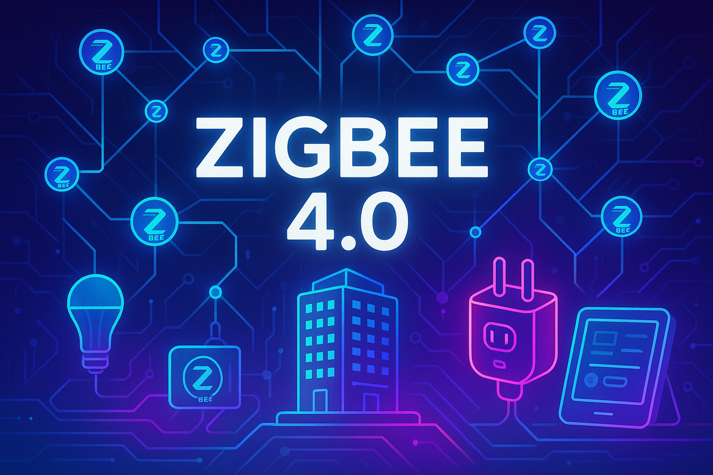

<a href="https://forumdomotique.com/forums/topic/536-zigbee-40-r%C3%A9volution-iot-adieu-les-pannes-bonjour-la-magie-connect%C3%A9e/">Lire et commenter sur Forum Domotique</a>

# Zigbee 4.0 : Révolution IoT – Adieu les Pannes, Bonjour la Magie Connectée !

- **Catégorie :** [Sonoff](https://forumdomotique.com/forums/55-sonoff/)
- **Sujet :** https://forumdomotique.com/forums/topic/536-zigbee-40-r%C3%A9volution-iot-adieu-les-pannes-bonjour-la-magie-connect%C3%A9e/
- **Auteur du premier message du sujet :** XAV59213
- **Messages de XAV59213 dans ce sujet :** 1
- **Premier message de XAV59213 :** 26 novembre 2025 à 10:09 (Europe/Paris)

---

## Message 1 — 26 novembre 2025 à 10:09 (Europe/Paris)

- **Identifiant :** `1326`
- **Lien :** https://forumdomotique.com/forums/topic/536-zigbee-40-r%C3%A9volution-iot-adieu-les-pannes-bonjour-la-magie-connect%C3%A9e/#findComment-1326

<!-- source : https://cdn.forumdomotique.com/monthly_2025_11/94743ECB-8C3A-444D-9D8C-DC4551566E5E.png.78de424bdf78bb1046400fe522905ef0.png -->

La Connectivity Standards Alliance, anciennement connue sous le nom de Zigbee Alliance, a récemment dévoilé la **mise à jour Zigbee 4.0**, une évolution majeure du protocole de communication sans fil dédié aux objets connectés. Annoncée le 18 novembre 2025, cette version s’appuie sur plus d’un milliard de dispositifs déjà déployés à travers le monde pour offrir une connectivité plus sécurisée, interopérable et étendue, répondant aux besoins croissants des écosystèmes IoT dans les environnements résidentiels, commerciaux et industriels. En intégrant des avancées technologiques comme le support des bandes de fréquences inférieures au GHz et une simplification des processus d’installation, **Zigbee 4.0** vise à renforcer la résilience des réseaux maillés tout en optimisant la consommation énergétique, ce qui permet aux fabricants de concevoir des produits plus efficaces et aux utilisateurs de bénéficier d’une expérience plus fluide sans compromettre la compatibilité avec les versions antérieures.  Parmi les innovations clés, on retrouve une harmonisation accrue entre les dispositifs traditionnels Zigbee et ceux orientés énergie intelligente, facilitant ainsi des échanges d’informations plus complets et favorisant la création de solutions domestiques intelligentes plus intégrées. Cette approche assure non seulement une meilleure interopérabilité entre les appareils de différents fournisseurs mais aussi une scalabilité accrue pour gérer des réseaux plus denses sans perte de performances.

Au cœur de cette mise à jour se trouve une série d’améliorations en matière de sécurité, alignées sur les normes internationales pour protéger les réseaux contre les menaces émergentes. Des fonctionnalités telles que la **clé de liaison dynamique**, l’**entretien des dispositifs** et le contrôle du niveau d’authentification pour l’énergie intelligente permettent une authentification plus stricte des appareils rejoignant le réseau, tandis que des outils comme le mode restreint, le canal sécurisé, les changements d’identifiant PAN et le remplacement du centre de confiance empêchent les modifications non autorisées. De plus, la synchronisation avancée des compteurs de trames prévient les attaques par rejeu en validant les messages de manière plus robuste, garantissant ainsi que seuls les échanges légitimes soient traités. Ces mesures collectives renforcent la confiance dans les écosystèmes connectés, en particulier dans un contexte où les cybermenaces ciblant les objets IoT se multiplient, et elles s’accompagnent d’une agilité cryptographique pour s’adapter aux évolutions futures des standards de chiffrement.  Parallèlement, **Zigbee 4.0** étend ses capacités fréquentilles en intégrant les bandes 800 MHz pour l’Europe et 900 MHz pour l’Amérique du Nord, offrant une portée accrue et une meilleure pénétration des signaux à travers les obstacles comme les murs épais ou les environnements extérieurs, ce qui représente un atout majeur pour les installations à grande échelle.

Introduite en tandem avec cette version, la technologie **Suzi** marque une étape décisive vers une connectivité à longue portée via un maillage sans fil en sous-GHz, combinant performance étendue, faible consommation d’énergie et interopérabilité multi-fournisseurs. Basée sur la couche réseau de Zigbee, **Suzi** cible des applications variées, des espaces résidentiels extérieurs aux bâtiments commerciaux vastes et aux infrastructures urbaines, où l’interférence minimale et la robustesse du signal sont essentielles. Contrairement aux fréquences traditionnelles à 2,4 GHz, cette approche sub-GHz permet de couvrir des distances plus importantes tout en maintenant une sécurité alignée sur les principes internationaux, avec un programme de certification prévu pour ouvrir au premier semestre 2026. Cela ouvre la voie à des réseaux IoT plus vastes et plus fiables, où les dispositifs peuvent communiquer efficacement sans nécessiter de hubs intermédiaires supplémentaires, rendant l’adoption de technologies intelligentes plus accessible pour les professionnels comme pour les particuliers.  En outre, des optimisations comme la sélection formalisée des parents, la surveillance des clés de liaison uniques et la connectivité au centre de confiance améliorent la résilience globale du réseau, réduisant les pertes de messages et supportant des échanges plus fiables même dans des conditions denses.

Sur le plan de l’utilisabilité, **Zigbee 4.0** intègre le **Zigbee Direct**, désormais obligatoire, qui exploite le Bluetooth Low Energy pour permettre l’ajout et le contrôle direct des appareils via un smartphone sans recourir à un hub dédié, simplifiant grandement l’installation initiale. Ajouté à cela, la mise en service par lots autorise la configuration simultanée de plusieurs dispositifs, tandis que l’écoute coordonnée d’échantillons facilite les communications de bas niveau entre appareils en mode veille, prolongeant ainsi la durée de vie des batteries et favorisant une efficacité énergétique accrue. Ces éléments, combinés à des améliorations de performance réseau telles que les réessais standardisés au niveau réseau et le polling de données fiable pour les dispositifs endormis, font de cette mise à jour un levier pour des déploiements plus rapides et plus économes, particulièrement dans les scénarios où la mobilité et la simplicité d’usage sont primordiales.  Entièrement rétrocompatible avec **Zigbee 3.0** et les profils Smart Energy, cette version assure une transition en douceur pour les écosystèmes existants, permettant aux fabricants de choisir des fonctionnalités optionnelles adaptées à leurs cas d’usage sans compromettre l’interopérabilité multi-vendeurs.

En définitive, la **mise à jour Zigbee 4.0** et l’arrivée de **Suzi** positionnent le protocole comme un pilier incontournable de l’avenir de l’IoT, en répondant aux défis de sécurité, de portée et d’efficacité qui freinent parfois l’adoption massive des technologies connectées. Alors que les marchés évoluent vers des solutions plus intuitives et scalables, ces avancées favorisent l’innovation ouverte au sein de la Connectivity Standards Alliance, encourageant les développeurs à créer des applications plus complexes et plus sécurisées pour des environnements variés. Avec des certifications simplifiées et une focalisation sur la durabilité énergétique, cette évolution non seulement renforce la compétitivité de Zigbee face à d’autres protocoles comme Matter ou Thread mais aussi pave la route pour une connectivité globale plus inclusive, où les objets intelligents s’intègrent harmonieusement dans le quotidien sans les contraintes techniques du passé.

---
