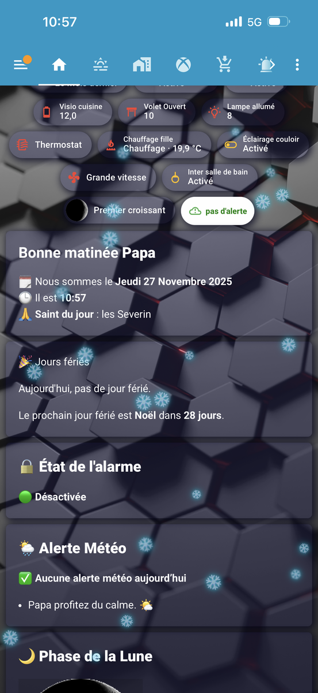


<p class="forum-cta"><a href="https://forumdomotique.com/forums/topic/542-home-assistant-nous-r%C3%A9serve-de-la-neige-cette-ann%C3%A9e/">Lire et commenter sur Forum Domotique</a></p>

# Home Assistant nous réserve de la neige cette année !

- **Catégorie :** [Café Domotique](https://forumdomotique.com/forums/85-caf%C3%A9-domotique/)
- **Sujet :** https://forumdomotique.com/forums/topic/542-home-assistant-nous-r%C3%A9serve-de-la-neige-cette-ann%C3%A9e/
- **Auteur du premier message du sujet :** XAV59213
- **Messages de XAV59213 dans ce sujet :** 3
- **Premier message de XAV59213 :** 27 novembre 2025 à 12:19 (Europe/Paris)
- **Dernier message de XAV59213 :** 1 décembre 2025 à 13:24 (Europe/Paris)

---

## Message 1 — 27 novembre 2025 à 12:19 (Europe/Paris)

- **Identifiant :** `1355`
- **Lien :** https://forumdomotique.com/forums/topic/542-home-assistant-nous-r%C3%A9serve-de-la-neige-cette-ann%C3%A9e/#findComment-1355



**Plus de détails sur le Winter Mode dans Home Assistant 2025.12**

Le **Winter Mode** ❄️ est la toute première fonctionnalité preview introduite dans Home Assistant Labs, une nouvelle section dédiée aux tests d’innovations avant leur intégration définitive. Comme indiqué dans les notes de version beta (et confirmée dans la RC du 26 novembre 2025), cette feature est purement ludique et saisonnière : une fois activée, elle métamorphose l’interface utilisateur de Home Assistant en un “paysage hivernal enchanté” avec de la neige qui tombe en arrière-plan. C’est conçu pour plonger les utilisateurs dans l’esprit des fêtes de fin d’année, ajoutant une touche festive sans impacter les fonctionnalités principales.

**Comment l’activer ?**

•  Allez dans **Paramètres > Système > Labs**.

•  Activez l’option “Winter Mode” dans la liste des fonctionnalités preview.

•  Vous avez l’option de créer une sauvegarde automatique avant l’activation, pour plus de sécurité.

•  Pas besoin de redémarrer Home Assistant – l’effet est immédiat !

•  Pour le désactiver, il suffit de décocher l’option, sans redémarrage non plus.

•  Par défaut, il est désactivé, et son activation n’affecte pas votre configuration existante.

**Fonctionnalités et retours de la communauté**

D’après les discussions sur Reddit (dans le thread dédié aux notes beta de 2025.12), les utilisateurs apprécient son aspect fun et humoristique. Par exemple :

•  Certains notent le contraste avec l’hémisphère sud, où c’est l’été en décembre (“Winter mode ! lol, meanwhile in the southern hemisphere 🌞”).

•  Des suggestions émergent pour l’étendre : ajouter d’autres thèmes météo (comme des orages liés à des entités réelles), ou l’intégrer à des automations pour un contrôle dynamique.

•  Un usage pratique mentionné : l’utiliser dans des automations pour ajuster des modes comme “Night mode”, qui pourrait s’activer plus tôt en hiver (basé sur la saison détectée par Winter Mode).

C’est une feature légère, testée et stable, mais qui pourrait évoluer ou disparaître en fonction des retours. Si vous testez la beta, rejoignez le canal #beta sur Discord pour partager vos impressions – les devs y sont actifs pour itérer.

---

## Message 2 — 28 novembre 2025 à 20:14 (Europe/Paris)

- **Identifiant :** `1389`
- **Lien :** https://forumdomotique.com/forums/topic/542-home-assistant-nous-r%C3%A9serve-de-la-neige-cette-ann%C3%A9e/#findComment-1389

D’ailleurs sur la dev il y a une refonte pour migrer vers la syntaxe moderne du yaml

Exemple avant

```yaml
switch:
  - platform: template
    switches:
      votre_switch:  # Remplacez par le nom de votre entité
        value_template: "{{ is_state('input_boolean.votre_entite', 'on') }}"
        turn_on:
          service: input_boolean.turn_on
          target:
            entity_id: input_boolean.votre_entite
        turn_off:
          service: input_boolean.turn_off
          target:
            entity_id: input_boolean.votre_entite
```

**nouvelle définition moderne sous la clé** template

```yaml
template:
  - switch:
      - entity_id: input_boolean.votre_entite  # L'entité source (ex. input_boolean)
        turn_on:
          action: input_boolean.turn_on  # Service pour allumer
        turn_off:
          - entity_id: input_boolean.votre_entite
            action: input_boolean.turn_off  # Service pour éteindre
        default_entity_id: switch.votre_switch  # ID par défaut du nouveau switch
        state: '{{ is_state("input_boolean.votre_entite", "on") }}'  # Template pour l'état
        name: Votre Switch  # Nom convivial
```

> **Il y a 4 heures, zerocool38 a dit :**
> hello comment va ?  
> c'est quoi de canal discord ?

Très bien et toi✌️

Lien du Discord bêta <https://rc.home-assistant.io/join-chat>

---

## Message 3 — 1 décembre 2025 à 13:24 (Europe/Paris)

- **Identifiant :** `1421`
- **Lien :** https://forumdomotique.com/forums/topic/542-home-assistant-nous-r%C3%A9serve-de-la-neige-cette-ann%C3%A9e/#findComment-1421

Salut [@Jyfy](https://forumdomotique.com/profile/227-jyfy/) 👋

Je test en bêta (les versions bêta 2025.12.0b0, b1 et b2 sont sorties fin novembre 2025),

la version stable devrait arriver très bientôt, avec une cérémonie de lancement en live stream prévue le 3 décembre 2025 à 20:00 GMT (21:00 CET) sur leur chaîne YouTube.

<https://www.youtube-nocookie.com/embed/8Zj0JiVoRNs?feature=oembed>

---

