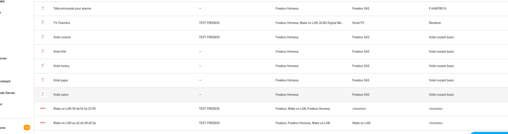

<a href="https://forumdomotique.com/forums/topic/56-probl%C3%A8me-de-d%C3%A9butant/">Lire et commenter sur Forum Domotique</a>

# Problème de débutant...

- **Catégorie :** [Box & Matériel](https://forumdomotique.com/forums/97-box-mat%C3%A9riel/)
- **Sujet :** https://forumdomotique.com/forums/topic/56-probl%C3%A8me-de-d%C3%A9butant/
- **Auteur du premier message du sujet :** un autre membre (XAV59213 a répondu dans ce sujet)
- **Messages de XAV59213 dans ce sujet :** 1
- **Premier message de XAV59213 :** 23 mai 2025 à 17:19 (Europe/Paris)

---

## Message 1 — 23 mai 2025 à 17:19 (Europe/Paris)

- **Identifiant :** `348`
- **Lien :** https://forumdomotique.com/forums/topic/56-probl%C3%A8me-de-d%C3%A9butant/#findComment-348

Salut [Patoc,](https://forumdomotique.com/profile/85-patoc/)

Si tu est chez free tu peux les ajouter sur freebox home et reconnu via mon intégration <https://github.com/XAV59213/freebox_homexa>
<!-- source : https://cdn.forumdomotique.com/monthly_2025_05/Capturedcrandu2025-05-2317-18-15.png.d6aec61cbb0df2db9f9a3889cda3679c.png -->

---
