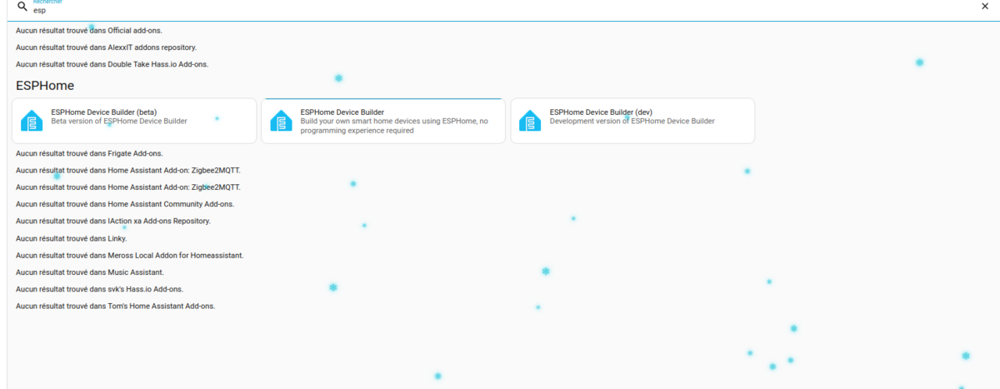
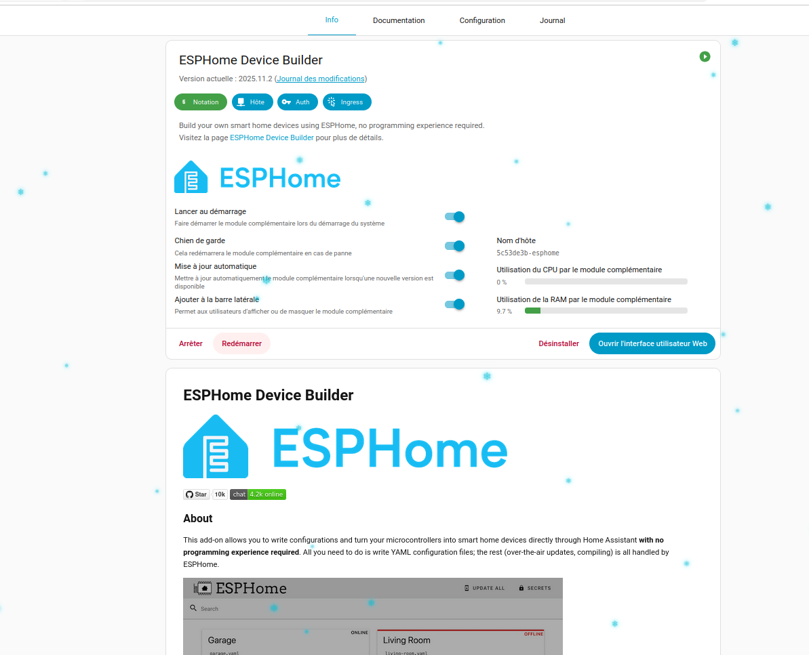
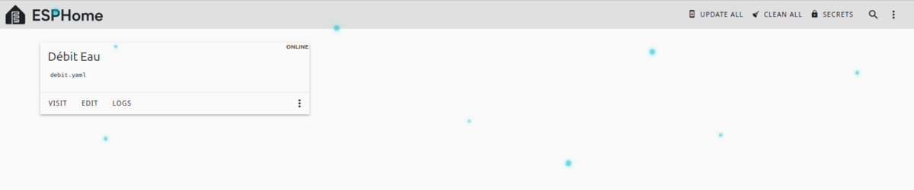
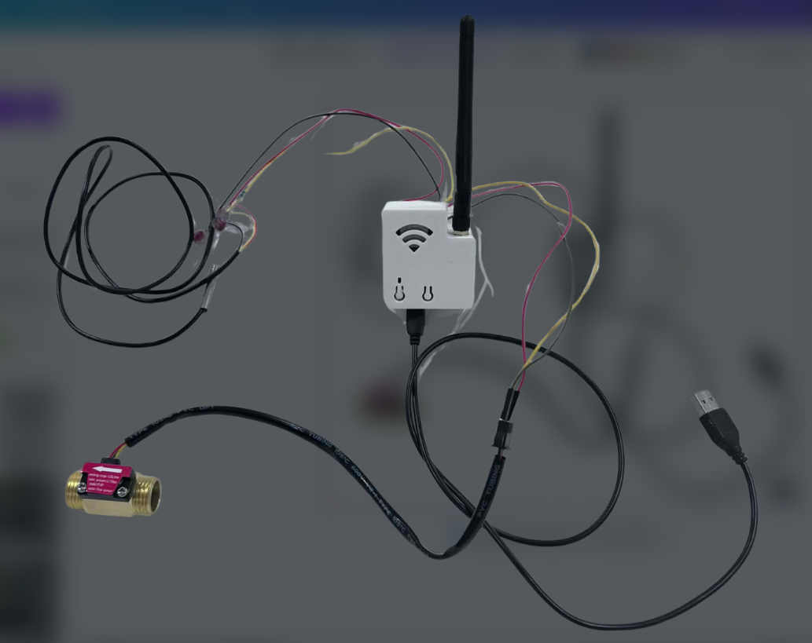
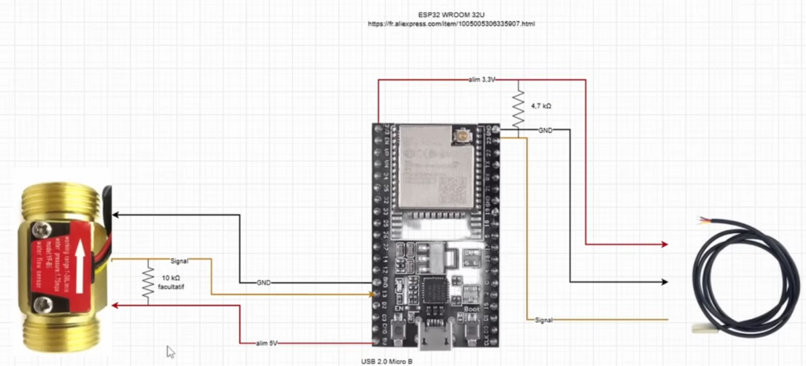
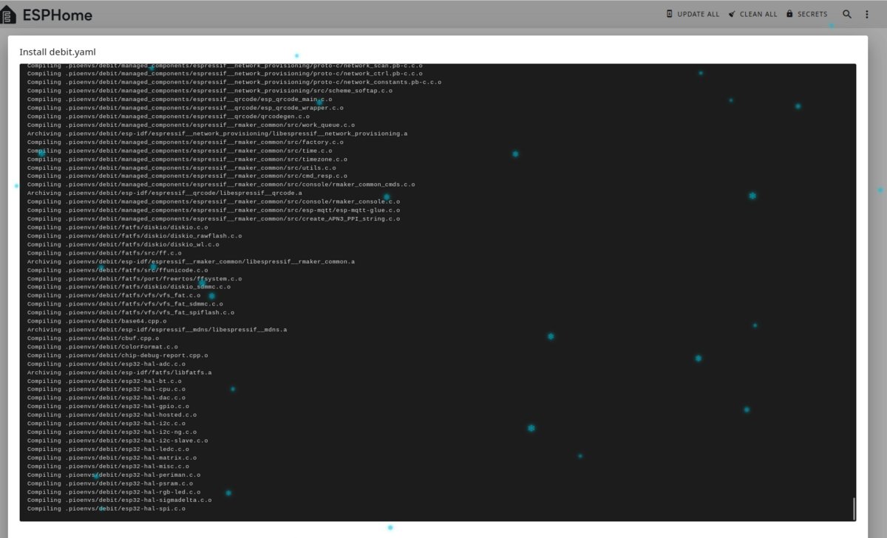
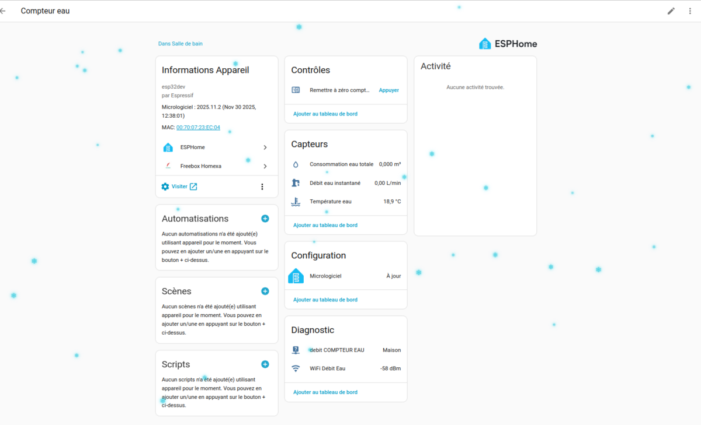
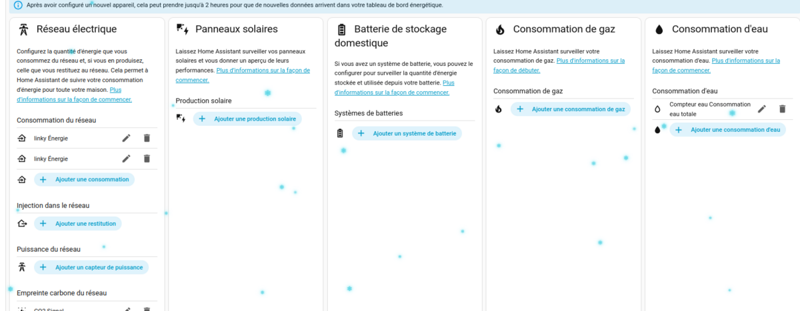
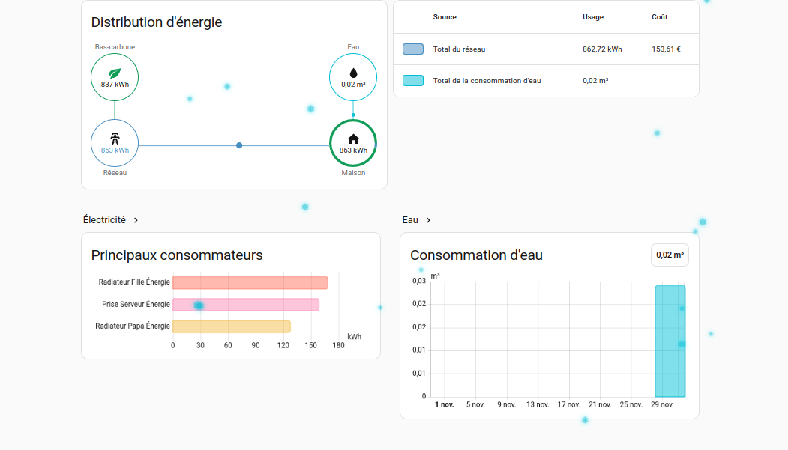

<p class="ha-note">Cette page conserve l’archive du message publié sur le forum. La version relue, avec les photos en local, se trouve dans <a href="{{ '/creations/compteur-deau-connecte-moins-de-20-euros/' | relative_url }}">Mes créations</a>.</p>

<p class="forum-cta"><a href="https://forumdomotique.com/forums/topic/567-compteur-deau-connect%C3%A9-%C3%A0-moins-de-20-%E2%82%AC-ma-consommation-enfin-sous-contr%C3%B4le-et-les-fuites-plus-jamais-une-surprise/">Lire et commenter sur Forum Domotique</a></p>


<section class="carousel photo-carousel" data-carousel data-lightbox aria-roledescription="carrousel" aria-label="Photos de l’article (9)" tabindex="0">
<div class="carousel-track" data-track>
<figure class="photo-slide" data-slide>
  <a href="images/Capturedcrandu2025-11-3014-11-10.png" data-full="images/Capturedcrandu2025-11-3014-11-10.png" data-alt="Photo 1 — Compteur d’eau connecté à moins de 20 € : ma consommation enfin sous contrôle (et les fuites plus jamais une surprise)" aria-label="Agrandir la photo 1 : Photo 1 — Compteur d’eau connecté à moins de 20 € : ma consommation enfin sous contrôle (et les fuites plus jamais une surprise)">
    
  </a>
</figure>
<figure class="photo-slide" data-slide>
  <a href="images/Capturedcrandu2025-11-3014-11-30.png" data-full="images/Capturedcrandu2025-11-3014-11-30.png" data-alt="Photo 2 — Compteur d’eau connecté à moins de 20 € : ma consommation enfin sous contrôle (et les fuites plus jamais une surprise)" aria-label="Agrandir la photo 2 : Photo 2 — Compteur d’eau connecté à moins de 20 € : ma consommation enfin sous contrôle (et les fuites plus jamais une surprise)">
    
  </a>
</figure>
<figure class="photo-slide" data-slide>
  <a href="images/Capturedcrandu2025-11-3012-30-06.png" data-full="images/Capturedcrandu2025-11-3012-30-06.png" data-alt="Photo 3 — Compteur d’eau connecté à moins de 20 € : ma consommation enfin sous contrôle (et les fuites plus jamais une surprise)" aria-label="Agrandir la photo 3 : Photo 3 — Compteur d’eau connecté à moins de 20 € : ma consommation enfin sous contrôle (et les fuites plus jamais une surprise)">
    
  </a>
</figure>
<figure class="photo-slide" data-slide>
  <a href="images/Capturedcrandu2025-11-3013-44-36.png" data-full="images/Capturedcrandu2025-11-3013-44-36.png" data-alt="Photo 4 — Compteur d’eau connecté à moins de 20 € : ma consommation enfin sous contrôle (et les fuites plus jamais une surprise)" aria-label="Agrandir la photo 4 : Photo 4 — Compteur d’eau connecté à moins de 20 € : ma consommation enfin sous contrôle (et les fuites plus jamais une surprise)">
    
  </a>
</figure>
<figure class="photo-slide" data-slide>
  <a href="images/Capturedcrandu2025-11-3013-47-19.png" data-full="images/Capturedcrandu2025-11-3013-47-19.png" data-alt="Photo 5 — Compteur d’eau connecté à moins de 20 € : ma consommation enfin sous contrôle (et les fuites plus jamais une surprise)" aria-label="Agrandir la photo 5 : Photo 5 — Compteur d’eau connecté à moins de 20 € : ma consommation enfin sous contrôle (et les fuites plus jamais une surprise)">
    
  </a>
</figure>
<figure class="photo-slide" data-slide>
  <a href="images/Capturedcrandu2025-11-3012-39-38.png" data-full="images/Capturedcrandu2025-11-3012-39-38.png" data-alt="Photo 6 — Compteur d’eau connecté à moins de 20 € : ma consommation enfin sous contrôle (et les fuites plus jamais une surprise)" aria-label="Agrandir la photo 6 : Photo 6 — Compteur d’eau connecté à moins de 20 € : ma consommation enfin sous contrôle (et les fuites plus jamais une surprise)">
    
  </a>
</figure>
<figure class="photo-slide" data-slide>
  <a href="images/Capturedcrandu2025-11-3012-42-45.png" data-full="images/Capturedcrandu2025-11-3012-42-45.png" data-alt="Photo 7 — Compteur d’eau connecté à moins de 20 € : ma consommation enfin sous contrôle (et les fuites plus jamais une surprise)" aria-label="Agrandir la photo 7 : Photo 7 — Compteur d’eau connecté à moins de 20 € : ma consommation enfin sous contrôle (et les fuites plus jamais une surprise)">
    
  </a>
</figure>
<figure class="photo-slide" data-slide>
  <a href="images/Capturedcrandu2025-11-3014-09-07.png" data-full="images/Capturedcrandu2025-11-3014-09-07.png" data-alt="Photo 8 — Compteur d’eau connecté à moins de 20 € : ma consommation enfin sous contrôle (et les fuites plus jamais une surprise)" aria-label="Agrandir la photo 8 : Photo 8 — Compteur d’eau connecté à moins de 20 € : ma consommation enfin sous contrôle (et les fuites plus jamais une surprise)">
    
  </a>
</figure>
<figure class="photo-slide" data-slide>
  <a href="images/Capturedcrandu2025-11-3014-08-47.png" data-full="images/Capturedcrandu2025-11-3014-08-47.png" data-alt="Photo 9 — Compteur d’eau connecté à moins de 20 € : ma consommation enfin sous contrôle (et les fuites plus jamais une surprise)" aria-label="Agrandir la photo 9 : Photo 9 — Compteur d’eau connecté à moins de 20 € : ma consommation enfin sous contrôle (et les fuites plus jamais une surprise)">
    
  </a>
</figure>
</div>
<button type="button" class="carousel-nav" data-prev aria-label="Photo précédente">‹</button>
<button type="button" class="carousel-nav" data-next aria-label="Photo suivante">›</button>
<div class="carousel-dots" data-dots></div>
<div class="carousel-live" data-live aria-live="polite"></div>
<p class="carousel-hint">Faites défiler les photos, ou ouvrez-les pour les agrandir (si JavaScript est activé).</p>
</section>

# Compteur d’eau connecté à moins de 20 € : ma consommation enfin sous contrôle (et les fuites plus jamais une surprise)

- **Catégorie :** [Projets et Personnalisations](https://forumdomotique.com/forums/12-projets-et-personnalisations/)
- **Sujet :** https://forumdomotique.com/forums/topic/567-compteur-deau-connect%C3%A9-%C3%A0-moins-de-20-%E2%82%AC-ma-consommation-enfin-sous-contr%C3%B4le-et-les-fuites-plus-jamais-une-surprise/
- **Auteur du premier message du sujet :** XAV59213
- **Messages de XAV59213 dans ce sujet :** 5
- **Premier message de XAV59213 :** 30 novembre 2025 à 14:27 (Europe/Paris)
- **Dernier message de XAV59213 :** 5 décembre 2025 à 14:23 (Europe/Paris)

---

## Message 1 — 30 novembre 2025 à 14:27 (Europe/Paris)

- **Identifiant :** `1402`
- **Lien :** https://forumdomotique.com/forums/topic/567-compteur-deau-connect%C3%A9-%C3%A0-moins-de-20-%E2%82%AC-ma-consommation-enfin-sous-contr%C3%B4le-et-les-fuites-plus-jamais-une-surprise/#findComment-1402

### J’ai mis un ESP32 sur mon compteur d’eau… et j’ai vraiment divisé ma facture par deux en trois mois

Cela faisait des années que je regardais ma facture d’eau arriver tous les six mois avec une petite boule au ventre. Maison des années 80, plomberie fatiguée, trois ados qui prennent des douches interminables et un jardin qui boit comme un chameau l’été : tout était réuni pour que ça grimpe vite. J’avais bien un compteur divisionnaire dans le garage, mais lire les petits chiffres rouges tous les jours, très peu pour moi.

Un soir, en scrollant les forums, je tombe sur un sujet où un gars explique qu’avec un débitmètre à 9 € et un ESP32 on peut suivre sa conso en temps réel dans Home Assistant, et surtout la voir apparaître directement dans le dashboard Énergie. Je me suis dit : si ça marche vraiment, c’est le projet le plus rentable de toute ma vie domotique. Trois semaines plus tard le colis AliExpress arrive, et je me lance…

Capteur de débit YF-B6 : [https://fr.aliexpress.com](https://fr.aliexpress.com/item/1005007272043498.html?aff_fcid=8a37210562f44b7eaba2ccc877648d6a-1764611022455-02886-_c3Mch87h&tt=CPS_NORMAL&aff_fsk=_c3Mch87h&aff_platform=shareComponent-detail&sk=_c3Mch87h&aff_trace_key=8a37210562f44b7eaba2ccc877648d6a-1764611022455-02886-_c3Mch87h&terminal_id=8506d2f27c78403fb5d3c198fe1b8d0d&afSmartRedirect=y)

Sonde T° DS18B20 (20x7.5x3.6 Head) : [https://fr.aliexpress.com/](https://fr.aliexpress.com/item/1005005488542048.html?aff_fcid=6aa8a09d290d4041b8f26125b8609ef7-1764610991776-08334-_c4PKbJ2P&tt=CPS_NORMAL&aff_fsk=_c4PKbJ2P&aff_platform=shareComponent-detail&sk=_c4PKbJ2P&aff_trace_key=6aa8a09d290d4041b8f26125b8609ef7-1764610991776-08334-_c4PKbJ2P&terminal_id=8506d2f27c78403fb5d3c198fe1b8d0d&afSmartRedirect=y)

ESP32 avec antenne Wifi : [https://fr.aliexpress.com/](https://fr.aliexpress.com/item/1005005306335907.html)

Comment j’ai installé ESPHome quand on part de rien À l’époque je tournais sous Home Assistant OS (sur un petit Intel NUC). Je n’avais jamais touché à ESPHome. Voici exactement ce que j’ai fait, étape par étape, et que tu peux copier-coller aujourd’hui sans réfléchir :

1. Dans Home Assistant → Paramètres → Modules complémentaires → Boutique des modules complémentaires (en bas à droite)
2. Recherche « ESPHome » → Installer la dernière version stable (à l’heure où j’écris c’est la 2025.11.2)
3. Une fois installé, cliquer sur Démarrer et cocher « Afficher dans la barre latérale »
4. L’interface ESPHome apparaît dans le menu de gauche. Clic sur le gros + orange « New Device » → donner un nom (j’ai mis « debit ») → Suivant → ESP32 → Skip (on flashera plus tard)

Et voilà, en trois clics ESPHome est opérationnel. Aucun terminal, aucun SSH, rien à installer à la main.


<!-- source : https://cdn.forumdomotique.com/monthly_2025_11/Capturedcrandu2025-11-3014-11-10.png.3a207f4790ea7ae8071c9c941ab6cad0.png -->


<!-- source : https://cdn.forumdomotique.com/monthly_2025_11/Capturedcrandu2025-11-3014-11-30.png.07430636c6b2170a11519d1605e8470a.png -->


<!-- source : https://cdn.forumdomotique.com/monthly_2025_11/Capturedcrandu2025-11-3012-30-06.png.f2f2fece8fa4f8362e7a1a18ab61784b.png -->

Le matériel que j’ai fini par garder Le grand classique : débitmètre YF-S201 en laiton rouge G3/¾", celui qui fait environ 300 impulsions par litre. Un ESP32 DevKitC ou WROOM-32 tout simple à 4-5 €. Une sonde DS18B20 étanche (facultatif mais pratique). Une boîte étanche 100 × 68 × 50 mm, un vieux chargeur 5 V 2 A, et surtout plus un seul câble Dupont dans la maison (je t’expliquerai pourquoi).

### Installation et mise en route : le guide pas-à-pas qui m’aurait fait gagner 3 soirées

Je vais te raconter exactement comment j’ai procédé du début à la fin, avec les choix que je referais aujourd’hui et ceux que je changerais.

Le matériel que j’ai utilisé J’ai pris le débitmètre le plus répandu, le YF-S201 (filetage ¾" laiton rouge) qui fait environ 300 impulsions par litre. Coût ≈ 9 € sur AliExpress. Pour la carte, un ESP32 classique « DevKitC » ou « WROOM-32U » à 4-5 €. Une sonde DS18B20 étanche avec câble de 1 m (optionnelle mais je la recommande). Une petite boîte étanche 100 × 68 × 50 mm, un vieux chargeur 5 V 1-2 A, et surtout plus de câbles Dupont (on en reparlera).


<!-- source : https://cdn.forumdomotique.com/monthly_2025_11/Capturedcrandu2025-11-3013-44-36.png.e084af470b8797793506e73d35d43d53.png -->

Le câblage définitif (plus jamais de faux contact) Au début j’avais tout branché en Dupont, ça a tenu trois semaines puis j’ai eu des coupures aléatoires. J’ai tout refait en fixe et depuis c’est du béton.

- Alimentation du débitmètre : fil rouge → 5 V de l’ESP (ou du chargeur)
- Masse : fil noir → GND commun
- Signal : fil jaune → GPIO13 + résistance pull-up 10kΩ entre le signal et le 5 V (j’ai mis la résistance directement sur la barrette à vis)
- Sonde DS18B20 : fil rouge → 3,3 V, fil noir → GND, fil jaune/blanc → GPIO23 + résistance pull-up 4,7 kΩ entre data et 3,3 V (classique)


<!-- source : https://cdn.forumdomotique.com/monthly_2025_11/Capturedcrandu2025-11-3013-47-19.png.6af94033182c32bc5f2a9b3026752c65.png -->

Tout est vissé sur une barrette à vis ou des Wago 221, gainé thermo, rangé dans la boîte étanche percée avec des presse-étoupe. L’ESP est alimenté par un vieux chargeur téléphone via le port micro-USB.

Le YAML qui marche à tous les coups en 2025.11 Voici le fichier complet que j’utilise aujourd’hui. Tu le copies-colles tel quel, tu changes juste ton SSID/mot de passe Wi-Fi et l’IP fixe si tu veux.

```yaml
esphome:
  name: debit
  friendly_name: Débit Eau

esp32:
  board: esp32dev
  framework:
    type: arduino

logger:

api:
  encryption:
    key: "REDACTE"  # clé d’API retirée de cette sauvegarde publique

ota:
  - platform: esphome
    password: "REDACTE"  # mot de passe retiré de cette sauvegarde publique

wifi:
  ssid: !secret wifi_ssid
  password: !secret wifi_password
  manual_ip:
    static_ip: 192.168.0.93
    gateway: 192.168.0.254
    subnet: 255.255.255.0
  fast_connect: true

  ap:
    ssid: "Debit Fallback"
    password: "REDACTE"  # mot de passe retiré de cette sauvegarde publique

captive_portal:

one_wire:
  - platform: gpio
    pin: GPIO23

sensor:
  - platform: wifi_signal
    name: "WiFi Débit Eau"
    update_interval: 300s

  - platform: dallas_temp
    name: "Température eau"
    device_class: temperature
    unit_of_measurement: "°C"
    accuracy_decimals: 1
    update_interval: 60s
    icon: mdi:coolant-temperature

  - platform: pulse_meter
    name: "Débit eau instantané"
    id: debit_eau
    pin:
      number: GPIO13
      mode: INPUT_PULLUP
      inverted: false
    unit_of_measurement: "L/min"
    device_class: water
    state_class: measurement
    accuracy_decimals: 2
    icon: mdi:water-pump
    timeout: 15s
    filters:
      - lambda: return x / 300.0;

    total:
      name: "Consommation eau totale"
      id: conso_eau_total_m3
      unit_of_measurement: "m³"
      device_class: water
      state_class: total_increasing
      accuracy_decimals: 3
      icon: mdi:water-outline
      filters:
        - lambda: return x / 300000.0;

time:
  - platform: homeassistant
    id: ha_time

button:
  - platform: template
    name: "Remettre à zéro compteur eau"
    icon: mdi:counter
    on_press:
      then:
        - pulse_meter.set_total_pulses:
            id: debit_eau
            value: 0
        - lambda: id(conso_eau_total_m3).publish_state(0.0);
        - homeassistant.service:
            service: input_text.set_value
            data:
              entity_id: input_text.last_reset_compteur_eau https://fr.aliexpress.com/item/1005007272043498.html?aff_fcid=8a37210562f44b7eaba2ccc877648d6a-1764611022455-02886-_c3Mch87h&tt=CPS_NORMAL&aff_fsk=_c3Mch87h&aff_platform=shareComponent-detail&sk=_c3Mch87h&aff_trace_key=8a37210562f44b7eaba2ccc877648d6a-1764611022455-02886-_c3Mch87h&terminal_id=8506d2f27c78403fb5d3c198fe1b8d0d&afSmartRedirect=y
              value: !lambda |
                auto t = id(ha_time).now();
                char str[20];
                snprintf(str, sizeof(str), "%04d-%02d-%02d %02d:%02d",
                         t.year, t.month, t.day_of_month, t.hour, t.minute);
                return std::string(str);
```

Flasher et première mise en route Dans ESPHome dashboard → Add device → tu colles le YAML → Install → Wireless (ou USB la première fois directement sur ton home assistant). À la première compilation tu auras peut-être l’erreur de linker OneWire que tout le monde a eu avec la 2025.11 : il suffit de cliquer sur les trois points de l’appareil → Clean Build Files puis recompiler. Ça passe du premier coup ensuite.


<!-- source : https://cdn.forumdomotique.com/monthly_2025_11/Capturedcrandu2025-11-3012-39-38.png.eec309a9f78f39a1a92ec1f8f6342942.png -->

Une fois l’ESP en ligne, tu auras immédiatement dans Home Assistant :

- sensor.débit_eau_instantané
- sensor.consommation_eau_totale (celle qui apparaît toute seule dans le dashboard Énergie → Eau)
- sensor.température_eau


<!-- source : https://cdn.forumdomotique.com/monthly_2025_11/Capturedcrandu2025-11-3012-42-45.png.14988c5337f2c50c7349b5c96c912913.png -->

Intégration dans le dashboard Énergie Paramètres → Tableaux de bord → Énergie → Ajouter consommation → Eau → tu sélectionnes Consommation eau totale → Valider. C’est tout. Pas de Riemann sum, pas d’utility meter, rien d’autre.


<!-- source : https://cdn.forumdomotique.com/monthly_2025_11/Capturedcrandu2025-11-3014-09-07.png.805aed496b12a75cb7e4aa4b0ab429b2.png -->


<!-- source : https://cdn.forumdomotique.com/monthly_2025_11/Capturedcrandu2025-11-3014-08-47.png.b5d4c1e37114d4c3a7daa534dd303f9a.png -->

Le petit plus que j’ai ajouté ensuite Un card Lovelace toute simple pour voir le débit en temps réel et le bouton reset :

```yaml
type: vertical-stack
cards:
  - type: entities
    entities:
      - entity: sensor.débit_eau_instantané
      - entity: sensor.consommation_eau_totale
      - entity: sensor.température_eau
      - entity: button.remettre_à_zéro_compteur_eau
```

Et voilà. En une soirée (ou deux si tu fais l’erreur des Dupont comme moi) tu as un compteur d’eau ultra-précis, 100 % local, qui te suit au litre près et qui te fait économiser de l’argent dès le premier mois.

Si tu suis ces étapes à la lettre, ça marche à tous les coups, même avec la dernière version d’ESPHome. Et surtout, tu n’auras plus jamais à y retoucher.

---

## Message 2 — 1 décembre 2025 à 16:00 (Europe/Paris)

- **Identifiant :** `1426`
- **Lien :** https://forumdomotique.com/forums/topic/567-compteur-deau-connect%C3%A9-%C3%A0-moins-de-20-%E2%82%AC-ma-consommation-enfin-sous-contr%C3%B4le-et-les-fuites-plus-jamais-une-surprise/#findComment-1426

Haha la plomberie, le pire cauchemar, je valide à 1000% 😅

Mais là zéro stress : j’ai du 15/21 avec des flexibles de chaque côté, donc j’ai juste dévissé les flexibles (30 secondes), glissé mon petit module perso au milieu, et revissé dessus. Aucun joint à refaire, pas de soudure, et je peux tout déposer en 1 minute si jamais j’ai besoin.

Je te balance les photos de l’installation dans la salle de bain une fois terminé : le module est posé à côté de ma nourrice, bien visible et hyper accessible (le boîtier Wi-Fi est juste à côté, fixé au mur avec du scotch double-face, on dirait presque que c’était prévu 😂).

Tu verras, même avec la flemme cosmique en plomberie c’est à la portée de n’importe qui et totalement réversible.

---

## Message 3 — 1 décembre 2025 à 18:21 (Europe/Paris)

- **Identifiant :** `1435`
- **Lien :** https://forumdomotique.com/forums/topic/567-compteur-deau-connect%C3%A9-%C3%A0-moins-de-20-%E2%82%AC-ma-consommation-enfin-sous-contr%C3%B4le-et-les-fuites-plus-jamais-une-surprise/#findComment-1435

Pour répondre à la question principale de [@Pierre](https://forumdomotique.com/profile/349-pierre/) (et oui tu as raison, j’ai un peu zappé l’explication dans le tuto, je me suis trop focalisé sur le « comment faire ») :

Concrètement, avoir le débit en temps réel + la courbe de conso journalière sous les yeux tous les jours, ça change TOUT sur le comportement de toute la famille 5 enfants.

Ce qui nous bouffait le plus d’eau (et qu’on ne voyait ABSOLUMENT pas avant) :

1. Les chasses d’eau qui fuient en continu → une chasse qui « goutte » en permanence, c’est facile 10–15 m³ sur 6 mois sans que personne ne s’en rende compte. Avec le débit instantané, tu vois direct un petit 0,3–0,8 L/min qui reste tout le temps, même la nuit. J’en ai réparé deux en deux semaines (joint de clappe à 3 € pièce).
2. Les ados et leurs douches de 25 minutes → maintenant ils voient la courbe qui monte en flèche sur le tableau de bord du salon dès qu’ils passent en mode « concert de chant sous l’eau » 😂. Résultat : douches divisées par deux en durée, sans même que je dise quoi que ce soit.
3. Le goutte-à-goutte du jardin que j’oubliais d’éteindre la nuit ou le lendemain, pour mes fraises.→ là aussi tu vois la conso qui continue alors que tout le monde dort ou est parti bosser. J’ai rajouté une vanne motorisée derrière, mais déjà juste le fait de voir la courbe m’a fait gagner 4–5 m³ par mois l’été.
4. Une micro-fuite sur l’arrivée machine à laver (un joint détérioré) → 0,1 L/min en permanence = ~130 m³/an quand même… Réparé en 10 minutes une fois détecté.

Bref, en trois mois on est passés de ~165 m³/semestre à 78 m³/semestre (factures à l’appui). C’est pas le capteur qui a réparé les fuites tout seul, c’est juste qu’on les a enfin VUES. Avant je lisais le compteur tous les 36 du mois, donc impossible de savoir quand et où ça fuyait.

Et comme dit [@filoo](https://forumdomotique.com/profile/232-filoo/) c’est exactement le même principe que la conso électrique quand tu mets un beau dashboard énergie : tu changes tes habitudes sans même t’en rendre compte.

Petit update depuis le tuto : le premier que j’ai mis (celui du tuto) est toujours sur le compteur général (eau ). Mais maintenant j’en ai 5 au total :

- 1 sur le compteur général (arrivée maison)
- 1 sur le ballon d’eau chaude
- 1 sur chaque WC (deux lignes séparées)
- 1 sur l’arrosage extérieur + machine à laver

Du coup dans le dashboard Énergie j’ai même un petit graphique « par usage » et quand une chasse fuit… c’est immédiat, la ligne « WC1 » ou « WC2 » reste à 0,4–0,6 L/min toute la nuit 😅. C’est devenu mon détecteur de fuites ultime.

Et comme je l’avais déjà dit à [@CedricMD](https://forumdomotique.com/profile/7-cedricmd/) dans les commentaires : tout le tuto est fait sur du tuyau cuivre 15/21 (diamètre extérieur 15 mm), c’est le standard le plus répandu en France dans les maisons des années 70–90. N’importe quel plombier te dira que le YF-S201 (ou YF-B6) en G3/4" se monte direct avec deux raccords laiton PER ↔ filetés15/21, zéro adaptation bizarre, zéro risque, et zéro perte de charge notable.

> **il y a 27 minutes, filoo a dit :**
> Je suppose qu'en ayant le nez sur des consommations instantanées on arrive à mieux gérer justement cette consommation.   
> C'est comme l'énergie électrique, le fait d'avoir un oeil en "permanence" sur la consommation on arrive à modifier ça manière de faire. Éteindre certains appareils, des appareils en veilles inutilement, etc...
>
> Dis-moi [@XAV59213](https://forumdomotique.com/profile/106-xav59213/) où as-tu déniché ce petit boîtier pour le ESP32 ? 😉

Capteur de débit YF-B6 : [https://s.click.aliexpress.com/e/_c3M...](https://fr.aliexpress.com/item/1005007272043498.html?aff_fcid=8a37210562f44b7eaba2ccc877648d6a-1764611022455-02886-_c3Mch87h&tt=CPS_NORMAL&aff_fsk=_c3Mch87h&aff_platform=shareComponent-detail&sk=_c3Mch87h&aff_trace_key=8a37210562f44b7eaba2ccc877648d6a-1764611022455-02886-_c3Mch87h&terminal_id=8506d2f27c78403fb5d3c198fe1b8d0d&afSmartRedirect=y)

Sonde T° DS18B20 (20x7.5x3.6 Head) : [https://s.click.aliexpress.com/e/_c4P...](https://fr.aliexpress.com/item/1005005488542048.html?aff_fcid=6aa8a09d290d4041b8f26125b8609ef7-1764610991776-08334-_c4PKbJ2P&tt=CPS_NORMAL&aff_fsk=_c4PKbJ2P&aff_platform=shareComponent-detail&sk=_c4PKbJ2P&aff_trace_key=6aa8a09d290d4041b8f26125b8609ef7-1764610991776-08334-_c4PKbJ2P&terminal_id=8506d2f27c78403fb5d3c198fe1b8d0d&afSmartRedirect=y)

ESP32 avec antenne Wifi : [https://fr.aliexpress.com/item/100500...](https://fr.aliexpress.com/item/1005005306335907.html)

Et pour conclure Il n’y a pas vraiment de limite avec Home Assistant, tout est une question d’adapter l’outil à tes besoins.

---

## Message 4 — 1 décembre 2025 à 21:16 (Europe/Paris)

- **Identifiant :** `1441`
- **Lien :** https://forumdomotique.com/forums/topic/567-compteur-deau-connect%C3%A9-%C3%A0-moins-de-20-%E2%82%AC-ma-consommation-enfin-sous-contr%C3%B4le-et-les-fuites-plus-jamais-une-surprise/#findComment-1441

En sortie compteur c’est du 20x27 (3/4 de pouce) adapte juste le débitmètre en conséquence

---

## Message 5 — 5 décembre 2025 à 14:23 (Europe/Paris)

- **Identifiant :** `1481`
- **Lien :** https://forumdomotique.com/forums/topic/567-compteur-deau-connect%C3%A9-%C3%A0-moins-de-20-%E2%82%AC-ma-consommation-enfin-sous-contr%C3%B4le-et-les-fuites-plus-jamais-une-surprise/#findComment-1481

> **Le 01/12/2025 à 18:11, filoo a dit :**
> Je suppose qu'en ayant le nez sur des consommations instantanées on arrive à mieux gérer justement cette consommation.   
> C'est comme l'énergie électrique, le fait d'avoir un oeil en "permanence" sur la consommation on arrive à modifier ça manière de faire. Éteindre certains appareils, des appareils en veilles inutilement, etc...
>
> Dis-moi [@XAV59213](https://forumdomotique.com/profile/106-xav59213/) où as-tu déniché ce petit boîtier pour le ESP32 ? 😉

Je dois encore modifier un peu le stl pour ajouter un support mural (au cas où il faudrait faire de la maintenance plus tard). Une fois que ce sera fini et que ça imprimera nickel, je le partagerai !

---
