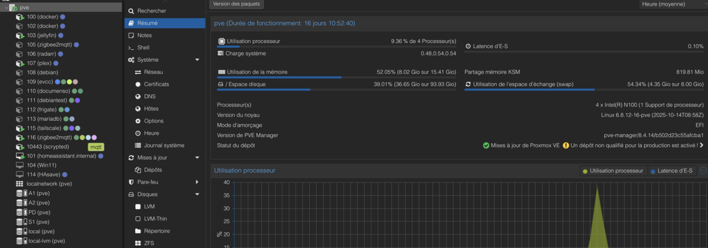
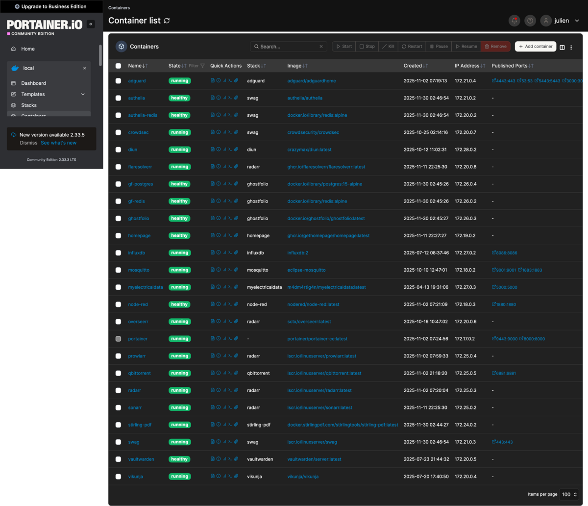

<a href="https://forumdomotique.com/forums/topic/568-creation-nouvelle-installation-ha/">Lire et commenter sur Forum Domotique</a>

# creation nouvelle installation HA

- **Catégorie :** [Bien débuter en domotique](https://forumdomotique.com/forums/99-bien-d%C3%A9buter-en-domotique/)
- **Sujet :** https://forumdomotique.com/forums/topic/568-creation-nouvelle-installation-ha/
- **Auteur du premier message du sujet :** un autre membre (XAV59213 a répondu dans ce sujet)
- **Messages de XAV59213 dans ce sujet :** 3
- **Premier message de XAV59213 :** 30 novembre 2025 à 15:24 (Europe/Paris)
- **Dernier message de XAV59213 :** 2 décembre 2025 à 08:45 (Europe/Paris)

---

## Message 1 — 30 novembre 2025 à 15:24 (Europe/Paris)

- **Identifiant :** `1404`
- **Lien :** https://forumdomotique.com/forums/topic/568-creation-nouvelle-installation-ha/#findComment-1404

> **il y a 46 minutes, iq164 a dit :**
> Bonjour a tous
>
> j’ai un projet d’installer HAOS sur un N100 de 8 go de RAM est 256 go SSD que j’ai déjà, avec un slzb 06 en Ethernet est zigbee2mqtt
>
> Sur ce N100 j’ai un emplacement pour mettre un SSD.
>
> Je compte mettre un petit SSD de 64 Go pour home assistant, est utilisé les 256 go avec le module
>
> samba share pour le partage de certain petit fichier pas pour en faire un nas bien sur c est pas le but.
>
> Est je voudrais installer aussi le module ad-guard pour le blocage de pub.
>
> D’âpres vous cela fonctionnerais ? ou je part plutôt sur l’installation de proxmox avec des vm sur le N100 bien que avec 8go cela va etre limité?

Salut [@iq164](https://forumdomotique.com/profile/750-iq164/) et bienvenue ! 😇

Oui, ton projet va très bien fonctionner en HAOS natif (sans Proxmox), et c’est même largement la meilleure solution dans ton cas avec seulement 8 Go de RAM.

Voici pourquoi je te conseille fortement de rester sur HAOS nu plutôt que Proxmox :

### Pourquoi HAOS directement sur le N100 est parfait ici

- Un Intel N100 (4 cœurs Alder Lake-N) + 8 Go RAM + SSD est une config extrêmement confortable pour Home Assistant OS + Zigbee2MQTT + AdGuard Home + Samba share.
- Consommation réelle en idle : ~6-8 W → avec HAOS seul avec tous tes add-ons : tu vas tourner à ~1,5-2,5 Go de RAM utilisée en permanence, même avec AdGuard, Zigbee2MQTT, Frigate (si tu en mets un jour), Node-RED, etc.
- Tu gardes les 256 Go pour ton partage Samba + éventuelles bases de données MariaDB, backups, etc.
- Le petit SSD 64 Go pour HAOS lui-même → parfait (HAOS prend ~10-15 Go installé avec plein d’add-ons, donc tu as une marge énorme).

### Ce que tu peux faire très facilement en HAOS (tout en add-ons officiels ou supervisés)

- AdGuard Home → add-on officiel ultra léger et très efficace
- Zigbee2MQTT → add-on officiel (SLZB-06 reconnu instantanément en Ethernet)
- Samba share → add-on officiel (tu montes ton disque 256 Go sans problème)
- Mosquitto broker, Node-RED, MariaDB, etc. → tout passe crème

### Pourquoi Proxmox est une mauvaise idée avec 8 Go de RAM

- Tu perds ~1 à 1,5 Go juste pour Proxmox + overhead de virtualisation
- Tu te retrouves avec 2 machines à maintenir au lieu d’une
- Tu compliques les passerelles USB/Ethernet (le SLZB-06 en Ethernet passe très bien en passthrough, mais c’est une étape inutile)
- Si un jour tu veux mettre Frigate avec Coral ou caméra 4K, tu seras déjà juste en RAM avec Proxmox, alors que tu seras large en HAOS natif

### Config que je te conseille à 100 %

- SSD 64 Go → installation HAOS (tu peux même prendre du 32 Go, ça suffit largement)
- SSD 256 Go → monté dans HAOS → utilisé pour :

  - Partage Samba (films de vacances, documents, etc.)
  - Base de données MariaDB si tu en as besoin
  - Stockage des enregistrements Frigate le jour où tu en mettras
- RAM : tu laisses les 8 Go tels quels (pas besoin de plus pour ton usage)

### Conclusion

Installe HAOS en direct sur le N100 → tu auras une machine :

- Ultra réactive
- Très économe (6-12 W en charge)
- Capable de faire bien plus que ce que tu prévois aujourd’hui
- Simple à sauvegarder et restaurer

Tu seras tranquille pendant des années. Proxmox, garde ça pour quand tu auras 32 Go de RAM et que tu voudras vraiment séparer plein de services critiques.

---

## Message 2 — 2 décembre 2025 à 00:44 (Europe/Paris)

- **Identifiant :** `1447`
- **Lien :** https://forumdomotique.com/forums/topic/568-creation-nouvelle-installation-ha/#findComment-1447

> **Il y a 1 heure, Ellywick a dit :**
> Je pense que tu peux vraiment partir sur Proxmox si tu en a envie. Je tourne sur un N100 également et je suis à 8/16go de ram consommé avec plusieurs VM, LXC et container docker.
>
> 
>
> 

Salut [@Ellywick](https://forumdomotique.com/profile/131-ellywick/) ,

Ton homeassitant production est sur proxmox avec tous tes lxc et vm ?

---

## Message 3 — 2 décembre 2025 à 08:45 (Europe/Paris)

- **Identifiant :** `1449`
- **Lien :** https://forumdomotique.com/forums/topic/568-creation-nouvelle-installation-ha/#findComment-1449

[@Ellywick](https://forumdomotique.com/profile/131-ellywick/)

Ok je comprends mieux 👍

---
