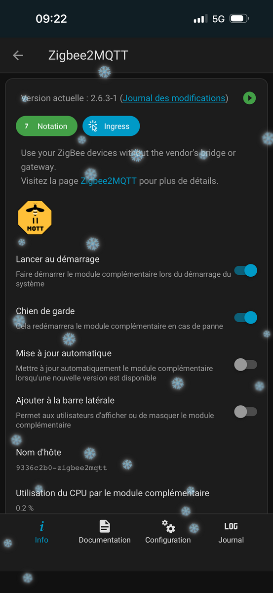
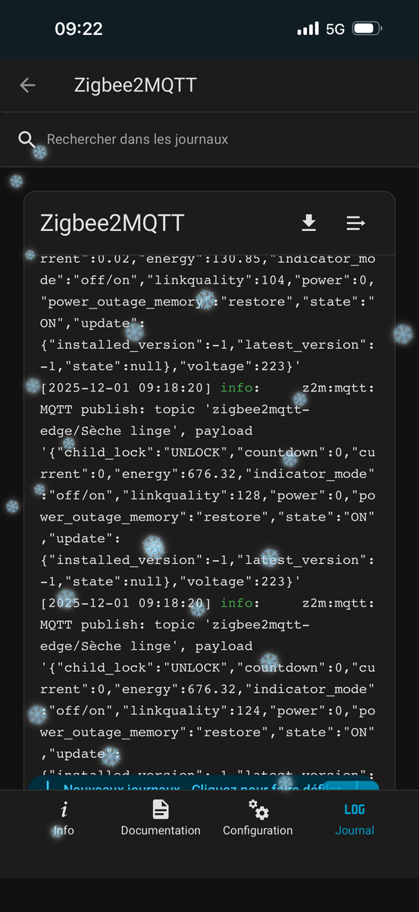

# Installation Z2M avec SLZB-06M

- **Catégorie :** [Zigbee](https://forumdomotique.com/forums/60-zigbee/)
- **Sujet :** https://forumdomotique.com/forums/topic/572-installation-z2m-avec-slzb-06m/
- **Auteur du premier message du sujet :** un autre membre (XAV59213 a répondu dans ce sujet)
- **Messages de XAV59213 dans ce sujet :** 2
- **Premier message de XAV59213 :** 1 décembre 2025 à 09:21 (Europe/Paris)
- **Dernier message de XAV59213 :** 1 décembre 2025 à 12:59 (Europe/Paris)

---

## Message 1 — 1 décembre 2025 à 09:21 (Europe/Paris)

- **Identifiant :** `1413`
- **Lien :** https://forumdomotique.com/forums/topic/572-installation-z2m-avec-slzb-06m/#findComment-1413

Salut [@Jyfy](https://forumdomotique.com/profile/227-jyfy/) ,

Peux-Tu nous transmettre les logs pour pouvoir répondre à ta demande ?


<!-- source : https://cdn.forumdomotique.com/monthly_2025_12/IMG_6343.png.30e7a22b2ca9a001309e8b8797041753.png -->

**Instructions pour accéder aux logs de Zigbee2MQTT :**

1.  **Ouvre l’interface de Home Assistant** : Connecte-toi à ton instance Home Assistant via un navigateur web (généralement à l’adresse <http://homeassistant.local:8123> ou l’IP de ton serveur).

2.  **Accède aux Paramètres** : Dans la barre latérale gauche, clique sur **Paramètres** (ou “Settings” si ton interface est en anglais).

3.  **Va dans les Add-ons** : Dans le menu des Paramètres, sélectionne **Add-ons** (ou “Extensions” en français). Cela t’amènera à la liste des add-ons installés.

4.  **Trouve Zigbee2MQTT** : Dans la liste des add-ons, cherche et clique sur **Zigbee2MQTT**. Si tu ne le vois pas, assure-toi qu’il est bien installé (via le magasin d’add-ons si nécessaire).

5.  **Accède aux logs** : Une fois sur la page de l’add-on Zigbee2MQTT, clique sur l’onglet **Journal** (ou “Log” en anglais). Tu verras ici les logs en temps réel ou les historiques récents.


<!-- source : https://cdn.forumdomotique.com/monthly_2025_12/IMG_6344.png.156d3f37a4caedae4859b4b8f08bd6b9.png -->

6.  **Copie ou télécharge les logs** :

•  Pour copier : Sélectionne le texte des logs avec ta souris, fais un copier-coller (Ctrl+C / Cmd+C).

•  Si l’option est disponible, utilise le bouton pour télécharger les logs sous forme de fichier texte.

•  Si les logs sont trop longs, tu peux filtrer par date ou erreur spécifique si l’interface le permet.

7.  **Envoie-moi les logs** : Une fois copiés ou téléchargés, envoie-les

Si Zigbee2MQTT n’est pas installé comme add-on mais via une intégration manuelle (par exemple en Docker ou directement sur le système), les logs pourraient être dans le fichier de configuration ou via la commande console (comme docker logs <container_id>). Dans ce cas, précise-moi plus de détails sur ta configuration pour affiner les instructions !

---

## Message 2 — 1 décembre 2025 à 12:59 (Europe/Paris)

- **Identifiant :** `1419`
- **Lien :** https://forumdomotique.com/forums/topic/572-installation-z2m-avec-slzb-06m/#findComment-1419

Salut [@Jyfy](https://forumdomotique.com/profile/227-jyfy/) !

Ton problème est très clair dans tes logs, tu as 2 erreurs qui reviennent tout le temps :

```plaintext
error: zh:ember:uart:ash: Port Error: read ECONNRESET

error: zh:ember: Adapter fatal error: ERROR_SERIAL_INIT

error: z2m: Adapter disconnected, stopping

et parfois :

getaddrinfo ENOTFOUND slzb-06.local
```

C’est du 100 % classique avec le SLZB-06.

Cela veut dire que la connexion réseau entre Zigbee2MQTT et le SLZB-06 se coupe sans raison.

Les causes les plus fréquentes :

• Firmware du SLZB-06 trop ancien (versions avant août 2024 = très instables)

• Utilisation de slzb-06.local au lieu d’une IP fixe (mDNS passe très mal dans Docker/HA OS)

• Alimentation USB instable ou câble/hub qui coupe

• Deux instances Zigbee2MQTT lancées en même temps

Solution (à faire dans cet ordre)

[1] Donne une IP fixe à ton SLZB-06 (réserve-la dans ta box ou configure-la en statique via l’interface web du SLZB-06)

[2] Modifie ton configuration.yaml:

```plaintext
# ANCIEN (à virer)

serial:

  port: tcp://slzb-06.local:6638

# NOUVEAU (à mettre)

serial:

  port: tcp://192.168.1.42:6638    # ← remplace par la vraie IP fixe du SLZB-06
```

[3] Mets à jour le firmware du SLZB-06 → dernière version ici :

https://smlight.tech/manual/slzb-06/flashing/ (prends au minimum la version 2024-11-07 ou plus récente)

[4] Redémarre Zigbee2MQTT → normalement plus jamais de déconnexion.

Pour être sûr à 100 %, peux-tu coller ici ton configuration.yaml actuel (sans les mots de passe MQTT) ?

Je te dis en 10 secondes si tout est bon.

Tu vas voir, une fois l’IP fixe + firmware à jour, c’est du béton

---
