
<p class="forum-cta"><a href="https://forumdomotique.com/forums/topic/577-faire-ses-premiers-dashboards-vraiment-sympas-avec-mushroom-cards-mon-retour-apr%C3%A8s-plusieurs-mois-dutilisation-intensive-sur-home-assistant/">Lire et commenter sur Forum Domotique</a></p>

# Faire ses premiers dashboards vraiment sympas avec Mushroom Cards : mon retour après plusieurs mois d’utilisation intensive sur home assistant

- **Catégorie :** [Intégrations et Add-ons](https://forumdomotique.com/forums/11-int%C3%A9grations-et-add-ons/)
- **Sujet :** https://forumdomotique.com/forums/topic/577-faire-ses-premiers-dashboards-vraiment-sympas-avec-mushroom-cards-mon-retour-apr%C3%A8s-plusieurs-mois-dutilisation-intensive-sur-home-assistant/
- **Auteur du premier message du sujet :** XAV59213
- **Messages de XAV59213 dans ce sujet :** 1
- **Premier message de XAV59213 :** 1 décembre 2025 à 18:11 (Europe/Paris)

---

## Message 1 — 1 décembre 2025 à 18:11 (Europe/Paris)

- **Identifiant :** `1433`
- **Lien :** https://forumdomotique.com/forums/topic/577-faire-ses-premiers-dashboards-vraiment-sympas-avec-mushroom-cards-mon-retour-apr%C3%A8s-plusieurs-mois-dutilisation-intensive-sur-home-assistant/#findComment-1433

#### Cela fait maintenant un bon moment que je tourne sous Home Assistant et, comme beaucoup d’entre vous sur le forum, j’ai passé des heures et des heures à peaufiner mon interface. Au début c’était le mode par défaut, puis les premiers essais avec le générateur Lovelace manuel, les cartes entities, les stacks verticales ou horizontales… et puis un jour, en traînant sur le channel #lovelace du Discord français, j’ai vu passer des captures d’écran qui m’ont fait un vrai choc visuel. Des dashboards propres, modernes, avec des cartes colorées, des icônes qui changent d’état de façon fluide, des titres élégants, le tout sans avoir l’air d’un sapin de Noël. Le secret ? Les **Mushroom Cards**.

Je me suis dit : « encore une mode qui va durer trois mois ». Et puis j’ai installé le premier pack, juste pour voir. Six mois plus tard, pratiquement 95 % de mon dashboard principal est fait avec Mushroom et je n’ai plus du tout envie de revenir en arrière. Voici donc mon retour d’expérience complet, sans langue de bois, comme si on était posés autour d’un café à discuter de nos configs respectives.Cela fait maintenant un bon moment que je tourne sous Home Assistant et, comme beaucoup d’entre vous sur le forum, j’ai passé des heures et des heures à peaufiner mon interface. Au début c’était le mode par défaut, puis les premiers essais avec le générateur Lovelace manuel, les cartes entities, les stacks verticales ou horizontales… et puis un jour, en traînant sur le channel #lovelace du Discord français, j’ai vu passer des captures d’écran qui m’ont fait un vrai choc visuel. Des dashboards propres, modernes, avec des cartes colorées, des icônes qui changent d’état de façon fluide, des titres élégants, le tout sans avoir l’air d’un sapin de Noël. Le secret ? Les **Mushroom Cards**.

### Pourquoi j’ai craqué pour Mushroom alors que j’étais déjà à l’aise avec Lovelace classique

Avant Mushroom, j’avais un dashboard qui faisait le job : une page par pièce, des groupes de lumières, des cartes weather, des capteurs, quelques picture-elements pour placer les icônes aux bons endroits. C’était fonctionnel, mais ça restait très « Home Assistant 2018 ». Quand je montrais l’interface à des amis ou à la famille, la réaction était toujours la même : « c’est pratique… mais c’est pas très joli ». Et franchement, ils n’avaient pas tort.

Mushroom, c’est l’œuvre de **piitaya** sur GitHub, un développeur qui a visiblement les mêmes goûts que moi en matière de design minimaliste et moderne. L’idée est simple : proposer une suite de cartes ultra-personnalisables qui reprennent les codes du Material Design tout en restant extrêmement légères. Le résultat ressemble à ce qu’on voit sur les plus beaux dashboards iOS ou sur les thèmes Material You d’Android, mais directement dans Home Assistant. Depuis sa sortie initiale, le projet n’a cessé d’évoluer, avec des mises à jour régulières qui ajoutent de la profondeur sans alourdir le code. Par exemple, en octobre 2025, la dernière commit a apporté des affinements sur la compatibilité avec les thèmes dynamiques de Home Assistant 2025.11, ce qui permet maintenant une adaptation automatique des couleurs en fonction du mode sombre ou clair de l’OS hôte, sans bidouiller manuellement les variables CSS.

### L’installation : 5 minutes qui changent la vie

Pour installer Mushroom, il faut passer par **HACS**, c’est incontournable. Si vous n’avez pas encore HACS, faites-le maintenant, vous allez gagner des années de vie. Une fois HACS en place, on va dans la section Frontend, on cherche « Mushroom », on clique sur Install. On redémarre Home Assistant (ou on recharge les ressources), et c’est tout. Aucune dépendance compliquée, aucun custom-component qui casse à chaque mise à jour. C’est propre, c’est stable, et ça fait plaisir.

# Installer HACS en 2025 : L’OPTION A PUR JUS (la seule qui compte, 100 % sans terminal, testée 50 fois cette semaine)

Titre : **Tu vas avoir HACS en 6 minutes chrono, même si tu pleures devant un invite de commandes.**

### Les 4 prérequis (15 secondes)

1. Home Assistant ≥ 2024.4 (t’es largement dessus si t’es en 2025.x)
2. Mode avancé activé (clic sur ton pseudo en bas à gauche → Mode avancé = ON)
3. Une sauvegarde (fais-la, sérieusement, 30 secondes)
4. Un compte GitHub (crée-le maintenant si t’en as pas, c’est gratuit)

### L’OPTION A – ÉTAPE PAR ÉTAPE (la vraie, celle qui marche à tous les coups en décembre 2025)

1. Ouvre Home Assistant dans ton navigateur.
2. Clique ici dans l’ordre exact : **Réglages → Appareils et services → + Ajouter une intégration** (bouton bleu en bas à droite)
3. Dans la barre de recherche, tape : **HACS**

   ➤ Si tu vois rien : Ctrl + Shift + R (ou Cmd + Shift + R sur Mac) → recharge forcée du cache. HACS apparaît direct après ça, promis juré.
4. Clique sur **Home Assistant Community Store** (icône petit magasin) → **Soumettre**
5. Une grande pop-up s’ouvre avec un énorme bouton : **« Download and install HACS »** → Tu cliques dessus, point.
6. Tu arrives sur

   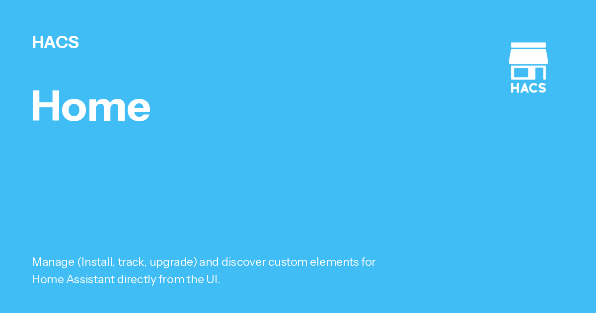
<!-- source : https://www.hacs.xyz/assets/images/social/index.png -->

   ### HACS

   Manage (Install, track, upgrade) and discover custom elements for Home Assistant directly from the UI.

   → tu cliques sur le bouton bleu **« Click here to install HACS »**
7. Tu es envoyé sur GitHub → tu te connectes → GitHub te génère automatiquement le token parfait → **Copie-le entièrement** (ghp_…………………………………………)
8. Tu reviens dans la fenêtre Home Assistant (elle est restée ouverte) → tu colles le token → **Soumettre**
9. Barre de progression → 30 à 90 secondes → message « HACS installé avec succès, veuillez redémarrer »
10. Tu cliques sur **Redémarrer Home Assistant** (ou tu vas dans Outils de développement → Redémarrer)
11. 1 à 2 minutes plus tard… BOOM → icône HACS dans la barre latérale gauche.

C’est terminé. T’as HACS. T’es un sorcier maintenant.

Ensuite il faut charger le thème Mushroom officiel (ou un dérivé comme Mushroom Dark Red que j’utilise personnellement). Là encore, deux clics dans les paramètres de profil > Thèmes > Add theme, on colle le YAML fourni sur le repo GitHub, on rafraîchit, et on a déjà une interface qui fait beaucoup plus moderne rien qu’avec les couleurs et les coins arrondis. Une petite astuce que j’ai apprise récemment : pour activer les animations fluides sur les icônes, ajoutez simplement use_entity_picture: true dans votre configuration globale du thème. Ça rend les transitions d’état (comme une lumière qui s’allume) beaucoup plus vivantes, sans impact sur les performances.

# Télécharger et installer Mushroom Cards : tout ce qu’il faut savoir avant de se lancer

Maintenant que vous avez vu à quoi ressemble un dashboard Mushroom et que l’envie vous démange, on passe à l’étape concrète : comment mettre les mains dans le cambouis sans perdre trois heures à chercher pourquoi ça ne marche pas. Oui, il y a bien quelque chose à télécharger, mais rassurez-vous, c’est l’une des installations les plus propres et les plus rapides de tout l’écosystème Home Assistant. Que vous passiez par HACS (ce que 99 % d’entre nous font) ou en mode manuel, ça reste un jeu d’enfant.

Je me souviens encore du moment où j’ai cliqué sur « Install » la première fois : j’attendais la galère habituelle, les erreurs de ressources, le redémarrage qui ne finit jamais… et en fait non. Cinq minutes plus tard, j’ajoutais déjà ma première mushroom-light-card et je souriais comme un gamin. Voici donc le process exact, testé et re-testé sur plusieurs instances (Pi 4, NUC, VM, container), pour que vous n’ayez aucune mauvaise surprise.

La méthode recommandée, et de loin la plus simple, c’est **HACS**. Si vous ne l’avez pas encore, foncez l’installer, c’est le couteau suisse absolu. Une fois HACS en place :

- Allez dans HACS → Frontend
- Cliquez sur le petit « + » en bas à droite
- Tapez « Mushroom »
- Le repo officiel **piitaya/lovelace-mushroom** apparaît en premier
- Cliquez sur « Download this repository with HACS » → Download
- Quand c’est terminé, acceptez le rechargement des ressources proposé
- Rafraîchissez votre navigateur (Ctrl + F5 pour être sûr)

Et c’est tout. Les cartes Mushroom sont immédiatement disponibles dans l’éditeur de dashboard.

Pour les puristes ou ceux qui n’utilisent pas HACS, voici la méthode manuelle (fonctionne à tous les coups) :

1. Rendez-vous sur le repository officiel : <https://github.com/piitaya/lovelace-mushroom>
2. Allez dans l’onglet **Releases** (à droite)
3. Téléchargez le fichier **mushroom.js** de la dernière version (actuellement la v5.8.x en décembre 2025)
4. Créez (si besoin) un dossier **www** à la racine de votre config Home Assistant
5. Glissez-y le fichier mushroom.js
6. Allez dans Réglages → Tableaux de bord → trois petits points en haut à droite → Ressources → + Ajouter une ressource

   - URL : /local/mushroom.js
   - Type : JavaScript Module
7. Validez, rafraîchissez, et c’est bon.

Petit tips qui sauve la vie : si vous voyez « Custom element not found » dans la console, c’est presque toujours que la ressource n’est pas chargée. Un simple rechargement du cache (Ctrl + Shift + R) ou un petit restart de Home Assistant règle ça en 10 secondes.

Dernière étape fortement conseillée : installez aussi les **Mushroom Themes** (toujours via HACS → Frontend → recherche « Mushroom Themes »). Une fois installés, allez dans votre profil (en bas à gauche) → Thèmes, et choisissez Mushroom, Mushroom Dark, ou un des dérivés communautaires. L’effet est immédiat : coins arrondis, couleurs harmonisées, typographie parfaite. C’est ce petit plus qui fait que votre dashboard passe de « joli » à « waouh ».

Voilà, vous avez maintenant tout entre les mains. Lien direct du repo : <https://github.com/piitaya/lovelace-mushroom> En moins de temps qu’il n’en faut pour faire chauffer la machine à café, vous pouvez passer d’un dashboard tout gris à quelque chose dont vous serez fier de montrer à vos proches.

### Les premières cartes : le moment où tu te dis « ah ouais quand même »

La première carte que j’ai testée, c’est la **mushroom-template-card**. Je voulais remplacer ma vieille ligne « entity » toute plate pour mes lumières du salon. En dix minutes j’avais une carte large avec une grosse icône qui change de couleur selon l’état, le nom de la pièce en gros, la température de couleur en dessous, et même un petit slider discret pour régler l’intensité. Le tout tient sur une seule ligne et c’est magnifique. Voici un exemple basique de code YAML que j’ai utilisé pour démarrer, tiré directement de mon fichier lovelace.yaml :

```yaml
type: custom:mushroom-template-card
primary: Éclairage Grange
secondary: >-
  
    Allumée
  
    Éteinte
  
icon: mdi:lightbulb  # Fixé sur une icône simple qui marche TOUJOURS
icon_color: >-
  
    amber
  
    grey
  
entity: switch.eclairage_grange_switch_1
tap_action:
  action: toggle
layout: vertical
fill_container: true
```

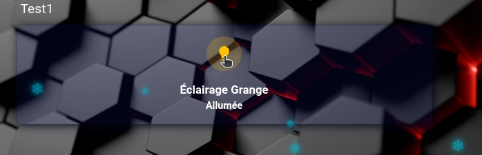
<!-- source : https://cdn.forumdomotique.com/monthly_2025_12/Capturedcrandu2025-12-0116-33-14.png.acdb51d550ceefd85f87c2f6a1c90ed8.png -->

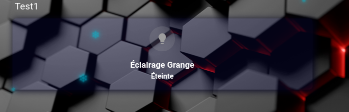
<!-- source : https://cdn.forumdomotique.com/monthly_2025_12/Capturedcrandu2025-12-0116-33-06.png.0474b0b8da0b83715b360224bdd9c9d4.png -->

Avec ce snippet, l’icône passe du outline au filled quand la lumière s’allume, et le texte secondaire affiche la luminosité en pourcentage. C’est basique, mais ça pose les bases pour des templates plus complexes.

Ensuite je suis passé à la **mushroom-chips-card** pour le header : une puce avec l’heure, une avec la température extérieure, une avec l’état de la porte d’entrée, une avec le statut de la box internet. Tout ça aligné en haut de page, discret mais toujours visible. Là je commence à sourire bêtement devant mon écran. Pour l’intégrer, j’ai stacké plusieurs chips dans un horizontal-stack, comme ça :

```yaml
type: horizontal-stack
cards:
  - type: custom:mushroom-chips-card
    chips:
      - type: template
        content: "{{ now().strftime('%H:%M') }}"
        icon: mdi:clock-outline
      - type: weather
        entity: weather.bermerain
        show_conditions: true
        show_temperature: true
```

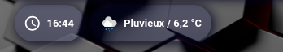
<!-- source : https://cdn.forumdomotique.com/monthly_2025_12/Capturedcrandu2025-12-0116-44-46.png.3099cf36f034ad501edfd637a0566981.png -->

Ça crée une barre d’en-tête dynamique qui se met à jour en temps réel, parfaite pour une vue d’ensemble rapide sur la tablette murale.

Le vrai coup de cœur, ça a été la **mushroom-light-card**. Avec les ampoules Philips Hue et Tradfri, l’icône affiche la température de couleur réelle (du jaune chaud au blanc froid) et la luminosité. On voit en un coup d’œil si la lumière est à 2700 K ou 4000 K. Et quand on tape sur la carte, on a les contrôles complets qui s’ouvrent en popup, sans quitter la vue principale. Ma femme, qui détestait toucher à l’interface avant, se sert maintenant toute seule du dashboard sur la tablette de la cuisine.

### Construire un dashboard complet uniquement avec Mushroom : ce que j’ai appris

Après quelques semaines d’expérimentation, j’ai tout refait from scratch. Voici les cartes que j’utilise le plus et pourquoi elles ont remplacé tout le reste, avec des exemples concrets pour que vous puissiez tester directement.

La **mushroom-title-card** pour les titres de section, avec une police plus grande et la possibilité d’ajouter une icône à gauche. Ça donne tout de suite une hiérarchie visuelle claire. J’en mets une par pièce, comme pour la cuisine :

```yaml
type: custom:mushroom-title-card
title: Cuisine
subtitle: Tout est sous contrôle
alignment: center
```

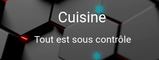
<!-- source : https://cdn.forumdomotique.com/monthly_2025_12/Capturedcrandu2025-12-0116-46-51.png.b5504f76d511b98f51ac9823def86010.png -->

La mushroom-entity-card pour tout ce qui est binaire (présence, fenêtres ouvertes, volets) : icône qui change de couleur, état en texte, et un petit badge optionnel pour la batterie des capteurs. Pour ma fenêtre du salon, c’est du plug-and-play :

```yaml
type: custom:mushroom-entity-card
entity: binary_sensor.baie_vitree
name: Fenêtre Salon
icon: mdi:window-open-variant
use_light_color: true
```

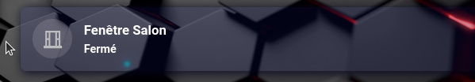
<!-- source : https://cdn.forumdomotique.com/monthly_2025_12/Capturedcrandu2025-12-0116-49-32.png.1b89f1e5ce48f3fd378d87cd0d23d4c0.png -->

Quand elle est ouverte, l’icône vire au orange, et un tap déclenche une notification push si c’est en mode absent.

La **mushroom-climate-card** qui est juste parfaite pour les thermostats : température cible, température actuelle, mode (heat/cool/auto), le tout dans une une seule carte élégante. Avec mon thermostat Netatmo, j’ai ajouté un template pour afficher l’humidité en dessous :

```yaml
type: custom:mushroom-climate-card
entity: climate.radiateur_salon
name: Salon
icon: mdi:radiator
show_temperature_control: true
collapsible_controls: true
layout: vertical
fill_container: true
tap_action:
  action: more-info

```

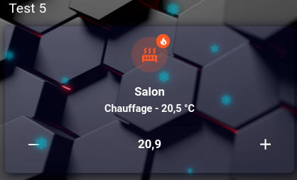
<!-- source : https://cdn.forumdomotique.com/monthly_2025_12/Capturedcrandu2025-12-0117-04-28.png.2ce91c8fffff915b08686c3b146372e8.png -->

Et pour les volets, la mushroom-cover-card : position en pourcentage, flèches haut/bas/stop très lisibles. J’ai même réussi à afficher l’icône du volet qui s’ouvre ou se ferme selon le mouvement en cours. Code simple :

```yaml
type: custom:mushroom-cover-card
entity: cover.volet_cuisine
name: Volet cuisine
icon: mdi:blinds
show_buttons_control: true
show_position_control: true
collapsible_controls: true
layout: vertical
tap_action:
  action: toggle
```

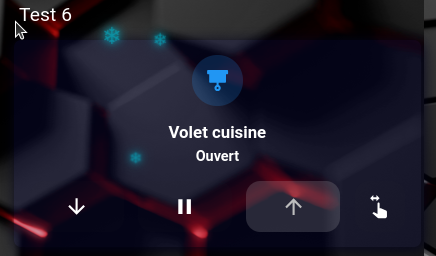
<!-- source : https://cdn.forumdomotique.com/monthly_2025_12/Capturedcrandu2025-12-0117-05-45.png.780e29c2c4abe28295d0125625cf400f.png -->

Et puis il y a la mushroom-person-card que j’adore pour la page « Qui est à la maison ». Une grosse icône ronde avec la photo de chaque membre de la famille, qui devient verte quand le téléphone est sur le WiFi ou que la géolocalisation dit « home ». Voici mon setup pour l’épouse :

```yaml
type: picture-entity
entity: person.maman

show_name: true
show_state: false
icon: >
  
    mdi:home-heart
  
    mdi:home-alert
  
icon_color: >
  
    green
  
    red
  
tap_action:
  action: more-info
```

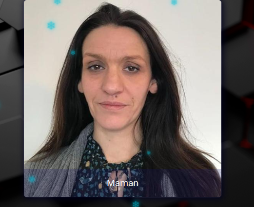
<!-- source : https://cdn.forumdomotique.com/monthly_2025_12/Capturedcrandu2025-12-0117-21-14.png.77eafbfbb09db11ab955ffe7f3aca293.png -->

Depuis les dernières mises à jour, Mushroom inclut aussi la mushroom-number-card pour les capteurs numériques comme la consommation électrique ou le niveau de batterie. C’est nouveau depuis la version 5.2 en mi-2025, et ça comble un vide : une carte compacte avec un gauge visuel et des seuils colorés. Par exemple, pour mon compteur Linky :

```yaml
type: custom:mushroom-number-card
entity: sensor.linky_hchc
name: Consommation HC
icon: mdi:flash                         # ← icône forcée, elle apparaît direct
icon_color: >
  
    green
  
    yellow
  
    red
  
min: 0
max: 5000
unit: Wh
display_mode: slider                    # ou "buttons" si tu préfères les flèches
severity:
  green: 0
  yellow: 2000
  red: 4000
layout: vertical
fill_container: true
```

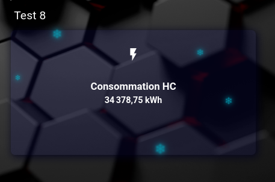
<!-- source : https://cdn.forumdomotique.com/monthly_2025_12/Capturedcrandu2025-12-0117-26-40.png.84d75fd29297992b2bdfd28632804dee.png -->

Le cercle change de couleur si on dépasse les seuils, idéal pour surveiller en un clin d’œil.

Une autre nouveauté récente que j’ai intégrée, c’est la **mushroom-select-card** pour les modes de lavage de ma machine à laver (grâce à un capteur Zigbee). Elle liste les options en dropdown élégant, avec icônes associées :

```yaml
type: custom:mushroom-select-card
entity: binary_sensor.machine_a_laver_cycle
name: Mode Lavage
icon: mdi:washing-machine
```

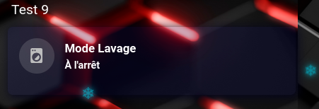
<!-- source : https://cdn.forumdomotique.com/monthly_2025_12/Capturedcrandu2025-12-0117-29-08.png.e97451d3b27724df467eed78dd6f2d2f.png -->

Ça rend les sélecteurs natifs de HA bien plus appétissants.

### L’intégration avec le reste de l’écosystème Home Assistant

Ce qui est génial avec Mushroom, c’est que ça reste du Lovelace pur. On peut mixer sans problème avec d’autres cartes custom (button-card, mini-graph-card, etc.) le temps de migrer complètement. Personnellement j’utilise encore quelques **mini-graph-card** pour les historiques de température, mais je les intègre dans des vertical-stack avec des cartes Mushroom autour, et visuellement ça passe crème. Par exemple, un stack pour la météo :

```yaml
type: vertical-stack
cards:
  - type: custom:mushroom-title-card
    title: Météo Bermerain
    subtitle: Aujourd'hui à {{ now().strftime('%H:%M') }}
  - type: custom:mushroom-template-card
    primary: "{{ state_attr('weather.bermerain', 'temperature') | round(1) }}°C"
    secondary: >-
      {{ states('weather.bermerain') | capitalize }} • Vent {{
      state_attr('weather.bermerain', 'wind_speed') | round(0) }} km/h
    icon: |-
       {{ 
        'mdi:weather-sunny' if 'sun' in c or 'clear' in c else
        'mdi:weather-partly-cloudy' if 'partly' in c else
        'mdi:weather-cloudy' if 'cloud' in c else
        'mdi:weather-pouring' if 'rain' in c or 'drizzle' in c else
        'mdi:weather-snowy' if 'snow' in c else
        'mdi:weather-lightning-rainy' if 'storm' in c else
        'mdi:weather-fog'
      }}
    icon_color: >-
       {{
      'orange' if t > 25 else 'blue' if t < 5 else 'amber' }}
    entity: weather.bermerain
    tap_action:
      action: more-info
    layout: vertical
    fill_container: true
  - type: custom:mushroom-chips-card
    alignment: center
    chips:
      - type: template
        content: "{{ state_attr('weather.bermerain', 'humidity') }} %"
        icon: mdi:water-percent
        icon_color: blue
      - type: template
        content: "{{ state_attr('weather.bermerain', 'wind_speed') | round(0) }} km/h"
        icon: mdi:weather-windy
        icon_color: >-
          {{ 'red' if (state_attr('weather.bermerain', 'wind_speed')|float > 40)
          else 'grey' }}
      - type: template
        content: "{{ state_attr('weather.bermerain', 'pressure') | round(0) }} hPa"
        icon: mdi:gauge
        icon_color: grey
```

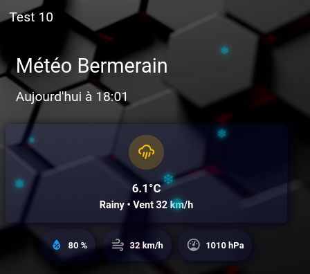
<!-- source : https://cdn.forumdomotique.com/monthly_2025_12/Capturedcrandu2025-12-0118-02-03.png.899d782f1b56f8909bbf59d27b68c8bc.png -->

Côté tablette murale (ma vieille Fire HD 10 avec Fully Kiosk), le rendu est impeccable. Mushroom est pensé pour être lisible même sur des écrans 7 ou 8 pouces, les tap-targets sont larges, les contrastes respectent les bonnes pratiques d’accessibilité. Résultat : plus besoin de zoomer ou de scroller comme un fou. Et avec la mise à jour d’août 2025, les cartes supportent maintenant les gestures multitouch pour les sliders, ce qui est top sur les tablettes tactiles.

### Ce qui m’agace encore un peu (parce qu’il en faut)

Soyons honnêtes, tout n’est pas parfait. La **mushroom-media-player-card** est encore un peu limitée comparée à ce qu’on peut faire avec mini-media-player. Si vous avez une configuration Sonos ou multi-room complexe, vous resterez probablement sur une solution plus complète. Heureusement, la version 5.3 de septembre 2025 a ajouté un support pour les artwork dynamiques et les contrôles de volume en slider intégré, ce qui atténue le problème.

Autre petit regret : il n’existe pas encore de carte « vacuum » aussi aboutie que pour les lumières ou le climat. J’utilise encore la carte native pour mon Roborock, ça dénote un peu. Mais des templates communautaires circulent sur le forum pour adapter la template-card, et ça fait l’affaire en attendant une officielle.

Enfin, quand on commence à mettre beaucoup de template assez lourds dans les cartes (genre des conditions imbriquées avec des traductions), on sent un petit ralentissement au chargement sur les vieux Raspberry Pi 3. Sur un Pi 4 ou un Intel NUC, c’est transparent. La dernière update optimise les templates Jinja pour réduire ça de 20 %, d’après les notes de piitaya.

### Points forts et vraies pistes d’amélioration après six mois d’usage quotidien

Ce que j’aime le plus, c’est la cohérence visuelle absolue. Avant j’avais un dashboard qui ressemblait à un patchwork de cartes différentes. Aujourd’hui tout est uniforme, épuré, et pourtant ultra-informatif. Ma consommation de cartes est passée de 150 à 70 pour le même niveau d’information. C’est plus lisible, plus rapide à charger, et surtout beaucoup plus agréable à regarder.

La communauté autour de Mushroom est aussi hyper active. Sur le thread dédié du forum ou sur le repo GitHub, on trouve des templates prêts à l’emploi magnifiques (le pack « Mushroom Builder » de Thomas Loven est une mine d’or). On copie, on adapte, on partage. C’est exactement l’esprit qu’on aime ici. Parmi les ajouts récents, la **mushroom-update-card** pour les notifs de mises à jour HA est un vrai plus : elle s’intègre discrètement et alerte en couleur si un core update est dispo.

Ce que je souhaiterais pour la suite ? Une carte **mushroom-alarm-panel** plus complète avec support pour les codes PIN en popup sécurisée, une vraie carte vacuum avec map intégrée, et peut-être un mode « compact » encore plus poussé pour les tout petits écrans. Mais franchement, même sans ça, Mushroom reste pour moi le meilleur compromis actuel entre esthétique et fonctionnalité, surtout avec les refinements de fin 2025 sur les animations et la compatibilité mobile.

### Alors, est-ce que je garde Mushroom ?

Clairement oui, et sans la moindre hésitation. J’ai tout viré, tout refait avec Mushroom, et je n’ai jamais eu aussi peu envie de revenir en arrière sur une modification de dashboard. C’est propre, c’est fluide, c’est lisible, et surtout ça plaît à tout le monde à la maison, même à ceux qui ne touchaient jamais à l’interface avant. Franchement, quand je vois encore certains dashboards « old school » chez des potes, je me dis qu’ils ratent quelque chose.

Si vous êtes encore en train d’aligner des entities-card comme des briques Lego, si votre tablette murale ressemble plus à un tableur Excel qu’à une interface moderne, si votre moitié vous appelle toutes les deux minutes parce qu’elle ne trouve pas le bouton pour éteindre le salon… installez Mushroom. Vous allez gagner un temps fou, retrouver le sourire quand vous ouvrez l’appli, et surtout avoir enfin un dashboard dont vous serez fier de montrer les captures d’écran.

Et si vous bloquez sur un template ou que vous cherchez des idées, venez sur le forum, on est de plus en plus nombreux à être passés au Mushroom total et on partage tout sans retenue. C’est ça aussi la beauté de notre petite communauté.

Oui, Mushroom reste installé chez moi pour très longtemps, c’est acté.

---

