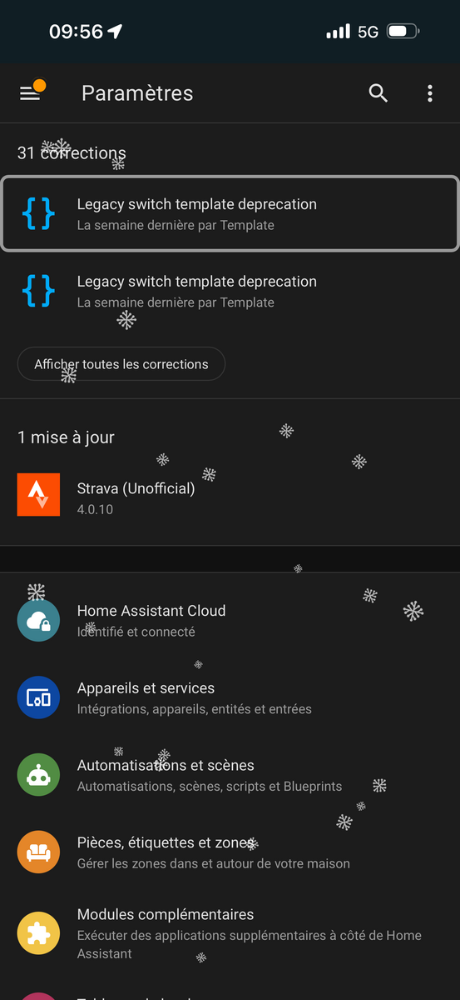
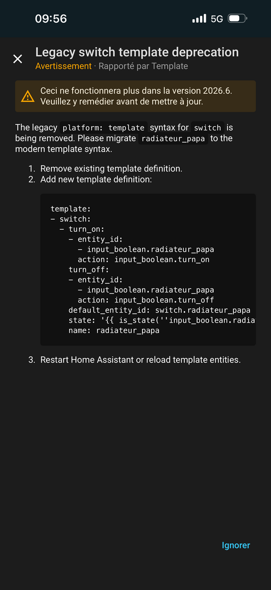


<p class="forum-cta"><a href="https://forumdomotique.com/forums/topic/585-migration-des-entit%C3%A9s-template-legacy-vers-la-syntaxe-moderne-dans-home-assistant-r%C3%A9soudre-lavertissement-pour-la-version-20266/">Lire et commenter sur Forum Domotique</a></p>

# Migration des Entités Template Legacy vers la Syntaxe Moderne dans Home Assistant : Résoudre l’Avertissement pour la Version 2026.6

- **Catégorie :** [Tutoriels, Guides & Astuces des Membres](https://forumdomotique.com/forums/87-tutoriels-guides-astuces-des-membres/)
- **Sujet :** https://forumdomotique.com/forums/topic/585-migration-des-entit%C3%A9s-template-legacy-vers-la-syntaxe-moderne-dans-home-assistant-r%C3%A9soudre-lavertissement-pour-la-version-20266/
- **Auteur du premier message du sujet :** XAV59213
- **Messages de XAV59213 dans ce sujet :** 1
- **Premier message de XAV59213 :** 4 décembre 2025 à 10:01 (Europe/Paris)

---

## Message 1 — 4 décembre 2025 à 10:01 (Europe/Paris)

- **Identifiant :** `1476`
- **Lien :** https://forumdomotique.com/forums/topic/585-migration-des-entit%C3%A9s-template-legacy-vers-la-syntaxe-moderne-dans-home-assistant-r%C3%A9soudre-lavertissement-pour-la-version-20266/#findComment-1476

Home Assistant, la plateforme open-source populaire pour la domotique, évolue constamment pour améliorer la stabilité, la cohérence et les fonctionnalités offertes aux utilisateurs. Récemment, avec la sortie de la version 2025.12, un avertissement important a été introduit concernant la dépréciation des entités template “legacy” (ancienne syntaxe). Cet avertissement indique que ces entités ne fonctionneront plus à partir de la version 2026.6, et il est crucial de les migrer avant toute mise à jour pour éviter des interruptions dans votre configuration. Dans cet article, nous explorerons les raisons de cette changement, les étapes de migration, et nous nous concentrerons sur l’exemple spécifique fourni : l’entité switch “radiateur_papa”.

**Contexte de l’Avertissement**

Si vous avez mis à jour Home Assistant vers 2025.12 ou une version ultérieure, vous avez peut-être rencontré un message d’avertissement similaire à celui-ci :


<!-- source : https://cdn.forumdomotique.com/monthly_2025_12/IMG_6359.png.14d8df1eed9dc3979fd8403869db0be0.png -->



Cela signifie que l’ancienne manière de définir des entités template (via platform: template) est obsolète et sera supprimée dans la version 2026.6. Home Assistant affiche cet avertissement via un “repair” (réparation) dans l’interface pour vous guider. Ignorer cela pourrait entraîner des dysfonctionnements de vos automatisations, scripts ou interfaces utilisateur dépendant de ces entités.

Cet avertissement concerne plusieurs domaines d’entités, y compris switch, sensor, binary_sensor, light, cover, fan, lock, vacuum, weather et alarm_control_panel. Il ne s’applique pas aux templates utilisés ailleurs, comme dans les cartes personnalisées du frontend ou les helpers template.

**Pourquoi cette Dépréciation ?**

Home Assistant a décidé de déprécier l’ancienne syntaxe pour plusieurs raisons techniques et stratégiques :

**Cohérence des Comportements des Entités** : L’ancienne syntaxe créait des incohérences dans le fonctionnement des entités template par rapport aux autres intégrations. La syntaxe moderne aligne tout sur un standard unique, rendant le système plus prévisible et plus facile à maintenir.

**Introduction de Nouvelles Fonctionnalités** : Les développeurs prévoient d’ajouter des “blueprints” template dans l’interface utilisateur (UI), ainsi que de nouveaux domaines comme climate et media_player. La syntaxe legacy bloquait ces avancées en raison de sa complexité et de ses limitations.

**Assignation aux Appareils** : À l’avenir, les entités template en YAML pourront être assignées à des appareils physiques, ce qui n’était pas possible avec l’ancienne approche.

**Problèmes de Maintenance** : Le support de la syntaxe legacy a causé de nombreux bugs et complications pour les développeurs. En la supprimant, Home Assistant peut se concentrer sur des améliorations plus robustes, tout en maintenant une parité complète des fonctionnalités avec la nouvelle syntaxe.

Cette évolution fait partie d’une stratégie plus large pour moderniser la plateforme, rendant la configuration plus intuitive, surtout pour les utilisateurs qui préfèrent l’UI graphique.

**Comment Migrer vers la Syntaxe Moderne ?**

La migration est relativement simple et se fait en modifiant votre fichier configuration.yaml (ou un fichier inclus comme templates.yaml). Voici les étapes générales :

1.  **Identifiez les Entités Concernées** : Vérifiez les avertissements dans l’interface Home Assistant (sous “Réparations” dans les paramètres). Chaque avertissement spécifie l’entité à migrer, comme “radiateur_papa” dans votre cas.

2.  **Supprimez l’Ancienne Définition** : Localisez et retirez la section legacy dans votre configuration. Par exemple, l’ancienne syntaxe pour un switch ressemblait à ceci :

```yaml
switch:
  - platform: template
    switches:
      radiateur_papa:
        value_template: '{{ is_state("input_boolean.radiateur_papa", "on") }}'
        turn_on:
          service: input_boolean.turn_on
          entity_id: input_boolean.radiateur_papa
        turn_off:
          service: input_boolean.turn_off
          entity_id: input_boolean.radiateur_papa
```

3.  **Ajoutez la Nouvelle Définition** : Utilisez la clé template: suivie du domaine (ici switch). Assurez-vous qu’il n’y ait qu’une seule section template: dans votre configuration globale. Si vous en avez déjà une (pour des triggers ou d’autres entités), ajoutez-y les nouvelles définitions au même niveau d’indentation.  
Pour votre exemple spécifique (“radiateur_papa”), la nouvelle configuration est la suivante :

```yaml
template:
  - switch:
      - turn_on:
          - entity_id:
              - input_boolean.radiateur_papa
            action: input_boolean.turn_on
        turn_off:
          - entity_id:
              - input_boolean.radiateur_papa
            action: input_boolean.turn_off
        default_entity_id: switch.radiateur_papa
        state: '{{ is_state("input_boolean.radiateur_papa", "on") }}'
        name: radiateur_papa
```

**Explications des Clés** :

•  turn_on et turn_off : Définissent les actions pour activer/désactiver l’entité (ici, via un input_boolean).

•  default_entity_id : Conserve l’ID de l’entité pour éviter de casser les références existantes.

•  state : Le template qui détermine l’état (équivalent à l’ancien value_template).

•  name : Le nom convivial de l’entité.

4.  **Vérifiez l’Indentation** : Une erreur courante est une mauvaise indentation. Toutes les sous-sections doivent être alignées correctement sous template:.

5.  **Redémarrez ou Rechargez** : Après la modification, redémarrez Home Assistant ou allez dans “Outils pour Développeurs > YAML > Recharger les Entités Template” pour appliquer les changements sans redémarrage complet.

6.  **Astuces Avancées** :

•  Si vous avez plusieurs fichiers, vous pouvez inclure un templates.yaml via !include templates.yaml dans configuration.yaml.

•  Pour les entités complexes, testez dans un environnement de développement avant d’appliquer en production.

•  Si vous préférez l’UI, recréez les entités via “Helpers > Créer un Helper > Template > Switch” (bien que cela ne conserve pas toujours l’ID exact).

**Problèmes Courants et Conseils**

**Erreur “Multiple template:”** : N’ajoutez pas une nouvelle section template: ; fusionnez tout dans l’existante.

**Indentation Incorrecte** : Utilisez un éditeur YAML pour vérifier (comme VS Code avec l’extension YAML).

**Parité des Fonctionnalités** : La nouvelle syntaxe supporte tout ce que l’ancienne faisait, y compris les templates avancés.

**Si Vous Avez Beaucoup d’Entités** : Priorisez les migrations basées sur les avertissements. Des outils communautaires existent pour automatiser une partie du processus, mais vérifiez toujours manuellement.

En suivant ces étapes, votre configuration sera prête pour les futures mises à jour. Cette migration non seulement résout l’avertissement, mais améliore aussi la flexibilité de votre setup Home Assistant.

---

