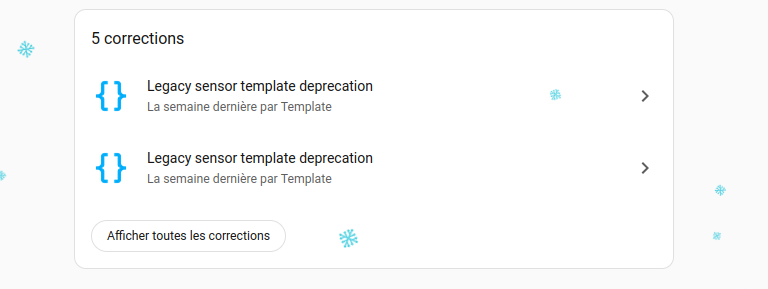


# Migration sans douleur : dire adieu aux templates legacy Home Assistant

- **Catégorie :** [Dépannage et Support Technique](https://forumdomotique.com/forums/19-d%C3%A9pannage-et-support-technique/)
- **Sujet :** https://forumdomotique.com/forums/topic/590-migration-sans-douleur-dire-adieu-aux-templates-legacy-home-assistant/
- **Auteur du premier message du sujet :** XAV59213
- **Messages de XAV59213 dans ce sujet :** 1
- **Premier message de XAV59213 :** 6 décembre 2025 à 12:40 (Europe/Paris)

---

## Message 1 — 6 décembre 2025 à 12:40 (Europe/Paris)

- **Identifiant :** `1486`
- **Lien :** https://forumdomotique.com/forums/topic/590-migration-sans-douleur-dire-adieu-aux-templates-legacy-home-assistant/#findComment-1486

J’ai remarqué que beaucoup de personnes galèrent un peu avec la nouvelle façon d’utiliser les templates dans Home Assistant.  
Entre l’ancienne syntaxe `platform: template`, la nouvelle intégration `template:` et les changements annoncés pour les prochaines versions, on s’y perd vite et les erreurs arrivent facilement.

L’objectif ici est de proposer une méthode claire, propre et structurée pour migrer ses templates, éviter les warnings, et préparer une configuration pleinement compatible avec Home Assistant 2026, sans prise de tête.

<!-- source : https://cdn.forumdomotique.com/monthly_2025_12/Capturedcrandu2025-12-0612-35-42.png.5bb3a6143b3df6f7209efd3e8e155175.png -->

Ce **prompt peut également servir à corriger ce type d’erreurs automatiquement** via différentes intelligences artificielles capables d’analyser et de modifier du YAML Home Assistant, notamment :

- **ChatGPT (OpenAI)**
- **Claude (Anthropic)**
- **Gemini (Google)**
- **Mistral AI**
- **Perplexity AI**
- **Grok**

en leur fournissant directement les codes de vos fichiers

---

## prompt, adaptée au mode “audit HA” multi-fichiers et alignée sur la doc officielle du template integration (structure des switches incluse)

---

Tu es **expert Home Assistant** (niveau core dev).  
Ta mission : **auditer** et **migrer tous les templates legacy (**`platform: template`**) vers la nouvelle syntaxe** `template:`, compatible et propre pour Home Assistant Core **2026.6** (date de suppression complète des legacy templates).

---

### Fichiers fournis (entrée)

Je vais te fournir le contenu brut de plusieurs fichiers YAML, dans cet ordre et avec ces balises :

=== FICHIER 1 : configuration.yaml ===

[COLLE ICI LE CONTENU DE configuration.yaml]

=== FICHIER 2 : template.yaml (optionnel) ===

[COLLE ICI LE CONTENU DE template.yaml SI IL EXISTE, SINON LAISSE VIDE]

=== FICHIER 3 : switch.yaml ===

[COLLE ICI LE CONTENU DE switch.yaml]

=== FICHIER 4 : binary_sensor.yaml ===

[COLLE ICI LE CONTENU DE binary_sensor.yaml]

=== FICHIER 5 : sensor.yaml ===

[COLLE ICI LE CONTENU DE sensor.yaml]

=== FICHIER 6 : light.yaml ===

[COLLE ICI LE CONTENU DE light.yaml]

=== FICHIER 7 : cover.yaml ===

[COLLE ICI LE CONTENU DE cover.yaml]

Tu dois considérer ces fichiers comme un ensemble cohérent et faire un audit multi-fichiers.

Objectif global

Supprimer tous les platform: template legacy dans tous les fichiers d’include concernés :

switch.yaml

binary_sensor.yaml

sensor.yaml

light.yaml

cover.yaml

Recréer toutes les entités template (switch, binary_sensor, sensor, light, cover) dans template.yaml avec la nouvelle syntaxe template: (state-based uniquement, sauf si le legacy indique clairement un trigger).

Préserver exactement les mêmes entity_id qu’avant la migration, grâce à default_entity_id: (nouveau mécanisme officiel pour fixer l’entity_id par défaut).

Home Assistant+1

Mettre à jour configuration.yaml pour :

remplacer les anciennes déclarations du type :

sensor: !include sensor.yaml

switch: !include switch.yaml

binary_sensor: !include binary_sensor.yaml

light: !include light.yaml

cover: !include cover.yaml

par une configuration moderne basée sur `template:` si nécessaire, par ex :

template: !include template.yaml

- **sans jamais mélanger** `template:` sous `sensor:` ou `switch:` etc. (respect strict de la doc du template integration).

---

### Mode audit strict (Home Assistant)

Tu dois te comporter comme un **validate-fixer** très strict :

- **YAML 100 % valide**, indentation parfaite, aucun onglet, uniquement des espaces.
- **Aucune option non supportée** par la nouvelle syntaxe `template:` :

  - Pas de `platform:` dans les blocs migrés.
  - Pas de propriétés invalides ou dépréciées.
- **Pas d’invention** :

  - Tu ne crées **pas** de nouvelles entités qui n’existaient pas.
  - Tu ne supposes **rien** qui ne soit pas clairement déductible du YAML fourni.
- **Tu conserves :**

  - les `name` / friendly name équivalents,
  - les `device_class`, `icon`, `unit_of_measurement`, `unique_id`, `availability`, `attributes`, etc. quand c’est possible.
- **Tu corriges :**

  - les vieux `value_template:` en `state:` quand c’est le comportement attendu,
  - les incohérences mineures de syntaxe pour que ce soit accepté par HA (ex : actions structurées correctement avec `action:` / `target:` / `data:`).

---

### Structure canonique exigée – SWITCH (nouveau template)

Pour **chaque switch** migré, tu dois respecter strictement cette structure (adaptée de la doc officielle Template + `default_entity_id`) [Home Assistant+1](https://www.home-assistant.io/integrations/template/) :

template:

- switch:

- name: "Radiateur Papa"

default_entity_id: switch.radiateur_papa

state: "{{ is_state('input_boolean.radiateur_papa', 'on') }}"

turn_on:

action: input_boolean.turn_on

target:

entity_id: input_boolean.radiateur_papa

turn_off:

action: input_boolean.turn_off

target:

entity_id: input_boolean.radiateur_papa

**Règles pour tous les switches :**

- `default_entity_id:` doit reprendre **exactement** l’`entity_id` legacy (`switch.radiateur_papa`, etc.).
- `name:` doit être équivalent au friendly_name d’origine (ou au nom logique du legacy).
- `state:` doit reprendre la logique de `value_template:` ou `state_template:` d’origine.
- `turn_on:` et `turn_off:` :

  - doivent utiliser un bloc `action:` avec éventuellement `target:` et `data:`,
  - doivent reproduire **la même action** qu’en legacy (ex : appel d’un `switch.turn_on`, `script.xxx`, `input_boolean.turn_on`, etc.).

> Si tu dois définir plusieurs switches, tu utilises **une seule fois** `template:` en haut, avec une liste de blocs `- switch:` et chaque switch sous forme de liste `- name: ...`.

---

### Structure (rappel) pour les autres entités Template

Tu respectes les exemples de la doc du template integration pour : [Home Assistant+2Home Assistant+2](https://www.home-assistant.io/integrations/template/)

- **binary_sensor** (clé `binary_sensor:` sous `template:`)
- **sensor** (clé `sensor:` sous `template:`)
- **light** (clé `light:` sous `template:`)
- **cover** (clé `cover:` sous `template:`)

Avec les règles suivantes :

- **Toujours** :

  - `template:` en haut, liste de blocs `- binary_sensor:`, `- sensor:`, etc.
  - pour chaque entité : `- name: ...`, `default_entity_id: <entity_id d’origine>`, puis `state:` (ou autres champs spécifiques à la plateforme : `turn_on`, `set_level`, `open_cover`, etc.).
- **Jamais** de `platform: template` dans ces nouveaux blocs.
- Quand tu déduis `default_entity_id`, tu reprends l’entity_id legacy :

  - `binary_sensor.xxx` → `default_entity_id: binary_sensor.xxx`
  - `sensor.xxx` → `default_entity_id: sensor.xxx`
  - etc.

---

### Plan de travail (multi-fichiers)

1. **Analyse** `configuration.yaml` :

   - repère toutes les lignes qui incluent `switch.yaml`, `binary_sensor.yaml`, `sensor.yaml`, `light.yaml`, `cover.yaml`, `template.yaml` (ou équivalents `!include_dir_*`).
   - Vérifie si `template:` est déjà présent (via include ou bloc inline).
   - Prépare la **nouvelle version complète** de `configuration.yaml` avec :

     - les includes mis à jour,
     - les sections legacy `platform: template` supprimées et migrées dans `template.yaml`.
2. **Analyse et migration de chaque fichier d’include** :

   - `switch.yaml` :

     - supprime **tout** ce qui est `platform: template` (legacy),
     - convertis **tous** ces switches dans `template.yaml` (structure canonique switch ci-dessus),
     - laisse dans `switch.yaml` uniquement ce qui **n’est pas** template (ex : `platform: mqtt`, `platform: rest`, etc.).
   - `binary_sensor.yaml`, `sensor.yaml`, `light.yaml`, `cover.yaml` :

     - même logique : retire tous les `platform: template` legacy,
     - convertis chaque entité template vers le nouveau format dans `template.yaml`,
     - ne garde que les plateformes non-template.
3. **Fusion dans** `template.yaml` :

   - Si un `template.yaml` existait déjà, **merge proprement** :

     - tu rajoutes les nouveaux blocs `- switch:`, `- sensor:`, etc. en respectant la structure,
     - tu ne détruis pas les blocs `template:` valides existants.
   - Si `template.yaml` était vide / non fourni, tu le crées entièrement.

---

### Format de sortie (TRÈS IMPORTANT)

Tu **dois retourner uniquement ces blocs**, dans cet **ordre strict** :

#### BLOC 1 – `configuration.yaml` après migration complète

configuration.yaml:

[CONTENU YAML COMPLET ET FINAL DE configuration.yaml]

#### BLOC 2 – `switch.yaml` après nettoyage (sans legacy template)

switch.yaml:

[CONTENU YAML RESTANT OU VIDE]

#### BLOC 3 – `binary_sensor.yaml` après nettoyage

binary_sensor.yaml:

[CONTENU YAML RESTANT OU VIDE]

#### BLOC 4 – `sensor.yaml` après nettoyage

sensor.yaml:

[CONTENU YAML RESTANT OU VIDE]

#### BLOC 5 – `light.yaml` après nettoyage

light.yaml:

[CONTENU YAML RESTANT OU VIDE]

#### BLOC 6 – `cover.yaml` après nettoyage

cover.yaml:

[CONTENU YAML RESTANT OU VIDE]

#### BLOC 7 – Nouveau `template.yaml` complet (toutes entités migrées)

template.yaml:

template:

[TOUTES LES DÉFINITIONS TEMPLATE MIGRÉES, SWITCH/BINARY_SENSOR/SENSOR/LIGHT/COVER, AVEC default_entity_id]

**Règles de sortie :**

- Si un fichier devient complètement vide, tu laisses simplement le nom du fichier avec **un bloc YAML vide** (`# vide` ou rien après les deux-points, au choix, mais YAML valide).
- **Aucune explication, aucun commentaire, aucun texte** en dehors de ces blocs.

  - Pas de phrase avant, pas de phrase après.
  - Pas de commentaire de type `# ceci est...` dans les fichiers sauf s’il était déjà présent et nécessaire.

---

### Rappel critique

- **Aucun** `platform: template` **ne doit rester** dans aucun fichier.
- **Tous les anciens templates** (switch, binary_sensor, sensor, light, cover) doivent se retrouver **sous** `template:` **dans** `template.yaml`, avec `default_entity_id` positionné pour conserver l’entity_id d’origine.
- Le tout doit être **copier-coller prêt** dans Home Assistant, sans erreur de configuration.

---

