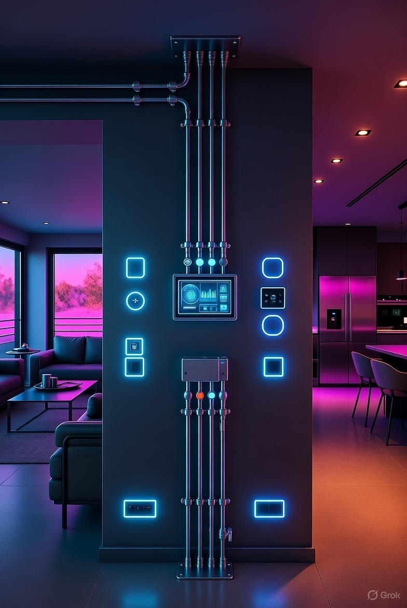
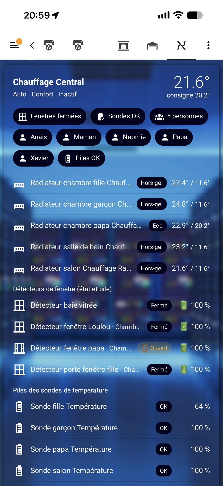
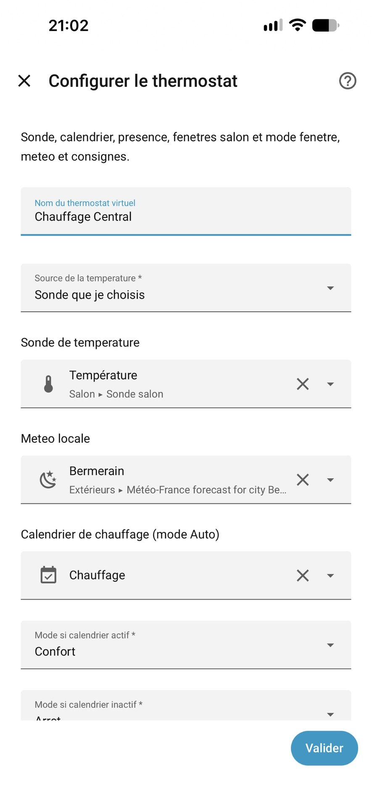
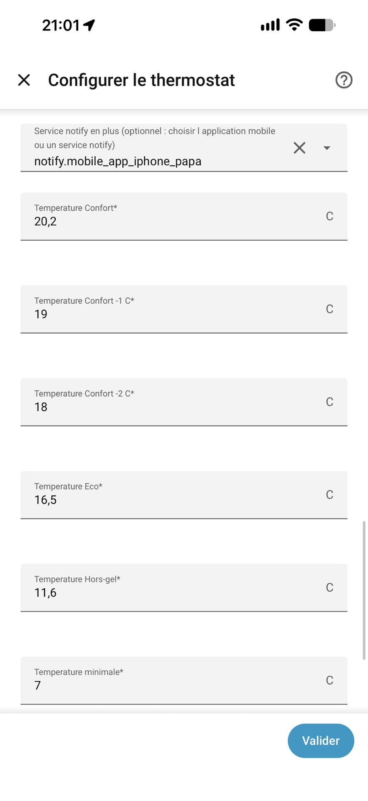
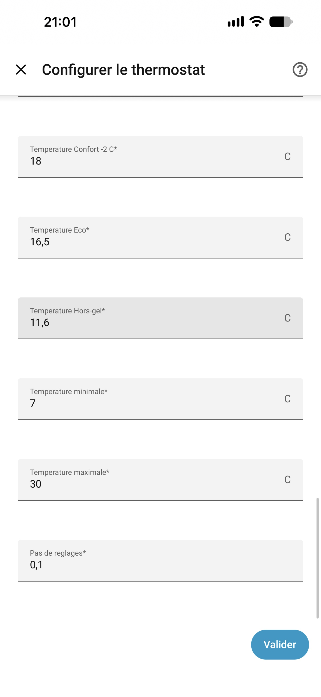
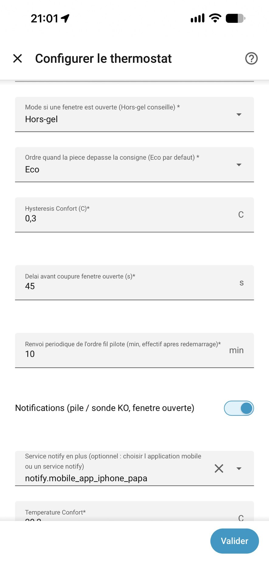
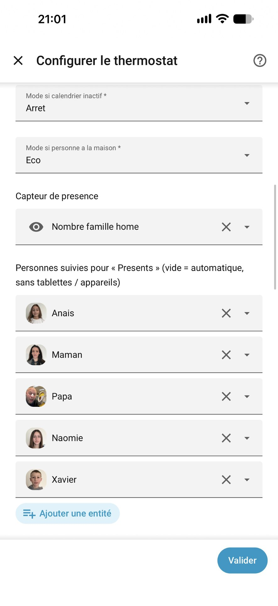

<p class="forum-cta"><a href="https://forumdomotique.com/forums/topic/596-chauffage-%C3%A9lectrique-fil-pilote-fr-enfin-une-int%C3%A9gration-qui-parle-fran%C3%A7ais/">Lire et commenter sur Forum Domotique</a> · <a href="https://github.com/XAV59213/chauffage">Dépôt HACS : Chauffage Électrique Fil Pilote FR</a></p>


<section class="carousel photo-carousel" data-carousel data-lightbox aria-roledescription="carrousel" aria-label="Photos de l’article (7)" tabindex="0">
<div class="carousel-track" data-track>
<figure class="photo-slide" data-slide>
  <a href="images/IMG_6431.jpeg" data-full="images/IMG_6431.jpeg" data-alt="Photo 1 — Chauffage Électrique Fil Pilote FR – Enfin une intégration qui parle français !" aria-label="Agrandir la photo 1 : Photo 1 — Chauffage Électrique Fil Pilote FR – Enfin une intégration qui parle français !">
    
  </a>
</figure>
<figure class="photo-slide" data-slide>
  <a href="images/carte-chauffage.jpg" data-full="images/carte-chauffage.jpg" data-alt="Photo 2 — Chauffage Électrique Fil Pilote FR – Enfin une intégration qui parle français !" aria-label="Agrandir la photo 2 : Photo 2 — Chauffage Électrique Fil Pilote FR – Enfin une intégration qui parle français !">
    
  </a>
</figure>
<figure class="photo-slide" data-slide>
  <a href="images/config-thermostat.jpg" data-full="images/config-thermostat.jpg" data-alt="Photo 3 — Chauffage Électrique Fil Pilote FR – Enfin une intégration qui parle français !" aria-label="Agrandir la photo 3 : Photo 3 — Chauffage Électrique Fil Pilote FR – Enfin une intégration qui parle français !">
    
  </a>
</figure>
<figure class="photo-slide" data-slide>
  <a href="images/config-thermostat-2.jpg" data-full="images/config-thermostat-2.jpg" data-alt="Photo 4 — Chauffage Électrique Fil Pilote FR – Enfin une intégration qui parle français !" aria-label="Agrandir la photo 4 : Photo 4 — Chauffage Électrique Fil Pilote FR – Enfin une intégration qui parle français !">
    
  </a>
</figure>
<figure class="photo-slide" data-slide>
  <a href="images/config-thermostat-3.jpg" data-full="images/config-thermostat-3.jpg" data-alt="Photo 5 — Chauffage Électrique Fil Pilote FR – Enfin une intégration qui parle français !" aria-label="Agrandir la photo 5 : Photo 5 — Chauffage Électrique Fil Pilote FR – Enfin une intégration qui parle français !">
    
  </a>
</figure>
<figure class="photo-slide" data-slide>
  <a href="images/config-thermostat-4.jpg" data-full="images/config-thermostat-4.jpg" data-alt="Photo 6 — Chauffage Électrique Fil Pilote FR – Enfin une intégration qui parle français !" aria-label="Agrandir la photo 6 : Photo 6 — Chauffage Électrique Fil Pilote FR – Enfin une intégration qui parle français !">
    
  </a>
</figure>
<figure class="photo-slide" data-slide>
  <a href="images/config-thermostat-5.jpg" data-full="images/config-thermostat-5.jpg" data-alt="Photo 7 — Chauffage Électrique Fil Pilote FR – Enfin une intégration qui parle français !" aria-label="Agrandir la photo 7 : Photo 7 — Chauffage Électrique Fil Pilote FR – Enfin une intégration qui parle français !">
    
  </a>
</figure>
</div>
<button type="button" class="carousel-nav" data-prev aria-label="Photo précédente">‹</button>
<button type="button" class="carousel-nav" data-next aria-label="Photo suivante">›</button>
<div class="carousel-dots" data-dots></div>
<div class="carousel-live" data-live aria-live="polite"></div>
<p class="carousel-hint">Faites défiler les photos, ou ouvrez-les pour les agrandir (si JavaScript est activé).</p>
</section>

# Chauffage Électrique Fil Pilote FR – Enfin une intégration qui parle français !

Salut la communauté 👋

Grosse mise à jour pour ce sujet ! Voici une présentation complète et à jour de **Chauffage Électrique Fil Pilote FR** 🔥, une intégration Home Assistant **100 % locale** pensée pour nos radiateurs électriques français à **fil pilote** : modules NodOn SIN-4-FP-21, Legrand, Delta Dore… avec des sondes de température Zigbee, via Zigbee2MQTT ou ZHA. Aucun cloud, aucun abonnement.

Depuis ma première présentation de décembre 2025, elle a énormément évolué, et elle fait maintenant partie de la **bibliothèque officielle de HACS**. Oubliez donc mon avertissement sur la v1.0.8 : la version actuelle est la [**v3.1.76**](https://github.com/XAV59213/chauffage/releases/tag/v3.1.76).

👉 **Le plus simple :** cliquez sur ce bouton. Un clic ouvre directement l’intégration dans votre HACS, et le dépôt est ajouté automatiquement :


<!-- source : https://my.home-assistant.io/badges/hacs_repository.svg -->


<!-- source : https://raw.githubusercontent.com/XAV59213/chauffage/main/docs/images/carte-chauffage.jpg -->

### 🤔 Le fil pilote, c’est quoi au juste ?

La plupart des radiateurs électriques installés en France ont un petit fil supplémentaire, souvent noir ou gris : le **fil pilote**. En envoyant un signal sur ce fil, on dit au radiateur dans quel mode se mettre : **Confort, Confort -1 °C, Confort -2 °C, Éco, Hors-gel ou Arrêt**. C’est ce qu’on appelle les « 6 ordres ».

Pour piloter ce fil depuis Home Assistant, on ajoute un petit module (par exemple un NodOn SIN-4-FP-21 en Zigbee) derrière le radiateur. Le problème, c’est que les thermostats virtuels existants (Versatile Thermostat est génial, énorme respect à jmcollin78) ne parlent pas nativement ces ordres français. D’où cette intégration, taillée pour la France.

### 🧠 Comment ça fonctionne ?

L’idée est de tout piloter depuis **un seul thermostat central virtuel**, comme une molette unique pour toute la maison :

- 🎛️ le thermostat central envoie le bon ordre fil pilote à **tous les radiateurs**
- 🏠 chaque **pièce** a sa sonde de température, son module, et éventuellement son capteur de fenêtre
- 🗓️ en mode **Auto**, c’est votre **calendrier** de chauffe qui décide : Confort quand il est actif, un mode plus économique sinon
- 👨‍👩‍👧 **personne à la maison** → Éco automatiquement
- 🪟 **fenêtre ouverte** plus de 45 secondes → le radiateur de la pièce passe en Hors-gel (ou Éco, ou Arrêt, au choix), puis reprend dès qu’on referme
- ✋ un radiateur réglé à la main garde votre réglage, même après un redémarrage, jusqu’à ce que vous le remettiez en Auto

### ✨ Ce qui a changé depuis décembre 2025

La liste est longue (une centaine de versions !), alors voici l’essentiel :

- ✅ **Dans la bibliothèque HACS par défaut**
- 🎨 **Une carte Lovelace complète livrée avec l’intégration** : thermostat, radiateurs, températures des pièces, fenêtres, piles des capteurs, consommation et courbes de puissance. Aucune option obligatoire, tout est détecté automatiquement
- 🛡️ **Sécurités** : consigne maximale (23 °C par défaut), détection de **surchauffe** ou d’un radiateur qui chauffe alors qu’il devrait être coupé, avec arrêt forcé et notification
- 🍂 **Saison de chauffe** : coupure automatique hors saison (du 15 avril au 15 octobre par défaut) ou quand il fait doux dehors (moyenne sur 24 h au-dessus de 16 °C)
- ⚡ **Consommation** par radiateur et pour la maison, en utilisant le vrai compteur du module quand il existe
- 📜 **Historique des décisions** : pour chaque radiateur, on sait pourquoi il a changé de mode, et **qui** l’a demandé (vous, une automatisation, le thermostat central…)
- 🔧 Reconfiguration du thermostat et des radiateurs sans tout supprimer, diagnostics téléchargeables, alertes quand une sonde ou un module a disparu
- 🧪 Des tests automatisés à chaque modification

### 🛠️ Installation pas à pas (bibliothèque officielle HACS)

*Pour ceux qui débutent : HACS, c’est un peu le « magasin d’applications » communautaire de Home Assistant. Il permet d’installer et de mettre à jour en quelques clics des intégrations qui ne sont pas fournies d’origine. S’il n’est pas encore installé chez vous, le guide officiel est ici :* [*https://hacs.xyz/docs/use/*](https://hacs.xyz/docs/use/)

L’intégration fait partie de la **bibliothèque HACS par défaut** : plus besoin d’ajouter un dépôt personnalisé.

**Le plus rapide :** un clic sur ce bouton ouvre directement l’intégration dans votre HACS, et le dépôt est ajouté automatiquement :


<!-- source : https://my.home-assistant.io/badges/hacs_repository.svg -->

**Ou à la main :**

1. Dans Home Assistant, ouvrez **HACS** dans le menu de gauche
2. Tapez **Chauffage Électrique Fil Pilote FR** dans la barre de recherche
3. Ouvrez la fiche, puis cliquez sur **Télécharger**
4. Redémarrez Home Assistant (**Paramètres > Système > bouton ⏻ en haut à droite > Redémarrer**)
5. Allez dans **Paramètres > Appareils et services > + Ajouter une intégration**, et cherchez **Chauffage Électrique Fil Pilote FR**

⚠️ Petite subtilité qui piège souvent au début : HACS ne fait que **télécharger les fichiers**. Ce sont les étapes 4 et 5 qui créent réellement l’intégration et ses entités. Si vous ne voyez qu’une entité `update.…` après l’installation, c’est normal : c’est HACS qui surveille les mises à jour, il reste juste l’étape 5.

⚠️ Il faut Home Assistant **2025.1** ou plus récent.

Raccourci pour l’étape 5 : <https://my.home-assistant.io/redirect/config_flow_start/?domain=electric_heater>

### ⚙️ Configuration : deux étapes à bien comprendre

C’est la partie qui pose le plus de questions, alors je détaille. On ajoute l’intégration **plusieurs fois** :

1. **Une première fois pour créer le thermostat central.** L’assistant vous demande la sonde de référence, le calendrier de chauffe, le capteur de présence (par exemple le nombre de personnes à la maison), les fenêtres du salon et la météo.
2. **Puis une fois par radiateur.** Pour chaque pièce, vous refaites **+ Ajouter une intégration > Chauffage Électrique Fil Pilote FR**, et vous choisissez cette fois le module fil pilote du radiateur, la sonde de la pièce et, si vous en avez un, le capteur de fenêtre.


<!-- source : https://raw.githubusercontent.com/XAV59213/chauffage/main/docs/images/config-thermostat.jpg -->


<!-- source : https://raw.githubusercontent.com/XAV59213/chauffage/main/docs/images/config-thermostat-2.jpg -->


<!-- source : https://raw.githubusercontent.com/XAV59213/chauffage/main/docs/images/config-thermostat-3.jpg -->


<!-- source : https://raw.githubusercontent.com/XAV59213/chauffage/main/docs/images/config-thermostat-4.jpg -->


<!-- source : https://raw.githubusercontent.com/XAV59213/chauffage/main/docs/images/config-thermostat-5.jpg -->

Tout se modifie ensuite via **Configurer** sur l’intégration. Le module peut être une entité `select` (Zigbee2MQTT) ou `climate` (ZHA).

### 🎨 Ajouter la carte

**Tableau de bord > Modifier > Ajouter une carte**, puis cherchez **« Chauffage Fil Pilote »**. En YAML, une seule ligne suffit :

```plaintext
type: custom:electric-heater-card
```

Chaque bloc (thermostat, radiateurs, températures, fenêtres, piles, consommation, puissances) peut ensuite être masqué dans l’éditeur visuel.

### 💬 @wibip, pour ta question de mai

Désolé pour le délai ! Le thermostat central se crée à la première étape décrite ci-dessus : après l’installation via HACS et un redémarrage, **Paramètres > Appareils et services > + Ajouter une intégration > Chauffage Électrique Fil Pilote FR**. Ensuite, on ajoute l’intégration une fois de plus pour chaque radiateur. Dis-moi si ça coince.

### 📚 Documentation

Le dépôt contient un wiki complet en français : [Configuration](https://github.com/XAV59213/chauffage/blob/main/wiki/Configuration.md), [Fonctionnement](https://github.com/XAV59213/chauffage/blob/main/wiki/Fonctionnement.md), [Carte](https://github.com/XAV59213/chauffage/blob/main/wiki/Carte.md), [Dépannage](https://github.com/XAV59213/chauffage/blob/main/wiki/Depannage.md).

### 🔗 Liens

- Dépôt GitHub : <https://github.com/XAV59213/chauffage>
- Dernière version (v3.1.76) : <https://github.com/XAV59213/chauffage/releases/tag/v3.1.76>
- Signaler un bug ou proposer une idée : <https://github.com/XAV59213/chauffage/issues>

Vos retours, idées et remontées de bugs sont les bienvenus, ici ou sur GitHub 😉

Bonne domotique ! 🏠  
Xavier (XAV59213)
