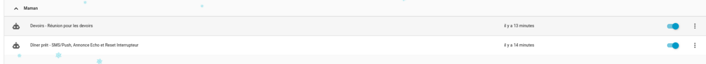

<p class="forum-cta"><a href="https://forumdomotique.com/forums/topic/605-quand-papa-geek-essaie-de-faire-plaisir-%C3%A0-maman-lhistoire-de-linterrupteur-maudit/">Lire et commenter sur Forum Domotique</a></p>

# Quand Papa Geek Essaie de Faire Plaisir à Maman : L'Histoire de l'Interrupteur Maudit

- **Catégorie :** [Tutoriels, Guides & Astuces des Membres](https://forumdomotique.com/forums/87-tutoriels-guides-astuces-des-membres/)
- **Sujet :** https://forumdomotique.com/forums/topic/605-quand-papa-geek-essaie-de-faire-plaisir-%C3%A0-maman-lhistoire-de-linterrupteur-maudit/
- **Auteur du premier message du sujet :** XAV59213
- **Messages de XAV59213 dans ce sujet :** 1
- **Premier message de XAV59213 :** 14 décembre 2025 à 14:09 (Europe/Paris)

---

## Message 1 — 14 décembre 2025 à 14:09 (Europe/Paris)

- **Identifiant :** `1534`
- **Lien :** https://forumdomotique.com/forums/topic/605-quand-papa-geek-essaie-de-faire-plaisir-%C3%A0-maman-lhistoire-de-linterrupteur-maudit/#findComment-1534

Ah, la vie de père de cinq enfants... Cinq ! C'est pas une famille, c'est une petite tribu. Y en a un qui crie parce qu'il a perdu sa chaussette gauche, l'autre qui transforme le salon en circuit de Formule 1 avec ses jouets, la troisième qui négocie comme un avocat pour 5 minutes de tablette en plus, et les deux derniers qui se battent pour savoir qui a le droit de respirer le plus fort. Et au milieu de ce chaos organisé, il y a moi : le papa qui veut juste... faire plaisir à sa femme.


<!-- source : https://cdn.forumdomotique.com/monthly_2025_12/Capturedcrandu2025-12-1414-25-30.png.4be71c4261b542bc36cab185259e992c.png -->

Ma chérie, cette sainte femme qui gère tout avec un sourire (et parfois des yeux qui lancent des éclairs), se plaint souvent : "À table ! Le dîner est prêt !" et personne ne bouge. Les enfants sont scotchés à leurs écrans, collés dans leurs chambres, ou en train de "finir juste cette partie" de je-ne-sais-quoi. Elle répète, elle hausse le ton, elle finit par envoyer des SOS par pigeon voyageur (non, en vrai, par WhatsApp, mais c'est pareil).

Alors moi, en bon geek domestique armé de Home Assistant, d'Echo Dots planqués partout et d'interrupteurs connectés, j'ai eu LA idée de génie. L'idée qui allait révolutionner notre vie de famille. L'idée qui allait me faire passer pour le héros du foyer.

**L'interrupteur magique du dîner.**


<!-- source : https://cdn.forumdomotique.com/monthly_2025_12/Capturedcrandu2025-12-1414-27-26.png.485023902080fbf8fd8409351b954a43.png -->

J'en ai pris un beau, tout simple, WiFi bien sûr . Je l'ai configuré pour que quand ma femme appuie dessus : BAM ! SMS à toute la famille ("Le dîner est servi ! Venez à table !"), et en plus, annonce vocale sur TOUS les Echo Dots de la maison. Cuisine, salon, grange (oui on en a un dans la grange, ne demandez pas pourquoi), chambre, salle de bain... Partout. La voix d'Alexa qui résonne en stéréo : "Le dîner est servi ! Venez à table !"🤣

Voici les codes:



C'est l'heure des devoirs ! Tout le monde à table pour travailler ensemble !

```yaml
alias: Devoirs - Réunion pour les devoirs
description: ""
triggers:
  - trigger: state
    entity_id: switch.interrupteur_depart_arrive_switch_1
    to: "on"
conditions: []
actions:
  - action: notify.send_message
    metadata: {}
    data:
      message: >-
        C'est l'heure des devoirs ! Tout le monde à table pour travailler
        ensemble !
    target:
      entity_id:
        - notify.maman
        - notify.papa
        - notify.xavier
        - notify.naomie
        - notify.anais
  - action: notify.alexa_media_grange_echo_dot
    metadata: {}
    data:
      message: >-
        C'est l'heure des devoirs ! Tout le monde à table pour travailler
        ensemble !
  - action: notify.alexa_media_xavier_echo_show_5_2eme_gen
    metadata: {}
    data:
      message: >-
        C'est l'heure des devoirs ! Tout le monde à table pour travailler
        ensemble !
  - action: notify.alexa_media_xavier_s_freebox_delta
    metadata: {}
    data:
      message: >-
        C'est l'heure des devoirs ! Tout le monde à table pour travailler
        ensemble !
  - action: notify.alexa_media_xavier_echo_dot_sdb
    metadata: {}
    data:
      message: >-
        C'est l'heure des devoirs ! Tout le monde à table pour travailler
        ensemble !
  - delay:
      hours: 0
      minutes: 0
      seconds: 5
      milliseconds: 0
  - action: switch.turn_off
    metadata: {}
    data:
      entity_id: switch.interrupteur_depart_arrive_switch_1
mode: single
```

Le dîner est servi ! Venez à table !

```yaml
alias: Dîner prêt - SMS/Push, Annonce Echo et Reset Interrupteur
description: ""
triggers:
  - trigger: state
    entity_id: switch.interrupteur_depart_arrive_switch_2
    to: "on"
conditions: []
actions:
  - action: notify.send_message
    metadata: {}
    data:
      message: Le dîner est servi ! Venez à table !
    target:
      entity_id:
        - notify.maman
        - notify.papa
        - notify.xavier
        - notify.naomie
        - notify.anais
  - action: notify.alexa_media_grange_echo_dot
    metadata: {}
    data:
      message: Le dîner est servi ! Venez à table !
  - action: notify.alexa_media_xavier_echo_show_5_2eme_gen
    metadata: {}
    data:
      message: Le dîner est servi ! Venez à table !
  - action: notify.alexa_media_xavier_s_freebox_delta
    metadata: {}
    data:
      message: Le dîner est servi ! Venez à table !
  - action: notify.alexa_media_xavier_echo_dot_sdb
    metadata: {}
    data:
      message: Le dîner est servi ! Venez à table !
  - action: notify.alexa_media_grange_echo_dot
    metadata: {}
    data:
      message: Le dîner est servi ! Venez à table !
  - delay:
      hours: 0
      minutes: 0
      seconds: 5
      milliseconds: 0
  - action: switch.turn_off
    metadata: {}
    data:
      entity_id: switch.interrupteur_depart_arrive_switch_2
mode: single
```

Le premier soir : miracle. Elle appuie, les téléphones vibrent, les Echo parlent, et en 30 secondes chrono, tout le monde débarque à table. Les yeux de ma femme brillent. "T'es génial mon chéri !" qu'elle me fait. Je bombe le torse. Papa 1 - Chaos familial 0.

Et puis... la réalité a rattrapé le geek.

Deuxième soir : elle appuie pour le dîner. Annonce partout. Les enfants arrivent... mais déjà avec un petit sourire en coin.

Troisième soir : "Le dîner est servi !" → Un gamin répond à Alexa : "Ouais ouais, on arrive..."

Quatrième soir : J'entends depuis la cuisine un "Encore ?!" suivi d'un soupir collectif.

Une semaine plus tard ? C'est l'enfer.

Les enfants en peuvent plus.

- Le grand : "Papa, c'est lourd là, on dirait une alarme incendie à chaque repas."
- La deuxième : "Alexa me saoule, elle parle trop fort dans ma chambre."
- Le troisième : "Je peux pas avoir un bouton pour éteindre Alexa quand maman appuie ?"
- Et les petits... ben ils imitent Alexa maintenant : "Le dîner est servi ! Venez à table !" en boucle, juste pour embêter leurs frères et sœurs.

Ma femme ? Elle adore toujours. Elle appuie avec un petit sourire sadique maintenant. "C'est pratique !" qu'elle dit.

Moi je me cache dans la grange avec l'Echo qui répète le message en boucle!

J'ai même créé un deuxième interrupteur pour les devoirs ("C'est l'heure des devoirs ! Tout le monde à table !"). Erreur fatale. Là, c'est la mutinerie ouverte. Les enfants complotent pour "débrancher Papa du réseau".

Moralité de l'histoire ? Quand on est père de cinq enfants, on croit qu'on peut dompter le chaos avec de la technologie. En réalité, la technologie devient juste un nouveau membre de la famille... que tout le monde finit par détester (sauf maman).

Mais bon, au moins, maintenant, on mange tous ensemble. Et c'est ça le vrai bonheur, non ? (Enfin... jusqu'à ce que je trouve comment faire un interrupteur pour le coucher. Là, je sens que je vais me faire lyncher pour de bon.)

Papa geek, toujours en sursis. 🍽️😂

Désolé, je dois vous quitter, l’apéro est servi ! 😅 Je vous laisse avec le code. Bien sûr, n’hésitez pas à l’adapter à vos besoins. Si vous avez la moindre question ou une autre demande, faites-moi signe quand vous voulez, je serai ravi de vous aider !

---
