
<a href="https://forumdomotique.com/forums/topic/618-comment-ajouter-la-musique-stock%C3%A9e-sur-le-disque-dur-de-votre-freebox-%C3%A0-music-assistant-via-partage-smb/">Lire et commenter sur Forum Domotique</a>

# Comment ajouter la musique stockée sur le disque dur de votre Freebox à Music Assistant via partage SMB

- **Catégorie :** [Tutoriels, Guides & Astuces des Membres](https://forumdomotique.com/forums/87-tutoriels-guides-astuces-des-membres/)
- **Sujet :** https://forumdomotique.com/forums/topic/618-comment-ajouter-la-musique-stock%C3%A9e-sur-le-disque-dur-de-votre-freebox-%C3%A0-music-assistant-via-partage-smb/
- **Auteur du premier message du sujet :** XAV59213
- **Messages de XAV59213 dans ce sujet :** 1
- **Premier message de XAV59213 :** 21 décembre 2025 à 13:30 (Europe/Paris)

---

## Message 1 — 21 décembre 2025 à 13:30 (Europe/Paris)

- **Identifiant :** `1589`
- **Lien :** https://forumdomotique.com/forums/topic/618-comment-ajouter-la-musique-stock%C3%A9e-sur-le-disque-dur-de-votre-freebox-%C3%A0-music-assistant-via-partage-smb/#findComment-1589

Music Assistant est un excellent add-on pour Home Assistant qui permet de gérer et diffuser une bibliothèque musicale unifiée, y compris vos fichiers locaux. Si vous avez de la musique stockée sur le disque dur de votre Freebox (Pop, Delta, Révolution, etc.), vous pouvez l'intégrer facilement grâce au partage SMB (également appelé "Partages Windows").

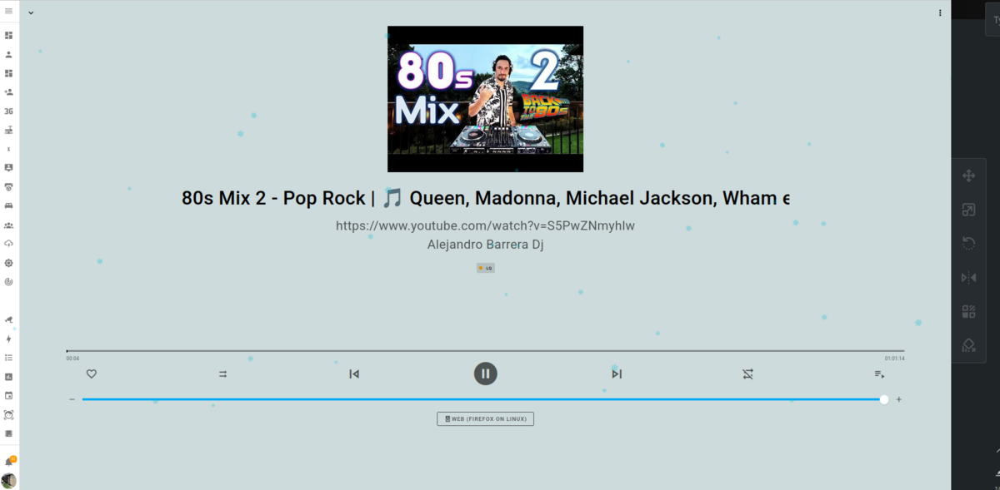

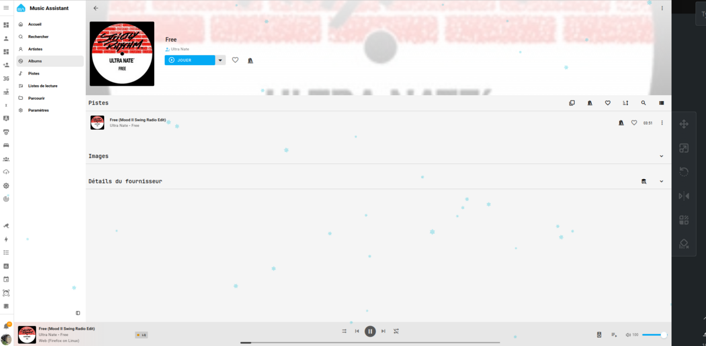

La Freebox expose son disque dur via le chemin réseau \\freebox_server\Disque dur (ou parfois \\freebox_server\Disque 1 selon le modèle).

Music Assistant supporte nativement les partages SMB distants via son provider **Filesystem (remote share)**.

Voici un guide détaillé et étape par étape.

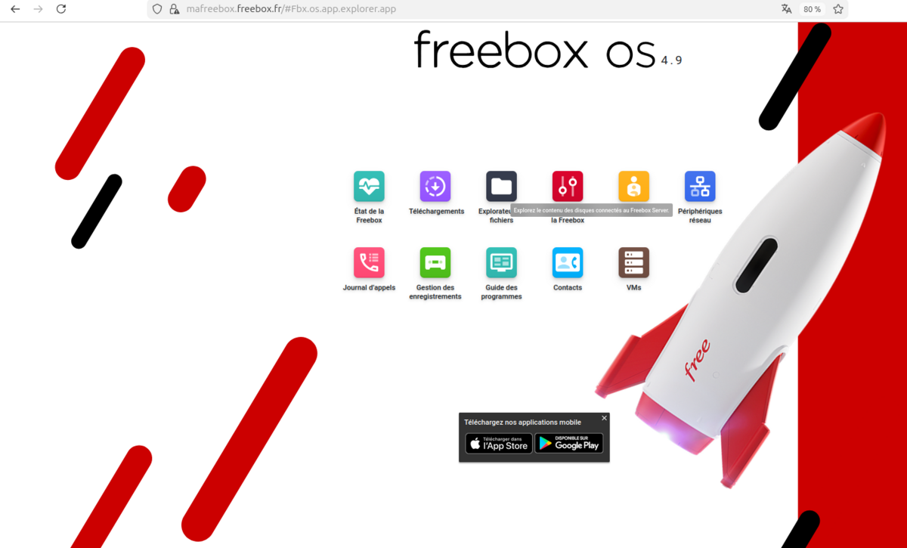

### Prérequis

- Home Assistant avec Music Assistant installé (version récente recommandée).
- Disque dur connecté à votre Freebox et contenant vos fichiers musicaux (MP3, FLAC, etc.), idéalement organisés dans un dossier dédié (ex. : un sous-dossier "Musique").

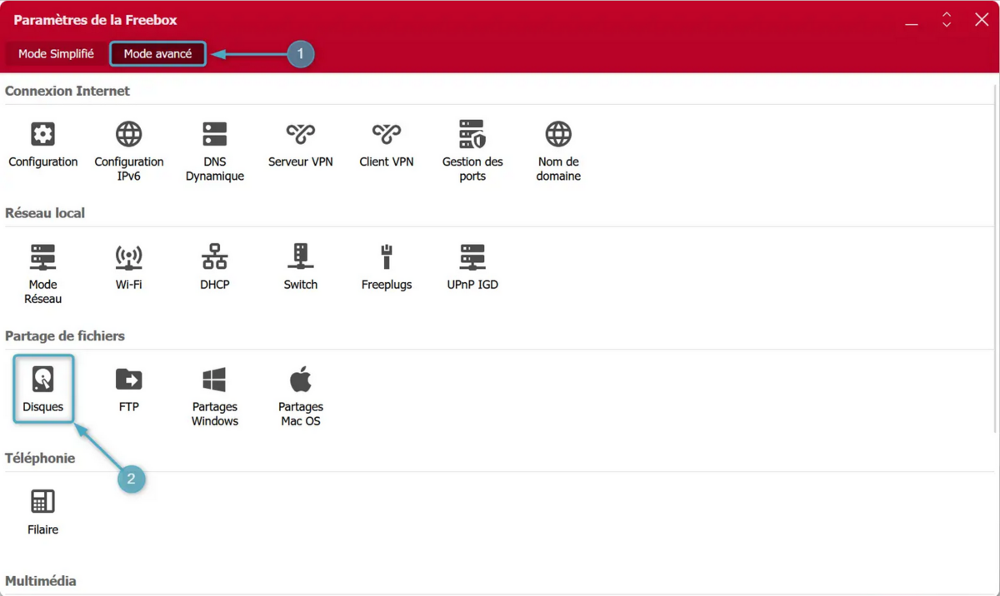
<!-- source : https://cdn.forumdomotique.com/monthly_2025_12/Capturedcrandu2025-12-2113-33-24.png.8633bfc94aefde66e2d59b4e7a05050f.png -->

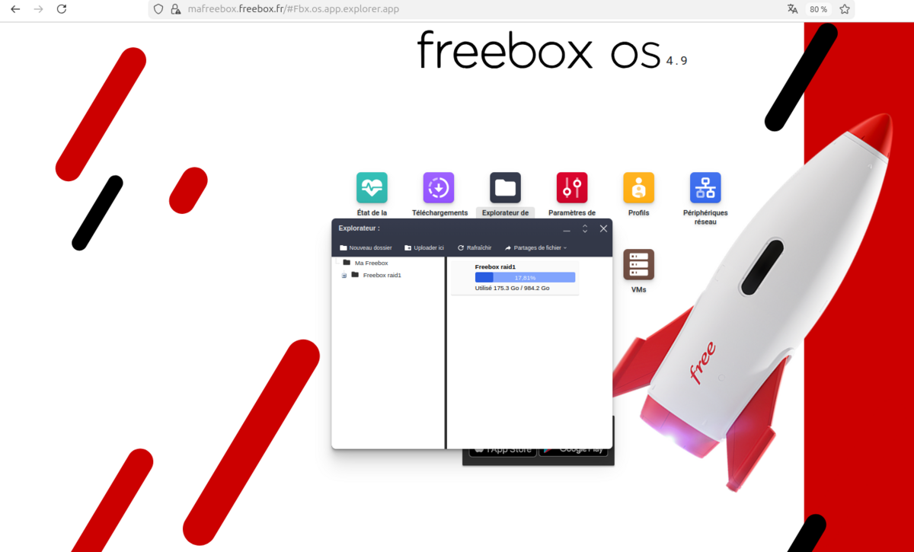

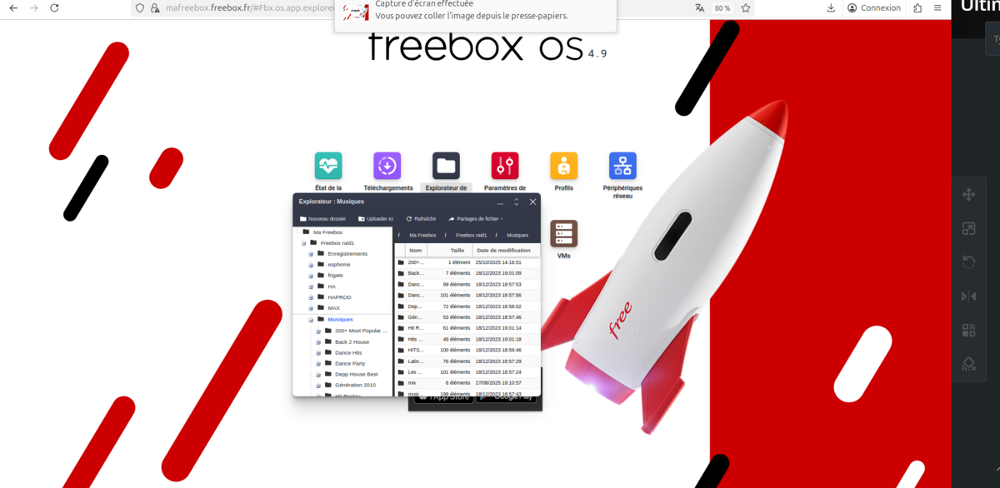
<!-- source : https://cdn.forumdomotique.com/monthly_2025_12/Capturedcrandu2025-12-2112-46-57.png.86e99055786aa42a06fad09b25599963.png -->

- Partage SMB activé sur la Freebox :

  - Connectez-vous à Freebox OS.
  - Allez dans **Paramètres de la Freebox** > **Partages de fichiers** > **Partages Windows (SMB)**.
  - Activez le partage et, si possible, SMBv2/SMBv3 pour plus de sécurité et compatibilité.
- Votre instance Home Assistant doit être sur le même réseau local que la Freebox.

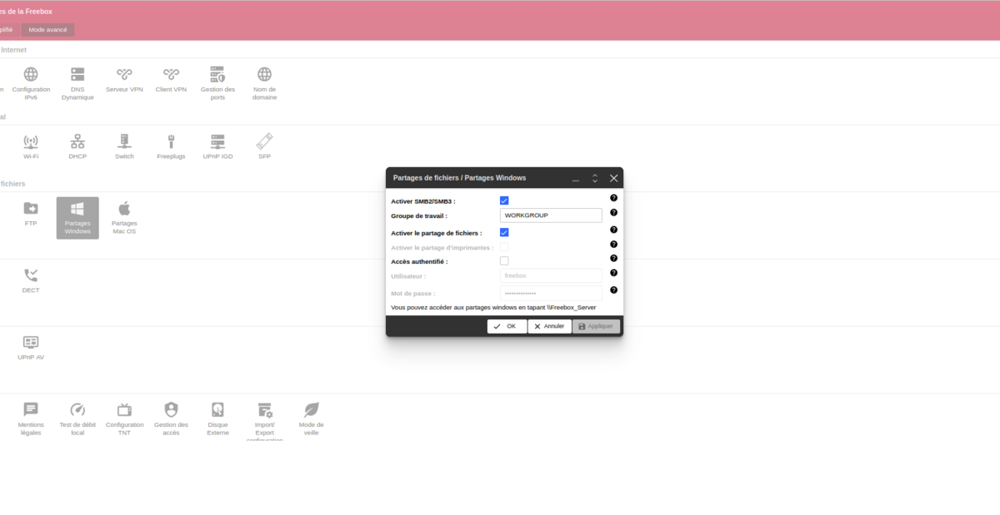
<!-- source : https://cdn.forumdomotique.com/monthly_2025_12/Capturedcrandu2025-12-2113-35-09.png.a1fa67de114ce5a4a4116471c9808715.png -->

### Étapes pour ajouter le partage dans homeassistant

1. **Configurez le partage SMB de la Freebox** :

   - **Host** : freebox_server (ou l'IP de votre Freebox, ex. : 192.168.1.254 si le nom ne résout pas).
   - **Share name** : Disque dur (attention à l'espace et aux majuscules ! Si c'est "Disque 1", adaptez).
   - **Subfolder** (optionnel) : Indiquez le chemin vers votre dossier musique, ex. : Musique ou Ma Musique/Musique.
   - **Username** et **Password** : Laissez vide si aucun mot de passe n'est configuré sur la Freebox (par défaut). Sinon, saisissez les identifiants définis dans Freebox OS.
   - **SMB Version** : Laissez "Auto" ou sélectionnez SMB 3.0/3.1.1 (recommandé ; évitez SMB 1.0 pour des raisons de sécurité).

   **Cache Mode** : "Loose" (recommandé pour les bibliothèques musicales).

   - Exemple de configuration :
   - Host :192.168.1.254
   - Share : Freebox raid1/Musiques

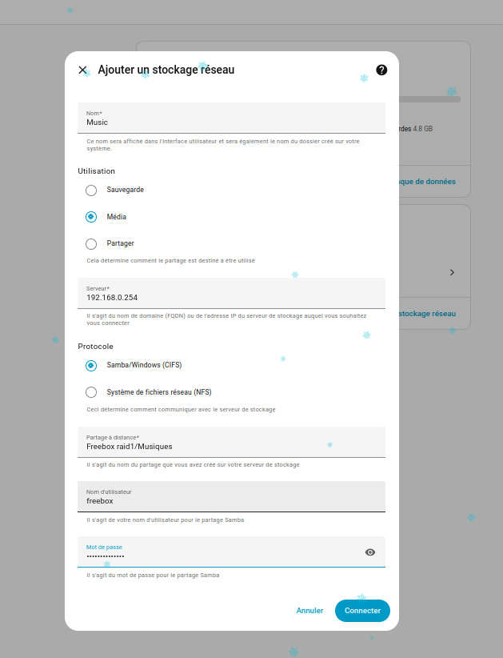

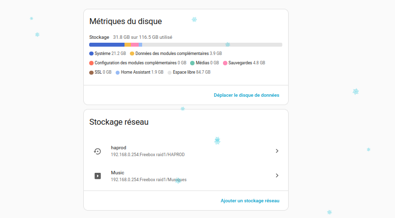

#### Le dossier qui se crée automatiquement dans Médias !

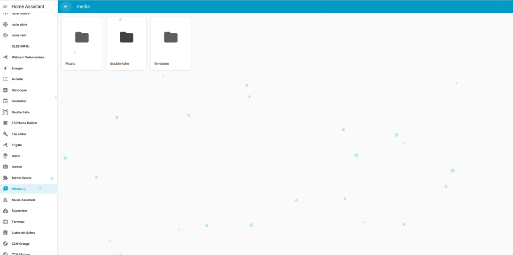
<!-- source : https://cdn.forumdomotique.com/monthly_2025_12/Capturedcrandu2025-12-2113-58-29.png.3f0e55bb06022db3e56f1ed75f0abfc2.png -->

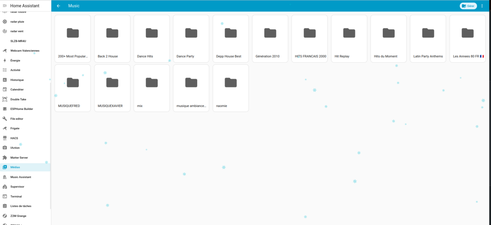
<!-- source : https://cdn.forumdomotique.com/monthly_2025_12/Capturedcrandu2025-12-2113-58-41.png.5efa3c3c16dafdd4996eba9fede814a6.png -->

### Étapes pour ajouter le provider dans Music Assistant

1. **Ouvrez l'interface Music Assistant** :

   - Dans Home Assistant, allez dans la sidebar > **Music Assistant**.
   - Ou directement via l'URL (ex. : <http://votre-ip-ha:8095> si installé en add-on).
2. **Accédez aux paramètres des providers** :

   - Cliquez sur l'icône engrenage (Settings) en bas à gauche.
   - Sélectionnez l'onglet **Music Providers**.
3. **Ajoutez un nouveau provider** :

   - Cliquez sur **Add Provider**.
   - Cherchez et sélectionnez **Filesystem (remote share)**.

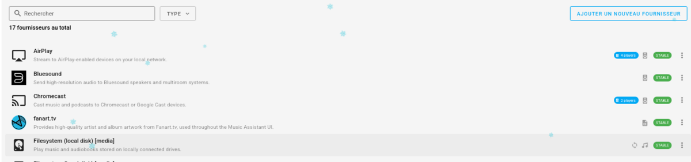

1. **Validez et synchronisez** :

   - Cliquez sur **Save**.
   - Music Assistant montera le partage et scannera votre bibliothèque (cela peut prendre du temps selon la taille).
   - Vos albums, artistes et pistes apparaîtront dans la bibliothèque unifiée.

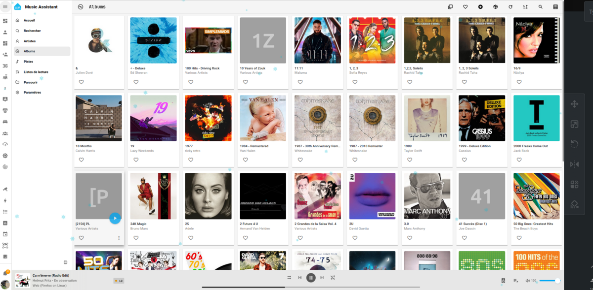

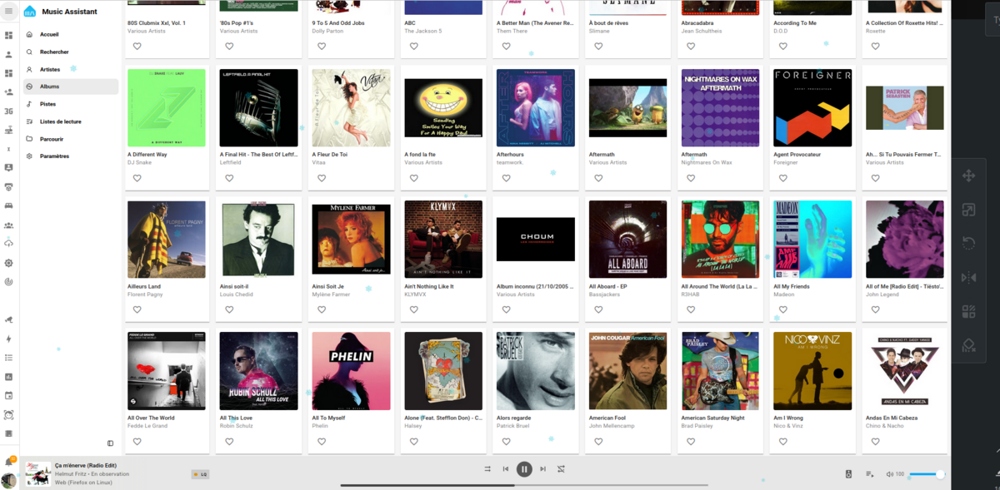

### Utilisation une fois ajouté

- Vos fichiers locaux s'intègrent parfaitement avec d'autres providers (Spotify, Deezer, etc.).
- Music Assistant priorise toujours la meilleure qualité (ex. : FLAC local > stream compressé).
- Diffusez sur tous vos players compatibles (Chromecast, Sonos, etc.).
- Créez des playlists mixtes ou automatisations Home Assistant (ex. : musique au réveil).

### Problèmes courants et solutions

- **Erreur de montage SMB** : Vérifiez le nom exact du share dans Freebox OS. Testez l'accès depuis un PC Windows (\\freebox_server\Disque dur).
- **Nom avec espace** : "Disque dur" fonctionne normalement, mais si erreur, essayez l'IP au lieu du nom.
- **Synchronisation lente ou incomplète** : Assurez-vous que les fichiers ont de bons tags (ID3 pour MP3, etc.). Relancez la sync manuellement.
- **Accès refusé** : Activez SMBv2+ sur Freebox et évitez SMB1.
- Si votre Freebox demande un mot de passe, configurez-le dans Freebox OS pour plus de sécurité.

Avec cette intégration, votre musique locale sur Freebox devient accessible dans tout votre écosystème Home Assistant, sans passer par l'interface Freebox Player. Pratique pour une maison connectée !

---
