<p class="forum-cta"><a href="https://forumdomotique.com/forums/topic/620-connecter-son-imprimante-3d-%C3%A0-home-assistant-avec-octoprint-sur-raspberry-pi-mon-retour-dexp%C3%A9rience/">Lire et commenter sur Forum Domotique</a></p>


<section class="carousel photo-carousel" data-carousel data-lightbox aria-roledescription="carrousel" aria-label="Photos de l’article (14)" tabindex="0">
<div class="carousel-track" data-track>
<figure class="photo-slide" data-slide>
  <a href="images/Capturedcrandu2025-12-2114-39-36.png" data-full="images/Capturedcrandu2025-12-2114-39-36.png" data-alt="Photo 1 — Connecter son imprimante 3D à Home Assistant avec OctoPrint sur Raspberry Pi : mon retour d'expérience" aria-label="Agrandir la photo 1 : Photo 1 — Connecter son imprimante 3D à Home Assistant avec OctoPrint sur Raspberry Pi : mon retour d'expérience">
    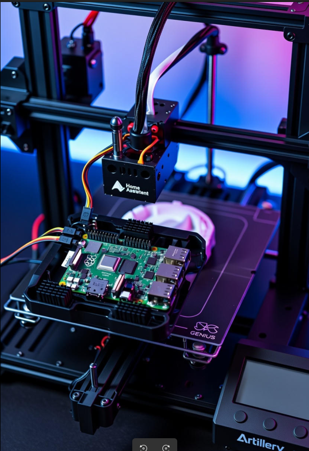
  </a>
</figure>
<figure class="photo-slide" data-slide>
  <a href="images/Capturedcrandu2025-12-2114-58-47.png" data-full="images/Capturedcrandu2025-12-2114-58-47.png" data-alt="Photo 2 — Connecter son imprimante 3D à Home Assistant avec OctoPrint sur Raspberry Pi : mon retour d'expérience" aria-label="Agrandir la photo 2 : Photo 2 — Connecter son imprimante 3D à Home Assistant avec OctoPrint sur Raspberry Pi : mon retour d'expérience">
    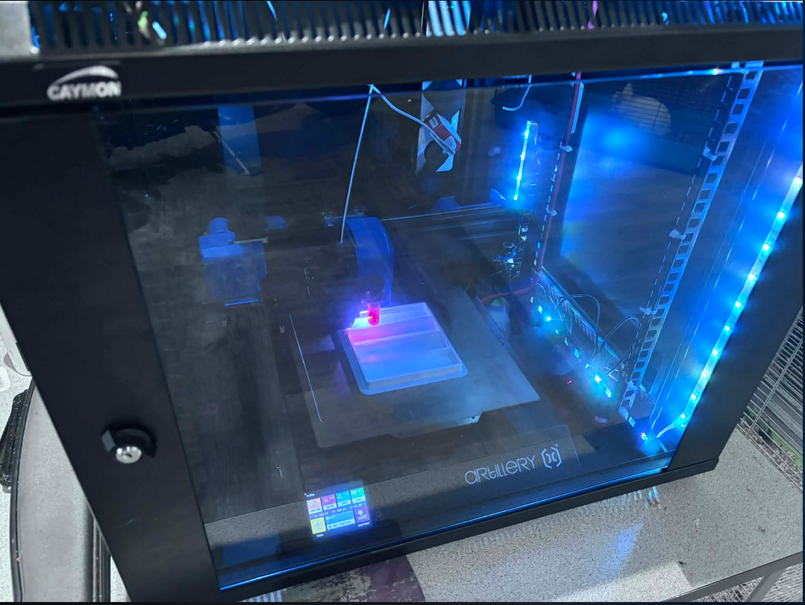
  </a>
</figure>
<figure class="photo-slide" data-slide>
  <a href="images/Capturedcrandu2025-12-2114-59-16.png" data-full="images/Capturedcrandu2025-12-2114-59-16.png" data-alt="Photo 3 — Connecter son imprimante 3D à Home Assistant avec OctoPrint sur Raspberry Pi : mon retour d'expérience" aria-label="Agrandir la photo 3 : Photo 3 — Connecter son imprimante 3D à Home Assistant avec OctoPrint sur Raspberry Pi : mon retour d'expérience">
    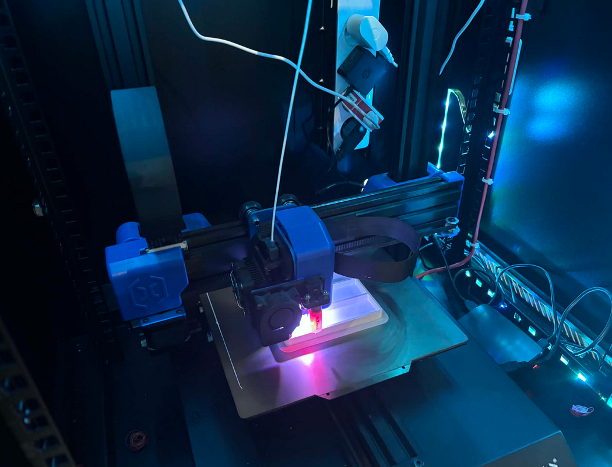
  </a>
</figure>
<figure class="photo-slide" data-slide>
  <a href="images/Capturedcrandu2025-12-2115-10-51.png" data-full="images/Capturedcrandu2025-12-2115-10-51.png" data-alt="Photo 4 — Connecter son imprimante 3D à Home Assistant avec OctoPrint sur Raspberry Pi : mon retour d'expérience" aria-label="Agrandir la photo 4 : Photo 4 — Connecter son imprimante 3D à Home Assistant avec OctoPrint sur Raspberry Pi : mon retour d'expérience">
    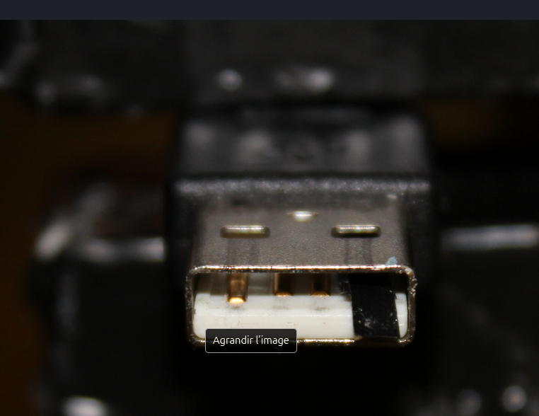
  </a>
</figure>
<figure class="photo-slide" data-slide>
  <a href="images/Capturedcrandu2025-12-2115-11-10.png" data-full="images/Capturedcrandu2025-12-2115-11-10.png" data-alt="Photo 5 — Connecter son imprimante 3D à Home Assistant avec OctoPrint sur Raspberry Pi : mon retour d'expérience" aria-label="Agrandir la photo 5 : Photo 5 — Connecter son imprimante 3D à Home Assistant avec OctoPrint sur Raspberry Pi : mon retour d'expérience">
    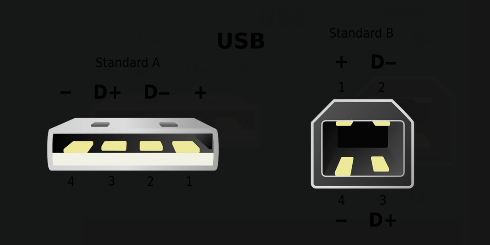
  </a>
</figure>
<figure class="photo-slide" data-slide>
  <a href="images/Capturedcrandu2025-12-2115-05-23.png" data-full="images/Capturedcrandu2025-12-2115-05-23.png" data-alt="Photo 6 — Connecter son imprimante 3D à Home Assistant avec OctoPrint sur Raspberry Pi : mon retour d'expérience" aria-label="Agrandir la photo 6 : Photo 6 — Connecter son imprimante 3D à Home Assistant avec OctoPrint sur Raspberry Pi : mon retour d'expérience">
    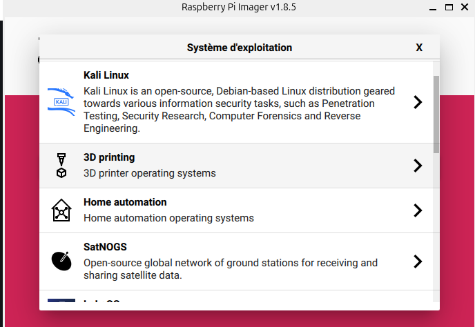
  </a>
</figure>
<figure class="photo-slide" data-slide>
  <a href="images/Capturedcrandu2025-12-2115-05-33.png" data-full="images/Capturedcrandu2025-12-2115-05-33.png" data-alt="Photo 7 — Connecter son imprimante 3D à Home Assistant avec OctoPrint sur Raspberry Pi : mon retour d'expérience" aria-label="Agrandir la photo 7 : Photo 7 — Connecter son imprimante 3D à Home Assistant avec OctoPrint sur Raspberry Pi : mon retour d'expérience">
    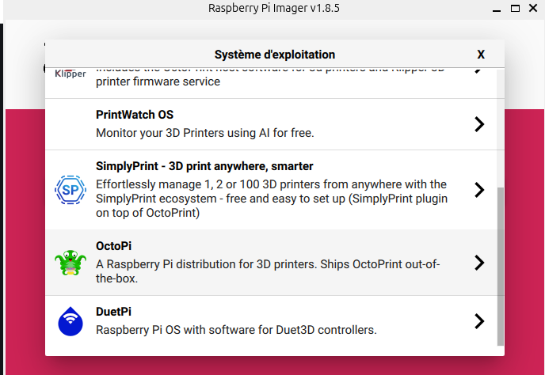
  </a>
</figure>
<figure class="photo-slide" data-slide>
  <a href="images/Capturedcrandu2025-12-2115-05-39.png" data-full="images/Capturedcrandu2025-12-2115-05-39.png" data-alt="Photo 8 — Connecter son imprimante 3D à Home Assistant avec OctoPrint sur Raspberry Pi : mon retour d'expérience" aria-label="Agrandir la photo 8 : Photo 8 — Connecter son imprimante 3D à Home Assistant avec OctoPrint sur Raspberry Pi : mon retour d'expérience">
    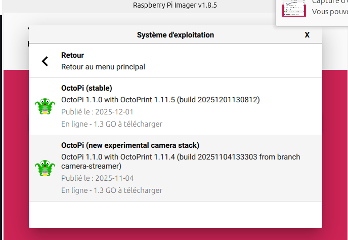
  </a>
</figure>
<figure class="photo-slide" data-slide>
  <a href="images/Capturedcrandu2025-12-2114-52-02.png" data-full="images/Capturedcrandu2025-12-2114-52-02.png" data-alt="Photo 9 — Connecter son imprimante 3D à Home Assistant avec OctoPrint sur Raspberry Pi : mon retour d'expérience" aria-label="Agrandir la photo 9 : Photo 9 — Connecter son imprimante 3D à Home Assistant avec OctoPrint sur Raspberry Pi : mon retour d'expérience">
    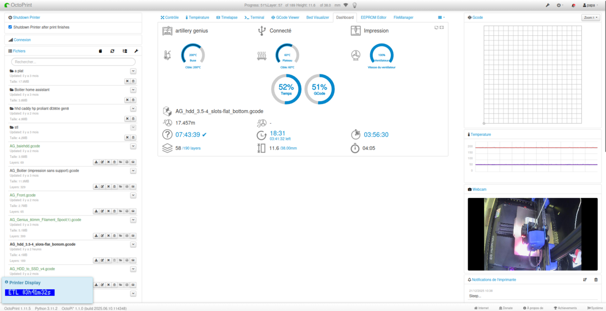
  </a>
</figure>
<figure class="photo-slide" data-slide>
  <a href="images/Capturedcrandu2025-12-2115-18-32.png" data-full="images/Capturedcrandu2025-12-2115-18-32.png" data-alt="Photo 10 — Connecter son imprimante 3D à Home Assistant avec OctoPrint sur Raspberry Pi : mon retour d'expérience" aria-label="Agrandir la photo 10 : Photo 10 — Connecter son imprimante 3D à Home Assistant avec OctoPrint sur Raspberry Pi : mon retour d'expérience">
    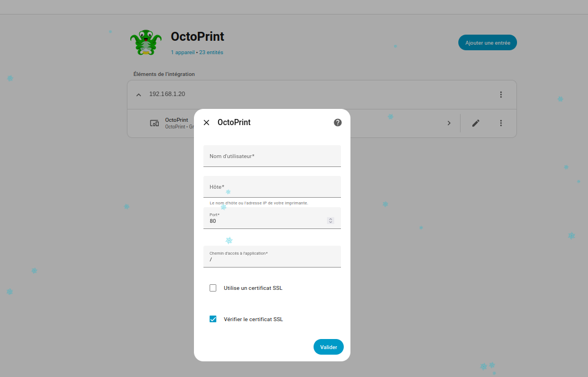
  </a>
</figure>
<figure class="photo-slide" data-slide>
  <a href="images/Capturedcrandu2025-12-2115-09-14.png" data-full="images/Capturedcrandu2025-12-2115-09-14.png" data-alt="Photo 11 — Connecter son imprimante 3D à Home Assistant avec OctoPrint sur Raspberry Pi : mon retour d'expérience" aria-label="Agrandir la photo 11 : Photo 11 — Connecter son imprimante 3D à Home Assistant avec OctoPrint sur Raspberry Pi : mon retour d'expérience">
    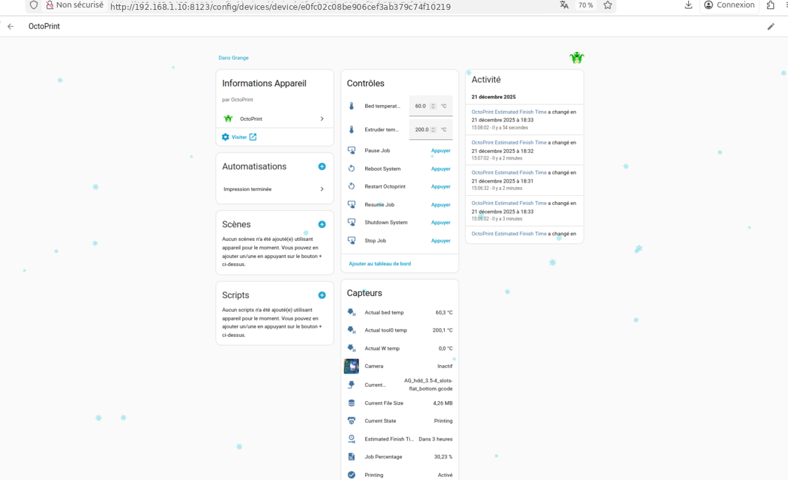
  </a>
</figure>
<figure class="photo-slide" data-slide>
  <a href="images/Capturedcrandu2025-12-2114-52-57.png" data-full="images/Capturedcrandu2025-12-2114-52-57.png" data-alt="Photo 12 — Connecter son imprimante 3D à Home Assistant avec OctoPrint sur Raspberry Pi : mon retour d'expérience" aria-label="Agrandir la photo 12 : Photo 12 — Connecter son imprimante 3D à Home Assistant avec OctoPrint sur Raspberry Pi : mon retour d'expérience">
    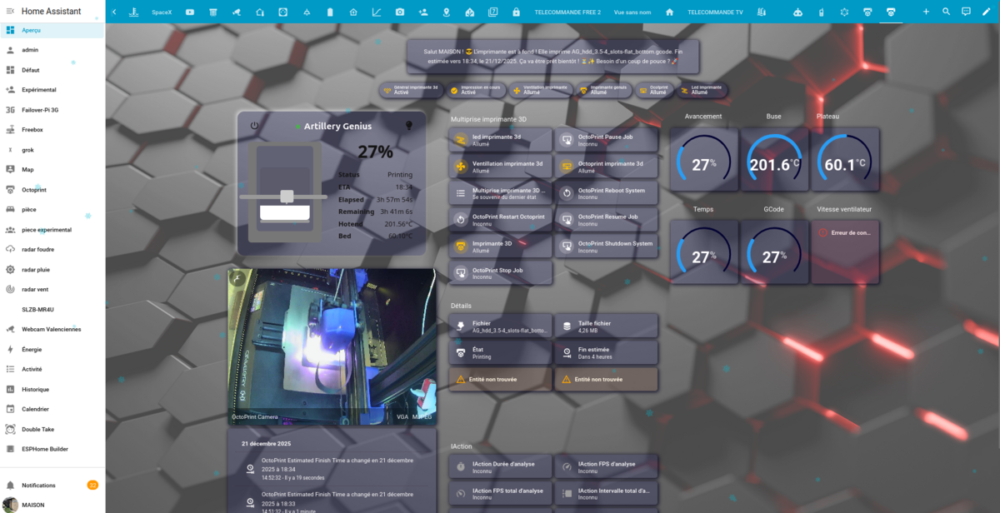
  </a>
</figure>
<figure class="photo-slide" data-slide>
  <a href="images/Capturedcrandu2025-12-2115-44-23.png" data-full="images/Capturedcrandu2025-12-2115-44-23.png" data-alt="Photo 13 — Connecter son imprimante 3D à Home Assistant avec OctoPrint sur Raspberry Pi : mon retour d'expérience" aria-label="Agrandir la photo 13 : Photo 13 — Connecter son imprimante 3D à Home Assistant avec OctoPrint sur Raspberry Pi : mon retour d'expérience">
    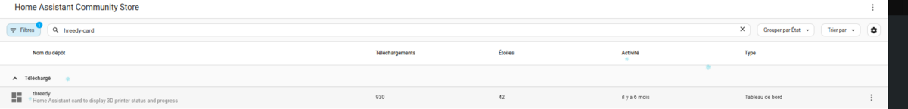
  </a>
</figure>
<figure class="photo-slide" data-slide>
  <a href="images/Capturedcrandu2025-12-2115-44-45.png" data-full="images/Capturedcrandu2025-12-2115-44-45.png" data-alt="Photo 14 — Connecter son imprimante 3D à Home Assistant avec OctoPrint sur Raspberry Pi : mon retour d'expérience" aria-label="Agrandir la photo 14 : Photo 14 — Connecter son imprimante 3D à Home Assistant avec OctoPrint sur Raspberry Pi : mon retour d'expérience">
    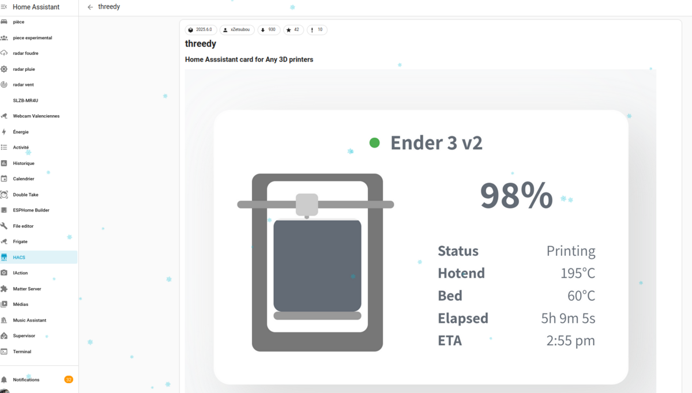
  </a>
</figure>
</div>
<button type="button" class="carousel-nav" data-prev aria-label="Photo précédente">‹</button>
<button type="button" class="carousel-nav" data-next aria-label="Photo suivante">›</button>
<div class="carousel-dots" data-dots></div>
<div class="carousel-live" data-live aria-live="polite"></div>
<p class="carousel-hint">Faites défiler les photos, ou ouvrez-les pour les agrandir (si JavaScript est activé).</p>
</section>

# Connecter son imprimante 3D à Home Assistant avec OctoPrint sur Raspberry Pi : mon retour d'expérience

- **Catégorie :** [Tutoriels, Guides & Astuces des Membres](https://forumdomotique.com/forums/87-tutoriels-guides-astuces-des-membres/)
- **Sujet :** https://forumdomotique.com/forums/topic/620-connecter-son-imprimante-3d-%C3%A0-home-assistant-avec-octoprint-sur-raspberry-pi-mon-retour-dexp%C3%A9rience/
- **Auteur du premier message du sujet :** XAV59213
- **Messages de XAV59213 dans ce sujet :** 1
- **Premier message de XAV59213 :** 21 décembre 2025 à 15:53 (Europe/Paris)

---

## Message 1 — 21 décembre 2025 à 15:53 (Europe/Paris)

- **Identifiant :** `1591`
- **Lien :** https://forumdomotique.com/forums/topic/620-connecter-son-imprimante-3d-%C3%A0-home-assistant-avec-octoprint-sur-raspberry-pi-mon-retour-dexp%C3%A9rience/#findComment-1591

Depuis que j'ai plongé plus sérieusement dans l'impression 3D il y a quelques mois , avec une Artilery Genuis qui trône dans mon atelier, je cherchais une façon simple et fiable de surveiller mes impressions à distance sans avoir à rester collé devant la machine.


L'idée d'intégrer tout ça à **Home Assistant**, ma plateforme domotique centrale qui gère déjà lumières, thermostats et caméras dans la maison, m'a tout de suite séduit.

C'est là qu'**OctoPrint** entre en jeu, ce logiciel open source qui transforme un **Raspberry Pi** en serveur dédié pour l'imprimante.

J'ai monté ce setup il y a quelques mois maintenant, et franchement, ça a changé ma manière de lancer des impressions longues sans stress.

Pas de révolution miracle, juste une solution pratique qui fonctionne au quotidien et qui s'intègre parfaitement dans l'écosystème Home Assistant.

Pour le matériel, rien de bien compliqué ni d'onéreux.

J'ai utilisé un **Raspberry Pi 4** que j'avais sous la main, avec une alimentation dédiée et une carte microSD de 32 Go, mais un Pi 3 ou même un Zero 2 W fait largement l'affaire pour ce genre d'usage.

L'imprimante est connectée via un câble USB classique, et j'ai ajouté une petite webcam basique pour la surveillance vidéo.

Tout tient dans un boîtier discret fixé près de l'imprimante, alimenté indépendamment pour éviter les surprises.

Ce qui m'a agréablement surpris, c'est la compacité du montage : une fois installé, on oublie presque le Pi, il fait juste son boulot en silence sans chauffer excessivement, même pendant des impressions de plusieurs heures.


La mise en route commence par une étape cruciale que beaucoup négligent au départ, et que j'ai moi-même apprise à mes dépens lors d'un premier essai raté : isoler correctement la ligne 5V du câble USB pour éviter le retour de courant de l'imprimante vers le Pi.

Beaucoup d'imprimantes 3D, comme les Ender et genuis, envoient du 5V via le port USB même quand elles sont allumées, ce qui peut causer des instabilités, des redémarrages intempestifs du Pi ou pire, endommager la carte à long terme.

J'ai opté pour la méthode simple et réversible avec du ruban isolant sur la broche correspondante du connecteur USB côté Pi, mais couper le fil rouge à l'intérieur du câble fonctionne aussi très bien si on est à l'aise avec un cutter et du ruban électrique.

Ça prend cinq minutes, et croyez-moi, ça évite bien des galères par la suite.


Une fois cette précaution prise, l'installation d'OctoPrint se fait presque toute seule grâce à l'image **OctoPi**, qui est prête à l'emploi.

Je l'ai flashée sur la carte SD avec Raspberry Pi Imager, en configurant le Wi-Fi directement dans les options pour que le Pi se connecte au réseau domestique dès le premier démarrage.


Le port série se détecte généralement automatiquement, et un baud rate en auto fait le reste.

J'ai eu un petit moment de doute quand la connexion n'était pas immédiate, mais un redémarrage de l'imprimante et du Pi a tout résolu.

À l'allumage, on accède à l'interface web via octopi.local, on suit l'assistant pour créer un compte sécurisé et connecter l'imprimante.

Depuis, la liaison est stable, même en Wi-Fi, sans latence notable pour les commandes basiques.

Au quotidien, OctoPrint devient vite indispensable.

L'interface est claire, avec un suivi en temps réel de la température du nozzle et du bed, de la progression de l'impression et même d'une webcam si on en branche une.

J'aime particulièrement pouvoir uploader un G-code depuis n'importe quel ordinateur ou téléphone, lancer une impression et la surveiller de loin.

Les plugins ajoutent des fonctionnalités utiles, comme des alertes en cas de problème ou des timelapses automatiques à la fin.

La réactivité est bonne, les commandes comme pause ou arrêt répondent instantanément, et la stabilité est au rendez-vous tant que le réseau Wi-Fi est correct.

Pour les impressions longues la nuit, c'est un vrai confort de pouvoir vérifier d'un œil sur le téléphone que tout va bien sans se lever.


#### Mais le vrai plus pour moi, c'est l'intégration avec **Home Assistant**.


Une fois OctoPrint en place, ajouter l'intégration officielle est enfantin : dans les réglages de Home Assistant, on cherche OctoPrint, on entre l'adresse IP du Pi et la clé API générée dans OctoPrint, et voilà.

L'auto-découverte fonctionne souvent du premier coup si les deux sont sur le même réseau. Immédiatement, on récupère une foule d'entités utiles : capteurs de température, pourcentage d'avancement, état de l'impression, et même des boutons pour contrôler pause, reprise ou arrêt.


J'ai créé un dashboard dédié avec une vue caméra, les températures en gros et un graphique de progression, ce qui rend le suivi hyper intuitif depuis l'application Home Assistant sur mon téléphone.


J’ai aussi installé la carte via HACS : <https://github.com/xZetsubou/ha-threedy-card>


Ce qui simplifie vraiment la vie, c'est de pouvoir coupler ça à des automatisations : par exemple, une notification SMS quand l'impression est terminée, ou allumer une lumière spécifique dans l'atelier en cas d'erreur détectée.

```yaml
alias: "Impression terminée "
description: ""
triggers:
  - device_id: e0fc02c08be906cef3ab379c74f10219
    domain: button
    entity_id: aa7a79614c181af12daad30fac0c2f78
    type: pressed
    trigger: device
conditions: []
actions:
  - action: notify.send_message
    metadata: {}
    data:
      message: "Impression terminée "
    target:
      entity_id: notify.papa
mode: single
```

Ce setup a de vrais points forts qui en font une solution durable.

D'abord, la fiabilité une fois l'isolation USB bien faite, plus de crashes aléatoires qui m'avaient agacé au début.

Ensuite, la flexibilité : tout est open source, gratuit, et s'intègre sans accroc à Home Assistant sans passer par des clouds tiers.

La consommation électrique reste modeste, et le Pi dédié à OctoPrint ne perturbe pas les autres tâches domotiques.

Côté pistes d'amélioration, je dirais que l'interface OctoPrint pourrait être un peu plus moderne sur mobile, même si ça fait le job, et qu'il faut veiller à une bonne ventilation du Pi lors d'usages intensifs.

Aussi, pour les débutants en Raspberry Pi, la partie isolation USB peut sembler intimidante, mais avec les tutos de la communauté, ça passe crème.

Au final, après plusieurs mois d'utilisation régulière, je garde ce montage sans hésiter.

Il m'a apporté exactement ce que j'attendais : un contrôle distant serein de mon imprimante 3D, intégré à Home Assistant pour une vue unifiée de la maison.

C'est parfait pour les passionnés de domotique qui ont déjà une imprimante 3D et veulent aller plus loin sans complications inutiles.

Si vous hésitez encore, lancez-vous, la communauté autour d'OctoPrint et Home Assistant est active et prête à aider en cas de besoin.

Pour ma part, c'est devenu un élément fixe de mon atelier connecté.

---
