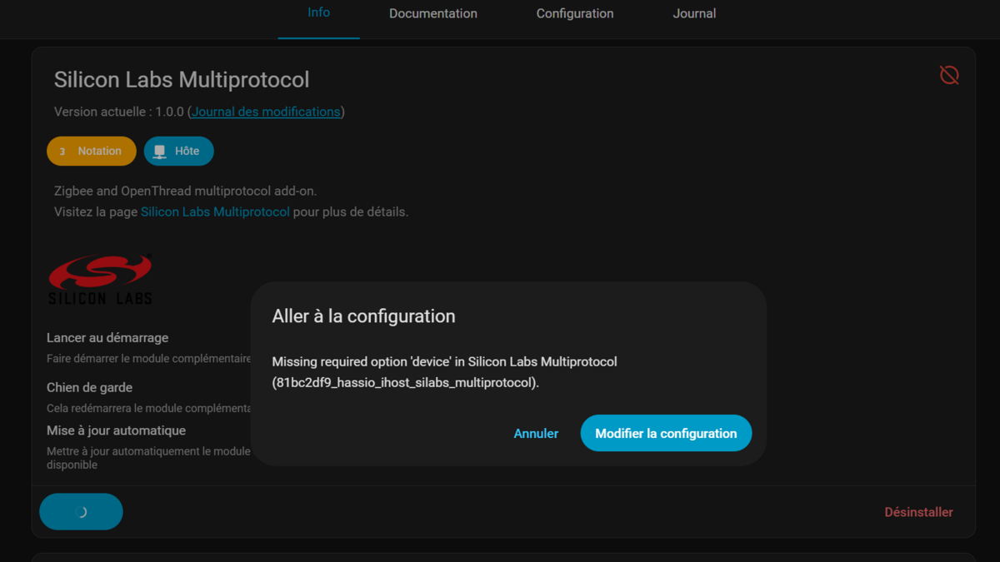

<p class="forum-cta"><a href="https://forumdomotique.com/forums/topic/675-pas-encore-retrait%C3%A9-mais-jai-l%C3%A2ge-dy-%C3%AAtre/">Lire et commenter sur Forum Domotique</a></p>

# Pas encore retraité mais j'ai l'âge d'y être.

- **Catégorie :** [Présentez-vous](https://forumdomotique.com/forums/5-pr%C3%A9sentez-vous/)
- **Sujet :** https://forumdomotique.com/forums/topic/675-pas-encore-retrait%C3%A9-mais-jai-l%C3%A2ge-dy-%C3%AAtre/
- **Auteur du premier message du sujet :** un autre membre (XAV59213 a répondu dans ce sujet)
- **Messages de XAV59213 dans ce sujet :** 12
- **Premier message de XAV59213 :** 11 janvier 2026 à 10:13 (Europe/Paris)
- **Dernier message de XAV59213 :** 19 janvier 2026 à 16:16 (Europe/Paris)

---

## Message 1 — 11 janvier 2026 à 10:13 (Europe/Paris)

- **Identifiant :** `1720`
- **Lien :** https://forumdomotique.com/forums/topic/675-pas-encore-retrait%C3%A9-mais-jai-l%C3%A2ge-dy-%C3%AAtre/#findComment-1720

> **Il y a 11 heures, jbron a dit :**
> Bref...passionné de tech, développeur à mes heures, je me lance, dans ma nouvelle maison (ancienne) dans la domotique.
>
> Après quelques amusements avec mon Alexa et des ampoules et prises connectées, j'ai décidé de passer à la vitesse supérieure. J'ai acheté la box Home Assistant Green ainsi qu'un dongle Sonoff Zigbee 3.0 USB Dongle Plus (ZB-Dongle E).
>
> J'ai flashé le dongle en installant le firmware Mulipan depuis le site de Sonoff. Après avoir ajouté et installé le module complémentaire Silicon Labs Multiprotocol, lorsque je démarre le module, j'obtiens le message d'erreur suivant :
>
> 
>
> J'ai effectué une recherche avec ce message d'erreur mais je n'ai pas trouvé d'explication ou de réponse adéquate.
>
> Merci de votre aide.

Salut [@jbron](https://forumdomotique.com/profile/1088-jbron/) !

Bienvenue dans le monde de la domotique avec Home Assistant, c'est un super choix pour une maison ancienne (et c'est souvent plus fun que de rester sur Alexa + ampoules connectées).

Le message d'erreur que tu vois :

**"Missing required option 'device' in Silicon Labs Multiprotocol"**

est très classique avec le add-on **Silicon Labs Multiprotocol** sur Home Assistant Green. Ça veut dire que le module complémentaire ne sait pas sur quel port série (USB) il doit parler avec ton dongle Sonoff ZB-Dongle-E.

### Pourquoi ça arrive ?

Home Assistant Green est un peu particulier : les dongles USB ne sont pas toujours montés automatiquement sous /dev/ttyUSB0 (ou autre nom fixe). Le add-on attend explicitement que tu lui indiques le chemin du device dans sa configuration.

### Étape par étape pour corriger ça

Le problème vient du fait que le add-on **Silicon Labs Multiprotocol** exige maintenant explicitement le champ **device** dans sa configuration YAML (c'était déjà le cas avant, mais sur HA Green c'est souvent oublié car l'auto-détection n'est pas toujours parfaite).

Voici la marche à suivre précise pour corriger ça rapidement :

Va dans Paramètres → Add-ons → Silicon Labs Multiprotocol → Configuration

Active le mode YAML (bouton en haut à droite si ce n'est pas déjà fait) et assure-toi que ça ressemble à ça :

```yaml
device: /dev/ttyUSB0          # ou mieux : le chemin by-id complet (voir ci-dessous)
baudrate: 460800
flow_control: false
autoflash_firmware: true      # ou false si tu préfères gérer toi-même
```

Le plus fiable sur HA Green : utilise le chemin stable **/dev/serial/by-id/** Pour le trouver :

- Paramètres → Système → Matériel
- Descends jusqu'à "Ports série" ou clique sur "Tout le matériel"
- Cherche l'entrée qui mentionne **Silicon Labs**, **Sonoff Zigbee 3.0 USB Dongle Plus** ou **EFR32**
- Copie le chemin complet genre : /dev/serial/by-id/usb-Silicon_Labs_CP210x_USB_to_UART_Bridge_Controller_0001-if00-port0 (le nom exact varie mais commence toujours par usb-Silicon_Labs_... ou usb-Itead_Sonoff_...)

Colle ce chemin dans **device:** et enregistre.

Redémarre ensuite l'add-on (bouton Restart).

Regarde les logs de l'add-on juste après : tu devrais voir qu'il se connecte au dongle, initialise le multiprotocole et lance à la fois Zigbee + Thread/OpenThread.

Une fois que l'add-on tourne bien :

- Ajoute l'intégration ZHA → choisis **Entrer manuellement** le radio → mets socket://core-silabs-multiprotocol:9999 (ou tcp:// si socket ne passe pas)
- Pour Thread/Matter : l'intégration Thread devrait apparaître automatiquement après redémarrage de HA si multiprotocole est OK.

Si après ça tu as toujours l'erreur ou un nouveau message dans les logs (genre connexion refusée, baudrate mismatch, firmware pas compatible), copie-moi les 10-15 dernières lignes du journal de l'add-on, je t'aiderai à affiner.

Ton Sonoff ZB-Dongle-E avec firmware Multi-PAN récent devrait marcher nickel en 2026 (les versions 4.x.x sont stables maintenant). Courage, t'es à deux clics de tout faire tourner !

### Petits conseils bonus pour ton setup

Utilise le chemin **by-id** plutôt que **ttyUSB0** → plus stable sur le long terme.

Si tu changes de firmware plus tard (ex. : revenir à un firmware Zigbee-only EmberZNet), il faudra refaire la manip flashage.

Pour ton Sonoff ZB-Dongle-E, le firmware Multi-PAN le plus récent et stable en ce moment est généralement la série **rcp-uart-802154-v4.x.x** (460800 baud).

Essaie ces étapes et dis-moi si ça démarre correctement ou si tu as un nouveau message d’erreur. On va le faire marcher, t’inquiète ! 😊

---

## Message 2 — 11 janvier 2026 à 11:17 (Europe/Paris)

- **Identifiant :** `1722`
- **Lien :** https://forumdomotique.com/forums/topic/675-pas-encore-retrait%C3%A9-mais-jai-l%C3%A2ge-dy-%C3%AAtre/#findComment-1722

> **il y a 4 minutes, jbron a dit :**
> Ca n'a pas l'air de marcher.
>
> ```plaintext
> [2026-01-11T10:07:28.058070Z] Info : ENCRYPTION IS DISABLED 
> ```
>
> [2026-01-11T10:07:28.058125Z] *** ASSERT *** : FATAL system call in function 'driver_uart_open' in file /usr/src/cpc-daemon/driver/driver_uart.c at line #425 : Input/output error
>
> [2026-01-11T10:07:28.058173Z] Info : Daemon exiting with status EXIT_FAILURE
>
> Logger buffer size = 28672, highwater mark = 2520 : 8.79%. Lost logs : 0
>
> [11:07:28] INFO: CPC ended with exit code 1 (signal 0)...
>
> rm: cannot remove '/dev/shm/cpcd': No such file or directory
>
> [11:07:29] INFO: Starting cpcd...
>
> WARNING in function 'main' in file /usr/src/cpc-daemon/main.c at line #68 : Running CPCd as 'root' is not recommended. Proceed at your own risk.
>
> FATAL system call in function 'driver_uart_open' in file /usr/src/cpc-daemon/driver/driver_uart.c at line #425 : Input/output error
>
> [2026-01-11T10:07:29.235729Z] Info : [CPCd v4.6.1.0] [Library API v3] [RCP Protocol v5]
>
> [2026-01-11T10:07:29.235915Z] Info : Git commit: a15eb6b608497535dd1c3d9bd8871f6a4865c443 / branch:
>
> [2026-01-11T10:07:29.235924Z] WARNING : In function 'main' in file /usr/src/cpc-daemon/main.c at line #68 : Running CPCd as 'root' is not recommended. Proceed at your own risk.
>
> [2026-01-11T10:07:29.235976Z] Info : Reading cli arguments
>
> [2026-01-11T10:07:29.235999Z] Info : /usr/local/bin/cpcd
>
> [2026-01-11T10:07:29.236508Z] Info : Reading configuration
>
> [2026-01-11T10:07:29.236525Z] Info : file_path = /usr/local/etc/cpcd.conf
>
> [2026-01-11T10:07:29.236529Z] Info : instance_name = cpcd_0
>
> [2026-01-11T10:07:29.236532Z] Info : socket_folder = /dev/shm
>
> [2026-01-11T10:07:29.236536Z] Info : operation_mode = MODE_NORMAL
>
> [2026-01-11T10:07:29.236539Z] Info : use_encryption = false
>
> [2026-01-11T10:07:29.236542Z] Info : binding_key_file = /etc/binding-key.key
>
> [2026-01-11T10:07:29.236545Z] Info : stdout_tracing = false
>
> [2026-01-11T10:07:29.236548Z] Info : file_tracing = false
>
> [2026-01-11T10:07:29.236551Z] Info : lttng_tracing = false
>
> [2026-01-11T10:07:29.236553Z] Info : enable_frame_trace = false
>
> [2026-01-11T10:07:29.236556Z] Info : traces_folder = /dev/shm/cpcd-traces
>
> [2026-01-11T10:07:29.236559Z] Info : bus = UART
>
> [2026-01-11T10:07:29.236562Z] Info : uart_baudrate = 460800
>
> [2026-01-11T10:07:29.236565Z] Info : uart_hardflow = false
>
> [2026-01-11T10:07:29.236568Z] Info : uart_file = /dev/ttyS0
>
> [2026-01-11T10:07:29.236571Z] Info : fwu_recovery_pins_enabled = false
>
> [2026-01-11T10:07:29.236575Z] Info : fwu_connect_to_bootloader = false
>
> [2026-01-11T10:07:29.236578Z] Info : fwu_enter_bootloader = false
>
> [2026-01-11T10:07:29.236581Z] Info : restart_cpcd = false
>
> [2026-01-11T10:07:29.236583Z] Info : application_version_validation = false
>
> [2026-01-11T10:07:29.236586Z] Info : print_secondary_versions_and_exit = false
>
> [2026-01-11T10:07:29.236589Z] Info : use_noop_keep_alive = false
>
> [2026-01-11T10:07:29.236591Z] Info : reset_sequence = true
>
> [2026-01-11T10:07:29.236594Z] Info : stats_interval = 0
>
> [2026-01-11T10:07:29.236597Z] Info : rlimit_nofile = 2000
>
> [2026-01-11T10:07:29.236600Z] Info : **ENCRYPTION IS DISABLED**
>
> [2026-01-11T10:07:29.236647Z] *** ASSERT *** : FATAL system call in function 'driver_uart_open' in file /usr/src/cpc-daemon/driver/driver_uart.c at line #425 : Input/output error
>
> [2026-01-11T10:07:29.236717Z] Info : Daemon exiting with status EXIT_FAILURE
>
> Logger buffer size = 28672, highwater mark = 2520 : 8.79%. Lost logs : 0
>
> [11:07:29] INFO: CPC ended with exit code 1 (signal 0)...
>
> rm: cannot remove '/dev/shm/cpcd': No such file or directory

Le log que tu partages est très clair : le problème vient du **CPCd** (le daemon qui gère la communication avec le firmware RCP sur le dongle Silicon Labs).

Voici la ligne critique :

```plaintext
FATAL system call in function 'driver_uart_open' in file /usr/src/cpc-daemon/driver/driver_uart.c at line #425 : Input/output error
```

Et juste avant :

```plaintext
uart_file = /dev/ttyS0
```

**Le add-on Silicon Labs Multiprotocol essaie d'ouvrir /dev/ttyS0 alors que ton dongle Sonoff ZB-Dongle-E est branché en USB et devrait apparaître comme /dev/ttyUSB0 (ou /dev/serial/by-id/...).**

### Solution : Corriger le chemin du port série dans la configuration

1. Va dans **Paramètres → Add-ons → Silicon Labs Multiprotocol → Configuration**
2. Passe en mode **YAML** (bouton en haut à droite si ce n'est pas déjà fait)
3. Modifie (ou ajoute) la ligne suivante :

```yaml
device: /dev/ttyUSB0
# OU mieux, le chemin stable :
# device: /dev/serial/by-id/usb-Silicon_Labs_xxxxxxxxxxxxxx-if00-port0
# (remplace par le vrai nom – voir étape suivante)
```

4. **Trouver le bon chemin (recommandé)**

   - Paramètres → Système → **Matériel**
   - Cherche dans la section **Ports série**
   - Tu devrais voir une ligne qui ressemble à : /dev/serial/by-id/usb-Silicon_Labs_CP210x_USB_to_UART_Bridge_Controller_... ou /dev/serial/by-id/usb-Itead_Sonoff_Zigbee_3.0_USB_Dongle_Plus_...
   - Copie **exactement** ce chemin long et mets-le dans device:
5. Enregistre la configuration Puis **Redémarre** l'add-on (bouton Restart)

### Vérifications rapides après redémarrage

- Dans les **logs** de l'add-on, tu devrais **ne plus** voir l'erreur Input/output error
- Tu devrais voir des lignes indiquant que CPCd démarre correctement et que la connexion UART est établie

### Exemple de configuration complète minimale qui marche bien avec Sonoff ZB-Dongle-E

```yaml
device: /dev/serial/by-id/usb-Silicon_Labs_CP210x_USB_to_UART_Bridge_Controller_0001-if00-port0
baudrate: 460800
flow_control: false
autoflash_firmware: false      # si tu as déjà flashé le bon firmware toi-même
```

### Si ça ne marche toujours pas après correction

Vérifie ces points :

- Le dongle est-il bien détecté ? (dans Matériel → Ports série)
- As-tu plusieurs dongles USB ? Débranche tout le reste pour éviter les conflits
- es tu mis une rallonge usb ?
- Le firmware est-il bien Multi-PAN ? (pas un firmware Zigbee-only ou Thread-only) → Si doute, tu peux re-flasher avec le dernier Multi-PAN de Silicon Labs (via le site Sonoff ou directement avec le outil de Silicon Labs)

Dis-moi ce que donnent les logs après avoir corrigé le device, on devrait pouvoir avancer rapidement !

---

## Message 3 — 11 janvier 2026 à 11:30 (Europe/Paris)

- **Identifiant :** `1725`
- **Lien :** https://forumdomotique.com/forums/topic/675-pas-encore-retrait%C3%A9-mais-jai-l%C3%A2ge-dy-%C3%AAtre/#findComment-1725

> **il y a 6 minutes, jbron a dit :**
> OK merci.
>
> J'ai indiqué le chemin complet. L'add-on semble avoir démarré, mais dans les logs j'ai çà :
>
> ```plaintext
> [11:11:15] INFO: Starting cpcd...
> ```
>
> WARNING in function 'main' in file /usr/src/cpc-daemon/main.c at line #68 : Running CPCd as 'root' is not recommended. Proceed at your own risk.
>
> [2026-01-11T10:11:15.074268Z] Info : [CPCd v4.6.1.0] [Library API v3] [RCP Protocol v5]
>
> [2026-01-11T10:11:15.074451Z] Info : Git commit: a15eb6b608497535dd1c3d9bd8871f6a4865c443 / branch:
>
> [2026-01-11T10:11:15.074459Z] WARNING : In function 'main' in file /usr/src/cpc-daemon/main.c at line #68 : Running CPCd as 'root' is not recommended. Proceed at your own risk.
>
> [2026-01-11T10:11:15.074520Z] Info : Reading cli arguments
>
> [2026-01-11T10:11:15.074545Z] Info : /usr/local/bin/cpcd
>
> [2026-01-11T10:11:15.085761Z] Info : Reading configuration
>
> [2026-01-11T10:11:15.085781Z] Info : file_path = /usr/local/etc/cpcd.conf
>
> [2026-01-11T10:11:15.085785Z] Info : instance_name = cpcd_0
>
> [2026-01-11T10:11:15.085789Z] Info : socket_folder = /dev/shm
>
> [2026-01-11T10:11:15.085792Z] Info : operation_mode = MODE_NORMAL
>
> [2026-01-11T10:11:15.085795Z] Info : use_encryption = false
>
> [2026-01-11T10:11:15.085798Z] Info : binding_key_file = /etc/binding-key.key
>
> [2026-01-11T10:11:15.085801Z] Info : stdout_tracing = false
>
> [2026-01-11T10:11:15.085804Z] Info : file_tracing = false
>
> [2026-01-11T10:11:15.085806Z] Info : lttng_tracing = false
>
> [2026-01-11T10:11:15.085809Z] Info : enable_frame_trace = false
>
> [2026-01-11T10:11:15.085812Z] Info : traces_folder = /dev/shm/cpcd-traces
>
> [2026-01-11T10:11:15.085814Z] Info : bus = UART
>
> [2026-01-11T10:11:15.085817Z] Info : uart_baudrate = 460800
>
> [2026-01-11T10:11:15.085820Z] Info : uart_hardflow = false
>
> [2026-01-11T10:11:15.085823Z] Info : uart_file = /dev/serial/by-id/usb-Itead_Sonoff_Zigbee_3.0_USB_Dongle_Plus_V2_c0b58a3f7f12f0119e580514773d9da9-if00-port0
>
> [2026-01-11T10:11:15.085827Z] Info : fwu_recovery_pins_enabled = false
>
> [2026-01-11T10:11:15.085830Z] Info : fwu_connect_to_bootloader = false
>
> [2026-01-11T10:11:15.085833Z] Info : fwu_enter_bootloader = false
>
> [2026-01-11T10:11:15.085836Z] Info : restart_cpcd = false
>
> [2026-01-11T10:11:15.085839Z] Info : application_version_validation = false
>
> [2026-01-11T10:11:15.085841Z] Info : print_secondary_versions_and_exit = false
>
> [2026-01-11T10:11:15.085844Z] Info : use_noop_keep_alive = false
>
> [2026-01-11T10:11:15.085846Z] Info : reset_sequence = true
>
> [2026-01-11T10:11:15.085849Z] Info : stats_interval = 0
>
> [2026-01-11T10:11:15.085852Z] Info : rlimit_nofile = 2000
>
> [2026-01-11T10:11:15.085855Z] Info : **ENCRYPTION IS DISABLED**
>
> [2026-01-11T10:11:15.102153Z] Info : Starting daemon in normal mode
>
> [2026-01-11T10:11:15.117681Z] Info : Connecting to Secondary...
>
> [2026-01-11T10:11:17.117998Z] Info : Failed to connect, secondary seems unresponsive
>
> [2026-01-11T10:11:17.118027Z] Info : Connecting to Secondary...
>
> [2026-01-11T10:11:19.118184Z] Info : Failed to connect, secondary seems unresponsive
>
> [2026-01-11T10:11:19.118214Z] Info : Connecting to Secondary...
>
> [2026-01-11T10:11:21.118377Z] Info : Failed to connect, secondary seems unresponsive

Super nouvelle : le chemin du device est maintenant **correct** ! CPCd lit bien /dev/serial/by-id/usb-Itead_Sonoff_Zigbee_3.0_USB_Dongle_Plus_V2_c0b58a3f7f12f0119e580514773d9da9-if00-port0 (c'est le bon ID pour ton Sonoff ZB-Dongle-E V2), le baudrate 460800 est standard, flow control désactivé → tout ça est nickel.

Le blocage actuel est clair dans les logs :

```plaintext
[2026-01-11T10:11:15.117681Z] Info : Connecting to Secondary...
[2026-01-11T10:11:17.117998Z] Info : Failed to connect, secondary seems unresponsive
```

Et ça boucle. Le "Secondary" = le firmware RCP (Multi-PAN) qui tourne sur le EFR32MG21 de ton dongle. CPCd arrive à ouvrir le port série, mais il n'arrive pas à communiquer avec le firmware → le dongle ne répond pas aux pings/init du protocole CPC.

### Causes les plus probables en 2026 (avec ton setup)

1. **Firmware pas compatible ou mal flashé** Le firmware Multi-PAN que tu as flashé (via le site Sonoff) n'est probablement pas à jour ou pas la bonne variante pour la version actuelle de l'add-on (qui utilise CPCd v4.6.1.0 avec RCP Protocol v5). En 2025-2026, Sonoff a sorti des versions MultiPAN V4.6.0+ stables, mais beaucoup d'utilisateurs ont eu exactement ce symptôme avec des firmwares anciens ou Zigbee-only par erreur.
2. **Problème de reset/init du chip** Le dongle est dans un état "gelé" (souvent après un flash raté ou plusieurs restarts). CPCd fait un reset logiciel, mais parfois ça ne suffit pas.
3. **Moins probable** : Mauvaise détection hardware flow control (mais tu as false, et le Sonoff E n'en a pas), ou conflit USB.

### Étapes pour corriger (dans l'ordre recommandé)

**Étape 1 : Réinitialisation physique simple (souvent magique)**

- Débranche le dongle USB du HA Green.
- Attends 10-15 secondes.
- Rebranche-le (essaie un autre port USB si possible).
- Redémarre l'add-on Silicon Labs Multiprotocol (ou redémarre tout HA Green pour être sûr). Regarde les logs : si toujours "unresponsive", passe à l'étape 2.

**Étape 2 : Re-flasher le firmware Multi-PAN (solution la plus fiable)** Utilise un flasher web récent et compatible 2026 (darkxst est toujours la référence communautaire, même si Sonoff a ses propres outils) :

- Va sur : [https://darkxst.github.io/silabs-firmware-builder/](https://darkxst.github.io/silabs-firmware-builder/?referrer=grok.com) (ouvre dans Chrome/Edge)
- Sélectionne ton modèle : **Sonoff Zigbee 3.0 USB Dongle Plus V2** (ou E)
- Choisis **rcp-uart-802154-** (MultiPAN RCP) – prends la version la plus récente (souvent v4.6.x ou plus haut en 2026)
- Baudrate : 460800
- Hardware flow control : **No** (désactivé)
- Connecte le dongle directement à ton PC portable (pas via HA Green), lance le flash (ça prend ~1 min).

Une fois flashé :

- Rebranche sur HA Green
- Dans l'add-on config : garde **autoflash_firmware: false** (pour ne pas qu'il réécrase ton nouveau flash)
- Redémarre l'add-on.

Alternativement, si tu préfères l'outil officiel Sonoff : utilise leur **SONOFF Dongle Flasher** (sur dongle.sonoff.tech ou leur guide récent) et choisis explicitement **MultiPAN firmware**.

**Étape 3 : Si toujours pas après re-flash**

- Installe l'add-on **Silicon Labs Flasher** (si disponible dans ton store HA) pour vérifier/flasher depuis HA directement.
- Vérifie dans **Paramètres → Système → Matériel** que le dongle est toujours vu après rebranch.
- Poste les nouveaux logs si ça boucle encore.

Une fois que CPCd dit "Connected to Secondary" puis "Secondary Protocol v5" sans crash → c'est gagné, l'add-on tournera, et tu pourras ajouter ZHA via socket://core-silabs-multiprotocol:9999.

C'est un problème très courant avec ces dongles E + multiprotocole, mais 99% du temps résolu par un bon re-flash du bon firmware. Vas-y, flash-le et reviens avec les logs après, on termine ça ensemble ! 💪

---

## Message 4 — 11 janvier 2026 à 12:21 (Europe/Paris)

- **Identifiant :** `1728`
- **Lien :** https://forumdomotique.com/forums/topic/675-pas-encore-retrait%C3%A9-mais-jai-l%C3%A2ge-dy-%C3%AAtre/#findComment-1728

> **il y a 27 minutes, jbron a dit :**
> Hourra !
>
> J'ai re-flashé depuis le site indiqué et ça semble fonctionner !
>
> Un TRES GRAND MERCI pour ton aide, mais j'en ai encore un peu besoin 🤗
>
> Détail, j'ai V4 et non V5 pour le Secondary Protocol et çà donne :
>
> ```plaintext
> [2026-01-11T10:48:06.105164Z] Info : Connected to Secondary
> ```
>
> [2026-01-11T10:48:06.109128Z] Info : Secondary Protocol v4
>
> [2026-01-11T10:48:06.117154Z] Info : Secondary CPC v4.3.1
>
> [2026-01-11T10:48:06.621179Z] Info : Secondary bus bitrate is 460800
>
> [2026-01-11T10:48:06.629139Z] Info : Secondary APP vUNDEFINED
>
> [2026-01-11T10:48:06.629407Z] Info : Daemon startup was successful. Waiting for client connections
>
> [11:48:06] INFO: Starting zigbeed-socket...
>
> [11:48:07] INFO: Starting zigbeed...
>
> Cannot open file /usr/local/etc/zigbeed.conf
>
> [11:48:07] INFO: Starting zigbeed-tcp...
>
> [11:48:08] INFO: Setup OTBR firewall...
>
> [2026-01-11T10:48:08.033072Z] Info : New client connection using library v4.6.1.0
>
> [2026-01-11T10:48:08.038507Z] Info : Opened connection socket for ep#12
>
> [2026-01-11T10:48:08.043428Z] Info : Endpoint socket #12: Client connected. 1 connection(s)
>
> [11:48:09] INFO: Starting otbr-agent...
>
> otbr-agent[303]: [NOTE]-AGENT---: Running 0.3.0
>
> otbr-agent[303]: [NOTE]-AGENT---: Thread version: 1.4.0
>
> otbr-agent[303]: [NOTE]-AGENT---: Thread interface: wpan0
>
> otbr-agent[303]: [NOTE]-AGENT---: Radio URL: spinel+cpc://cpcd_0?iid=2&iid-list=0
>
> otbr-agent[303]: [NOTE]-ILS-----: Infra link selected: end0
>
> [2026-01-11T10:48:09.332430Z] Info : New client connection using library v4.6.1.0
>
> [2026-01-11T10:48:09.337427Z] Info : Endpoint socket #12: Client connected. 2 connection(s)
>
> otbr-agent[303]: 49d.17:13:36.499 [C] P-SpinelDrive-: Software reset co-processor successfully
>
> otbr-agent[303]: 00:00:00.100 [N] RoutingManager: BR ULA prefix: fd1f:2e79:74d6::/48 (loaded)
>
> otbr-agent[303]: 00:00:00.100 [N] RoutingManager: Local on-link prefix: fd84:d9b1:636b:c803::/64
>
> otbr-agent[303]: 00:00:00.142 [N] Mle-----------: Role disabled -> detached
>
> otbr-agent[303]: 00:00:00.148 [N] P-Netif-------: Changing interface state to up.
>
> s6-rc: info: service otbr-agent successfully started
>
> s6-rc: info: service otbr-agent-rest-discovery: starting
>
> [11:48:12] INFO: Successfully sent discovery information to Home Assistant.
>
> s6-rc: info: service otbr-agent-rest-discovery successfully started
>
> s6-rc: info: service legacy-services: starting
>
> s6-rc: info: service legacy-services successfully started
>
> otbr-agent[303]: 00:00:26.995 [N] Mle-----------: RLOC16 c000 -> fffe
>
> otbr-agent[303]: 00:00:27.700 [N] Mle-----------: Attach attempt 1, AnyPartition reattaching with Active Dataset
>
> otbr-agent[303]: 00:00:34.201 [N] RouterTable---: Allocate router id 48
>
> otbr-agent[303]: 00:00:34.201 [N] Mle-----------: RLOC16 fffe -> c000
>
> otbr-agent[303]: 00:00:34.205 [N] Mle-----------: Role detached -> leader
>
> otbr-agent[303]: 00:00:34.206 [N] Mle-----------: Partition ID 0xf53f0a1
>
> otbr-agent[303]: 00:00:34.648 [W] DuaManager----: Failed to perform next registration: InvalidState
>
> otbr-agent[303]: [NOTE]-BBA-----: BackboneAgent: Backbone Router becomes Primary!
>
> otbr-agent[303]: 00:00:35.652 [W] DuaManager----: Failed to perform next registration: NotFound
>
> otbr-agent[303]: 00:00:38.651 [W] DuaManager----: Failed to perform next registration: NotFound
>
> otbr-agent[303]: 00:00:45.648 [W] DuaManager----: Failed to perform next registration: NotFound

Hourra ! Super nouvelle que le re-flash ait marché, le dongle répond enfin à CPCd 🎉 Ton add-on **Silicon Labs Multiprotocol** démarre correctement maintenant :

- **Connected to Secondary** → connexion UART OK
- **Secondary Protocol v4** + **Secondary CPC v4.3.1** → c'est une version stable et compatible avec la plupart des add-ons HA en 2026 (les problèmes graves venaient souvent de mismatch v5 vs v4 dans les CPCd plus anciens ; ici, tout est aligné, pas d'assert fatal)
- **Daemon startup was successful. Waiting for client connections** → le cœur tourne bien
- zigbeed-socket, zigbeed-tcp lancés
- otbr-agent lancé (Thread/OpenThread Border Router) et il devient **leader** de son réseau Thread (Partition ID 0xf53f0a1, rôle leader)

### Les petits messages "inoffensifs" dans tes logs

- **Cannot open file /usr/local/etc/zigbeed.conf** : C'est courant et normal dans l'implémentation HA du add-on (zigbeed utilise des params par défaut ou via env vars quand le fichier conf manque ; ça n'empêche pas le fonctionnement de ZHA via socket). Pas besoin de s'inquiéter tant que ZHA se connecte.
- Les **DuaManager----: Failed to perform next registration: NotFound** (et parfois InvalidState au début) : Ce sont des **warnings bénins** au démarrage ou quand aucun dispositif Thread/Matter n'est encore pairé. DUA = Device Unique Address (IPv6 global pour Thread devices). Le Border Router essaie d'enregistrer une adresse unique auprès du Backbone (ton réseau WiFi/Ethernet), mais comme tu n'as pas encore ajouté de device Matter/Thread, il n'y a rien à trouver → il réessaie périodiquement sans bloquer. Une fois que tu ajoutes ton premier device Thread/Matter, ces messages disparaissent (ou deviennent rares). C'est documenté comme normal dans beaucoup de setups OTBR multiprotocole.

### Prochaines étapes pour tout faire tourner

1. **Ajoute ZHA (Zigbee)**

   - Paramètres → Appareils & services → **+ Ajouter une intégration** → **Zigbee Home Automation (ZHA)**
   - Quand il demande le radio type : **Entrer manuellement**
   - Adresse du radio : socket://core-silabs-multiprotocol:9999 (ou tcp://core-silabs-multiprotocol:9999 si socket pose problème)
   - Valide → ZHA devrait se connecter via le multiprotocole, scanner le réseau Zigbee et tu pourras ajouter tes ampoules/prises. Si erreur : vérifie les logs de l'add-on pour voir si zigbeed reçoit la connexion.
2. **Pour Thread/Matter**

   - L'intégration **OpenThread Border Router** devrait être auto-découverte (via le discovery envoyé : "Successfully sent discovery information to Home Assistant").
   - Ajoute **Matter** (via l'intégration Matter Server si pas déjà installé).
   - Quand tu ajoutes un device Matter sur Thread : utilise ton phone/tablette, il rejoindra automatiquement via OTBR.
   - Les warnings DuaManager s'arrêteront une fois le réseau actif avec devices.
3. **Conseils finaux**

   - Laisse **autoflash_firmware: false** dans la config de l'add-on pour garder ton firmware v4 stable.
   - Si tu veux upgrader plus tard : surveille les releases de l'add-on et re-flash avec une version RCP qui match (généralement via darkxst builder pour v4.x ou v5.x quand CPCd sera upgradé).
   - Redémarre HA une fois pour rafraîchir les discoveries si besoin.

Tu es vraiment à deux doigts du setup complet multiprotocole ! Ajoute ZHA d'abord, dis-moi ce que ça donne (logs ou succès), et on passe à Matter si tu veux. T'as géré comme un chef, bravo ! 🚀🤗

---

## Message 5 — 12 janvier 2026 à 09:40 (Europe/Paris)

- **Identifiant :** `1739`
- **Lien :** https://forumdomotique.com/forums/topic/675-pas-encore-retrait%C3%A9-mais-jai-l%C3%A2ge-dy-%C3%AAtre/#findComment-1739

Ne t’inquiète pas, on n’est pas loin du but, et ce que tu décris est un piège classique avec le multiprotocole sur ces dongles Sonoff beaucoup d’utilisateurs y passent avant de comprendre le twist. Le problème principal : tu essaies de connecter ZHA directement au port série physique du dongle (/dev/serial/by-id/…), mais en mode Multi-PAN, ça ne marche pas comme ça. L’add-on Silicon Labs Multiprotocol “intercepte” le port série pour multiplexer Zigbee et Thread, et ZHA doit se connecter via un socket TCP virtuel fourni par l’add-on (pas le vrai port USB). C’est pour ça que ça tourne en rond ou échoue, et que l’add-on s’arrête (parce que ZHA essaie de verrouiller le port réel, créant un conflit).

Les logs “Failed to connect, secondary seems unresponsive” qui bouclent après un restart indiquent que le firmware RCP sur le dongle est dans un état instable souvent à cause d’un verrouillage précédent ou d’un reset incomplet. Ça arrive fréquemment quand on switch entre configs, mais c’est réparable sans tout recommencer.

Voici la séquence exacte pour tout remettre d’aplomb, pas à pas, en évitant les conflits.

D’abord, assure-toi que rien ne touche au dongle : supprime toute intégration ZHA existante (si résidu), et arrête l’add-on Silicon Labs Multiprotocol via son onglet (bouton Stop). Débranche physiquement le dongle USB du HA Green, attends 10 secondes, rebranche-le (sur le même port ou un autre pour tester). Redémarre ensuite tout Home Assistant (Paramètres → Système → Redémarrer) ça libère tout verrouillage potentiel sur le port série.

Une fois HA redémarré, va dans l’add-on Silicon Labs Multiprotocol : vérifie ta config YAML (device: ton chemin /dev/serial/by-id/… complet, baudrate: 460800, flow_control: false, autoflash_firmware: false pour garder ton flash récent). Enregistre si besoin, puis démarre l’add-on (bouton Start). Surveille les logs : tu devrais voir “Connected to Secondary”, “Secondary Protocol v4”, “Daemon startup was successful”, et les services zigbeed/otbr-agent se lancer sans boucle infinie. Si ça boucle encore sur “unresponsive”, re-flash le firmware Multi-PAN une fois de plus via [darkxst.github.io/silabs-firmware-builder](http://darkxst.github.io/silabs-firmware-builder) (choisis rcp-uart-802154-v4.x.x la plus récente, baud 460800, no flow) – connecte le dongle à un PC pour flasher, puis rebranche sur HA et redémarre l’add-on. Ça reset tout proprement.

Maintenant, avec l’add-on qui tourne stable (confirme dans les logs qu’il est “Waiting for client connections” sans erreurs), ajoute ZHA comme suit : Paramètres → Appareils & services → + Ajouter une intégration → Zigbee Home Automation (ZHA). À la fenêtre “Sélectionnez le port série”, choisis “Enter Manually”. Puis, à “Choisissez votre type d’adaptateur Zigbee”, sélectionne “EZSP = Silicon Labs EmberZNet protocol”.

Là, à la fenêtre des params du port : NE mets PAS le /dev/serial/by-id/… physique. Au lieu de ça, dans “Chemin d’accès du périphérique série”, saisis exactement : socket://core-silabs-multiprotocol:9999 (c’est le socket virtuel exposé par l’add-on pour Zigbee). Pour la vitesse du port série, laisse par défaut ou mets 115200 (ça n’importe pas vraiment pour un socket, mais EZSP attend souvent ça). Pour le contrôle de flux, choisis “none”. Valide – ZHA devrait se connecter via l’add-on sans toucher au port réel, évitant les conflits.

Si ça passe, ZHA va scanner et tu pourras re-pairer tes deux appareils Zigbee (ils perdront leur config précédente, normal après changement de firmware, mais c’est rapide à refaire). Tes ampoules/prises devraient rejoindre sans problème, tant que le canal Zigbee n’interfère pas avec WiFi (vérifie dans ZHA config si besoin).

Pour Thread/Matter, une fois ZHA OK, l’intégration OpenThread Border Router devrait pop-up automatiquement (ou ajoute-la manuellement si pas). Les warnings DuaManager dans les logs s’ignorent tant que pas de devices Thread.

Si après ces étapes précises tu as encore un échec de connexion sur ZHA ou des boucles dans les logs, copie-moi les 20 dernières lignes des logs de l’add-on après un fresh start – on affinera (peut-être un ajustement baud ou une version firmware spécifique). Mais normalement, avec le socket au lieu du port physique, tout débloque

---

## Message 6 — 12 janvier 2026 à 10:24 (Europe/Paris)

- **Identifiant :** `1745`
- **Lien :** https://forumdomotique.com/forums/topic/675-pas-encore-retrait%C3%A9-mais-jai-l%C3%A2ge-dy-%C3%AAtre/#findComment-1745

OK, on va y arriver, pas de souci ta patience est aussi impressionnante, et tes logs sont en fait excellents : “Daemon startup was successful. Waiting for client connections” est bien là (juste avant le lancement de zigbeed), et le reste (otbr-agent becoming leader, Backbone Router Primary) confirme que le multiprotocole tourne stable pour Thread. Les warnings DuaManager sont standards et inoffensifs sans devices Matter actifs. Pas de boucles “unresponsive” cette fois, c’est du progrès net !

Puisque le re-flash a remis les choses en ordre, concentrons-nous sur l’échec de connexion ZHA. Le piège ici (et c’est courant en 2026 avec ces setups Sonoff + HA Green) : le socket virtuel pour ZHA via multiprotocole est bien “socket://core-silabs-multiprotocol:9999”, mais l’échec vient souvent d’une variante subtile dans les params lors de l’ajout – baudrate mal matché pour EZSP (le protocole Zigbee), ou un switch à “tcp://” au lieu de “socket://”. HA essaie parfois de valider le socket comme un port série réel, d’où le blocage.

**Séquence ajustée pour ajouter ZHA sans fail**

1.  **Préparation (pour éviter conflits)**

•  Si tu as déjà une intégration Thread/OpenThread Border Router ou Matter qui pop-up (via le discovery), supprime-la temporairement (Paramètres → Appareils & services → clique sur l’intégration → Supprimer). Ça libère les ressources et évite que OTBR “bloque” le multiprotocole pendant l’ajout ZHA. Tu pourras la ré-ajouter après.

•  Confirme que l’add-on Silicon Labs Multiprotocol est running et stable (logs comme les tiens, sans erreurs). Ne le stoppe pas.

2.  **Ajout de ZHA avec params précis**

•  Paramètres → Appareils & services → + Ajouter une intégration → Zigbee Home Automation (ZHA).

•  À “Sélectionnez le port série” : “Enter Manually”.

•  À “Choisissez votre type d’adaptateur” : “EZSP = Silicon Labs EmberZNet protocol”.

•  À la fenêtre “params du port série” :

•  Chemin d’accès du périphérique série : **socket://core-silabs-multiprotocol:9999** (exactement ça si ça fail, essaie la variante **tcp://core-silabs-multiprotocol:9999** comme alternative courante en 2026 pour contourner des bugs socket Unix dans HA Green).

•  Vitesse du port série (baudrate) : **115200** (c’est la valeur standard pour le socket EZSP en multiprotocole, même si ton UART physique est à 460800 ! ne mets pas 460800 ici, c’est un piège fréquent qui cause l’échec).

•  Contrôle de flux : **none**.

•  Valide et attends si ça connecte, ZHA va demander de créer un nouveau réseau Zigbee (choisis “créer un nouveau” si tes anciens devices ne sont plus compatibles post-flash).

Si toujours “Échec de connexion” :

•  Regarde immédiatement les logs de l’add-on Silicon Labs pendant la tentative (tu devrais voir une ligne comme “New client connection using library vX.X.X” pour ep#12 ou similaire, indiquant que ZHA essaie de se connecter via socket). Si rien, ou une erreur comme “ConnectionRefused”, c’est souvent le baudrate ou le protocol mismatch.

•  Alternative : Essaie baudrate 460800 avec tcp:// (certains firmwares v4 exigent ça pour EZSP).

•  Poste-moi les logs add-on juste après l’échec (les 10-20 lignes post-tentative), plus le message exact d’erreur ZHA si plus détaillé (parfois c’est “ConnectionRefusedError” ou “serial protocol error”).

Une fois ZHA connecté, re-paire tes deux appareils Zigbee (ils rejoindront vite), et ré-ajoute Thread/Matter le multiprotocole gérera les deux sans souci. Si le re-flash change rien (inutile si logs déjà bons), saute-le et focus sur ces tweaks baud/protocol.

Croisons les doigts ensemble 🤞 teste ça et reviens avec les résultats🤓

---

## Message 7 — 12 janvier 2026 à 11:24 (Europe/Paris)

- **Identifiant :** `1750`
- **Lien :** https://forumdomotique.com/forums/topic/675-pas-encore-retrait%C3%A9-mais-jai-l%C3%A2ge-dy-%C3%AAtre/#findComment-1750

Ok 👍

---

## Message 8 — 12 janvier 2026 à 15:32 (Europe/Paris)

- **Identifiant :** `1764`
- **Lien :** https://forumdomotique.com/forums/topic/675-pas-encore-retrait%C3%A9-mais-jai-l%C3%A2ge-dy-%C3%AAtre/#findComment-1764

Oui, [@jbron](https://forumdomotique.com/profile/1088-jbron/) ,

ces intégrations qui persistent peuvent absolument expliquer une partie de tes difficultés, car l'OpenThread Border Router (OTBR) et Thread sont directement liées à l'add-on Silicon Labs Multiprotocol, qui gère le multiprotocole sur ton dongle Sonoff. Quand l'add-on est actif, HA auto-découvre et réinstalle ces intégrations via mDNS ou discovery interne, même après suppression, ce qui crée des conflits potentiels avec ZHA (par exemple, en verrouillant des ressources ou en interférant avec le socket virtuel). Si ZHA essaie de se connecter pendant que OTBR tourne, ça peut causer des échecs de connexion comme ceux que tu décris, surtout si le réseau Thread est priorisé ou mal nettoyé.

Pour les supprimer proprement sans que ça revienne, commence par arrêter complètement l'add-on Silicon Labs Multiprotocol via son onglet dans Add-ons (bouton Stop), puis désinstalle-le temporairement (Uninstall). Une fois ça fait, va dans Paramètres > Appareils & services, trouve l'intégration Thread (service Thread) et OTBR (service Silicon Labs Multiprotocol), clique sur chacune, sélectionne les trois points en haut à droite, et choisis Supprimer (Delete). Redémarre HA ensuite pour nettoyer les résidus. Si Thread persiste, ça peut être lié à des credentials stockées dans ton app compagnon HA (iOS/Android) – va dans l'app, cherche les border routers Thread, et utilise l'option "Make Preferred Network" ou reset pour enlever l'ancien. Une fois tout supprimé, tu pourras réinstaller l'add-on et ajouter ZHA sans interférence, en suivant les étapes précédentes avec le socket.

Quant à réinitialiser complètement la box Home Assistant Green pour repartir de zéro avec ton dongle déjà flashé en Multi-PAN, c'est tout à fait possible et souvent recommandé quand les configs s'emmêlent comme ça – ça efface tout, y compris add-ons, intégrations et données, pour un fresh start. Voici comment faire d'après les docs officiels et la communauté : d'abord, shutdown proprement HA via l'UI (Paramètres > Système > trois points > Restart Home Assistant, puis attends que ça s'éteigne). Débranche l'alimentation. Pour un factory reset simple, maintiens le petit bouton à l'arrière (près du port Ethernet) enfoncé, rebranche l'alimentation, et garde le bouton pressé jusqu'à ce que la LED frontale passe au jaune (environ 10-15 secondes) – ça déclenche la réinitialisation eMMC interne. Si ça ne marche pas (parfois besoin d'un shutdown parfait avant), utilise la méthode SD card : télécharge l'image HA OS pour Green sur le site officiel (home-assistant.io/installation/green), flash-la sur une SD card avec un outil comme Raspberry Pi Imager ou Balena Etcher, insère la SD dans la Green (éteinte), allume-la, et attends que les LEDs clignotent et s'éteignent (ça réécrit l'OS sur l'eMMC interne, prend 5-10 min). Retire la SD, redémarre, et HA sera comme neuf – réinstalle l'add-on Silicon Labs Multiprotocol, configure-le avec ton chemin device, et ajoute ZHA via socket comme avant. Ton dongle flashé restera intact, car le reset n'affecte pas les USB externes.

Pour l'autre option, renvoyer le Sonoff et passer au SMLight MR1-U ou MR4-U, c'est une excellente idée si tu veux éviter ces déboires – ces dongles sont conçus spécifiquement pour HA, avec des radios séparées pour Zigbee et Thread (contrairement au Sonoff qui multiplexe sur un seul chip, ce qui cause parfois des instabilités comme tes unresponsive loops). Le MR1-U (environ 40-50€) est compact, USB/Ethernet/WiFi avec PoE optionnel, et super stable pour multiprotocole sans flash manuel compliqué ; le MR4-U ajoute plus de puissance pour grands réseaux. La communauté HA les adore pour leur rock solid performance, placement flexible (pas coincé sur USB du Green), et intégration plug-and-play avec ZHA/Z2M/Thread sans les hacks Sonoff. Oui, c'est un peu plus cher (2x le Sonoff), mais tu gagnes en temps et fiabilité – si ta domotique grandit, ça vaut le coup. Si tu préfères économiser et persévérer avec le Sonoff, on peut continuer à debugger (par exemple, tester tcp:// au lieu de socket:// pour ZHA),

mais SMLight simplifierait tout.

Dis-moi ce que tu choisis, on avance ensemble ! 😊

---

## Message 9 — 12 janvier 2026 à 17:42 (Europe/Paris)

- **Identifiant :** `1766`
- **Lien :** https://forumdomotique.com/forums/topic/675-pas-encore-retrait%C3%A9-mais-jai-l%C3%A2ge-dy-%C3%AAtre/#findComment-1766

Les clés dongles classiques ne sont pas top pour le multi-protocole.

Moi j’avais réussi à tout installer, mais je suis passé aux SMLight ensuite.

Revends ta clé dongle et achète plutôt un **SMLight SLZB-MR1U** ou **SLZB-MR4U** (la version PoE/Ethernet pure)

---

## Message 10 — 14 janvier 2026 à 12:04 (Europe/Paris)

- **Identifiant :** `1784`
- **Lien :** https://forumdomotique.com/forums/topic/675-pas-encore-retrait%C3%A9-mais-jai-l%C3%A2ge-dy-%C3%AAtre/#findComment-1784

Félicitations 🎊🎈🍾

---

## Message 11 — 19 janvier 2026 à 11:39 (Europe/Paris)

- **Identifiant :** `1829`
- **Lien :** https://forumdomotique.com/forums/topic/675-pas-encore-retrait%C3%A9-mais-jai-l%C3%A2ge-dy-%C3%AAtre/#findComment-1829

Salut [@jbron](https://forumdomotique.com/profile/1088-jbron/) ,

Il faut seulement connecter Alexa à home assistant

---

## Message 12 — 19 janvier 2026 à 16:16 (Europe/Paris)

- **Identifiant :** `1833`
- **Lien :** https://forumdomotique.com/forums/topic/675-pas-encore-retrait%C3%A9-mais-jai-l%C3%A2ge-dy-%C3%AAtre/#findComment-1833

**1. Via Home Assistant Cloud (Nabu Casa) – Méthode automatique et payante**

Cette approche est la plus simple pour exposer des entités HA (lumières, interrupteurs, thermostats, etc.) à Alexa, permettant des commandes vocales comme “Alexa, allume la lumière de la cuisine”. Elle utilise le skill Smart Home d’HA hébergé sur les serveurs de Nabu Casa.

•  **Exigences** : Abonnement Home Assistant Cloud (environ 6,50 €/mois), compte Amazon.

•  **Étapes** :

1.  Configurez Home Assistant Cloud dans HA.

2.  Allez dans Paramètres > Assistants vocaux, activez Alexa.

3.  Sur l’onglet “Exposer”, sélectionnez les entités à exposer.

4.  Dans l’app Alexa, activez le skill “Home Assistant” et liez votre compte Nabu Casa.

5.  Dites “Alexa, découvre les nouveaux appareils”.

•  **Avantages** : Pas de configuration manuelle, support des routines Alexa, contrôle via l’app Alexa. Pas besoin d’ouvrir des ports ou d’AWS.

•  **Limites** : Payant ; limité aux entités exposées.

**2. Via l’émulation Philips Hue (Emulated Hue) – Méthode gratuite et locale**

HA simule un pont Philips Hue, ce qui permet à Alexa de découvrir et contrôler des entités HA comme si elles étaient des ampoules Hue. Idéal pour une intégration simple sans cloud externe.

•  **Exigences** : Instance HA accessible localement (pas besoin d’Internet pour Alexa si tout est en local, mais Alexa doit être sur le même réseau).

•  **Étapes** :

1.  Dans HA, allez dans Configuration > Intégrations, ajoutez “Emulated Hue”.

2.  Configurez-le pour exposer les entités souhaitées (lumières, interrupteurs).

3.  Dans l’app Alexa, ajoutez un pont Hue et liez-le à HA.

4.  Découvrez les appareils via Alexa.

•  **Avantages** : Gratuit, local, pas de compte développeur nécessaire.

•  **Limites** : Tout apparaît comme une ampoule (pas de support pour thermostats ou capteurs avancés) ; peut nécessiter un redémarrage.

**3. Via un skill Smart Home manuel – Méthode avancée et gratuite**

Créez un skill personnalisé sur le portail développeur Amazon pour une intégration plus riche, sans Nabu Casa.

•  **Exigences** : Compte développeur Amazon, compte AWS (gratuit jusqu’à 1 million de requêtes/mois), instance HA accessible via HTTPS sur port 443.

•  **Étapes** :

1.  Créez un skill Smart Home sur [developer.amazon.com](https://developer.amazon.com).

2.  Configurez une fonction AWS Lambda pour relier Alexa à HA (utilisez le code fourni dans la doc HA).

3.  Dans HA, activez l’intégration Alexa et configurez l’endpoint.

4.  Liez le skill dans l’app Alexa et découvrez les appareils.

•  **Avantages** : Support avancé (routines, app Alexa), gratuit après setup.

•  **Limites** : Complexe (implique du code et AWS) ; nécessite un accès externe sécurisé.

**4. Via Alexa Media Player (pour contrôler Alexa depuis HA) – Intégration bidirectionnelle**

Cette intégration HACS permet d’utiliser des appareils Alexa (comme Echo) comme lecteurs multimédias, capteurs ou pour des notifications TTS dans HA. Elle peut aussi aider à exposer des entités HA à Alexa indirectement.

•  **Exigences** : HACS installé dans HA, compte Amazon avec 2FA (authentification à deux facteurs).

•  **Étapes** :

1.  Installez Alexa Media Player via HACS > Intégrations.

2.  Configurez avec vos identifiants Amazon (générez une clé OTP via l’app authentificateur).

3.  Ajoutez l’intégration dans HA > Paramètres > Appareils & services.

4.  Exposez des entités HA via d’autres méthodes (comme Emulated Hue) pour le contrôle vocal.

•  **Avantages** : Permet des notifications vocales sur Echo, contrôle des appareils Alexa depuis HA ; gratuit.

•  **Limites** : Principalement pour l’intégration d’Alexa dans HA ; nécessite une reconfiguration périodique pour la sécurité.

**5. Via un pont Matter virtuel – Méthode locale gratuite sans port forwarding**

Utilisez un addon HA pour créer un pont Matter virtuel, permettant à Alexa (compatible Matter) de se connecter directement à HA sans abonnement ni ouverture de ports.

•  **Exigences** : Addon “Matter Bridge” installé via HACS ou GitHub, appareils Alexa compatibles Matter.

•  **Étapes** :

1.  Installez l’addon Matter Bridge Home Assistant (disponible sur GitHub).

2.  Configurez-le pour exposer des entités HA comme des appareils Matter.

3.  Dans l’app Alexa, ajoutez l’appareil Matter et liez-le.

•  **Avantages** : Sécurisé, local, gratuit ; fonctionne aussi avec Google Home.

•  **Limites** : Nécessite des appareils Alexa récents compatibles Matter ; encore expérimental en 2026.

**6. Autres méthodes alternatives ou complémentaires**

•  **Skill personnalisé ou Flash Briefing** : Pour des commandes custom ou des briefings (ex. : météo via HA). Créez un skill sur [developer.amazon.com](https://developer.amazon.com) et configurez HA en conséquence. Nécessite HTTPS.

•  **Utilisation d’helpers (Input Boolean)** : Créez des interrupteurs virtuels dans HA, exposez-les à Alexa via l’une des méthodes ci-dessus pour déclencher des automatisations complexes.

•  **Intégration Alexa Devices** : Similaire à Alexa Media Player, pour contrôler des appareils Alexa connectés (lumières, thermostats) depuis HA. Ajoutez via Paramètres > Intégrations.

---
