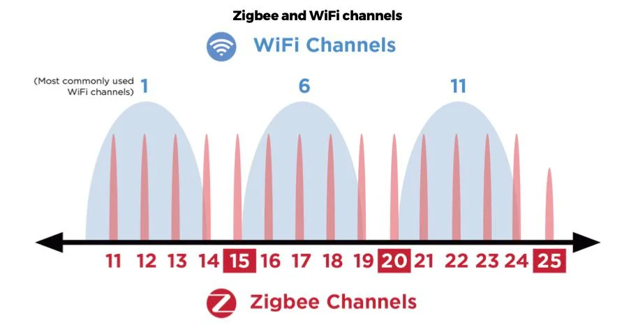
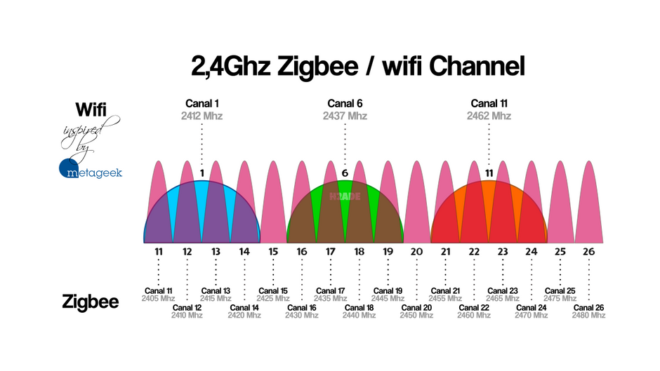

# Le drame invisible : quand ton Wi-Fi tue ton Zigbee en silence

- **Catégorie :** [Tutoriels, Guides & Astuces des Membres](https://forumdomotique.com/forums/87-tutoriels-guides-astuces-des-membres/)
- **Sujet :** https://forumdomotique.com/forums/topic/676-le-drame-invisible-quand-ton-wi-fi-tue-ton-zigbee-en-silence/
- **Auteur du premier message du sujet :** XAV59213
- **Messages de XAV59213 dans ce sujet :** 2
- **Premier message de XAV59213 :** 11 janvier 2026 à 09:52 (Europe/Paris)
- **Dernier message de XAV59213 :** 12 janvier 2026 à 14:57 (Europe/Paris)

---

## Message 1 — 11 janvier 2026 à 09:52 (Europe/Paris)

- **Identifiant :** `1719`
- **Lien :** https://forumdomotique.com/forums/topic/676-le-drame-invisible-quand-ton-wi-fi-tue-ton-zigbee-en-silence/#findComment-1719

#### Les interférences entre le Wi-Fi et le Zigbee sont un problème courant en raison de leur utilisation partagée de la bande de fréquences 2.4 GHz. Voici une explication détaillée et structurée pour mieux comprendre le phénomène et comment le gérer.

<!-- source : https://cdn.forumdomotique.com/monthly_2026_01/n7qxmyl73ea91.webp.f2cf6b7c8f7b88f53b419f53b32b2b66.webp -->

### 1. **Contexte technique**

- **Bande de fréquences commune** : Le Wi-Fi (normes IEEE 802.11b/g/n/ac/ax dans la bande 2.4 GHz) et le Zigbee (norme IEEE 802.15.4, souvent utilisé pour les objets connectés comme les ampoules intelligentes, capteurs ou hubs comme le SLZB) opèrent tous deux sur la plage de fréquences allant de 2.405 GHz à 2.480 GHz environ.
- **Canaux Wi-Fi** : Dans la bande 2.4 GHz, le Wi-Fi utilise typiquement 13 canaux (numérotés de 1 à 13 en Europe), chacun occupant une largeur de bande de 20 MHz (ou 40 MHz pour les modes plus rapides). Ces canaux se chevauchent partiellement pour maximiser l'utilisation du spectre.
- **Canaux Zigbee** : Le Zigbee utilise 16 canaux (numérotés de 11 à 26), mais chacun ne fait que 2 MHz de largeur, avec un espacement de 5 MHz entre eux. Cela les rend plus étroits et plus sensibles aux perturbations.

Lorsque ces canaux se chevauchent, des interférences se produisent : les signaux Wi-Fi, plus puissants et plus larges, peuvent "noyauter" les signaux Zigbee plus faibles, entraînant des pertes de paquets, des déconnexions, une latence accrue ou une instabilité du réseau Zigbee.

### 2. **Comment se manifestent les interférences ?**

- **Perte de signal et instabilité** : Si un canal Zigbee est trop proche ou chevauche un canal Wi-Fi actif (le vôtre ou celui d'un voisin), cela peut causer des erreurs de transmission. Par exemple, un routeur Wi-Fi sur le canal 6 (fréquence centrale ~2.437 GHz) peut interférer avec les canaux Zigbee 15 à 20.
- **Facteurs aggravants** :

  - Densité des réseaux voisins (appartements, bureaux).
  - Puissance des signaux : Le Wi-Fi émet souvent à plus haut niveau (jusqu'à 100 mW) que le Zigbee (typiquement 1-10 mW).
  - Autres sources : Micro-ondes, Bluetooth, babyphones ou même certains téléphones sans fil utilisent aussi le 2.4 GHz.
- **Impact sur Zigbee** : Comme Zigbee est conçu pour les réseaux maillés à faible consommation (IoT), il est plus vulnérable. Cela peut se traduire par des dispositifs qui ne répondent plus ou un réseau instable.

Pour illustrer le chevauchement des canaux :

<!-- source : https://cdn.forumdomotique.com/monthly_2026_01/interference-zigbee-wifi-freqeunce-2.4ghz-en-940-5115f18fc.png.e51bf263045617d2360450c3bb6104a6.png -->

### 3. **Comment éviter ou minimiser les interférences ?**

- **Vérifiez la charge des canaux** : Utilisez des applications comme [Wi-Fi Analyzer (sur Android)](https://play.google.com/store/apps/details?id=abdelrahman.wifianalyzerpro&hl=fr&pli=1) ou des outils comme [Acrylic Wi-Fi (sur PC)](https://acrylic-wifi-free.fr.softonic.com/?utm_source=SEM&utm_medium=paid&utm_campaign=EN_FR_DSA&gad_source=1&gad_campaignid=18271237821&gclid=Cj0KCQiAsY3LBhCwARIsAF6O6Xg-VsH4fbpx6IbXxp8-_R6AbU1ixjLkJC5w_EnAoAVGYGFa6AG_zTkaAsjVEALw_wcB) pour scanner les réseaux Wi-Fi environnants et identifier les canaux les moins encombrés.
- **Choisissez des canaux optimaux** :

  - Pour le Wi-Fi : Privilégiez les canaux 1, 6 ou 11 (les plus espacés et moins chevauchants entre eux).
  - Pour le Zigbee : Configurez votre hub (comme un SLZB-06 ou similaire) sur un canal éloigné, comme le 15, 20, 25 ou 26. Évitez les canaux 11-14 si votre Wi-Fi est sur 1, ou 21-24 si sur 11.
  - Exemple de configuration idéale : Wi-Fi sur canal 1 (chevauche Zigbee 11-14), donc mettez Zigbee sur 20 ou 25.
- **Passez au 5 GHz pour le Wi-Fi** : Si vos appareils le supportent, migrez votre Wi-Fi vers la bande 5 GHz (ou 6 GHz pour Wi-Fi 6E), qui n'interfère pas avec le Zigbee.
- **Améliorez l'environnement** : Placez le routeur Wi-Fi et le hub Zigbee à distance l'un de l'autre (au moins 2-3 mètres). Utilisez des répéteurs Zigbee pour renforcer le maillage.
- **Mises à jour et tests** : Assurez-vous que vos firmwares sont à jour. Testez en changeant les canaux et en monitorant la stabilité.

---

## Message 2 — 12 janvier 2026 à 14:57 (Europe/Paris)

- **Identifiant :** `1762`
- **Lien :** https://forumdomotique.com/forums/topic/676-le-drame-invisible-quand-ton-wi-fi-tue-ton-zigbee-en-silence/#findComment-1762

Merci [@bernhara](https://forumdomotique.com/profile/74-bernhara/) 🥹

---
