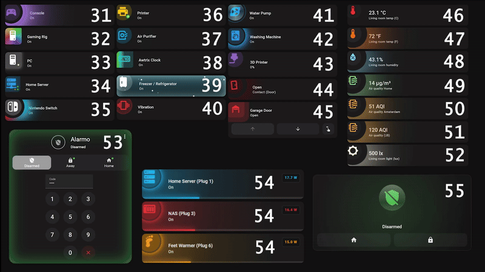
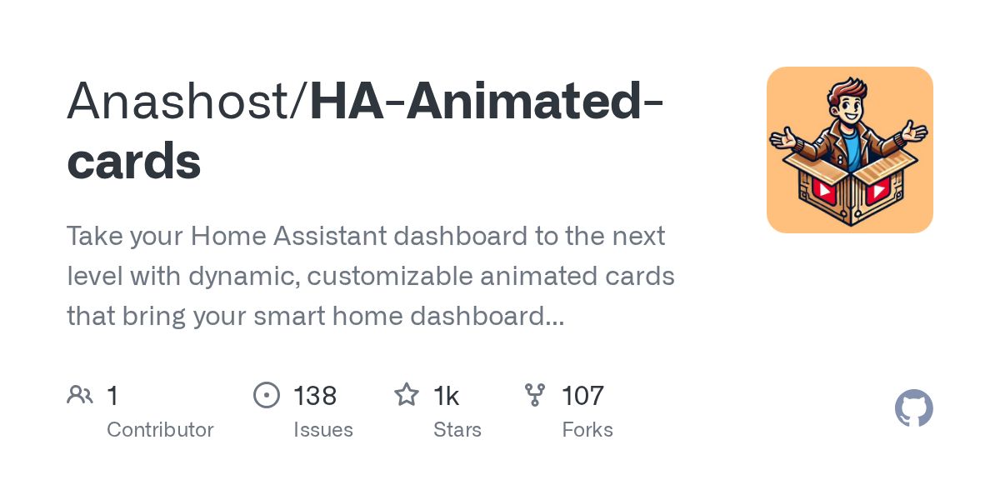
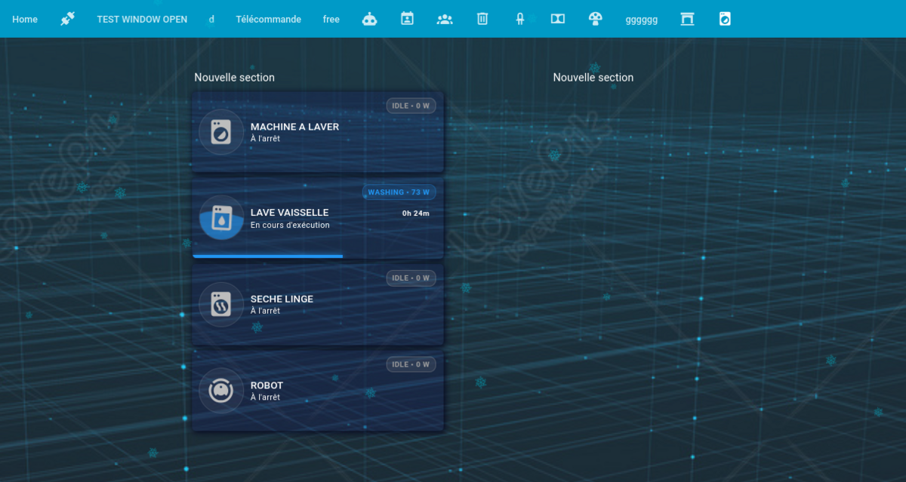
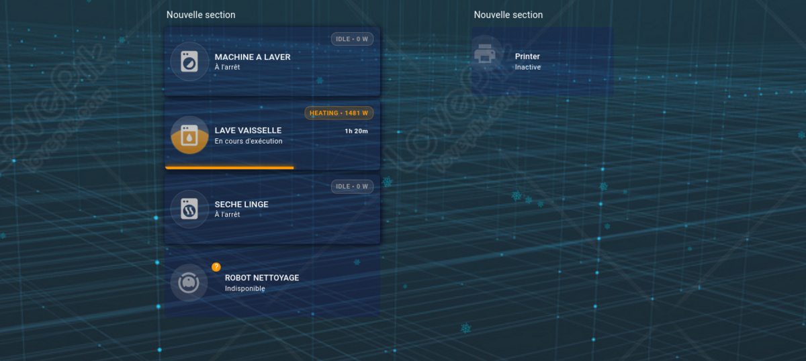

# HA-Animated-cards : quand votre dashboard Home Assistant prend enfin vie

- **Catégorie :** [Vos Dashboards & Installations](https://forumdomotique.com/forums/109-vos-dashboards-installations/)
- **Sujet :** https://forumdomotique.com/forums/topic/678-ha-animated-cards-quand-votre-dashboard-home-assistant-prend-enfin-vie/
- **Auteur du premier message du sujet :** XAV59213
- **Messages de XAV59213 dans ce sujet :** 3
- **Premier message de XAV59213 :** 11 janvier 2026 à 13:33 (Europe/Paris)
- **Dernier message de XAV59213 :** 31 janvier 2026 à 12:11 (Europe/Paris)

---

## Message 1 — 11 janvier 2026 à 13:33 (Europe/Paris)

- **Identifiant :** `1730`
- **Lien :** https://forumdomotique.com/forums/topic/678-ha-animated-cards-quand-votre-dashboard-home-assistant-prend-enfin-vie/#findComment-1730

Il y a des projets qui arrivent au bon moment. Vous savez, ces moments où on regarde son dashboard Home Assistant, on voit qu’il fait parfaitement le job, mais on se dit quand même qu’il manque un petit quelque chose. Ce petit truc qui transforme un tableau de bord utilitaire en véritable interface vivante, agréable à consulter même quand on n’a pas spécialement besoin de piloter quoi que ce soit.

C’est exactement ce que j’ai ressenti quand je suis tombé sur **HA-Animated-cards**, grâce à un tip d’un pote du forum qui m’avait dit « tu vas voir, c’est con mais c’est génial ». Il avait raison.

J’utilise Home Assistant depuis assez longtemps pour avoir connu les phases successives : le dashboard tout moche en yaml brut, puis les premiers thèmes sombres qui donnaient déjà meilleure mine, les cartes **Mushroom** qui ont vraiment fait basculer pas mal d’entre nous vers quelque chose de plus propre et moderne, les mini-graph-card pour visualiser les tendances sans se prendre la tête… Et puis arrive un jour où on se dit que ça reste quand même assez statique. Une icône d’ampoule qui reste figée quand la lumière est allumée, un ventilateur dont les pales ne bougent jamais, un lave-linge qui affiche « On » sans qu’on voie le tambour tourner. C’est fonctionnel, mais ça manque de vie.

**HA-Animated-cards** de Anashost change ça avec une collection impressionnante de 67 cartes animées, toutes basées sur des animations SVG très bien fichues. On parle ici de vraies petites animations subtiles et contextuelles : le lave-linge qui fait tourner son tambour avec des bulles quand il est en cycle, le ventilateur dont les pales tournent vraiment (et même à vitesse variable si vous couplez avec un capteur), la cheminée qui crépite doucement, les pales de l’aspirateur robot qui bougent, le projecteur qui s’allume avec son faisceau, la serrure qui se verrouille/déverrouille en animation fluide… Il y en a pour quasiment tous les usages qu’on rencontre dans une installation domotique un peu complète : prises intelligentes, rubans LED, capteurs environnementaux (température, humidité, qualité de l’air avec des halos respirants), mais aussi des trucs plus fun comme les setups gaming, PC/serveur, Nintendo Switch ou horloge Awtrix.

Ce qui m’a vraiment plu, c’est que l’auteur n’a pas fait dans le bling-bling tape-à-l’œil. Les animations sont discrètes, élégantes, et surtout parfaitement intégrées au style **Mushroom** que beaucoup d’entre nous utilisent déjà. Ça ne casse pas l’harmonie du dashboard, ça le sublime.

**La mise en route est étonnamment simple pour un projet aussi visuel**

<!-- source : https://github.githubassets.com/favicons/favicon.svg -->

##### GitHub

<!-- source : https://opengraph.githubassets.com/25ea09a060a3707ff9ae03007862bc0ef3c0da7b02d7c59d84dc472b47aefb04/Anashost/HA-Animated-cards -->

### GitHub - Anashost/HA-Animated-cards

Contribute to Anashost/HA-Animated-cards development by creating an account on GitHub.

Pas besoin d’installer une custom card dédiée qui va charger des tonnes de javascript. **HA-Animated-cards** fonctionne uniquement avec du **card-mod** (pour le style CSS) et la bonne vieille **mushroom-entity-card** (ou parfois la legacy-template si vous avez besoin d’un peu plus de flexibilité). C’est tout.

Concrètement, on va dans le repo GitHub, on choisit la catégorie qui nous intéresse (appliances, environnement, prises, éclairage, etc.), on copie le bloc de code YAML correspondant à l’équipement qu’on veut animer, on le colle dans une carte existante ou une nouvelle, on adapte l’**entity** (et parfois une entity secondaire si on veut un mode « number » basé sur une valeur numérique comme la puissance consommée), on choisit la couleur d’icône qui nous plaît… et c’est parti.

Les premières fois, on passe cinq minutes à comprendre les variables à changer dans le gros bloc card_mod (state_entity, active_value, number_operator, threshold…), mais une fois qu’on a pigé le principe, ça devient très rapide. L’auteur a bien fait les choses : les commentaires dans le code sont clairs, et il y a même des modes différents selon que vous voulez que l’animation se déclenche seulement quand l’appareil est « on », ou en permanence selon une valeur numérique (très pratique pour les ventilateurs ou les variateurs).

J’ai commencé par le plus évident chez moi : la carte **lave-linge**. Voir le tambour qui se met à osciller doucement, à vibrer légèrement puis à prendre de l’ampleur quand le cycle passe en mode essorage, avec ce petit mouvement de balancement réaliste qui imite parfaitement le brassage du linge, ça change vraiment la perception. C’est bête comme chou, mais à chaque fois que je passe devant l’écran mural du salon et que j’aperçois cette petite animation en train de tourner en fond, je souris tout seul. On sent presque le bruit du moteur et les vêtements qui dansent à l’intérieur.

<!-- source : https://cdn.forumdomotique.com/monthly_2026_01/Capturedcrandu2026-01-1113-35-20.png.3ddd74dc193bac1f5e6646d5ee4e323a.png -->

<!-- source : https://cdn.forumdomotique.com/monthly_2026_01/Capturedcrandu2026-01-1114-31-01.png.c025a17c6ef2e689b799c564b207dfb0.png -->

Avant, c’était juste une icône **mdi:washing-machine** figée avec « On » écrit à côté, et même si ça indiquait bien l’état, ça restait froid. Là, l’animation apporte une vraie sensation de vie, surtout quand le cycle est bien lancé : le hublot virtuel semble s’agiter, le corps de la machine tremble subtilement comme sous l’effet des vibrations, et tout ça reste élégant, sans verser dans le cartoon. C’est ce genre de détail discret qui rend le dashboard beaucoup plus attachant au quotidien, et qui fait que même les non-initiés captent instantanément que « ah ouais, ça tourne vraiment là ».

Bref, une petite modification de rien du tout qui donne tout de suite plus de personnalité à l’ensemble.

**Au quotidien, ça change quoi ?**

Honnêtement, la stabilité est excellente. Pas de saccade, pas de lag visible même sur un dashboard chargé avec une quinzaine de ces cartes animées. Les animations sont légères (SVG pur), donc ça ne plombe pas l’interface, même sur un vieux Raspberry Pi 4 ou une tablette Android un peu fatiguée.

La portée « psychologique » est plus importante que ce qu’on pourrait croire. Les membres de la famille qui ne sont pas du tout dans la domotique trouvent soudain le dashboard beaucoup plus intuitif et agréable. Ma femme m’a dit un jour : « ah ouais là on voit direct quand le lave-vaisselle a bientôt fini ». Avant elle regardait surtout le texte, maintenant elle voit l’animation des bulles ralentir progressivement et ça suffit.

Côté intégration Home Assistant, rien de particulier à dire : tout se fait en YAML pur dans les dashboards, pas besoin d’intégration HACS spécifique pour le projet lui-même (seulement card-mod en dépendance). Ça reste donc très propre et maintenable. Si vous bidouillez déjà pas mal vos cartes Mushroom, vous serez en terrain connu.

**Ce qui est vraiment top et ce qu’on aimerait voir évoluer**

Les points forts sautent aux yeux : le nombre d’animations disponibles (67 et ça continue d’augmenter), la qualité visuelle très cohérente, la discrétion des effets (pas de néons clignotants partout), la facilité relative d’adaptation, et le fait que ça reste gratuit et open-source sous licence Creative Commons, donc modifiable à volonté.

Ce qui pourrait être amélioré ? Peut-être un peu plus de documentation sur certains cas avancés (par exemple quand on veut combiner plusieurs conditions pour déclencher l’animation), ou un petit outil en ligne pour générer le code directement en choisissant les entités (mais bon, ça enlèverait une partie du plaisir du bidouillage). Et puis, forcément, on rêve toujours d’encore plus de catégories : des animations pour stores/volets, pour les fontaines d’intérieur, pour les humidificateurs… mais c’est le propre des bons projets communautaires, ça donne envie d’en demander toujours plus.

Au final, après plusieurs semaines à l’utiliser tous les jours, je ne reviendrais pas en arrière. Mon dashboard n’est plus juste un outil, il est devenu un petit objet de plaisir visuel. Il reste parfaitement lisible et fonctionnel pour les actions rapides, mais il gagne en personnalité et en chaleur. C’est exactement ce que je recherche dans ce genre de projet : quelque chose qui fait sourire sans sacrifier l’utilité.

Si vous êtes comme moi, un peu lassé de votre belle interface trop sage, et que vous avez déjà **Mushroom** + **card-mod** en place, je vous conseille vraiment de tester **HA-Animated-cards**. Pas besoin de tout refaire d’un coup : commencez par trois ou quatre cartes phares (le lave-linge, le ventilateur, une prise intelligente, un capteur de qualité d’air), et vous verrez que vous aurez du mal à vous arrêter là.

Bonne bidouille à tous, et comme d’habitude, n’hésitez pas à partager vos propres adaptations en commentaire ou sur le forum. C’est aussi ça qui fait vivre ces projets. 😊

---

## Message 2 — 22 janvier 2026 à 01:50 (Europe/Paris)

- **Identifiant :** `1862`
- **Lien :** https://forumdomotique.com/forums/topic/678-ha-animated-cards-quand-votre-dashboard-home-assistant-prend-enfin-vie/#findComment-1862

Ça c’est super cool!👍

---

## Message 3 — 31 janvier 2026 à 12:11 (Europe/Paris)

- **Identifiant :** `1932`
- **Lien :** https://forumdomotique.com/forums/topic/678-ha-animated-cards-quand-votre-dashboard-home-assistant-prend-enfin-vie/#findComment-1932

Salut hugo 158415,

Peux tu me transmettre ton code que je regarde ?

---
