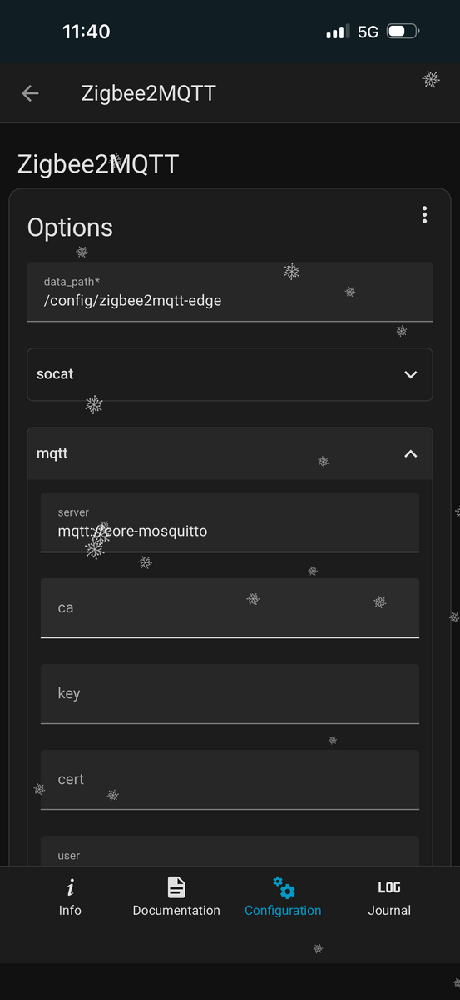
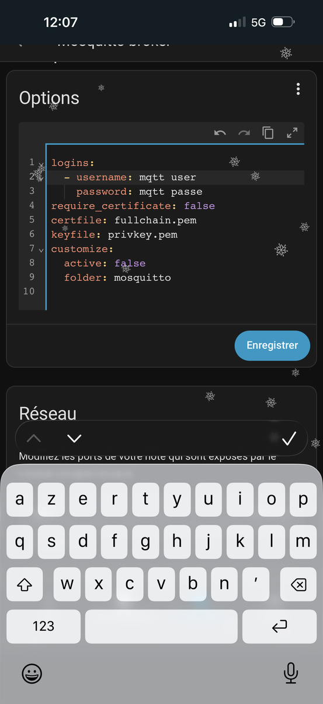
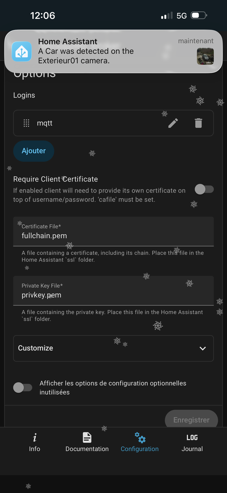

<a href="https://forumdomotique.com/forums/topic/680-finalisation-de-configuration/">Lire et commenter sur Forum Domotique</a>

<section class="carousel photo-carousel" data-carousel data-lightbox aria-roledescription="carrousel" aria-label="Photos de l’article (4)" tabindex="0">

<figure class="photo-slide" data-slide>
  
</figure>
<figure class="photo-slide" data-slide>
  
</figure>
<figure class="photo-slide" data-slide>
  
</figure>
<figure class="photo-slide" data-slide>
  
</figure>

<button type="button" class="carousel-nav" data-prev aria-label="Photo précédente">‹</button>
<button type="button" class="carousel-nav" data-next aria-label="Photo suivante">›</button>

Faites défiler les photos, ou ouvrez-les pour les agrandir (si JavaScript est activé).

</section>

# Finalisation de configuration

- **Catégorie :** [Intégrations et Add-ons](https://forumdomotique.com/forums/11-int%C3%A9grations-et-add-ons/)
- **Sujet :** https://forumdomotique.com/forums/topic/680-finalisation-de-configuration/
- **Auteur du premier message du sujet :** un autre membre (XAV59213 a répondu dans ce sujet)
- **Messages de XAV59213 dans ce sujet :** 7
- **Premier message de XAV59213 :** 12 janvier 2026 à 09:53 (Europe/Paris)
- **Dernier message de XAV59213 :** 12 janvier 2026 à 15:24 (Europe/Paris)

---

## Message 1 — 12 janvier 2026 à 09:53 (Europe/Paris)

- **Identifiant :** `1742`
- **Lien :** https://forumdomotique.com/forums/topic/680-finalisation-de-configuration/#findComment-1742

Salut [@philou83](https://forumdomotique.com/profile/922-philou83/),

Peux tu envoyer les logs du journal de z2mqtt

---

## Message 2 — 12 janvier 2026 à 11:16 (Europe/Paris)

- **Identifiant :** `1749`
- **Lien :** https://forumdomotique.com/forums/topic/680-finalisation-de-configuration/#findComment-1749

Salut [@philou83](https://forumdomotique.com/profile/922-philou83/) ,

D’après les logs que vous avez partagés, le problème principal semble venir de la configuration MQTT dans Zigbee2MQTT. L’erreur “ENOENT: no such file or directory, open ‘/etc/ssl/mqtt-ca.crt’” indique que Zigbee2MQTT essaie d’ouvrir un fichier de certificat CA pour une connexion SSL/TLS, mais ce fichier n’existe pas. Cela arrive souvent si l’option ca est définie dans la configuration, mais que vous n’utilisez pas de connexion sécurisée (mqtt:// au lieu de mqtts://).

De plus, je remarque une petite faute de frappe dans l’URL du broker : c’est “mqtt://core-mosquitto” (avec deux “t” à “mosquitto”), pas “core-mosquito”. Le nom correct pour le broker Mosquitto dans Home Assistant est bien “core-mosquitto”.

---

## Message 3 — 12 janvier 2026 à 11:32 (Europe/Paris)

- **Identifiant :** `1752`
- **Lien :** https://forumdomotique.com/forums/topic/680-finalisation-de-configuration/#findComment-1752

1 Dans ton module z2mqtt configuration trois petits points modifier en yaml

2 Supprimez la ligne ca: /etc/ssl/mqtt-ca.crt (ou toute référence à un certificat CA si vous n’utilisez pas SSL). Si vous avez d’autres options SSL comme key ou cert, supprimez-les aussi à moins que vous n’ayez configuré Mosquitto avec TLS (ce qui n’est pas le cas par défaut).

---

## Message 4 — 12 janvier 2026 à 11:41 (Europe/Paris)

- **Identifiant :** `1754`
- **Lien :** https://forumdomotique.com/forums/topic/680-finalisation-de-configuration/#findComment-1754

Oui

mqtt://core-mosquitto

Envoie moi ton fichier complet trois petit point modifier en yaml modifie le passe et user pour pas que quelqu’un capte tes infos que je puisse te corriger l’erreur

---

## Message 5 — 12 janvier 2026 à 12:01 (Europe/Paris)

- **Identifiant :** `1756`
- **Lien :** https://forumdomotique.com/forums/topic/680-finalisation-de-configuration/#findComment-1756

C’est le CA qui plante ton z2mqtt

Voici celui que tu doit mettre

server: mqtt://core-mosquitto

À tu configurer ton mosquito en tls ?

**Vérifiez l’add-on Mosquitto** :

•  Assurez-vous qu’il est en marche (Supervisor > Mosquitto > Start si besoin).

•  Dans ses logs, regardez s’il y a des erreurs de connexion refusée quand vous essayez de démarrer Z2M.

•  Si vous avez activé SSL dans Mosquitto (port 8883), il faut générer et placer les certificats corrects dans Z2M (mais je recommande de commencer sans SSL pour simplifier).

<!-- source : https://cdn.forumdomotique.com/monthly_2026_01/IMG_6557.png.22d0bec4c5ffc720423ef208f49f7bc4.png -->

<!-- source : https://cdn.forumdomotique.com/monthly_2026_01/IMG_6555.png.f9464549e84d0c7959fa782c0ec0a668.png -->

---

## Message 6 — 12 janvier 2026 à 12:38 (Europe/Paris)

- **Identifiant :** `1758`
- **Lien :** https://forumdomotique.com/forums/topic/680-finalisation-de-configuration/#findComment-1758

Félicitations 🎉🎈🍾

Oublie pas de clôturer le post😜

---

## Message 7 — 12 janvier 2026 à 15:24 (Europe/Paris)

- **Identifiant :** `1763`
- **Lien :** https://forumdomotique.com/forums/topic/680-finalisation-de-configuration/#findComment-1763

Tu dois avoir ça en bas de chacune de tes réponses :

<!-- source : https://cdn.forumdomotique.com/monthly_2026_01/image.png.875eb134db0f88b72f969341154f5df0.png -->

---
