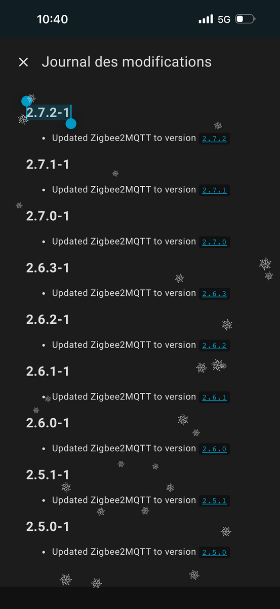



<a href="https://forumdomotique.com/forums/topic/690-pas-de-remont%C3%A9-dinfo-multiprise-nous-a11z/">Lire et commenter sur Forum Domotique</a>

# Pas de remonté d'info Multiprise NOUS A11Z

- **Catégorie :** [Autres marques de matériel domotique](https://forumdomotique.com/forums/59-autres-marques-de-mat%C3%A9riel-domotique/)
- **Sujet :** https://forumdomotique.com/forums/topic/690-pas-de-remont%C3%A9-dinfo-multiprise-nous-a11z/
- **Auteur du premier message du sujet :** un autre membre (XAV59213 a répondu dans ce sujet)
- **Messages de XAV59213 dans ce sujet :** 6
- **Premier message de XAV59213 :** 20 janvier 2026 à 11:42 (Europe/Paris)
- **Dernier message de XAV59213 :** 2 février 2026 à 18:17 (Europe/Paris)

---

## Message 1 — 20 janvier 2026 à 11:42 (Europe/Paris)

- **Identifiant :** `1843`
- **Lien :** https://forumdomotique.com/forums/topic/690-pas-de-remont%C3%A9-dinfo-multiprise-nous-a11z/#findComment-1843

Salut, avez-vous tous Z2MQTT ou ZHA ?

Avez-vous mis à jour la multiprise ?

Lors de votre configuration, avez-vous bien mis un canal éloigné du WiFi ?

---

## Message 2 — 24 janvier 2026 à 10:55 (Europe/Paris)

- **Identifiant :** `1871`
- **Lien :** https://forumdomotique.com/forums/topic/690-pas-de-remont%C3%A9-dinfo-multiprise-nous-a11z/#findComment-1871

Salut

Le support pour la multiprise NOUS A11Z a été ajouté dans Zigbee2MQTT à partir de la version 2.7.1, sortie le 6 décembre 2025. Cette mise à jour inclut spécifiquement la prise en charge du monitoring de puissance (power, voltage, current, energy) et du contrôle individuel des prises (l1, l2, l3).

Si vous êtes sur une version antérieure (comme 2.6.x ou moins), cela explique les bugs de remontée d’infos et de contrôle indépendant. Je recommande de mettre à jour vers la dernière stable votre z2mqtt 
<!-- source : https://cdn.forumdomotique.com/monthly_2026_01/IMG_6589.png.cc582c0af8af5af87ce865b0119c7eac.png -->

Pouvez vous me confirmer vos versions de z2mqtt et mettre vos logs

---

## Message 3 — 24 janvier 2026 à 14:03 (Europe/Paris)

- **Identifiant :** `1875`
- **Lien :** https://forumdomotique.com/forums/topic/690-pas-de-remont%C3%A9-dinfo-multiprise-nous-a11z/#findComment-1875

Salut @Cpey et les autres,

D’accord, si même en 2.7.2 les métriques globales (power, energy, etc.) restent à null alors que les per-outlet (l1, l2, l3) remontent bien quand il y a une charge, ça pourrait être un bug mineur ou une limitation du device NOUS A11Z (peut-être qu’il ne supporte pas les aggregates nativement).

J’ai checké vite fait le repo GitHub de Zigbee2MQTT : pas d’issues ouvertes ou fermées sur l’A11Z pour ce genre de problème (power monitoring partiel ou reporting incomplet). Le support a été ajouté récemment (décembre 2025), donc c’est peut-être pas encore parfait.

Il faut poster une issue là-bas pour signaler ça. Voici comment faire :

1.  Va sur <https://github.com/Koenkk/zigbee2mqtt/issues/new>

2.  Choisis le template “Device support request” ou “Bug report” (bug report si c’est un dysfonctionnement).

3.  Remplis :

•  Titre : genre “NOUS A11Z: Global power/energy metrics remain null, only per-outlet values reported”

•  Description : Décris le problème, colle ton log MQTT complet (celui que t’as partagé + d’autres si possible), ta version Z2M (2.7.2), HA, et le firmware du device si tu l’as.

•  Ajoute des captures d’écran de l’UI Z2M (exposes, reporting, bindings).

•  Mentionne que le contrôle individuel marche, mais pas les totaux.

4.  Poste et attends une réponse des devs – ils sont réactifs.

En attendant, comme workaround : crée des sensors templates dans HA pour sommer les valeurs l1+l2+l3 (ex. pour power : {{ states('sensor.triplette_power_l1') | float(0) + states('sensor.triplette_power_l2') | float(0) + states('sensor.triplette_power_l3') | float(0) }} ). Ça te donnera un total manuel.

Si t’as plus de logs ou détails, partage ici, on peut creuser encore.

Xavier

---

## Message 4 — 2 février 2026 à 09:44 (Europe/Paris)

- **Identifiant :** `1963`
- **Lien :** https://forumdomotique.com/forums/topic/690-pas-de-remont%C3%A9-dinfo-multiprise-nous-a11z/#findComment-1963

**Salut** [@Corent02](https://forumdomotique.com/profile/971-corent02/) [@Cpey](https://forumdomotique.com/profile/1221-cpey/) [@Axelle](https://forumdomotique.com/profile/1187-axelle/) [@fejib](https://forumdomotique.com/profile/1181-fejib/)

Je viens de voir passer une mise à jour sur Zigbee2MQTT 2.8.0-1 qui concerne exactement votre problème avec la Nous A11Z.

Il s’agit du [**#11383**](https://github.com/Koenkk/zigbee-herdsman-converters/pull/11383) : « Nous A11Z: les relais fixes étant contrôlés simultanément » (@Koenkk)

En gros, le bug faisait que quand tu commandais une seule prise, les autres s’allumaient ou s’éteignaient en même temps.

---

## Message 5 — 2 février 2026 à 13:03 (Europe/Paris)

- **Identifiant :** `1967`
- **Lien :** https://forumdomotique.com/forums/topic/690-pas-de-remont%C3%A9-dinfo-multiprise-nous-a11z/#findComment-1967

Salut [@Cpey](https://forumdomotique.com/profile/1221-cpey/)

À tu fait un redémarrage ?

---

## Message 6 — 2 février 2026 à 18:17 (Europe/Paris)

- **Identifiant :** `1974`
- **Lien :** https://forumdomotique.com/forums/topic/690-pas-de-remont%C3%A9-dinfo-multiprise-nous-a11z/#findComment-1974

Ok tiens moi au jus 👍

---

