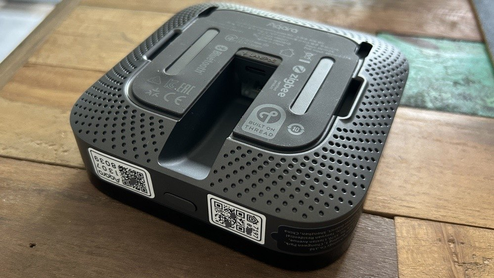

<a href="https://forumdomotique.com/forums/topic/733-bonjour-%C3%A0-tous/">Lire et commenter sur Forum Domotique</a>

# Bonjour à tous

- **Catégorie :** [Présentez-vous](https://forumdomotique.com/forums/5-pr%C3%A9sentez-vous/)
- **Sujet :** https://forumdomotique.com/forums/topic/733-bonjour-%C3%A0-tous/
- **Auteur du premier message du sujet :** un autre membre (XAV59213 a répondu dans ce sujet)
- **Messages de XAV59213 dans ce sujet :** 2
- **Premier message de XAV59213 :** 1 février 2026 à 13:08 (Europe/Paris)
- **Dernier message de XAV59213 :** 1 février 2026 à 15:02 (Europe/Paris)

---

## Message 1 — 1 février 2026 à 13:08 (Europe/Paris)

- **Identifiant :** `1948`
- **Lien :** https://forumdomotique.com/forums/topic/733-bonjour-%C3%A0-tous/#findComment-1948

Bonjour @shutouke !

Bienvenue dans le monde de la domotique ! C’est super que tu te lances, et les vidéos YouTube sont un excellent point de départ pour s’inspirer.

Pas de souci pour être débutant, on est tous passés par là. 😊 Pour ton hub Aqara M3, c’est un bon choix : il est polyvalent, compatible Matter, Zigbee, et il peut gérer plein d’appareils sans dépendre du cloud une fois configuré.

Je vais t’expliquer étape par étape comment le configurer et l’appareiller.

Si ça ne marche pas, on regardera les astuces de dépannage.

L’idée est d’utiliser l’app Aqara Home pour l’installation initiale.

**Étapes de configuration de base :**

1.  **Télécharge l’app Aqara Home** : Disponible sur l’App Store (iOS) ou Google Play (Android). Crée un compte si tu n’en as pas (c’est gratuit).

2.  **Alimente le hub** : Branche-le via USB-C (il est fourni avec un adaptateur) ou PoE si tu as une installation réseau avancée. Le hub devrait s’allumer et clignoter en jaune ou bleu pour indiquer qu’il est prêt.

3.  **Ajoute le hub dans l’app** :

•  Ouvre l’app Aqara Home.

•  Sur la page d’accueil, clique sur le “+” en haut à droite.

•  Sélectionne “Ajouter un accessoire” ou “Ajouter un hub”.

•  Choisis le modèle “Hub M3”.

•  L’app te guidera : elle utilisera le Bluetooth ou le Wi-Fi de ton téléphone pour détecter le hub (technologie “Magic Pair”).

•  Scanne le code QR sur le hub ou entre-le manuellement si demandé.

•  Connecte-le à ton réseau Wi-Fi (assure-toi que ton téléphone est connecté à un réseau 2.4 GHz, pas 5 GHz, car c’est souvent la cause des problèmes d’appairage).

4.  **Configure les paramètres** :

•  Choisis ta région (Europe si tu es en France, pour la compatibilité).

•  L’app te demandera peut-être de mettre à jour le firmware du hub – fais-le si proposé.

•  Une fois ajouté, tu pourras appairer d’autres appareils Aqara (capteurs, interrupteurs, etc.) via le hub.

Si tu veux l’intégrer à HomeKit (Apple), Alexa, Google Home ou Matter :

•  Dans l’app Aqara, va dans les paramètres du hub > “HomeKit” ou “Matter”.

•  Génére un code d’appairage et ajoute-le dans l’app correspondante (ex. : Maison pour HomeKit).

**Astuces si l’appairage ne marche pas :**

•  **Reset le hub** : Appuie 10 fois rapidement sur le bouton du hub jusqu’à ce qu’il clignote en jaune. Ça le remet en mode usine.

•  **Vérifie le Wi-Fi** : Le hub a besoin d’internet pour la config initiale (pour se connecter au serveur Aqara). Assure-toi que ton réseau est stable et que ton téléphone est proche du hub.

•  **Mode pairing** : Appuie deux fois sur le bouton pour basculer en mode Aqara cloud (tu entends un “ping”).

•  **Problèmes courants** : Si l’app ne détecte pas le hub, redémarre ton téléphone, ferme/reouvre l’app, ou essaie avec un autre appareil. Évite les VPN ou réseaux d’entreprise.

•  **Mise à jour** : Assure-toi que l’app est à jour.

Pour plus de détails visuels, je te recommande ces vidéos (en français ou anglais, mais faciles à suivre) :

•  [Vidéo d’installation Aqara Hub M3](https://www.youtube.com/watch?v=-wdPnm2QxMY) – Une config complète en français.

•  [Guide officiel en vidéo](https://www.youtube.com/watch?v=zq4fBNq_roo) – Étapes simples en anglais.

•  Le manuel utilisateur est téléchargeable sur le site Aqara : [User Manual Hub M3](https://www.aqara.com/us/product/hub-m3-user-manual).

Si ça coince toujours, dis-moi plus de détails : quel message d’erreur vois-tu ?

Tu essaies de l’appairer avec quoi (HomeKit, l’app Aqara seule) ? On creusera ensemble.

Au plaisir d’échanger, et bonne découverte de la domotique ! 🚀

---

## Message 2 — 1 février 2026 à 15:02 (Europe/Paris)

- **Identifiant :** `1952`
- **Lien :** https://forumdomotique.com/forums/topic/733-bonjour-%C3%A0-tous/#findComment-1952

Bonjour @shutouke !

Pas de souci, on va résoudre ça ensemble. D’après ta description (le hub est détecté, mais le scan du QR code ne fait rien et tu arrives sur une page inattendue), et en me basant sur des problèmes similaires rapportés par d’autres utilisateurs, il y a de fortes chances que tu scannes le mauvais code QR. Le hub Aqara M3 en a deux sur sa base : un pour l’app Aqara (appelé “Magic Pair” ou code Aqara) et un autre pour Matter/HomeKit (qui est pour une intégration directe avec Apple Home, Google, etc.). Si tu scannes le code Matter/HomeKit dans l’app Aqara, ça peut mener à une page comme “Prêt à ajouter des appareils Matter” sans finaliser la connexion au hub, ou simplement ne rien faire.

Voici comment corriger ça étape par étape :

1.  **Reset le hub pour repartir à zéro** : Appuie 10 fois rapidement sur le bouton du hub jusqu’à ce qu’il clignote en jaune. Ça le remet en mode usine. Attends qu’il clignote en jaune ou bleu pour indiquer qu’il est prêt à l’appairage.

2.  **Vérifie les codes QR sur le hub** : Retourne le hub et regarde la base. Il y a deux codes QR côte à côte.

•  Le code Aqara (Magic Pair) est celui qu’il faut scanner pour l’app Aqara Home. C’est généralement celui sans l’icône HomeKit (un petit maison avec un code numérique comme XXX-XX-XXX en dessous).

•  L’autre est pour Matter/HomeKit – évite-le pour l’instant si tu configures via l’app Aqara.  
Pour visualiser : voici une photo du dessous du hub M3 montrant les deux codes QR.

<!-- source : https://cdn.forumdomotique.com/monthly_2026_02/IMG_6657.jpeg.50af1f46f906f32709651a350da4b3ea.jpeg -->

3.  **Relance l’appairage dans l’app Aqara Home** :

•  Ouvre l’app, clique sur “+” > “Ajouter un hub” > “Hub M3”.

•  Quand l’app te demande de scanner le code QR, utilise le code Aqara (pas le Matter).

•  Si après le scan, une fenêtre apparaît, sélectionne le mode “Zigbee” (pas Matter) pour continuer la configuration.

•  Connecte-toi à ton Wi-Fi 2.4 GHz (assure-toi que ton téléphone est sur ce réseau, pas 5 GHz).

•  Si demandé, entre le code manuellement si le scan ne passe pas (le code est sous le QR).

4.  **Astuces supplémentaires si ça coince encore** :

•  Assure-toi que l’app a l’autorisation d’utiliser la caméra (dans les paramètres de ton téléphone).

•  Évite les VPN, et assure-toi que ton réseau Wi-Fi est stable sans caractères spéciaux dans le mot de passe.

•  Essaie avec un autre téléphone si possible (iOS ou Android).

•  Mets à jour l’app Aqara Home et redémarre ton téléphone.

•  Si tu vois un message d’erreur spécifique, note-le et dis-le-moi pour affiner.

Une fois le hub ajouté à l’app Aqara, tu pourras ensuite générer un code Matter pour l’intégrer à HomeKit ou autre si tu veux.

Si ça ne marche toujours pas, peux-tu me décrire exactement ce que montre la page après le scan (ou le message d’erreur) ? Ou confirmer quel code QR tu as scanné ?

Bonne chance, et dis-moi si ça avance ! 😊🚀

---
