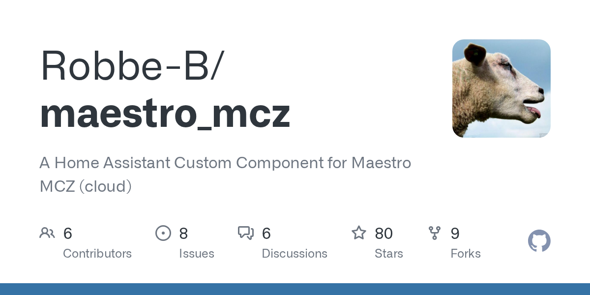


# Intégrer un poêle à granulés Brisach dans Home Assistant : possible ?

- **Catégorie :** [Tutoriels, Guides & Astuces des Membres](https://forumdomotique.com/forums/87-tutoriels-guides-astuces-des-membres/)
- **Sujet :** https://forumdomotique.com/forums/topic/734-int%C3%A9grer-un-po%C3%AAle-%C3%A0-granul%C3%A9s-brisach-dans-home-assistant-possible/
- **Auteur du premier message du sujet :** un autre membre (XAV59213 a répondu dans ce sujet)
- **Messages de XAV59213 dans ce sujet :** 5
- **Premier message de XAV59213 :** 1 février 2026 à 19:24 (Europe/Paris)
- **Dernier message de XAV59213 :** 2 février 2026 à 18:02 (Europe/Paris)

---

## Message 1 — 1 février 2026 à 19:24 (Europe/Paris)

- **Identifiant :** `1957`
- **Lien :** https://forumdomotique.com/forums/topic/734-int%C3%A9grer-un-po%C3%AAle-%C3%A0-granul%C3%A9s-brisach-dans-home-assistant-possible/#findComment-1957

Salut !

D’après mes recherches, intégrer un poêle à granulés Brisach dans Home Assistant est tout à fait possible, mais ça dépend du modèle et de la configuration de ton poêle (par exemple, s’il a un module WiFi intégré ou non). Brisach utilise souvent des contrôleurs Micronova, qui sont compatibles avec plusieurs solutions domotiques

---

## Message 2 — 1 février 2026 à 20:28 (Europe/Paris)

- **Identifiant :** `1959`
- **Lien :** https://forumdomotique.com/forums/topic/734-int%C3%A9grer-un-po%C3%AAle-%C3%A0-granul%C3%A9s-brisach-dans-home-assistant-possible/#findComment-1959

Voici les options principales que j’ai trouvées :

**1. Intégration via l’application Brisach (Easy Connect / Brisach Plus)**

•  Beaucoup de poêles Brisach sont connectés via l’app “Easy Connect” ou “Brisach Plus”, qui repose sur la plateforme Agua IOT de Micronova.

•  Il existe une intégration custom pour Home Assistant appelée **Micronova Agua IOT** disponible via HACS (Home Assistant Community Store).

•  Pour l’installer :

1.  Installe HACS si ce n’est pas déjà fait (via les add-ons de HA).

2.  Dans HACS, cherche “Micronova Agua IOT” et installe-le.

3.  Ajoute l’intégration dans HA via Paramètres > Appareils & Services > Ajouter une intégration.

4.  Tu auras besoin de tes identifiants de l’app Brisach (compte utilisateur et mot de passe).

•  Ça permet de contrôler l’allumage/extinction, la température, les modes (comme Silence), et de monitorer l’état du poêle.

•  Apps supportées : Easy Connect, Easy Connect Plus, Easy Connect Poêle (ce qui correspond aux poêles Brisach).

---

## Message 3 — 2 février 2026 à 08:12 (Europe/Paris)

- **Identifiant :** `1962`
- **Lien :** https://forumdomotique.com/forums/topic/734-int%C3%A9grer-un-po%C3%AAle-%C3%A0-granul%C3%A9s-brisach-dans-home-assistant-possible/#findComment-1962

salut [@Krysc61](https://forumdomotique.com/profile/125-krysc61/)

Oui, il est tout à fait possible d’aller plus loin et de **contrôler la consigne de ton poêle Brisach en fonction de la température extérieure** une fois qu’il est bien intégré via l’intégration **Micronova Agua IOT** dans Home Assistant.

Voici comment procéder étape par étape :

### 1. Ce que fournit l’intégration Micronova Agua IOT

D’après les infos disponibles (GitHub de l’intégration custom par Vincent Wolsink et retours utilisateurs), cette intégration crée généralement :

- Une entité **climate** (type thermostat) pour ton poêle : → Tu peux lire et modifier la **température cible** (setpoint / consigne ambiante). → Allumage / extinction, mode (confort, silence, etc.), état actuel (température pièce mesurée par la sonde du poêle, puissance, etc.).

C’est donc cette entité [climate.XXX](https://climate.XXX) (le nom dépend de ton poêle) que tu vas piloter.

### 2. Récupérer la température extérieure dans Home Assistant

Tu as plusieurs options simples et fiables :

- **Météo France** (ou autre intégration météo) → entité weather.forecast_meteo_france ou sensor.meteo_france_temperature (température actuelle).
- Une sonde extérieure physique (ex. : Xiaomi/Aqara Zigbee, RuuviTag, Sonde filaire via ESP, etc.) → c’est souvent plus précis localement.
- OpenWeatherMap, WeatherFlow, etc.

Exemple : appelons cette entité **sensor.temperature_exterieure** (en °C).

### 3. Créer une logique de régulation basée sur la T° extérieure

Home Assistant n’a pas de « courbe de chauffe » native pour les poêles à granulés, mais tu peux la recréer très facilement avec :

**Option la plus simple et recommandée : Automatisations + Helper**

- Crée un **input_number** (dans Paramètres → Appareils & Services → Helpers) pour stocker ta consigne calculée. Exemple : input_number.consigne_poele_calculee (min 16, max 24, pas 0.5).
- Crée une **automation** qui se déclenche :

  - Toutes les 15–30 min (ou à chaque changement significatif de T° ext).
  - Ou quand la température extérieure change de ±0.5 °C.

**Exemple de logique simple (courbe de chauffe linéaire)** :

```yaml
# Exemple dans l'éditeur d'automatisation (mode YAML ou graphique)
trigger:
  - platform: state
    entity_id: sensor.temperature_exterieure
    # ou time_pattern: minutes: "/15"

action:
  - variables:
      temp_ext: "{{ states('sensor.temperature_exterieure') | float(0) }}"
      consigne_base: 21.0          # consigne quand il fait 0°C dehors
      pente: -0.4                  # -0.4 °C de consigne par °C extérieur en plus
      min_consigne: 17.0
      max_consigne: 23.0

  - service: input_number.set_value
    target:
      entity_id: input_number.consigne_poele_calculee
    data:
      value: >
        {{ [min_consigne, max_consigne, (consigne_base + (temp_ext * pente)) ] | sort | slice(1) | first | round(1) }}

  - service: climate.set_temperature
    target:
      entity_id: climate.brisach_poele   # ← remplace par le vrai nom de ton entité poêle
    data:
      temperature: "{{ states('input_number.consigne_poele_calculee') | float }}"
```

Exemples de courbes plus réalistes :

- T° ext +10 °C → consigne 19 °C
- T° ext 0 °C → consigne 21.5 °C
- T° ext -10 °C → consigne 23 °C

Tu peux aussi ajouter des conditions :

- Seulement si le poêle est allumé (state == 'heat')
- Seulement en mode chauffage (pas en été)
- Tenir compte de l’heure (ex. : consigne plus basse la nuit)

### 4. Options plus avancées

- Utiliser **Versatile Thermostat** (via HACS) : très puissant pour créer des VTherm qui pilotent un climate en fonction de plusieurs capteurs (T° ext, T° pièce, etc.). Il gère nativement les courbes de chauffe.
- **Node-RED** : si tu aimes les flux visuels, c’est encore plus flexible pour des logiques complexes.
- **Generic Thermostat** : moins adapté ici car il commute un switch, alors que ton poêle est déjà un climate complet.

### En résumé

Oui, c’est faisable et même assez courant chez les utilisateurs de poêles à granulés connectés (MCZ, Ravelli, Piazzetta, etc. qui utilisent le même système Micronova). Installe d’abord l’intégration Micronova Agua IOT si ce n’est pas encore fait, vérifie que tu peux bien changer la consigne depuis l’entité climate, puis construis ta logique avec une automation ou Versatile Thermostat.

---

## Message 4 — 2 février 2026 à 17:45 (Europe/Paris)

- **Identifiant :** `1970`
- **Lien :** https://forumdomotique.com/forums/topic/734-int%C3%A9grer-un-po%C3%AAle-%C3%A0-granul%C3%A9s-brisach-dans-home-assistant-possible/#findComment-1970

Salut [@cirdec321](https://forumdomotique.com/profile/1296-cirdec321/)

Tu utilises bien cette intégration :


<!-- source : https://github.githubassets.com/favicons/favicon.svg -->

##### GitHub


<!-- source : https://opengraph.githubassets.com/d57ddbd0c3483ce819e89296d6b6b7857a61672ddd9fa0c0524cc9c2d6b65ea2/vincentwolsink/home_assistant_micronova_agua_iot -->

### GitHub - vincentwolsink/home_assistant_micronova_agua_iot...

Home Assistant integration controlling heating devices (pellet stoves) connected via the Agua IOT platform of Micronova - vincentwolsink/home_assistant_micronova_agua_iot

D’après les infos récentes (le repo GitHub est actif avec une mise à jour en janvier 2026), cette intégration supporte bien les apps comme Brisach Plus (ou Brisach+), qui repose sur la plateforme Agua IOT de Micronova.

Elle est listée sous des noms comme “Easy Connect Poêle” dans les vendors compatibles, car beaucoup de marques Brisach utilisent ce backend.

Voici quelques étapes de dépannage pour essayer de résoudre ça :

1.  **Vérifie la version de l’intégration** : Assure-toi d’avoir la dernière version (0.9.4 ou plus récente) installée via HACS. Si ce n’est pas le cas, mets-la à jour et redémarre HA.

2.  **Configuration de l’intégration** :

•  Dans HA, va dans Paramètres > Appareils & Services > Ajouter une intégration > Micronova Agua IOT.

•  Utilise tes identifiants exacts de l’app Brisach+ (email/mot de passe). Attention aux majuscules/minuscules.

•  Sélectionne le bon “vendor” ou app dans la liste : Essaie “Easy Connect Poêle” ou “Easy Connect Plus” si disponible, car ça correspond souvent aux modèles Brisach. Si ton poêle utilise un module WiFi Navel Plus (W011), c’est bien Agua IOT.

3.  **Vérifie les logs HA** :

•  Active les logs debug pour l’intégration : Ajoute ça dans ton configuration.yaml et redémarre HA :

```yaml
logger:
  default: warning
  logs:
    custom_components.micronova_agua_iot: debug
```

•  Puis, réessaie l’ajout et cherche des erreurs dans les logs (via Paramètres > Système > Logs). Des messages comme “connection failed” ou “invalid credentials” pourraient indiquer le problème (ex. : réseau, firewall, ou compte non activé).

4.  **Vérifie la connexion du poêle** :

•  Assure-toi que le poêle est bien connecté à ton WiFi et visible dans l’app Brisach+. Si besoin, reconnecte-le via le tuto Brisach (il y a une vidéo YouTube officielle pour ça).

•  Teste si l’app fonctionne bien à distance (pas juste en local/Bluetooth).

5.  **Alternatives si ça bloque** :

•  Si c’est un problème de vendor non listé, check le repo GitHub pour ouvrir un issue avec tes logs (le projet est actif avec 12 contributeurs).

---

## Message 5 — 2 février 2026 à 18:02 (Europe/Paris)

- **Identifiant :** `1972`
- **Lien :** https://forumdomotique.com/forums/topic/734-int%C3%A9grer-un-po%C3%AAle-%C3%A0-granul%C3%A9s-brisach-dans-home-assistant-possible/#findComment-1972

[@pj07](https://forumdomotique.com/profile/1297-pj07/)

Bien, je cherche des solutions à votre problème 🫣.

Et pour ton problème, c’est un peu comme Tuya qui passe par le cloud : les API ne suivent pas, il faut forcer un reload.

L’intégration repose sur du polling de l’API cloud MCZ.

Mets-toi en mode debug, enregistre pendant une journée et ouvre une issue.


<!-- source : https://github.githubassets.com/favicons/favicon.svg -->

##### GitHub


<!-- source : https://opengraph.githubassets.com/01f25427a28416d6cc97a5b8425a2961133a20116b23db7e53b99b1f924e6a5a/Robbe-B/maestro_mcz -->

### Robbe-B/maestro_mcz

A Home Assistant Custom Component for Maestro MCZ (cloud) - Robbe-B/maestro_mcz

---

