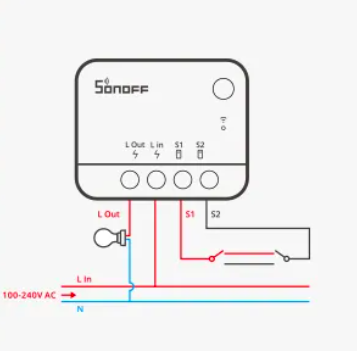
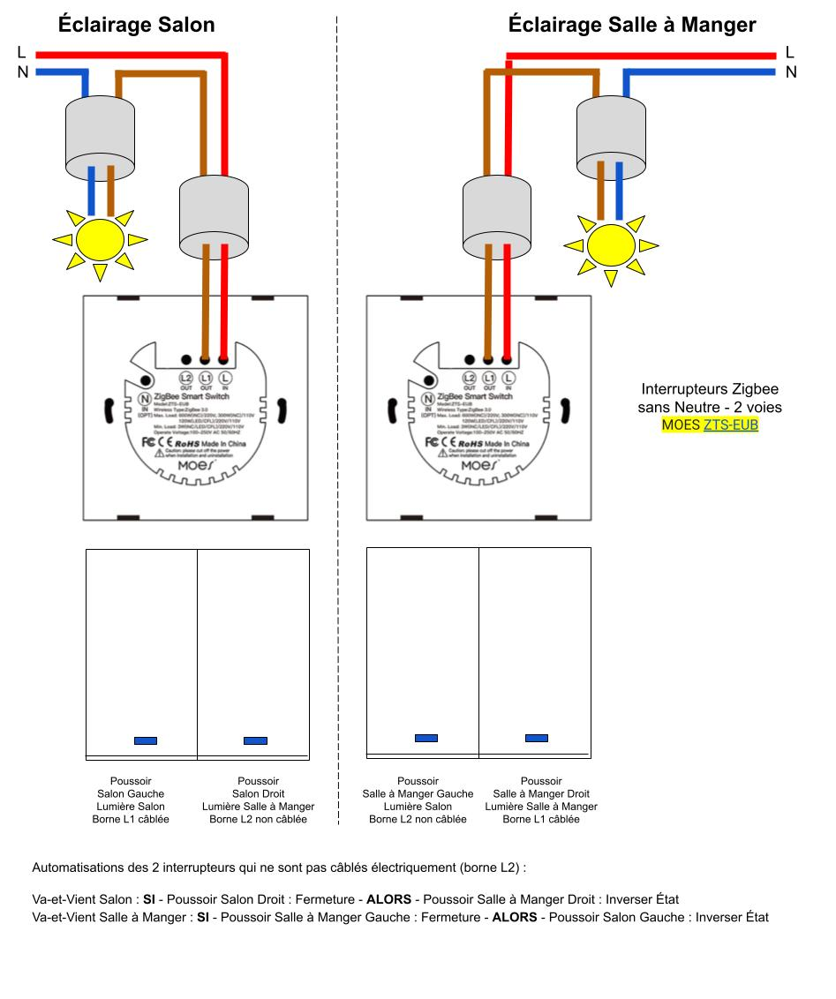
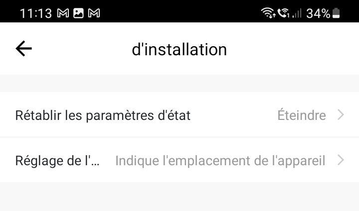

# Double "va et vient" avec une petite anomalie

- **Catégorie :** [Lidl Smart Home (Silvercrest & Livarno)](https://forumdomotique.com/forums/90-lidl-smart-home-silvercrest-livarno/)
- **Sujet :** https://forumdomotique.com/forums/topic/86-double-va-et-vient-avec-une-petite-anomalie/
- **Auteur du premier message du sujet :** un autre membre (XAV59213 a répondu dans ce sujet)
- **Messages de XAV59213 dans ce sujet :** 4
- **Premier message de XAV59213 :** 28 avril 2025 à 15:48 (Europe/Paris)
- **Dernier message de XAV59213 :** 5 mai 2025 à 16:42 (Europe/Paris)

---

## Message 1 — 28 avril 2025 à 15:48 (Europe/Paris)

- **Identifiant :** `174`
- **Lien :** https://forumdomotique.com/forums/topic/86-double-va-et-vient-avec-une-petite-anomalie/#findComment-174

Salut, peux-tu partager ton automatisation qui gère les deux interrupteurs ?

Je tiens à te prévenir : si tu déménages un jour, ton système risque de ne plus fonctionner qu’en allumage simple. Il aurait été préférable d’utiliser un module double (comme un Sonoff Mini) pour créer un va-et-vient directement sur les boutons d’origine, tout en intégrant l’automatisation.

Pour une solution durable, même en cas de déménagement, je te conseille d’opter pour un module double. Cela permet de câbler les interrupteurs en va-et-vient classique, tout en ajoutant l’automatisation par-dessus. Sinon, conserve un schéma précis du câblage d’origine pour pouvoir le restaurer facilement si besoin.

<!-- source : https://cdn.forumdomotique.com/monthly_2025_04/sonoffzm.png.8cf9a93cffbecba3f3b54cfa135af70f.png -->

---

## Message 2 — 29 avril 2025 à 16:04 (Europe/Paris)

- **Identifiant :** `188`
- **Lien :** https://forumdomotique.com/forums/topic/86-double-va-et-vient-avec-une-petite-anomalie/#findComment-188

Salut [BièreNard,](https://forumdomotique.com/profile/8-bi%C3%A8renard/)

1. **Compréhension de ton setup actuel** :

   - Tes interrupteurs sont gérés via l'app **Smart Life** (qui utilise le cloud Tuya).
   - Tu passes par **Home Assistant** pour centraliser la gestion?
   - Tu as intégré le composant **Tuya** dans Home Assistant?
   - Question : tes automatisations (scénarios, routines) sont-elles configurées dans **Home Assistant** ou dans **Smart Life** partage ton code yaml?
2. **Analyse et suggestion** :

   - Si tes automatisations sont dans **Home Assistant**, c'est une bonne base, car tu as plus de contrôle localement.
   - Si elles sont dans **Smart Life**, tu dépends du cloud Tuya, ce qui peut poser des problèmes (latence, dépendance à Internet).
   - Migrer vers **Tuya Local** (via **LocalTuya** dans Home Assistant) est une excellente idée pour :

     - Contrôler tes appareils localement (sans passer par le cloud).
     - Réduire la latence.
     - Éviter les interruptions si Internet tombe.
3. **Étapes pour migrer vers Tuya Local** : [lien](https://github.com/rospogrigio/localtuya)

   - **Vérifie la compatibilité** : Assure-toi que tes interrupteurs sont compatibles avec **LocalTuya** (la plupart des appareils Tuya le sont).
   - **Installe LocalTuya** :

     - Ajoute l'intégration **LocalTuya** via HACS dans Home Assistant.
     - Récupère les **Local Keys et sauvegarde les dans un bloc note** de tes appareils (via des outils comme Tuya-CLI ou en suivant un guide comme celui de la communauté Home Assistant).
   - **Configure LocalTuya** :

     - Entre les Local Keys, IP des appareils, et ID dans l'intégration.
     - Teste chaque interrupteur pour confirmer qu'il répond localement.
   - **Migre tes automatisations** :

     - Si elles étaient dans Smart Life, recrée-les dans Home Assistant (via l'éditeur d'automatisations ou en YAML).
   - **Supprime l'intégration Tuya officielle** (si plus nécessaire) pour éviter les conflits.
4. **Avantages de Tuya Local** :

   - Contrôle 100 % local.
   - Plus rapide et fiable.
   - Moins de dépendance au cloud Tuya.
5. **Conseil** :

   - Si tu veux éviter de tout migrer maintenant, tu peux tester **LocalTuya** sur un seul interrupteur pour valider le fonctionnement.
   - **Sauvegarde ta config Home Assistant avant de faire des changements.**

---

## Message 3 — 3 mai 2025 à 16:11 (Europe/Paris)

- **Identifiant :** `213`
- **Lien :** https://forumdomotique.com/forums/topic/86-double-va-et-vient-avec-une-petite-anomalie/#findComment-213

“Ce fut un réel plaisir [@BièreNard](https://forumdomotique.com/profile/8-bi%C3%A8renard/), amuse-toi bien avec ton installation Home Assistant !”

---

## Message 4 — 5 mai 2025 à 16:42 (Europe/Paris)

- **Identifiant :** `228`
- **Lien :** https://forumdomotique.com/forums/topic/86-double-va-et-vient-avec-une-petite-anomalie/#findComment-228

> **Il y a 4 heures, BièreNard a dit :**
> **J'ai trouvé la solution de mon problème de double "Va et Vient" !**  
> Comme souvent l'erreur venait d'une mauvaise compréhension des principes de fonctionnement, je m'explique :
>
> Les interrupteurs MOES ZTS-EUB se comportent bien comme des interrupteurs (états stables "Fermé" ou "Ouvert") malgré qu'ils s'apparentent à des boutons poussoir au niveau de leur manipulation : L'utilisateur exerce un appui fugitif sur le bouton, qui revient ensuite mécaniquement à sa position d'origine.  
> A l'intérieur du bouton, un relais transforme l'impulsion mécanique donnée par l'utilisateur, en état électrique stable. De sorte qu'à chaque impulsion, le bouton bascule électriquement de l'état stable "Ouvert" à l'état stable "Fermé", puis à l'état stable "Ouvert", etc.
>
> 
<!-- source : https://lh7-rt.googleusercontent.com/docsz/AD_4nXfwPwPmKHvameRqT0Qt5Z_ygbGYd8XoOtxeLNHRW2NACwREcaVGO3mocH141q0sa95Mo2V-97pao6l_qb-QT0KVEnavy9x26u8B1FqJbqntHXE3pglFtFY9qSqXsahEH1KhOcwu_Q?key=ZrWBb3vk-zACqE1RBuKnsHsr -->
>
> #### **Résolution du problème :**
>
> **Supprimer les Automatisations précédemment définies** (elles ne sont pas nécessaires)  
> Puis, pour chaque interrupteur :
>
> 1. **Définir une “Association Multicontrôle”** avec l’interrupteur de l’autre pièce (menu “Paramètres Généraux”) :
>
>    **Interrupteur “Salon”** : Association Multicontrôle : “Salon-SaM” :  (Interrupteur “Salon Gauche” → Lié avec Interrupteur “Salle à Manger Gauche”)
>
>    **Interrupteur “Salle à Manger”** : Association Multicontrôle : “SaM-Salon” : (Interrupteur “Salle à Manger Gauche” → Lié avec Interrupteur “Salon Gauche”)
> 2. **Modifier les Paramètres d’installation** (Icône du bas : “d’installation”) :
>
>    - Rétablir les paramètres d’état : “**Éteindre**”  
>      (la lumière de la pièce est éteinte, au retour du secteur après une coupure)
>    - Réglage de l’état de l’indicateur : “**Indique l’emplacement de l’appareil**”  
>      (le voyant de l’interrupteur est allumé quand la lumière de la pièce est éteinte, afin de pouvoir localiser visuellement l’interrupteur dans une pièce sombre)
>
> Les 2 actions à réaliser en images :
>
> **1. Définir une “Association Multicontrôle”**
>
> |  |  |
> | --- | --- |
> | AD_4nXeUrP3Rcp67WsxiaYELP-uWrlH_eNfgIWEu2IUT6267McqoOBXR8JHupURzAo8QV2fYAbL5craef4dKoPGXsqRnQ0Lhtbx5biH1WhpjjtFwNARh_YesVaER-Wgg3Au6-p3ZX6xYCw?key=ZrWBb3vk-zACqE1RBuKnsHsr | AD_4nXdZph85-e46GhDEluw7xFDqXIdO9FITQ0XiZlUYF6n7QaXRq_5gSnShjcGsQTk-mhK_Z3ofHnt4J0BXoPzEYZshsPk6SSZMkxcaYENW0xrb5T_WF1Hp0iapQ16GchCAWUDae9cUyw?key=ZrWBb3vk-zACqE1RBuKnsHsr |
>
> |  |  |
> | --- | --- |
> | AD_4nXffpX7wnRF29pWqgL1E8W2VqIT4Go-aLXRXxyK33FQOHsw3XHAIVrjbX5whjpxaa6EbmAK1U3giJ1lA8P6IGquVJdpW4L0FtLU9Va_X_73DoHw8g5CTsoBJPD41LuW-4MHjDekP?key=ZrWBb3vk-zACqE1RBuKnsHsr | AD_4nXdpHscYulqV0lEtxYYAAIooIxaXTaq31KsTUMIXVQ3ha6K8doElu_vwOs5Ao_HS6eSd8S2eGkXthwahb6AsLTUiD0vB9U158m1ramwT_2L7gBBS4PITym-ZlNNmRk8Hmg2X-_tk?key=ZrWBb3vk-zACqE1RBuKnsHsr |
>
> **2. Modifier les Paramètres d’installation**
>
> 
<!-- source : https://lh7-rt.googleusercontent.com/docsz/AD_4nXc22wj-U-yn1gjm3kcAXZMwUPuPMtJJGLmYUwE9m4JvOtW6kHbRyrkmiP7p4EsAMZZvQVN4EeHb6pavdsXv8YVE-_YWxIzplnirSQlwionTjOMdcgTfcQeMLMByu_np6vWwdT4tJg?key=ZrWBb3vk-zACqE1RBuKnsHsr -->
>
> |  |  |
> | --- | --- |
> | AD_4nXePrKdOraPtjhHVJvDSZ25tuG9vhtDMoEwzLwsAdSvUIgCEbOVVgWsGSmlkVYkkuuht8d4WQRazd5yZBOOPrO4ybJG1bizJDw4Y_T0yza9RSbZvg-CXfLmGWugkGCh3_z1lJtyz?key=ZrWBb3vk-zACqE1RBuKnsHsr | AD_4nXcpwxyvAvbbgk39z0U1I81Ay_OAT7et13_o1Dig3SFHqYh84Z9ckljde1xDBpAjJkelJqoJd9fZrFoTVlJ9L9IyD1IvX1rYTnEKd1QTYP4_VaDUaVkj7VAU0HPpnu2ANTrW8Y5dVw?key=ZrWBb3vk-zACqE1RBuKnsHsr |
>
> Avec cette solution, il maintenant possible d'allumer et d'éteindre la lumière de chaque pièce, soit par le bouton associé de l'interrupteur situé dans la pièce, soit par le 2ème bouton de l'interrupteur situé dans l'autre pièce : Un vrai double "va et vient" sans aucun câblage électrique supplémentaire, avec en plus toutes les possibilités d'automatisations offertes par Smart Life !

**Ben voilà** [@BièreNard](https://forumdomotique.com/profile/8-bi%C3%A8renard/) **!**

Je vois que tu commences à t’amuser, et c’est justement ça l’esprit de Home Assistant : on teste, on partage son retour d’expérience, et bim, on trouve la solution !

Je suis ravi que tu aies trouvé l’erreur par toi-même et réussi à résoudre le problème. Effectivement, l’idée d’utiliser un poussoir avec impulsion était une bonne solution pour ton cas.

Pour info, chaque installation domotique est unique, car chaque utilisateur a ses propres besoins et son propre matériel. C’est pour ça que j’ai essayé de bien comprendre ton installation — il existe tellement de modèles et de configurations possibles !

---
