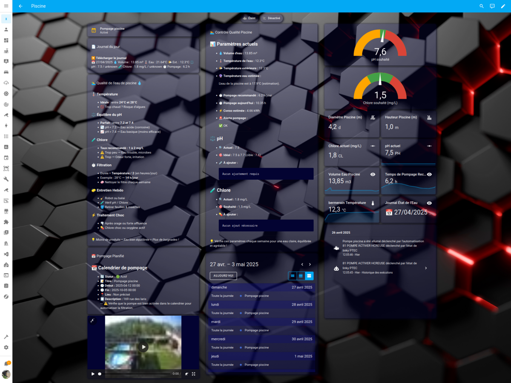


<p class="forum-cta"><a href="https://forumdomotique.com/forums/topic/90-cr%C3%A9er-un-tableau-de-bord-de-gestion-de-piscine-dans-home-assistant/">Lire et commenter sur Forum Domotique</a> · <a href="https://github.com/XAV59213/piscinexa">Dépôt HACS : Piscinexa</a></p>

# Créer un tableau de bord de gestion de piscine dans Home Assistant

Dans ce tutoriel, nous allons créer un tableau de bord interactif pour gérer une piscine dans **Home Assistant**. Ce tableau de bord permet de surveiller la qualité de l’eau (pH, chlore, température), planifier le pompage, suivre la filtration, et afficher des recommandations d’entretien. Voici comment j’ai construit ce tableau de bord, étape par étape, en utilisant YAML, des capteurs, des entrées numériques, et des cartes personnalisées.

---

## Prérequis

- Une instance de **Home Assistant** installée et configurée.
- Connaissance de base du format **YAML** et de l’interface Home Assistant.
- Accès à l’éditeur de configuration (via l’interface ou un éditeur comme VS Code).
- Modules recommandés :

  - **Frigate** (pour la caméra, si utilisée).
  - **Logbook** (pour l’historique des actions).
  - **Calendar** (pour planifier le pompage).
- Capteurs physiques ou virtuels pour la température, le volume d’eau, etc.
- Une piscine avec des équipements connectés (pompe, lumière, etc.) ou des simulations via Home Assistant.

---

## Étape 1 : Configurer les entrées numériques

Les **entrées numériques** (input_number) permettent à l’utilisateur de saisir des valeurs comme le diamètre de la piscine, le pH actuel, ou le chlore souhaité. Ces valeurs sont utilisées dans les calculs et affichages du tableau de bord.

### 1.1 Accéder à l’éditeur d’entrées

1. Allez dans **Configuration** > **Appareils et services** > **Entrées**.
2. Cliquez sur **Créer une entrée** et choisissez **Nombre**.

### 1.2 Créer les entrées suivantes

Voici les entrées que j’ai créées avec leurs paramètres :

| Nom | ID | Plage | Unité | Description |
| --- | --- | --- | --- | --- |
| Diamètre de la piscine | input_number.piscine_diametre | 0 à 10 | m | Diamètre pour calculer le volume |
| Hauteur de la piscine | input_number.piscine_hauteur | 0 à 2 | m | Hauteur pour calculer le volume |
| pH actuel | input_number.piscine_ph_actuel | 0 à 14 | Ph | pH mesuré dans l’eau |
| pH souhaité | input_number.piscine_ph_souhaite | 7 à 8 | Ph | Cible pour le pH (7.6 idéal) |
| Chlore actuel | input_number.piscine_chlore_actuel | 0 à 5 | mg/L | Taux de chlore mesuré |
| Chlore souhaité | input_number.piscine_chlore_souhaite | 0 à 3 | mg/L | Taux de chlore cible (1-2 mg/L) |

### 1.3 Exemple de configuration YAML

Si vous préférez configurer directement dans configuration.yaml, voici un exemple pour une entrée :

```yaml
input_number:
  piscine_diametre:
    name: Diamètre de la piscine
    min: 0
    max: 10
    step: 0.1
    unit_of_measurement: m
  piscine_hauteur:
    name: Hauteur de la piscine
    min: 0
    max: 2
    step: 0.1
    unit_of_measurement: m
  # Ajoutez les autres entrées de la même manière
```

**Conseil** : Utilisez l’interface graphique pour éviter les erreurs de syntaxe, puis exportez le YAML si nécessaire.

---

## Étape 2 : Configurer l’enregistreur (recorder)

L’enregistreur (**recorder**) stocke l’historique des capteurs et entrées pour afficher des graphiques ou des journaux. J’ai configuré recorder.yaml pour inclure uniquement les entités pertinentes afin d’optimiser la base de données.

### 2.1 Modifier configuration.yaml

Ajoutez cette ligne dans configuration.yaml pour inclure le fichier recorder.yaml :

```yaml
recorder: !include recorder.yaml
```

### 2.2 Créer recorder.yaml

Créez un fichier recorder.yaml dans le dossier de configuration de Home Assistant avec le contenu suivant :

```yaml
include:
  entities:
    - sensor.volume_eau_piscine
    - sensor.ph_a_ajouter
    - sensor.chlore_a_ajouter
    - sensor.temps_de_pompage_recommande
    - input_number.piscine_ph_actuel
    - input_number.piscine_chlore_actuel
    - sensor.journal_etat_eau
```

**Explication** :

- include spécifie les entités à enregistrer.
- Seules les entités listées auront un historique, ce qui réduit la taille de la base de données.
- Ajoutez d’autres entités si vous souhaitez suivre leur historique (par exemple, sensor.bermerain_temperature_2).

---

## Étape 3 : Créer des capteurs pour les calculs

Les capteurs calculent des valeurs comme le volume d’eau, le temps de pompage recommandé, ou la quantité de produits chimiques à ajouter. Ces capteurs sont définis dans configuration.yaml ou via l’interface.

### 3.1 Exemple de capteurs

Voici quelques capteurs que j’ai utilisés :

#### Capteur pour le volume d’eau

Calcule le volume de la piscine en fonction du diamètre et de la hauteur.

```yaml
sensor:
  - platform: template
    sensors:
      volume_eau_piscine:
        friendly_name: Volume d'eau de la piscine
        unit_of_measurement: m³
        value_template: >
          
          
          {{ ((3.14159 * (diametre / 2) ** 2 * hauteur) | round(2)) }}
```

#### Capteur pour le temps de pompage recommandé

Calcule le temps de filtration en fonction de la température (règle : température / 2).

```yaml
sensor:
  - platform: template
    sensors:
      temps_de_pompage_recommande:
        friendly_name: Temps de pompage recommandé
        unit_of_measurement: h
        value_template: >
          
          {{ (temp / 2) | round(1) }}
```

#### Capteur pour le pH à ajouter

Calcule la quantité de pH+ ou pH- à ajouter en fonction du pH actuel et du volume.

```yaml
sensor:
  - platform: template
    sensors:
      ph_a_ajouter:
        friendly_name: pH à ajouter
        unit_of_measurement: g
        value_template: >
          
          
          
            {{ ((ph - 7.7) * volume * 2) | round(0) }} g de pH-
          
            {{ ((7.5 - ph) * volume * 2) | round(0) }} g de pH+
          
            Aucun ajustement requis
          
```

**Conseil** : Testez chaque capteur dans l’onglet **Développeur** > **États** pour vérifier les valeurs calculées.

---

## Étape 4 : Configurer le tableau de bord

Le tableau de bord est créé dans l’interface graphique ou via YAML. J’ai utilisé un fichier YAML pour plus de contrôle. Voici comment il est structuré.

### 4.1 Structure générale

Le tableau de bord utilise une disposition en **sections** avec un maximum de 3 colonnes. Il inclut des badges, des cartes Markdown, des jauges, des graphiques, et une caméra Frigate.

```yaml
type: sections
max_columns: 3
title: Piscine
path: piscine
icon: phu:rooms-pool
theme: transparentblue
subview: true
```

- type: sections : Organise les cartes en sections.
- max_columns: 3 : Limite à 3 colonnes pour une disposition claire.
- theme: transparentblue : Applique un thème visuel.
- subview: true : Affiche le tableau comme une sous-vue.

### 4.2 Badges

Les badges affichent l’état de la pompe et de la lumière de la piscine en haut.

```yaml
badges:
  - type: entity
    entity: switch.pompe_piscine
    show_name: false
    show_state: true
    show_icon: true
  - type: entity
    entity: switch.lumiere_piscine
    show_name: false
    show_state: true
    show_icon: true
```

### 4.3 Sections et cartes

Le tableau est divisé en 4 sections avec différentes cartes :

#### Section 1 : Informations générales

- **Calendrier** : Affiche les événements de pompage planifiés.
- **Journal du jour** : Lien pour télécharger un journal (via sensor.journal_etat_eau).
- **Qualité de l’eau** : Conseils sur la température, le pH, le chlore, et l’entretien.
- **Pompage planifié** : Détails du prochain événement de pompage (statut, heure, lieu).
- **Caméra Frigate** : Flux vidéo de la piscine.

Exemple pour la carte Markdown de la qualité de l’eau :

title: 🏊‍♂️ Qualité de l’eau de piscine 💧

content: |

🌡️ Température - **Idéale :** entre **24°C et 28°C** -

🚫 Trop chaud ? Risque d’algues

⚖️ Équilibre du pH - **Parfait :** entre **7.2 et 7.4** -

📉 pH < 7.2 → Eau acide (corrosive) -

📈 pH > 7.4 → Eau basique (moins efficace) # ... (voir code complet)

#### Section 2 : Contrôle qualité

- Affiche les paramètres actuels (volume, température, pH, chlore).
- Calcule la température estimée de l’eau en fonction de la température extérieure.
- Recommande le temps de pompage et calcule la consommation énergétique.
- Indique les quantités de pH et de chlore à ajouter.

Exemple de calcul pour la température estimée :

```python







  L'eau de la piscine est à {{ temp_eau }}°C, c'est idéal ! Profitez-en !

  L'eau de la piscine est à {{ temp_eau }}°C (estimation).

```

#### Section 3 : Visualisations

- **Jauges** : Pour le pH et le chlore souhaités, avec des seuils colorés (vert, jaune, rouge).
- **Capteurs** : Affichent le diamètre, la hauteur, le volume, et le temps de pompage.
- **Graphiques** : Tracent l’évolution du pH, du chlore, et de la température.
- **Journal** : Affiche l’historique des actions (pompe, automatisations).

Exemple de jauge pour le pH :

```yaml
- type: gauge
  entity: input_number.piscine_ph_souhaite
  needle: true
  max: 14
  severity:
    green: 7
    yellow: 0
    red: 8
```

#### Section 4 : Nouvelle section

- Actuellement, une section vide avec un titre. Vous pouvez y ajouter d’autres cartes (par exemple, des boutons pour activer la pompe manuellement).

---

## Étape 5 : Ajouter des automatisations

Pour automatiser la pompe, j’ai créé des automatisations (non détaillées dans le code fourni, mais référencées dans le logbook). Voici un exemple d’automatisation pour activer la pompe le matin :

### Exemple : Activation de la pompe à 7h

```yaml
automation:
  - id: activation_piscine_1_heure_matin
    alias: Activer pompe piscine 1h le matin
    trigger:
      platform: time
      at: "07:00:00"
    action:
      service: switch.turn_on
      entity_id: switch.pompe_piscine
```

**Conseil** : Ajoutez une condition pour vérifier si le calendrier de pompage est actif (calendar.pompage_piscine).

---

## Étape 6 : Tester et personnaliser

1. **Tester le tableau de bord** :

   - Accédez à la vue via **Tableaux de bord** > **Piscine**.
   - Vérifiez que les capteurs, jauges, et graphiques affichent des données correctes.
   - Testez les entrées numériques en modifiant les valeurs (par exemple, pH actuel).
2. **Personnaliser** :

   - Ajoutez des icônes personnalisées via customize.yaml.
   - Modifiez le thème ou les couleurs des jauges.
   - Intégrez d’autres capteurs (par exemple, un capteur de turbidité).

---

## Conseils et bonnes pratiques

- **Sauvegardez vos fichiers** avant de modifier configuration.yaml ou le tableau de bord.
- **Utilisez l’éditeur graphique** pour les débutants, puis passez au YAML pour plus de flexibilité.
- **Validez le YAML** avec un linter (comme yamllint) pour éviter les erreurs.
- **Optimisez la base de données** en limitant les entités enregistrées dans recorder.yaml.
- **Ajoutez des notifications** (par exemple, via Telegram ou e-mail) pour alerter si le pH ou le chlore est hors plage.

---

## Résultat final

Voici à quoi ressemble le tableau de bord :

- **Badges** : État de la pompe et de la lumière en haut.
- **Section 1** : Calendrier, journal, conseils d’entretien, détails du pompage, et caméra.
- **Section 2** : Paramètres actuels (température, pH, chlore) avec recommandations.
- **Section 3** : Jauges, graphiques, et historique des actions.
- **Section 4** : Espace pour des extensions futures.

Vous pouvez voir un exemple visuel en accédant au tableau de bord dans Home Assistant ou en consultant une capture d’écran (non fournie ici).

---

## Code complet

Pour référence, voici le code YAML complet du tableau de bord (voir le code initial fourni). Ajoutez-le dans un fichier YAML sous **Tableaux de bord** > **Éditer en mode YAML**  
[piscine.yaml](https://forumdomotique.com/applications/core/interface/file/attachment.php?id=72&key=044d356f21653af8fb120d4101c0346b)


<!-- source : https://cdn.forumdomotique.com/monthly_2025_04/Capturedcrandu2025-04-2710-21-38.png.646c3fa348eff35afd2412abb7f0df90.png -->


